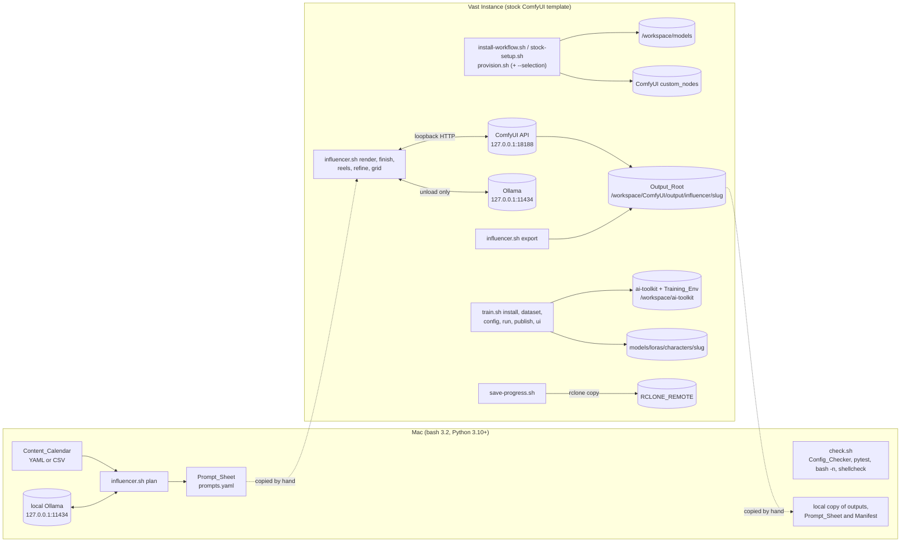
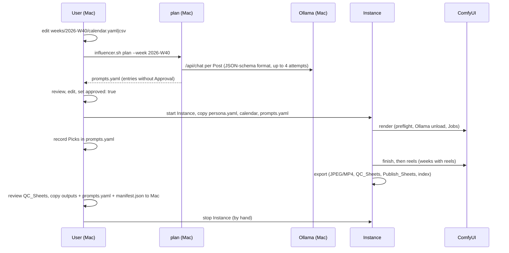
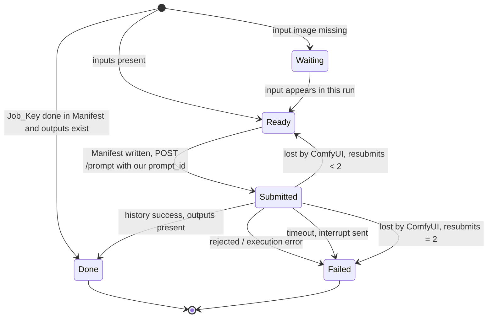
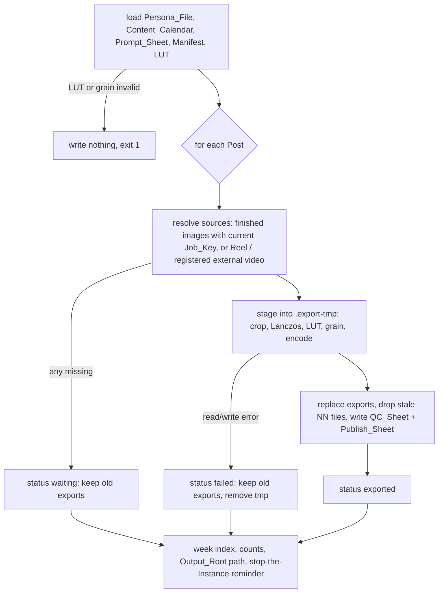

# Design Document: ai-influencer-pipeline (v7)

## Overview

This design turns comfyui-vastai into the production base for one fictional adult Instagram persona. It follows the approved requirements (28 requirements plus Appendix A) and the repo's conventions: one catalog, pipe-delimited config lists with `wf:` tags, idempotent and parallel-safe bash, per-id installs on the stock Vast ComfyUI template (ComfyUI on `127.0.0.1:18188`, Python `/venv/main`), tokens only in environment variables. It targets one large-memory NVIDIA GPU per session: 80 GB minimum, sized for 141–192 GB cards such as the H200 or B200 (Decision 28).

The feature adds four catalog ids, six Render_Template kinds, one Python package (`scripts/influencer/`) that holds the Batch_Generator, Export_Tool, Readers/Printers, Safety_Guard, Config_Checker, Disk_Estimator and Source_Checker, a bash Training_Kit around ostris/ai-toolkit, a Check_Suite, and docs. The work is organised along the four delivery phases of the requirements:

| Phase | Scope in this design | Requirements |
|---|---|---|
| 1. Stills | `influencer` id and config lines with `# licence:` records, read-only Selection mode, early-access handling, DeGrid guard, VOSR2 prefetch, disk-estimate hook; Python core (Readers/Printers, Safety_Guard, Template_Filler, Prompt_Assembler, stage engine); `new-calendar`, `plan`, `render`, `finish`, `export`; Still/Edit/Finish templates; Config_Checker with the offline Licence_Gate, Disk_Estimator (ids), Check_Suite, `.gitignore`, backups, docs | 1–15, 21.2–21.4, 21.6–21.8, 23, 25–28 |
| 2. Identity | Training_Kit (`scripts/train.sh`), Dataset check and captions, Refine_Template and `refine`, training configs, detached runs, publishing, Test_Grid and `grid`, Disk_Estimator (base models) | 17–20 |
| 3. Video | `influencer-video` id, Reel_Template and Ref_Reel_Template, `reels`, Reel export | 16 |
| 4. Optional | `influencer-nsfw` install, `character-design` id and patches, Source_Checker with the online Licence_Gate, Runbook sections | 21.1, 21.5, 22, 24 |

### Sources verified for this design (2026-09-28)

All sources were read on 2026-09-28 unless marked. Commit SHAs are the ones the design pins or was grounded in.

| Source | What it grounds |
|---|---|
| Krea 2 realism guide, [Civitai model 2749367, version 3092832](https://civitai.com/models/2749367?modelVersionId=3092832). Zip SHA-256 `EDF3C10C…D76204` equals the hash in Civitai's API. Members: `krea2_simple.json`, `additional workflows/krea2_simple_full_turbo.json` | Still_Template sampler chain, latent sizes, VAE, turbo LoRA 0.6 (Req 8) |
| [Comfy-Org/workflow_templates@98fd32c `image_krea2_turbo_t2i.json`](https://raw.githubusercontent.com/Comfy-Org/workflow_templates/98fd32ca756dd9d72077fbe3457146d11cbc88cb/templates/image_krea2_turbo_t2i.json) (SHA-256 `a1f1bbda…`) | Loader classes: `UNETLoader`, `CLIPLoader` type `krea2`, `LoraLoaderModelOnly` |
| [workflow_templates@98fd32c `image_qwen_image_edit_2511.json`](https://raw.githubusercontent.com/Comfy-Org/workflow_templates/98fd32ca756dd9d72077fbe3457146d11cbc88cb/templates/image_qwen_image_edit_2511.json) (SHA-256 `77b1f829…704c`; the later `e7cd011` only adds file sizes to its note) | Edit_Template node set: positive and empty-negative `TextEncodeQwenImageEditPlus` with `vae` and `image1`, `ModelSamplingAuraFlow` 3.1, `CFGNorm` 1, two `FluxKontextMultiReferenceLatentMethod` = `index_timestep_zero`, `VAEEncode`, `KSampler` euler / simple at 40 steps / CFG 4 (4 / 1 behind the off-by-default Lightning switch), `CLIPLoader` type `qwen_image`; `FluxKontextImageScale` snaps to a list of ~1 MP sizes with a centre crop |
| [Qwen/Qwen-Image-Edit-2511](https://huggingface.co/Qwen/Qwen-Image-Edit-2511) model card (`apache-2.0`, released 2025-12-23) | Licence; less drift and better character consistency than 2509; reference settings 40 steps, true CFG 4; no training-resolution table |
| [Comfy-Org/Qwen-Image-Edit_ComfyUI](https://huggingface.co/Comfy-Org/Qwen-Image-Edit_ComfyUI) and [Comfy-Org/Qwen-Image_ComfyUI](https://huggingface.co/Comfy-Org/Qwen-Image_ComfyUI) (both `apache-2.0`; `paths-info` and safetensors headers) | `qwen_image_edit_2511_bf16` (40,861,031,560 B, SHA-256 `ae42d927…e08c`, 1,933 BF16 tensors plus the `__index_timestep_zero__` marker); `qwen_2.5_vl_7b` (16,584,415,576 B, SHA-256 `cfafd739…463a`, BF16 with the 390-tensor vision tower); their `qwen_image_vae` is byte-identical to Comfy-Org/Krea-2's |
| [Comfy-Org/Krea-2](https://huggingface.co/Comfy-Org/Krea-2) `diffusion_models/krea2_raw_bf16.safetensors` | 26,283,332,608 B, SHA-256 `f99bb0ff…03d7`, 256 BF16 + 174 F32 tensors: the base of the Krea 2 templates (Decision 24) |
| ComfyUI core at `Comfy-Org/ComfyUI@7fbcfa8` (master, 2026-09-28): `comfy_extras/nodes_qwen.py`, `nodes_cfg.py`, `nodes_flux.py`, `nodes_model_advanced.py`, `nodes.py`, `comfy/model_sampling.py`, `comfy/model_detection.py` | `TextEncodeQwenImageEditPlus` inputs (`clip`, `prompt`, optional `vae`, `image1..3`), its `Picture N:` label and its own ~384² vision and ~1024² reference-latent scaling; `CFGNorm` (`strength`, optional `pre_cfg`); `ModelSamplingAuraFlow` (`shift`); `index_timestep_zero`; `ImageScale` (`lanczos`, `crop`); flow noise scaling that replaces the latent at sigma_max = 1; the 2511 marker detection, first released in v0.5.0 |
| diffusers `pipelines/qwenimage/pipeline_qwenimage_edit_plus.py` (main `5ff8e59`) | Reference pipeline: output `calculate_dimensions(1024*1024, ratio)` in multiples of 32, condition images 384², VAE images 1024², sizes divisible by 16, the same `Picture N:` label |
| Qwen Research License ([Qwen/Qwen-Image-2.1 LICENSE](https://huggingface.co/Qwen/Qwen-Image-2.1/blob/main/LICENSE), identical on GitHub; `license_name: qwen-research`, also on Comfy-Org/Qwen-Image-2.1) | Why no Qwen-Image 2.1 file serves an Influencer_Id; Noncommercial_List seed |
| [Krea 2 Community License v1 of 22 June 2026](https://krea.ai/krea-2-licensing) (the HF cards link the same text as a PDF) and the [Krea 2 Acceptable Use Policy](https://www.krea.ai/krea-2-use-policy) | Revenue ceiling (2.3), content filters (4.2), AI disclosure (4.3), no circumvention (4.1(c)), revocation (9.1, 9.2); AUP bans; conditions map and Runbook licences section |
| [MiniMax H3 licence and AUP](https://huggingface.co/MiniMaxAI/MiniMax-H3/blob/main/LICENSE) (AUP revised 2 Aug 2026), [licence application page](https://platform.minimax.io/h3-license) | Applicable Territory (V.4, AUP 1), no improving other models (V.3), US$20M authorisation (IV.1), "MiniMax H3" in a commercial UI (IV.2), no safeguard circumvention (AUP 5), machine-generated disclosure (AUP 12), applications from excluded territories (II) |
| Llama 3.1 Community License (the `dolphin3:8b` Ollama licence layer) and the [Llama 3.1 AUP](https://github.com/meta-llama/llama-models/blob/main/models/llama3_1/USE_POLICY.md) | 700M monthly-active-user threshold, AUP limits; conditions map |
| [Hugging Face licence list](https://huggingface.co/docs/hub/repositories-licenses) | The `cc-by-nc-*` identifiers seeded into the Noncommercial_List |
| [PyTorch wheel index](https://download.pytorch.org/whl/torch/) and `pytorch/pytorch@v2.13.0` (`cf30153`) `.ci/manywheel/build_env_setup.py`; [NVIDIA CUDA release notes](https://docs.nvidia.com/cuda/cuda-toolkit-release-notes/index.html) | torch 2.13.0 builds cu126, cu129, cu130 and cu132 (no cu128) and the per-build torchvision, torchaudio and torchcodec wheels; x86_64 arch lists (cu126 sm_50–sm_90, cu129/cu130/cu132 sm_75–sm_120 with sm_100); release wheels carry no PTX; CUDA 13.x needs driver ≥ 580 |
| NVIDIA [H200](https://www.nvidia.com/en-us/data-center/h200/) and [HGX B200 reference architecture](https://docs.nvidia.com/enterprise-reference-architectures/hgx-ai-factory-h100-h200-b200/latest/components.html) | 141 GB (H200) and 180 GB per GPU (HGX B200) |
| workflow_templates@9b91285 `video_minimax_h3_i2v.json` and `video_minimax_h3_r2v.json` (SHA-256 `ecb10a64…`, `46680208…`) | Reel templates: `MiniMaxH3ImageToVideo`, `MiniMaxH3ReferenceToVideo`, `BasicGuider`, `BasicScheduler`, `KSamplerSelect res_multistep`, `RandomNoise`, `SamplerCustomAdvanced`, `VAEDecodeAudio`, CLIPLoader type `minimax` |
| ComfyUI core `comfy_extras/nodes_minimax_h3.py` (master) | 17n+5 grid, canvas step 32, area cap 768×1344, `ref_images` slots `ref_image_0…8`, `<Picture i>`/`<Audio j>` numbering, `MiniMaxH3AddGuide` audio anchoring, first frame stretched (not cropped) |
| ComfyUI core `server.py`, `execution.py`, `comfy_extras/nodes_logic.py` (master) | `POST /prompt` (client `prompt_id` must be a lowercase UUID), `GET /queue`, `GET /history/{id}` status and `execution_*` messages, targeted `POST /interrupt {prompt_id}`, `GET /object_info`, `GET /models/{folder}`, `POST /free`, `POST /upload/image`; lazy `ComfySwitchNode` returns `None` for an unconnected branch |
| [Ollama `docs/api.md`](https://raw.githubusercontent.com/ollama/ollama/main/docs/api.md) | `POST /api/chat` with `stream:false` and a JSON-schema `format`, `think`, `keep_alive:0` unload, `GET /api/ps`, `GET /api/tags`, `POST /api/show` capabilities, base64 `images` |
| [lunaaispace-eng/ComfyUI-DeGrid@8082f8b](https://github.com/lunaaispace-eng/ComfyUI-DeGrid) (Apache-2.0) | `VAEDeGrid` inputs `image, enabled, mode, limit, skip_when_clean, grid_gain, grid_view`; placement straight after VAE Decode; SaveSimple id collision |
| [spacepxl/ComfyUI-VAE-Utils@4c62ea0](https://github.com/spacepxl/ComfyUI-VAE-Utils) (MIT) | `VAEUtils_CustomVAELoader` + `VAEUtils_VAEDecodeTiled` (auto 2× pixel-shuffle) for the upscale2x VAE |
| [ylchen333/ComfyUI-VOSR2@6a21810](https://github.com/ylchen333/ComfyUI-VOSR2) (Apache-2.0), [HF CSWRY/VOSR](https://huggingface.co/CSWRY/VOSR) (Apache-2.0) | `VOSR2ModelLoader`/`VOSR2Upscale`: integer `upscale` with minimum 1 and no maximum (its docs describe 1–4; its test plan covers exact ×3 dimensions), a bicubic pre-scale to exactly `upscale`× before restoration, DiT and VAE tiling computed on the upscaled target, tiling needed above 512 px, and an upstream note on grid patterns in upscaled faces (`nodes_vosr.py`, `inference.py`, `docs/VOSR2.md`); bundle folder `ComfyUI/models/vosr2/VOSR2/` read from `folder_paths.models_dir`, not from extra model paths; the five files and the DINOv2 `.pth → .safetensors` conversion |
| [ltdrdata/ComfyUI-Impact-Pack@429d015](https://github.com/ltdrdata/ComfyUI-Impact-Pack) (GPL-3.0), [Impact-Subpack@50c7b71](https://github.com/ltdrdata/ComfyUI-Impact-Subpack) (AGPL-3.0), [Bingsu/adetailer](https://huggingface.co/Bingsu/adetailer) (Apache-2.0 model card) | `FaceDetailer` inputs, `UltralyticsDetectorProvider` (`bbox/…` names, `ultralytics_bbox` folder key), install-time SAM download and its `skip_download_model` marker, weights-only loader with whitelist |
| [luxdelux7/ComfyUI-Forbidden-Vision@b474d57](https://github.com/luxdelux7/ComfyUI-Forbidden-Vision) (AGPL-3.0) | Rejected alternative (models download on first run from its own HF repo) |
| [ostris/ai-toolkit@ecee894](https://github.com/ostris/ai-toolkit/tree/ecee894ed2b1f3716d9d7326693061ec1a3105bb) | Pin; torch 2.13.0 / torchvision 0.28.0 / torchaudio 2.11.0 / torchcodec 0.15.0 on cu126 or cu130 (its installer `manager/spec.py` takes cu130 for a driver with CUDA ≥ 13.0, else cu126, and counts only compute capability ≥ 12.0 as Blackwell; `manager/detect.py` reads `compute_cap` and the banner's `CUDA Version`); UI on port 8675 via `server.listen(port)` (all interfaces); UI jobs inherit `process.env` and only override `HF_TOKEN`/`MODELS_PATH` from the settings DB when set; `MODELS_PATH` env; `krea2` arch loads `raw.safetensors` from `krea/Krea-2-Raw`, the text encoder from `Qwen/Qwen3-VL-4B-Instruct`, the VAE from `Qwen/Qwen-Image`; `minimax_h3` arch loads the Comfy-Org repack under `MODELS_PATH`; no Krea 2 or H3 example config exists in `config/examples/` |
| [MiniMax-H3 reference prompt guide](https://huggingface.co/MiniMaxAI/MiniMax-H3/blob/main/docs/VIDEO_PROMPT_WRITING_GUIDE_ref_en.md) | Dialogue as `<d>[Language] …</d>`, speaker ids `(S1)` |
| Civitai API `v1/model-versions/{id}` and `v1/models/{id}` for every Civitai version in Appendix A, plus model 2764727 (the listing the CharacterSheet card links) | File names, sizes, SHA-256, no early access, usage permissions (`allowCommercialUse`, `allowNoCredit`, `allowDerivatives`, `allowDifferentLicense`; table in Components §C2) |
| Hugging Face API (`api/models/<repo>` cardData `license`/`license_name`, `tree`, `paths-info`, model cards) and the Ollama registry's licence layers | Sizes, licence identifiers, gating (`krea/Krea-2-Raw` gated "auto"); Ollama carries its licence only as free text (Apache-2.0 for `qwen3:8b`, LLAMA 3.1 COMMUNITY LICENSE for `dolphin3:8b`) |
| PyPI JSON API | Check_Suite pins (Data Models §M13) |
| Pillow 12.3.0 `JpegImagePlugin.py` | `icc_profile=` and `xmp=` supported; `comment` falls back to the source image's `info` |
| [IPTC Digital Source Type vocabulary](https://cv.iptc.org/newscodes/digitalsourcetype/) | `Iptc4xmpExt:DigitalSourceType` = `http://cv.iptc.org/newscodes/digitalsourcetype/trainedAlgorithmicMedia` |

Content from these sources was rephrased for compliance with licensing restrictions.

### Key design decisions

Each decision names the requirement it serves. Open items that stay unresolved are listed at the end of the document.

1. **One Python package, two runtimes.** `scripts/influencer/` (stdlib + PyYAML + Pillow + NumPy + ffmpeg CLI) runs with `/venv/main/bin/python` on the Instance and with any Python 3.10+ on the Mac, through the launcher `scripts/influencer.sh`. Nothing is installed into the ComfyUI_Env (Req 25.6, 25.7).
2. **Face detailer: Impact Pack `FaceDetailer` + Impact Subpack `UltralyticsDetectorProvider` + `face_yolov8m.pt` (52 MB) from Bingsu/adetailer.** Its inputs are explicit and stable, it returns the input unchanged when no face is found (Req 12.6), and the detector is one pinned file with no first-use download. Forbidden Vision is also AGPL-licensed and fetches its own models on first run, which would need a second prefetch mechanism. Licences: Impact Pack GPL-3.0, Subpack and `ultralytics` AGPL-3.0, detector card Apache-2.0. These packs run locally and are not redistributed, so the copyleft terms add no obligation for posted images. Impact Pack's `install.py` would download a 375 MB SAM model from `dl.fbaipublicfiles.com`; the Provisioner creates `custom_nodes/skip_download_model`, the documented opt-out, because FaceDetailer does not use SAM here.
3. **Upscaler: VOSR2 at an integer factor** (integer `upscale` input, 512 px DiT tiles, 1024 px VAE tiles). VOSR2 bicubic-scales its input to exactly f·w × f·h before restoring it, so the ratio never changes. Still_Template Picks use ×2: 1440×1920 becomes 2880×3840, 1536×1920 becomes 3072×3840 and a 9:16 1080×1920 becomes 2160×3840, each at least twice the export size (Req 12.4). Edit_Template Picks, near 1 MP, use ×3 (Decision 27).
4. **Still sizes follow the guide's size table.** 3:4 renders at 1440×1920 (the guide's linked latent) and 4:5 at 1536×1920. For 9:16 the guide's largest size is 1088×1920, with its note to cut the extra 8 px. The template does that, centre-cropping to exactly 1080×1920, so every output ratio is exact (Req 8.6) and a story Pick upscales to exactly 2160×3840.
5. **Variants instead of conditional graphs.** The Template_Filler may only replace placeholders and insert LoRA chains (Req 7.2), and ComfyUI validates every node in a prompt, even behind a lazy switch. So the sharp decode is a second file of the Still_Template kind (`still-sharp`), and voice clips are second files of the two Reel kinds (`reel-voice`, `ref-reel-voice`). Every statement about a kind applies to all its variants.
6. **Variable reference counts use lazy switches.** The Ref_Reel_Template has 9 fixed reference slots. Each is `LoadImage → ComfySwitchNode(switch={{use_ref_N}}) → ref_images.ref_image_{N-1}`. An unused slot has `switch=false`: it outputs `None`, which `MiniMaxH3ReferenceToVideo` skips, and its `LoadImage` names the first reference upload so validation passes (Req 16.4, 16.13).
7. **Reel output through VideoHelperSuite `VHS_VideoCombine`** (`video/h264-mp4`, `yuv420p`, crf 10, audio muxed). Core `SaveVideo` changed to a dynamic-combo schema in 2026, and VHS is already installed for minimax-h3. The Export_Tool re-encodes anyway (Req 13.10).
8. **VOSR2 prefetch through ordinary models.list lines.** Five `CSWRY/VOSR` files install under `/workspace/models/vosr2/VOSR2/`. `common.sh` links `/workspace/ComfyUI/models/vosr2` there, because VOSR2 ignores extra model paths. After the downloads, `provision.sh` converts `dinov2_vitl14_pretrain.pth` to `dinov2_vitl14.safetensors` with the ComfyUI_Env's torch, as the VOSR2 README does by hand. The first Job then downloads nothing (Req 3.3, 3.7).
9. **The guide workflow installs as one patchable member.** `workflow|krea2_simple.json|civitai|3092832::krea2_simple.json` uses the existing `version::member` extraction. Patches apply only to non-zip workflow lines (Req 26.6), so `config/patches/krea2_simple.json.patch.json` can rename its loaders to the installed files. It also disables the paid filter-bypass slot (Req 3.5). Its `UNETLoader` #316 already names `krea2_raw_bf16.safetensors`, the file the new bf16 line installs (Decision 24), so the patch leaves that node alone. The "full turbo" variant is not installed; its own note says it is weak at realism.
10. **The face detector lives in `models/detection/`.** `extra_model_paths.yaml` gains `ultralytics_bbox: detection/`, so the models.list line is an ordinary `detection` line and Req 26.11's rule "name = path below the kind's default folder" holds literally.
11. **The Licence_Gate comments out two look LoRAs and SNOFS.** Civitai lists `Image` commercial use for five of the seven Appendix A look LoRAs. Aesthetic Amateur Photo V4 (model 689192) allows only `RentCivit`, and the Smartphone Photography Slider (model 2796343) allows `RentCivit, Rent`. Both fail the Licence_Gate, so their lines stay commented out below a reason comment (Req 2.6), as does SNOFS Krea 2 v1.4 in `influencer-nsfw` (`RentCivit` only). The active looks are NiceGirls (credit required), Realistic Snapshot, Add Micro Details, Realistic Skin Texture and the Emotion Enhancer, 0.99 GB together. The Runbook's licences section records the three exclusions (Req 28.8).
12. **`lbouaraba/comfyui-krea2edit` is active for `character-design` only.** The CharacterSheet Krea 2 workflows use its `Krea2EditGroundedEncode` and `Krea2EditModelPatch` nodes (Comfy Registry id `comfyui-krea2edit`, repository lbouaraba), so Req 22.1 needs the pack. Its GitHub repo is the first publisher's own. The Identity Edit **LoRA** line stays commented out (Req 2.6, Decision 5 of the requirements), and carousels use Qwen-Image-Edit-2511 (Decision 25).
13. **Crash-safe submission with client-chosen prompt ids.** The Batch_Generator writes `submitted` with a fresh UUID4 into the Manifest, then posts `/prompt` with that `prompt_id`. A process killed between the two steps never double-renders: on resume the id is either known to ComfyUI (wait) or lost (resubmit) (Req 10.5, 10.9, 10.13).
14. **Content-addressed uploads.** Every input image or audio is uploaded as `influencer/<sha256>.<ext>`. The filled prompt therefore changes whenever an input's bytes change, and the Job_Key also hashes the bytes explicitly (Req 10.2).
15. **Seeds cannot collide within a Slide.** `seed = (H(week, post, slide) + (candidate−1)·0x9E3779B1) mod 2³²`, and the stride is odd, so Candidates 1–4 of a Slide always get pairwise different seeds (Req 10.1, 11.5).
16. **Identity paragraph exactly once.** The Prompt_Assembler removes every occurrence of the Identity_Paragraph from the location, outfit and scene parts (to a fixpoint), then joins the four parts with blank lines. The Persona_Reader rejects an Identity_Paragraph that contains a blank line, starts or ends with whitespace, or occurs inside the Trigger_Word. Under those rules no other occurrence can exist (Req 6.6, 6.7; proof in Algorithms §A4).
17. **Disclosure line exactly once** means exactly one line equal to the disclosure text, and it is the last line (Req 6.9).
18. **Dialogue tag.** Each line becomes `(S1) says, <d>[<Language>] <line></d>`. That is H3's documented format, and the line itself sits unchanged inside its own pair (Req 16.9). The language comes from the Persona_File (default `English`).
19. **Training_Env.** It is a uv-managed CPython 3.12 installed under `/workspace/.aitk/python`, with the venv at `/workspace/ai-toolkit/venv`, where ai-toolkit's UI looks for it. torch is pinned to 2.13.0, and the CUDA build follows the GPU architecture that `nvidia-smi` reports (§C9 step 6): **cu126** when every GPU is sm_80 to sm_90 (A100, H100, H200), **cu130** when a GPU is sm_100 or newer (B200). The v2.13.0 build table gives cu126 no sm_100 kernels and release wheels no PTX, so a cu126 torch cannot run on a B200; cu130 has sm_100 but needs a driver with CUDA 13.0 support (R580 or later), which the install checks first. cu126 stays the build for sm_80–sm_90 because it runs on the widest range of drivers. ai-toolkit's own installer at the pin uses the same two builds but counts only compute capability ≥ 12.0 as Blackwell, so on a B200 with an older driver it would pick cu126; the Training_Kit does not copy that rule. torchvision, torchaudio and torchcodec are pinned per build. uv comes from PyPI, CPython from GitHub releases and torch from the PyTorch index, all allowed hosts (Req 25.2).
20. **UI on loopback without editing ai-toolkit.** `ui/cron/fileServer.ts` calls `server.listen(8675)` with no host. The Training_Kit starts the UI with `NODE_OPTIONS=--require scripts/training/aitk-loopback.cjs`, a preload that binds any host-less `listen()` to `127.0.0.1`, then checks the listening sockets and stops the UI if 8675 is bound anywhere else (Req 17.7). Node.js comes from PyPI (`nodejs-wheel-binaries`), not from nodejs.org.
21. **H3 training base model.** `MiniMaxAI/MiniMax-H3` is the id the requirements name, but ai-toolkit's `minimax_h3` arch downloads the Comfy-Org repack (four files, about 42.5 GB) under `MODELS_PATH`, plus a 0.31 GB training adapter. The Training_Kit sets `MODELS_PATH=/workspace/models`, so the installed minimax-h3 weights are reused, and the Disk_Estimator reports that download set for this id (Req 19.3, 23.7).
22. **Backups do not collide with outputs.** The Backup_Script already copies `/workspace/ComfyUI/output` (which contains `influencer/<slug>/`, the Output_Root) into `$RCLONE_REMOTE`. Persona state therefore goes to `${RCLONE_REMOTE%/}.state/influencer/<slug>/`, and published LoRAs to `${RCLONE_REMOTE%/}.state/characters/` (Req 25.5).
23. **NumPy pins per Python version.** NumPy 2.5.x needs Python ≥ 3.12 and 2.2.x stops at 3.13, so the Check_Suite pins NumPy with environment markers: 2.2.6 on 3.10, 2.4.6 on 3.11, 2.5.3 on 3.12+ (Req 27.3).
24. **bf16 weights for stills, edits and finishing** (Req 8.1, 11.2, 12.3; requirements Decision 7). `still`, `still-sharp`, `finish` and `refine` load `krea2_raw_bf16.safetensors` (26.28 GB), which is also the file the realism guide names. `edit` loads the bf16 Qwen-Image-Edit-2511 model (40.86 GB) and the bf16 Qwen2.5-VL-7B encoder (16.58 GB, vision tower included). The Qwen3-VL-4B encoder and the turbo LoRA were bf16 already. On a 141–192 GB card the fp8 and int8 files only save memory that is no longer short, so the templates take the unquantised weights. The fp8 Raw line stays `wf:krea2` for the krea2 graphs, and `character-design` keeps the fp8 Turbo that `krea2` already installs; neither is a stills, edit or finishing template.
25. **Edit_Template on Qwen-Image-Edit-2511** (Req 11.2, 11.3; requirements Decision 5). The model is Apache-2.0, so its outputs carry no licence conditions. ComfyUI core supports it from v0.5.0: the Comfy-Org bf16 file carries the `__index_timestep_zero__` marker that selects the `index_timestep_zero` reference method. Comfy-Org ships an official template, and the model card reports less drift and better character consistency than 2509, which is what Slides 2..N need. The graph copies the official template's node set and sampler settings (40 steps, CFG 4, euler / simple, shift 3.1, CFGNorm 1), with two changes:
    - An exact-ratio `ImageScale` replaces `FluxKontextImageScale`, whose ~1 MP size list breaks exact 3:4 and 4:5 ratios. The sizes are 864×1152 for 3:4 and 896×1120 for 4:5: multiples of 32, 5.1 % and 4.3 % below the reference pipeline's 1024×1024 (Req 11.2).
    - The Lightning branch is left out, and the 2511 Lightning LoRA (0.85 GB) is not installed. Quality is the target and a 141–192 GB card makes the undistilled 40-step path affordable, while 4 steps at CFG 1 would also drop the negative conditioning.

    Qwen-Image-Edit-2509 (Apache-2.0, same node set) is the fallback if 2511 fails the first session's checks (open item 14).
26. **Commercial-use Licence_Gate** (Req 2.4, 2.6, 24.3, 24.4, 26.17, 26.18; requirements Decision 8). Every active models.list and ollama-models.txt line whose tag lists an Influencer_Id carries a `# licence:` record (§M15). One module, `checks/licences.py`, parses records and applies the gate for both checkers. Offline, the Config_Checker gates the record. Online, the Source_Checker gates the licence the source declares now (HF cardData, Civitai `allowCommercialUse`) and reports the record's conditions with a pass. Two committed files hold the policy: the Noncommercial_List and a conditions map from licence id to the condition text that every record of that licence states (§M15). Ollama's registry gives the licence only as free text, so Ollama lines are gated offline only. Resources that fail stay commented out with the reason (Decision 11).
27. **Finish upscale factor from the Pick** (Req 12.4, 11.2). `finish` takes an integer `{{upscale}}` (bounds 2–4): the smallest integer f ≥ 2 with f·w ≥ 2·W and f·h ≥ 2·H, for a Pick of w×h and an export size of W×H.
    - Still Picks get ×2.
    - Edit Picks get ×3: 864×1152 becomes 2592×3456 (floor 2160×2880), and 896×1120 becomes 2688×3360 (floor 2160×2700).

    ComfyUI-VOSR2's `upscale` is an integer input with minimum 1 and no maximum, its docs describe 1–4, and its own test plan covers exact ×3 dimensions. Tiling is computed on the upscaled target, so ×3 changes only the tile count: 48 DiT tiles for an Edit Pick, against 63 for a 1440×1920 Still Pick at ×2. Rendering the edit at about 1.5 MP to keep ×2 would break Req 11.2's ±10 % of 1024×1024.
28. **Large-GPU target** (requirements Introduction). The templates are sized for one 141–192 GB card: the H200 has 141 GB, and NVIDIA's HGX B200 table gives 180 GB per GPU. By file size, the Edit stack is about 57.7 GB, the Still stack about 37 GB, the Finish stack about 44 GB and all three together about 102 GB. On such a card ComfyUI keeps all of them loaded across Still, Edit and Finish Jobs; open item 13 measures the real peaks. 80 GB stays the minimum: each template fits alone, and ComfyUI swaps models between Edit and Krea Jobs (Performance). The Training_Env picks a torch build with kernels for the GPU (Decision 19). Whether the stock template's own torch runs on a B200 is open item 12.

## Architecture

### Where each part runs



The Batch_Generator and Export_Tool talk only to loopback services. The Provisioner, Training_Kit, Disk_Estimator and Source_Checker are the only parts that reach the internet, each through the hosts that Requirement 25 lists.

### Weekly session



### Stage engine (render, finish, reels, refine, grid)



Every transition writes the Manifest atomically before the next submission (Req 10.9). A stage ends when no Job is queued, running or ready (Req 10.8).

### Paths and naming

| Name | Instance default | Mac default | Override |
|---|---|---|---|
| Influencer home | `/workspace/influencer` | `<repo>/influencer` (git-ignored) | `INFLUENCER_HOME` |
| Influencer_Root | `<home>/<slug>/` | same | `--persona <slug>` (optional when the home holds exactly one persona) |
| Persona_File | `Influencer_Root/persona.yaml` | same | — |
| Week folder | `Influencer_Root/weeks/<Week_Id>/` holding `calendar.yaml`/`.yml`/`.csv`, `prompts.yaml`, `manifest.json`, `external.yaml`, `.lock` | same | — |
| Test_Grid | `Influencer_Root/test-grid.yaml`; grid Manifest `Influencer_Root/grid/manifest.json`, lock `Influencer_Root/grid/.lock` | same | `--test-grid` |
| Dataset | `Influencer_Root/dataset/<version>/`; refine Manifest `<version>-refined/.manifest.json`; refine lock `Influencer_Root/dataset/.refine.lock` | same | — |
| Training runs | `Influencer_Root/training/<run>/` holding `config.yaml`, `train.log`, `output/` | — | — |
| Output_Root | `/workspace/ComfyUI/output/influencer/<slug>/` | `<repo>/influencer/_output/<slug>/` | `INFLUENCER_OUTPUT` (parent of `<slug>`) |
| ComfyUI_API | `http://127.0.0.1:18188` | same | `COMFYUI_URL` (loopback only) |
| Ollama_API | `http://127.0.0.1:11434` | same | `OLLAMA_URL` (loopback only) |

Output_Root layout (Req 10.11, 13.12, 21.8):

```
<Output_Root>/<Week_Id>/index.md                       week index (Req 15.4)
<Output_Root>/<Week_Id>/<post-id>/render/…             Still/Edit Candidates (ComfyUI SaveImage)
<Output_Root>/<Week_Id>/<post-id>/finish/…             finished images
<Output_Root>/<Week_Id>/<post-id>/reel/…               rendered Reel (VHS)
<Output_Root>/<Week_Id>/<post-id>/<post-id>_NN.jpg|mp4 exports
<Output_Root>/<Week_Id>/<post-id>/<post-id>_qc.jpg     QC_Sheet
<Output_Root>/<Week_Id>/<post-id>/<post-id>_publish.md Publish_Sheet
<Output_Root>/<Week_Id>/other/<post-id>/…              same layout for platform "other"
<Output_Root>/grid/<checkpoint-stem>/s<strength>/…     grid renders and QC_Sheets
<Output_Root>/refine/<version>/…                       refine renders before they are copied into the Dataset
<Output_Root>/dry-run/<stage>-<scope>-<UTC stamp>/     dry-run prompt files (one folder per dry run)
```

ComfyUI adds its own counter suffix (`_00001_`) to saved files. The Manifest records the exact names from `/history`.

### File layout

New files are marked **new**, changed files **changed**. The phase column tells the task list when each item is built.

| Path | Status | Phase | Purpose |
|---|---|---|---|
| `config/catalog.txt` | changed | 1 (+3, 4) | four ids (§C1) |
| `config/models.list` | changed | 1–4 | new lines with provenance comments; `wf:` tags and `# licence:` records on shared lines (§C2) |
| `config/nodes.txt` | changed | 1–4 | new packs; tags (§C3) |
| `config/ollama-models.txt` | changed | 1, 4 | tags and `# licence:` records (§C4) |
| `config/patches/krea2_simple.json.patch.json` | new | 1 | guide loaders → installed names |
| `config/patches/lineart_example.json.patch.json`, `QuadView_krea2_v1.json.patch.json`, `DynamicCharacterSheet_krea2_v1.json.patch.json` | new | 4 | character-design loaders → installed names |
| `config/influencer/templates/still.json`, `still-sharp.json`, `edit.json`, `finish.json` | new | 1 | stills Render_Templates |
| `config/influencer/templates/refine.json` | new | 2 | Refine_Template |
| `config/influencer/templates/reel.json`, `reel-voice.json`, `ref-reel.json`, `ref-reel-voice.json` | new | 3 | Reel Render_Templates |
| `config/influencer/examples/persona.yaml`, `calendar.yaml`, `calendar.csv` | new | 1 | Persona_Example and example Content_Calendars |
| `config/influencer/examples/test-grid.yaml` | new | 2 | example Test_Grid |
| `config/influencer/luts/identity-33.cube`, `example-grade-33.cube` | new | 1 | Req 14.10 |
| `config/influencer/safety/minor-terms.txt`, `resource-terms.txt` | new | 1 | committed term lists (§A5) |
| `config/influencer/licences/noncommercial.txt`, `conditions.txt` | new | 1 | Noncommercial_List and conditions map of the Licence_Gate (§M15) |
| `config/influencer/training/krea2-character-lora.yaml` | new | 2 | Krea 2 Raw ai-toolkit example |
| `config/influencer/training/minimax-h3-character-lora.experimental.yaml` | new | 2 | experimental H3 example (Req 19.2) |
| `config/influencer/training/base-models.txt` | new | 2 | download sets per training base model (§M12) |
| `extra_model_paths.yaml` | changed | 1 | `ultralytics_bbox: detection/` |
| `scripts/provision.sh` | changed | 1 | `--selection`, early access, DeGrid guard, VOSR2 conversion, Impact SAM opt-out |
| `scripts/common.sh` | changed | 1 | pack model-folder links (`vosr2`), per-id system tools (`ffmpeg` for influencer-video) |
| `scripts/install-workflow.sh` | changed | 1 (+3) | disk-estimate hook; `ffmpeg` for influencer-video |
| `scripts/stock-setup.sh`, `scripts/vast-provision.sh` | unchanged code | 1 | `all` picks up `influencer` from the Catalog order (Req 1.8); help text mentions it |
| `scripts/save-progress.sh` | changed | 1 | Influencer_Root and `models/loras/characters/` copies |
| `scripts/influencer.sh` | new | 1 | launcher: picks the interpreter, sets `PYTHONPATH`, runs `python -m influencer` |
| `scripts/influencer/` | new | 1–4 | Python package (§C6) |
| `scripts/train.sh` | new | 2 | Training_Kit entry (§C9) |
| `scripts/training/aitk-loopback.cjs` | new | 2 | Node preload that forces loopback binding |
| `scripts/check.sh` | new | 1 | Check_Suite (§C11) |
| `tests/requirements-check.txt` | new | 1 | pinned, hashed test environment |
| `tests/fixtures/selection-v6.txt`, `tests/tools/snapshot_v6_selection.sh` | new | 1 | Selection_Snapshot and its generator (§M11) |
| `tests/…` | new | 1–4 | unit, property and integration tests (Testing Strategy) |
| `.gitignore` | changed | 1 | `/influencer/`, `/models/loras/characters/`, `/.check-venv/`, `.pytest_cache/`, `.hypothesis/` |
| `README.md`, `REFERENCE.md`, `CHANGELOG.md` | changed | 1–4 | Runbook sections and v7 entry (§C12) |

## Components and Interfaces

### C1. Catalog (`config/catalog.txt`) — Phase 1 (lines for Phases 3–4 land with the same commit)

`influencer` goes directly above `global`, and the opt-in ids go after `flux`. Only `all`'s order matters (Req 1.1, 1.8).

```
qwen21|yes||Qwen-Image 2.1 text-to-image + Lenovo UltraReal LoRA
qwen21-edit|yes||Qwen-Image 2.1 image edit, up to 10 reference images
krea2|yes||Krea 2 text-to-image: realism/NSFW LoRA set, Dolphin3 prompt enhancement via Ollama
edit-2509|yes||Qwen-Image-Edit 2509 multi-image edit, 4-step Lightning
krea-style|yes||Krea 2 Turbo style reference (1-3 style images)
wan-i2v|yes||Wan2.2 Remix/Painter uncensored image-to-video
minimax-h3|yes|0.30.0|MiniMax H3 all-in-one: 7 modes + lip sync, native stereo audio
wan-animate|yes||Wan2.2 Animate: driving-video motion transfer + Instareal realism LoRA
influencer|yes||AI influencer stills: Krea 2 Raw realism recipe, carousel edits, face detail, VOSR2 upscale, DeGrid
global|yes||Shared extras: Z-Image Turbo checkpoint, general-purpose nodes, qwen3:8b
flux|no||Flux.2 Klein 9B support files (base needs HF approval; workflows disabled)
influencer-video|no|0.30.0|AI influencer Reels: MiniMax H3 image- and reference-to-video, H3 look LoRAs, ffmpeg
influencer-nsfw|no||NSFW add-on for platform-other posts: loras/nsfw + dolphin3:8b; install influencer and influencer-video as separate ids
character-design|no||Krea 2 sketch-to-hero (lineart edit) and QuadView/DynamicCharacterSheet character sheets
```

`stock-setup.sh all` and `vast-provision.sh` with `WORKFLOWS=all` already iterate the `in_all=yes` ids top to bottom. With this Catalog that order is `qwen21 … wan-animate influencer global` (Req 1.8), so neither script needs a code change.

### C2. models.list lines

Conventions for every new line whose `wf:` tag lists only Influencer_Ids (Req 2.1–2.6):

- a comment block directly above the line (or above the first line of a consecutive group from one source page) with exactly three keyed lines: `# source: https://…`, `# licence: …` and `# verified: YYYY-MM-DD`. Free-text notes may precede the three lines. The `# licence:` line is a licence record in the form of §M15:
  - the licence id (the HF `license`, or `license_name` when `license` is `other`), `none stated`, or `Civitai permissions: commercial use …; credit …; derivatives …; relicensing …`
  - then `; conditions: …` with the licence's conditions on commercial use of outputs (Req 2.4)
  - for records the gate cannot classify, `; terms: …`
- A commented-out line keeps its provenance block. Its reason comment is the line directly above it (Req 2.6).
- `hf` lines always write `repo::path`, even when the path equals the filename.
- `civitai` lines use the version id. Every version below was checked on 2026-09-28 through `api/v1/model-versions/<id>`: `status: Published`, `earlyAccessConfig: null`, `paidAccess: null`, `usageControl: Download`, so no payment and no early access. Requirement 2.1's "a free account could download it" condition is re-checked by the Source_Checker (Req 24.2).
- The Config_Checker verifies these conventions as extra provenance rules (§C10).

**Shared lines gain tags and licence records** (Req 2.4, 3.2, 16.1, 22.4). On each line only the `wf:` field changes. A `# licence:` record goes into the comment block that already sits directly above the line, or above the first line of a group from one source page. `<Krea conditions>` and `<H3 conditions>` stand for the conditions-map texts of §M15, which every record of those licences repeats verbatim:

| Line (filename) | Before | After | `# licence:` record added |
|---|---|---|---|
| `lenovo_krea2_3000.safetensors` | `wf:krea2` | `wf:krea2,influencer` | `apache-2.0 (Danrisi/Lenovo_Krea2)` |
| `qwen3vl_4b_fp8_scaled.safetensors` and `qwen_image_vae.safetensors` (consecutive, one record above the first) | `wf:krea2,krea-style` and `wf:krea2,krea-style,edit-2509` | `wf:krea2,krea-style,character-design` and `wf:krea2,krea-style,edit-2509,character-design,influencer` | `krea-2-community-license (repo-level licence of Comfy-Org/Krea-2; the VAE is byte-identical to the apache-2.0 copy in Comfy-Org/Qwen-Image_ComfyUI); conditions: <Krea conditions>`. The shared line keeps its source, because moving it would change existing Selections (Req 1.4) |
| `krea2_turbo_fp8_scaled.safetensors` | `wf:krea2` | `wf:krea2,character-design` | `krea-2-community-license; conditions: <Krea conditions>` |
| the five minimax-h3 weight lines (two UNets, text encoder, two VAEs; consecutive) and the turbo LoRA line | `wf:minimax-h3` | `wf:minimax-h3,influencer-video` | `minimax-h3-community-license-agreement (https://huggingface.co/MiniMaxAI/MiniMax-H3/blob/main/LICENSE); conditions: <H3 conditions>`, once above the five and once above the LoRA. The H3 file names stay as they are |
| `taeh3.safetensors` | `wf:minimax-h3` | `wf:minimax-h3,influencer-video` | `apache-2.0 (Kijai/MiniMax-H3-TAE)` |

Two lines keep their tags: `krea2_raw_fp8_scaled.safetensors` stays `wf:krea2`, and the four Qwen-Image 2.1 lines (`qwen_image_2.1_int8_convrot`, `qwen3vl_8b_int8_convrot`, `qwen_image_2.1_vae_bf16`, `lenovo_qwen21`) keep `wf:qwen21,qwen21-edit`. No Influencer_Id uses them: Krea 2 Raw is now the bf16 file (Decision 24), and Qwen-Image 2.1 is research-licensed (Decision 25). The Lenovo Qwen 2.1 LoRA lists `Image` on Civitai, but it only runs on that research-licensed base. The two Ollama lines are in §C4.

**New lines** (sizes are decimal GB from the HF and Civitai APIs):

```
# ===== influencer (AI influencer stills) ===================================
# Stills: Krea 2 Raw bf16 + turbo LoRA 0.6 (the realism guide's recipe), bf16 Qwen3-VL-4B encoder,
# Wan 2.1 fp32 VAE (or the upscale2x VAE for sharp decoding), DeGrid, Impact FaceDetailer, VOSR2
# upscale (x2; x3 for edited Slides). Carousel slides 2..N: Qwen-Image-Edit-2511 bf16 (below).
# Krea 2 Raw bf16 (26.28 GB, sha256 f99bb0ff…03d7; the file the realism guide names), turbo LoRA
# rank 64 (0.47 GB) and bf16 text encoder (8.88 GB)
# source: https://huggingface.co/Comfy-Org/Krea-2
# licence: krea-2-community-license (v1 of 2026-06-22, https://krea.ai/krea-2-licensing); conditions: <Krea conditions>
# verified: 2026-09-28
diffusion|krea2_raw_bf16.safetensors|hf|Comfy-Org/Krea-2::diffusion_models/krea2_raw_bf16.safetensors||wf:influencer
lora|krea2_turbo_lora_rank_64_bf16.safetensors|hf|Comfy-Org/Krea-2::loras/krea2_turbo_lora_rank_64_bf16.safetensors||wf:influencer
text_encoder|qwen3vl_4b_bf16.safetensors|hf|Comfy-Org/Krea-2::text_encoders/qwen3vl_4b_bf16.safetensors||wf:influencer
# Qwen-Image-Edit-2511 bf16 for the Edit_Template (40.86 GB, sha256 ae42d927…e08c). It carries the
# __index_timestep_zero__ marker that ComfyUI >= 0.5.0 detects. The 2511 Lightning LoRA is not
# installed: the Edit_Template runs the full 40 steps at CFG 4.
# source: https://huggingface.co/Comfy-Org/Qwen-Image-Edit_ComfyUI
# licence: apache-2.0 (the Qwen/Qwen-Image-Edit-2511 card: Apache 2.0)
# verified: 2026-09-28
diffusion|qwen_image_edit_2511_bf16.safetensors|hf|Comfy-Org/Qwen-Image-Edit_ComfyUI::split_files/diffusion_models/qwen_image_edit_2511_bf16.safetensors||wf:influencer
# Qwen2.5-VL-7B bf16 text encoder with its vision tower (16.58 GB, sha256 cfafd739…463a). The edit
# VAE is qwen_image_vae.safetensors from the krea2 section, byte-identical to this repo's copy.
# source: https://huggingface.co/Comfy-Org/Qwen-Image_ComfyUI
# licence: apache-2.0
# verified: 2026-09-28
text_encoder|qwen_2.5_vl_7b.safetensors|hf|Comfy-Org/Qwen-Image_ComfyUI::split_files/text_encoders/qwen_2.5_vl_7b.safetensors||wf:influencer
# Wan 2.1 VAE, fp32 safetensors conversion first published by Kijai (0.51 GB); the guide's default decoder.
# source: https://huggingface.co/Kijai/WanVideo_comfy
# licence: none stated; terms: upstream Wan-AI/Wan2.1-T2V-14B, apache-2.0
# verified: 2026-09-28
vae|Wan2_1_VAE_fp32.safetensors|hf|Kijai/WanVideo_comfy::Wan2_1_VAE_fp32.safetensors||wf:influencer
# Wan 2.1 upscale2x VAE for sharp decoding (0.51 GB); decoded with VAE-Utils, then halved.
# source: https://huggingface.co/spacepxl/Wan2.1-VAE-upscale2x
# licence: apache-2.0
# verified: 2026-09-28
vae|Wan2.1_VAE_upscale2x_imageonly_real_v1.safetensors|hf|spacepxl/Wan2.1-VAE-upscale2x::Wan2.1_VAE_upscale2x_imageonly_real_v1.safetensors||wf:influencer
# Face detector for Impact FaceDetailer (52 MB, sha256 717923c1…43e5f). ComfyUI sees models/detection
# as ultralytics_bbox through extra_model_paths.yaml, so the template names it bbox/face_yolov8m.pt.
# source: https://huggingface.co/Bingsu/adetailer
# licence: apache-2.0
# verified: 2026-09-28
detection|face_yolov8m.pt|hf|Bingsu/adetailer::face_yolov8m.pt||wf:influencer
# VOSR 2.0 bundle (6.97 GB). ComfyUI-VOSR2 reads ComfyUI/models/vosr2/VOSR2/ and would fetch these on
# first use; common.sh links ComfyUI/models/vosr2 -> /workspace/models/vosr2, and provision.sh converts
# dinov2_vitl14_pretrain.pth -> dinov2_vitl14.safetensors after download (as the VOSR2 README does).
# source: https://huggingface.co/CSWRY/VOSR
# licence: apache-2.0 (the card: Qwen-Image-vae-2d follows the Wan2.1 and Qwen-Image terms, both apache-2.0; the DINOv2 weights follow the DINOv2 repo, Apache-2.0)
# verified: 2026-09-28
upscale|args.json|hf|CSWRY/VOSR::VOSR2/args.json|vosr2/VOSR2|wf:influencer
upscale|ema_model.safetensors|hf|CSWRY/VOSR::VOSR2/checkpoints/ema_model.safetensors|vosr2/VOSR2/checkpoints|wf:influencer
upscale|config.json|hf|CSWRY/VOSR::Qwen-Image-vae-2d/config.json|vosr2/VOSR2/Qwen-Image-vae-2d|wf:influencer
upscale|diffusion_pytorch_model.safetensors|hf|CSWRY/VOSR::Qwen-Image-vae-2d/diffusion_pytorch_model.safetensors|vosr2/VOSR2/Qwen-Image-vae-2d|wf:influencer
upscale|dinov2_vitl14_pretrain.pth|hf|CSWRY/VOSR::torch_cache/checkpoints/dinov2_vitl14_pretrain.pth|vosr2/VOSR2|wf:influencer
# Look LoRAs for Krea 2 (loras/looks/, 0.99 GB for the five active ones). Aesthetic Amateur V4 and the
# Smartphone slider stay commented out: Civitai lists no Image commercial use (Licence_Gate, Req 2.6).
# Whatever a look LoRA's own permissions, its outputs are Krea 2 outputs under the Krea conditions.
# NiceGirls UltraReal v1.0 Krea2 (0.11 GB)
# source: https://civitai.com/models/1862761?modelVersionId=3075498
# licence: Civitai permissions: commercial use Image, RentCivit, Rent, Sell, SellMerge; credit required; derivatives not allowed; relicensing allowed
# verified: 2026-09-28
lora|nicegirls_krea2.safetensors|civitai|3075498|loras/looks|wf:influencer
# Aesthetic Amateur Photo, Krea V4 (0.23 GB)
# source: https://civitai.com/models/689192?modelVersionId=3284331
# licence: Civitai permissions: commercial use RentCivit; credit not required; derivatives allowed; relicensing allowed
# verified: 2026-09-28
# Commented out: fails the Licence_Gate (Civitai lists no Image commercial use), Req 2.6.
# lora|Krea_Amateur_V4.safetensors|civitai|3284331|loras/looks|wf:influencer
# Realistic Snapshot, Krea2 v0.5 (0.23 GB)
# source: https://civitai.com/models/2268008?modelVersionId=3084537
# licence: Civitai permissions: commercial use Image, RentCivit, Rent, Sell, SellMerge; credit not required; derivatives allowed; relicensing allowed
# verified: 2026-09-28
lora|RealisticSnapshotKrea2.safetensors|civitai|3084537|loras/looks|wf:influencer
# Elusarca's Krea 2 Smartphone Photography Slider v1.0 (0.03 GB)
# source: https://civitai.com/models/2796343?modelVersionId=3151907
# licence: Civitai permissions: commercial use RentCivit, Rent; credit not required; derivatives allowed; relicensing not allowed
# verified: 2026-09-28
# Commented out: fails the Licence_Gate (Civitai lists no Image commercial use), Req 2.6.
# lora|krea-smartphone-photo-slider.safetensors|civitai|3151907|loras/looks|wf:influencer
# Add Micro Details v1.0_Krea2 (0.23 GB)
# source: https://civitai.com/models/1377820?modelVersionId=3298811
# licence: Civitai permissions: commercial use Image, RentCivit, Sell, Rent, SellMerge; credit not required; derivatives allowed; relicensing allowed
# verified: 2026-09-28
lora|AddMicroDetails_Krea2_v1.safetensors|civitai|3298811|loras/looks|wf:influencer
# Krea 2 Realistic Skin Texture v1.0 (0.19 GB; trained words "inline-skin-lora, detailed skin texture")
# source: https://civitai.com/models/2808600?modelVersionId=3167109
# licence: Civitai permissions: commercial use Image, RentCivit, Rent, Sell, SellMerge; credit not required; derivatives allowed; relicensing allowed
# verified: 2026-09-28
lora|inline-skin-lora-krea-2-raw.safetensors|civitai|3167109|loras/looks|wf:influencer
# Krea 2 Emotion Enhancer, "Evil Smile/Grin/Smirk" (0.23 GB)
# source: https://civitai.com/models/2758632?modelVersionId=3105008
# licence: Civitai permissions: commercial use RentCivit, Image, Rent; credit not required; derivatives not allowed; relicensing not allowed
# verified: 2026-09-28
lora|ImprovedEvilSmile_Krea2.safetensors|civitai|3105008|loras/looks|wf:influencer
# Krea 2 realism guide by nsfwVariant (Civitai model 2749367, zip of two graphs). Only krea2_simple.json
# is installed, so config/patches/krea2_simple.json.patch.json can point it at the installed files.
# source: https://civitai.com/models/2749367?modelVersionId=3092832
# licence: Civitai permissions: commercial use Image, RentCivit, Rent; credit not required; derivatives allowed; relicensing allowed
# verified: 2026-09-28
workflow|krea2_simple.json|civitai|3092832::krea2_simple.json||wf:influencer
# Krea 2 Identity Edit LoRA (lbouaraba): commented out until an official download host for the LoRA
# is confirmed (2026-09-28: the linked HF file answered HTTP 401 and only mirrors were found).
# Carousel slides use Qwen-Image-Edit-2511 instead.
# lora|krea2_identity_edit_v1_2.safetensors|hf|<official-repo>::krea2_identity_edit_v1_2.safetensors||wf:influencer
# Krea2-Reference LoRA (KonokoAz): commented out, its source is unconfirmed (2026-09-28).
# lora|krea2_reference.safetensors|hf|<official-repo>::krea2_reference.safetensors||wf:influencer

# ===== influencer-video (Reels; the minimax-h3 weights above gain the tag) ==
# Every Reel is an H3 Output under the MiniMax H3 licence (territory, display, attribution, revenue;
# the <H3 conditions> of the shared H3 records), whatever a look LoRA's own permissions say.
# H3 look LoRAs (loras/MINIMAX/, 0.31 GB together)
# Amateur Hour, MiniMax H3 v0.9 (0.15 GB)
# source: https://civitai.com/models/2530917?modelVersionId=3317385
# licence: Civitai permissions: commercial use Image, RentCivit; credit required; derivatives allowed; relicensing not allowed
# verified: 2026-09-28
lora|AmateurHour_H3_000017500.safetensors|civitai|3317385|loras/MINIMAX|wf:influencer-video
# IG/TikTok Aesthetics Minimax H3 v2.0-MH3 (0.15 GB)
# source: https://civitai.com/models/2901433?modelVersionId=3322046
# licence: Civitai permissions: commercial use Image, Rent, RentCivit; credit not required; derivatives not allowed; relicensing allowed
# verified: 2026-09-28
lora|relim_v2_lora_500.safetensors|civitai|3322046|loras/MINIMAX|wf:influencer-video

# ===== influencer-nsfw (add-on; platform "other" only, never Instagram) =====
# Installed under loras/nsfw/, which the Instagram_Allowlist excludes. The Krea 2 AUP and the H3 AUP
# apply to these outputs as to any other.
# SNOFS Krea 2 v1.4 (1.56 GB)
# source: https://civitai.com/models/1972981?modelVersionId=3290120
# licence: Civitai permissions: commercial use RentCivit; credit required; derivatives not allowed; relicensing allowed
# verified: 2026-09-28
# Commented out: fails the Licence_Gate (Civitai lists no Image commercial use), Req 2.6.
# lora|snofs_krea_v1_4.safetensors|civitai|3290120|loras/nsfw|wf:influencer-nsfw
# PhotoReal BetterNudes, KREA 2 (0.23 GB)
# source: https://civitai.com/models/2174081?modelVersionId=3066702
# licence: Civitai permissions: commercial use Image, RentCivit, Rent, Sell, SellMerge; credit not required; derivatives allowed; relicensing allowed
# verified: 2026-09-28
lora|krea2_nud3.safetensors|civitai|3066702|loras/nsfw|wf:influencer-nsfw
# Krea2 Filter Bypass [Fedor] (1 KB vector LoRA). Its name says it bypasses Krea 2's filter: whether that
# breaches the Krea 2 licence 4.1(c) and AUP item 8 is open item 11.
# source: https://civitai.com/models/2746817?modelVersionId=3089754
# licence: Civitai permissions: commercial use Image, RentCivit, Rent, Sell, SellMerge; credit not required; derivatives allowed; relicensing allowed
# verified: 2026-09-28
lora|fedor_bypass.safetensors|civitai|3089754|loras/nsfw|wf:influencer-nsfw
# [MMH3] Mystic XXX v4.0 (0.15 GB). The version's primary file is the FL2VA LoRA; its separate
# ref2va file is not fetched (a version id downloads the primary file only).
# source: https://civitai.com/models/2856467?modelVersionId=3266628
# licence: Civitai permissions: commercial use Image, RentCivit, Rent, Sell, SellMerge; credit not required; derivatives allowed; relicensing allowed
# verified: 2026-09-28
lora|MysticXXX_MMH3-V4.safetensors|civitai|3266628|loras/nsfw|wf:influencer-nsfw
# MiniMax H3 NSFW Unlocked H3_V1.1 (0.17 GB). Whether "unlocking" breaches H3 AUP item 5 is open item 11.
# source: https://civitai.com/models/2925727?modelVersionId=3345855
# licence: Civitai permissions: commercial use Image, RentCivit; credit required; derivatives not allowed; relicensing allowed
# verified: 2026-09-28
lora|M3_Unlocked_V2.1.safetensors|civitai|3345855|loras/nsfw|wf:influencer-nsfw

# ===== character-design (sketch -> hero image, multi-view sheets) ==========
# Krea 2 lineart edit LoRAs and their example graph (0.46 GB each)
# source: https://huggingface.co/Cierpliwy/krea2_lineart_edit
# licence: krea-2-community-license; conditions: <Krea conditions>
# verified: 2026-09-28
lora|krea2_lineart_edit_v1.safetensors|hf|Cierpliwy/krea2_lineart_edit::krea2_lineart_edit_v1.safetensors||wf:character-design
lora|krea2_lineart_coarse_edit_v1.safetensors|hf|Cierpliwy/krea2_lineart_edit::krea2_lineart_coarse_edit_v1.safetensors||wf:character-design
workflow|lineart_example.json|hf|Cierpliwy/krea2_lineart_edit::lineart_example.json||wf:character-design
# CharacterSheet: Krea 2 QuadView and DynamicCharacterSheet LoRAs (0.91 GB each) and the two Krea 2
# workflows. The Flux.2 Klein files of this repo are not installed (their base needs BFL approval).
# source: https://huggingface.co/Alissonerdx/CharacterSheet
# licence: civitai-model-license (HF license other, the card links https://civitai.red/models/2764727/tripleview); terms: Civitai permissions: commercial use Image, RentCivit, Rent, Sell, SellMerge; credit not required
# verified: 2026-09-28
lora|QuadView_krea2_v1.safetensors|hf|Alissonerdx/CharacterSheet::QuadView_krea2_v1.safetensors||wf:character-design
lora|DynamicCharacterSheet_krea2_v1.safetensors|hf|Alissonerdx/CharacterSheet::DynamicCharacterSheet_krea2_v1.safetensors||wf:character-design
workflow|QuadView_krea2_v1.json|hf|Alissonerdx/CharacterSheet::workflows/QuadView_krea2_v1.json||wf:character-design
workflow|DynamicCharacterSheet_krea2_v1.json|hf|Alissonerdx/CharacterSheet::workflows/DynamicCharacterSheet_krea2_v1.json||wf:character-design
```

Sizes and the Appendix A estimate, measured on 2026-09-28: the new `influencer` files come to 102.1 GB (Krea 2 Raw bf16 26.28, Qwen-Image-Edit-2511 bf16 40.86, Qwen2.5-VL-7B 16.58, Qwen3-VL-4B 8.88, turbo LoRA 0.47, two Wan VAEs 1.02, detector 0.05, VOSR2 6.97, the five active looks 0.99, guide 0.00). With the shared files (Lenovo Krea 2 0.11, Qwen-Image VAE 0.25, `qwen3:8b` 5.23, together 5.6) the id totals about 107.7 GB, in line with Appendix A's 108 GB. The Lightning LoRA would have added 0.85 GB. After SNOFS is commented out, the Krea part of `influencer-nsfw` is 0.23 GB (BetterNudes 0.23, Fedor under 0.01).

**Patch for the guide graph** (`config/patches/krea2_simple.json.patch.json`, Req 3.5). Node ids come from the verified zip:

| Node | Widget | expect | value |
|---|---|---|---|
| `VAELoader` #210 | 0 | `wan21_vae_fp32.safetensors` | `Wan2_1_VAE_fp32.safetensors` |
| `Power Lora Loader (rgthree)` #315 | 2 | `{"on":true,"lora":"TURBO_LORA_HERE.safetensors","strength":0.6,"strengthTwo":null}` | same with `"lora":"krea2_turbo_lora_rank_64_bf16.safetensors"` |
| `Power Lora Loader (rgthree)` #315 | 3 | `{"on":true,"lora":"FILTER_BYPASS_LORA_HERE.safetensors","strength":1,"strengthTwo":null}` | `{"on":false,"lora":"None","strength":1,"strengthTwo":null}` (the 2-vector bypass is paid) |

`UNETLoader` #316 already names `krea2_raw_bf16.safetensors` and `CLIPLoader` #317 names `qwen3vl_4b_bf16.safetensors`, the installed files, so neither needs a patch row. rgthree's `"None"` entry names no file.

**Character-design patches** (Phase 4, Req 22.1). All three workflows point their UNet at `krea2_turbo_fp8_scaled.safetensors`, which saves the 13.5 GB int8 file:

| Patch | Node / widget | expect → value |
|---|---|---|
| `lineart_example.json.patch.json` | `UNETLoader` 0 | `krea2-turbo-mxfp8-simple.safetensors` → `krea2_turbo_fp8_scaled.safetensors` |
| `QuadView_krea2_v1.json.patch.json` | `UNETLoader` 0 | `Downloads/krea2_turbo_int8_convrot.safetensors` → `krea2_turbo_fp8_scaled.safetensors` |
| | `LoraLoaderModelOnly` 0 | `Downloads/krea2_4panel_hia_1536.safetensors` → `QuadView_krea2_v1.safetensors` |
| `DynamicCharacterSheet_krea2_v1.json.patch.json` | `UNETLoader` 0 | `Downloads/krea2_turbo_int8_convrot.safetensors` → `krea2_turbo_fp8_scaled.safetensors` |
| | `LoraLoaderModelOnly` 0 | `krea/krea2_charactersheet_full_v1.safetensors` → `DynamicCharacterSheet_krea2_v1.safetensors` |

The CharacterSheet card says that the LoRA name stored in the workflows differs from the file in the repo, and that each workflow loads its own file.

### C3. nodes.txt lines

| Line | Change |
|---|---|
| `https://github.com/ClownsharkBatwing/RES4LYF\|\|wf:qwen21,qwen21-edit,influencer` | tag (Req 3.2) |
| `https://github.com/rgthree/rgthree-comfy\|\|wf:global,minimax-h3,influencer` | tag (Req 3.2) |
| `https://github.com/Kosinkadink/ComfyUI-VideoHelperSuite\|\|wf:wan-i2v,minimax-h3,wan-animate,influencer-video` | tag (Reel templates use `VHS_VideoCombine`) |
| `https://github.com/kijai/ComfyUI-KJNodes\|\|wf:global,minimax-h3,wan-animate,character-design` | tag (`AddLabel`, `ImageConcatMulti`, `ImageResizeKJv2`) |
| `https://github.com/Fannovel16/comfyui_controlnet_aux\|\|wf:global,character-design` | untagged → tagged (Req 22.4) |

New lines, each under a `source/licence/verified` block:

```
# --- influencer (stills) ---
# DeGrid: removes the 2 px VAE lattice right after VAE Decode. Skipped and reported when
# custom_nodes/ComfyUI-SaveSimple exists (same node id VAEDeGrid).
# source: https://github.com/lunaaispace-eng/ComfyUI-DeGrid
# licence: Apache-2.0
# verified: 2026-09-28
https://github.com/lunaaispace-eng/ComfyUI-DeGrid||wf:influencer
# source: https://github.com/spacepxl/ComfyUI-VAE-Utils
# licence: MIT
# verified: 2026-09-28
https://github.com/spacepxl/ComfyUI-VAE-Utils||wf:influencer
# source: https://github.com/ylchen333/ComfyUI-VOSR2
# licence: Apache-2.0
# verified: 2026-09-28
https://github.com/ylchen333/ComfyUI-VOSR2||wf:influencer
# FaceDetailer. provision.sh creates custom_nodes/skip_download_model first, so install.py does not
# fetch the unused 375 MB SAM model.
# source: https://github.com/ltdrdata/ComfyUI-Impact-Pack
# licence: GPL-3.0
# verified: 2026-09-28
https://github.com/ltdrdata/ComfyUI-Impact-Pack||wf:influencer
# UltralyticsDetectorProvider (bbox/face_yolov8m.pt)
# source: https://github.com/ltdrdata/ComfyUI-Impact-Subpack
# licence: AGPL-3.0
# verified: 2026-09-28
https://github.com/ltdrdata/ComfyUI-Impact-Subpack||wf:influencer
# Krea2-Reference (KonokoAz): commented out with its LoRA, source unconfirmed (2026-09-28).
# https://github.com/KonokoAz/ComfyUI-Krea2-Reference||wf:influencer

# --- character-design ---
# TextEncodeKrea2OstrisEdit / Krea2OstrisEditModelPatch (lineart_example.json)
# source: https://github.com/ostris/ComfyUI-Krea2-Ostris-Edit
# licence: MIT
# verified: 2026-09-28
https://github.com/ostris/ComfyUI-Krea2-Ostris-Edit||wf:character-design
# Krea2EditGroundedEncode / Krea2EditModelPatch (CharacterSheet Krea 2 graphs). Only the node pack:
# its Identity Edit LoRA stays commented out in models.list.
# source: https://github.com/lbouaraba/comfyui-krea2edit
# licence: Apache-2.0
# verified: 2026-09-28
https://github.com/lbouaraba/comfyui-krea2edit||wf:character-design
```

`lineart_example.json` also uses `SaveImageWebsocket`, which ships with ComfyUI itself as `custom_nodes/websocket_image_save.py`. The Config_Checker's map counts it as core.

### C4. ollama-models.txt

```
# General prompt expansion (comfyui-ollama OllamaGenerate). Append /nothink to skip Qwen3 reasoning.
# licence: apache-2.0 (Ollama licence layer: Apache License 2.0; upstream Qwen/Qwen3-8B)
qwen3:8b|wf:global,influencer
# Uncensored prompt enhancer for krea2's NSFW LLM workflow (Plush Advanced Prompt Enhancer)
# licence: llama3.1 (Ollama licence layer: LLAMA 3.1 COMMUNITY LICENSE; upstream cognitivecomputations/Dolphin3.0-Llama3.1-8B); conditions: <Llama 3.1 conditions>
dolphin3:8b|wf:krea2,influencer-nsfw
```

`qwen3:8b` stays in `global` and full runs (Req 3.2). `dolphin3:8b` is pulled by `influencer-nsfw` (Req 21.1). Both lines are shared, so each gets a `# licence:` record in its existing comment block (Req 2.4). The registry gives the licence only as the text of a layer, so the record names the matching HF identifier by hand, and `<Llama 3.1 conditions>` is the conditions-map text (§M15). The Persona_File's `other` model defaults to `dolphin3:8b`, so a Mac user who plans `other` Posts pulls it into the Mac's Ollama by hand (Runbook).

### C5. Provisioner changes (bash; `provision.sh`, `common.sh`, `install-workflow.sh`)

All new code keeps `set -euo pipefail`, avoids bash ≥ 4 features on code paths that run on the Mac (`--selection` only), and quotes every expansion.

**Read-only Selection mode** (Req 1.6, 1.7, 1.9, 1.10). The call is `bash scripts/provision.sh --selection <id>|global|all`, where `all` means a full run. `main()` handles `--selection` before any side effect:

1. `export LC_ALL=C` so byte handling and `awk` field splitting don't depend on the locale.
2. `[ -f "$CATALOG" ]`, then validate the id: `catalog_has` or `global` or `all`. An unknown id prints `unknown workflow '<id>' — available:` plus `list_workflows` on stderr and exits 1 (Req 1.9).
3. Set `WORKFLOW` (unset for `all`), then call `print_selection`. For each file in the fixed order `models.list`, `nodes.txt`, `ollama-models.txt` it prints a header line `[<file>]`. Then, for each active line in file order that `selected "$tag"` accepts, it prints the trimmed fields without the tag, joined by `|`: 5 fields for models.list (missing ones empty), 2 for nodes.txt, 1 for ollama-models.txt. The loop reuses `trim` and `selected`, the same functions the install phases use. It uses no arrays (empty arrays fail under `set -u` in bash 3.2), no `mapfile`, no `{fd}` redirection and no `flock`.
4. It creates no directory, lock, staging or log file, and makes no network call. The function touches only the three lists and the Catalog (Req 1.10).

Example (`--selection influencer`, abridged; the shared lines come first because they sit earlier in the file):

```
[models.list]
vae|qwen_image_vae.safetensors|hf|Comfy-Org/Krea-2::vae/qwen_image_vae.safetensors|
lora|lenovo_krea2_3000.safetensors|hf|Danrisi/Lenovo_Krea2::lenovo_krea2_3000.safetensors|
diffusion|krea2_raw_bf16.safetensors|hf|Comfy-Org/Krea-2::diffusion_models/krea2_raw_bf16.safetensors|
…
[nodes.txt]
https://github.com/ClownsharkBatwing/RES4LYF|
…
[ollama-models.txt]
qwen3:8b
```

**Civitai early access** (Req 2.7–2.9). `curl_civitai` gains a probe step. Before resuming or starting a download, it requests the same URL without following redirects, with `--range 0-65535 -o "$probe" -w '%{http_code}'`. `$probe` is under `$STAGING_DIR/civitai/`, and the token still goes on stdin. The range means a server that answers with the file directly sends at most 64 KB twice.

- A 2xx or 3xx answer deletes the probe and continues into the existing resumable download.
- A 403 whose probe body contains `early access` in any letter case deletes the probe and calls `fail "early access: <filename> (Civitai version <vid>) — the version is in early access; it downloads once early access ends"`. The partial file of an earlier run is left untouched, no file from the answer stays on disk, and the loop moves to the next line.
- Any other answer keeps today's handling.

`fail` adds the entry to `FAILURES`, so the closing summary names each filename and version id and the run exits 3.

**DeGrid collision guard** (Req 3.4, 3.6). In `install_nodes`, before cloning or updating `ComfyUI-DeGrid`, a `find "$COMFYUI_DIR/custom_nodes" -maxdepth 1 -iname ComfyUI-SaveSimple` lookup skips the pack (no clone, pull or requirements) and calls `fail "skipped ComfyUI-DeGrid: node id VAEDeGrid collides with <path>"`. Remaining items still install, and the run exits non-zero.

**Impact Pack SAM opt-out.** Before `install.py` runs for `ComfyUI-Impact-Pack`, the Provisioner creates `$COMFYUI_DIR/custom_nodes/skip_download_model`, an empty file that ComfyUI ignores and Impact Pack's `install.py` checks.

**VOSR2 prefetch** (Req 3.3, 3.7).
- `common.sh ensure_model_paths` gains `ensure_pack_model_link vosr2`. It creates `$WORKSPACE/models/vosr2` first, then makes `$COMFYUI_DIR/models/vosr2` a symlink to it. An existing real folder has its contents moved over with no-clobber (`cp -rn`), then it is replaced. `NEED_RESTART` is not set, because VOSR2 resolves the path when a Job loads it.
- After `download_models`, `provision.sh` runs `vosr2_convert`. If `models/vosr2/VOSR2/dinov2_vitl14_pretrain.pth` exists and `dinov2_vitl14.safetensors` does not, it runs the README's conversion (`torch.load(…, weights_only=True)` then `safetensors.torch.save_file`) with `$PYTHON` into a `.tmp` file and renames it. A failure calls `fail`. The `.pth` is kept, so a re-run skips its download.

**Per-id system tools** (Req 16.1). `install-workflow.sh` runs `case "$id" in influencer-video) need_tool ffmpeg ;; esac`. `need_tool`, new in `common.sh`, calls the existing `apt_install ffmpeg` when `ffmpeg` is not on `PATH`. A failure is a reported problem and a non-zero exit.

**Disk-estimate hook** (Req 23.3, 23.4, 23.6). After `check_disk` and before the provision phases, `install-workflow.sh` runs:

```bash
if est="$(INFLUENCER_PYTHON="$PYTHON" timeout 120 bash "$SCRIPT_DIR/influencer.sh" disk --id "$id" --brief 2>/dev/null)"; then
  say "$est"   # "to download: 102.1 GB (0 unknown), already present: 5.6 GB, free on /workspace: 412.3 GB"
  # the estimator prints a WARNING line itself when to-download > free (Req 23.6)
else
  warn "disk estimate unavailable (continuing)"
fi
```

The estimator's own per-request timeout is 10 seconds. A failure or timeout changes neither the install steps nor the exit status (Req 23.4). The `disk` subcommand needs only the standard library, so it runs in the ComfyUI_Env even before any node requirements are installed.

**Idempotence** (Req 3.7). Every addition either checks before acting (probe only when a download is due, symlink only when missing, conversion only when the target is missing) or is a metadata request (the estimate). A second run with unchanged lists downloads no model or workflow file, clones no node pack and pulls no Ollama model. Node packs still get their usual `git pull` update, which Req 3.7 does not exclude.

### C6. Python package `scripts/influencer/` and its CLI — Phase 1 core, later phases add modules

**Launcher** `scripts/influencer.sh` (bash 3.2 compatible). It picks the interpreter in this order:

1. `$INFLUENCER_PYTHON`
2. `/venv/main/bin/python`, the ComfyUI_Env on the Instance (Req 25.6)
3. `<repo>/.check-venv/bin/python`, the Check_Suite environment, which already holds the pinned PyYAML, Pillow and NumPy and doubles as the Mac's plan environment
4. the first of `python3.14 … python3.10 python3` whose version is at least 3.10

It then runs `PYTHONPATH="scripts[:$PYTHONPATH]" exec "$PY" -m influencer "$@"`. The package re-checks the version and imports (Req 25.10), so a wrong `INFLUENCER_PYTHON` still fails cleanly.

**Commands** (common options `--persona <slug>`, `--home <dir>`):

| Command | Tool | Phase | Requirements |
|---|---|---|---|
| `new-calendar --week W [--csv]` | Batch_Generator | 1 | 5.11, 5.12, 5.17 |
| `plan --week W [--replan id,id]` | Batch_Generator | 1 | 6, 21.3, 21.4, 21.6 |
| `render --week W [--dry-run] [--only id,id]` | Batch_Generator | 1 | 8, 9, 10, 11 |
| `finish --week W [--dry-run]` | Batch_Generator | 1 | 12, 9, 10 |
| `export --week W [--external post-id=path …]` | Export_Tool | 1 (+3 for Reels) | 13, 14, 15 |
| `persona check`, `calendar check --week W` | Readers | 1 | 4, 5 |
| `check-config` | Config_Checker | 1 | 26 |
| `disk --id X [--id Y…] \| --base B [--brief]` | Disk_Estimator | 1 (ids), 2 (bases) | 19.3, 23 |
| `dataset check V`, `dataset captions V [--vision-model M]` | Training_Kit helpers | 2 | 18.1–18.6, 18.8–18.10 |
| `refine --dataset V [--denoise 0.30] [--dry-run]` | Batch_Generator | 2 | 18.7, 18.11, 18.12 |
| `train-config RUN V`, `train-publish RUN` | Training_Kit helpers | 2 | 19.1, 19.9, 19.10, 19.12 |
| `grid [--checkpoints a,b] [--strengths 0.8,1.0] [--dry-run]` | Batch_Generator | 2 | 20 |
| `reels --week W [--dry-run]` | Batch_Generator | 3 | 16 |
| `sources [--id X…]` | Source_Checker | 4 | 24 |

Exit statuses: `0` success (waiting Jobs or Posts included, Req 10.14); `1` invalid input or usage (rejected Persona_File, bad Week_Id, and so on); `2` environment, preflight or connectivity failure; `3` one or more Jobs or Posts failed; `4` another process holds the lock. The requirements only need "non-zero"; distinct values make the tests precise.

**Modules** (one responsibility each, pure where possible so the property tests can reach them without I/O):

| Module | Responsibility | Pure? |
|---|---|---|
| `env.py` | paths from §Architecture, env overrides, Python version and import checks (Req 25.10) | mostly |
| `errors.py` | `Problem(path, field, line, reason)`, `ValidationError(problems: list)` so Readers report every failure together (Req 4.2) | yes |
| `yamlio.py` | `load_yaml(path)` (PyYAML `SafeLoader`; a syntax error becomes a Problem with its line number) and `dump_yaml(obj)` (custom representer, §A11) | yes |
| `atomic.py` | `write_atomic(path, data)`: temp file in the same folder, `fsync`, `os.replace`, folder `fsync` | I/O |
| `locks.py` | `ProcessLock(path)`: `fcntl.flock(LOCK_EX\|LOCK_NB)` plus the PID written into the lock file. The kernel drops the lock when the holder dies (Req 10.10, 18.12, 20.8) | I/O |
| `safety.py` | Safety_Guard (§A5) | yes |
| `persona.py` | Persona model, Persona_Reader and Persona_Printer (§M1) | yes (file checks optional) |
| `calendar_io.py` | Content_Calendar model, YAML and CSV Readers and Printers, skeleton (§M2) | yes |
| `prompt_sheet.py` | Prompt_Sheet model, Reader and Printer (§M3) | yes |
| `manifest.py` | Manifest model, Reader and Printer, atomic write (§M4) | yes + I/O |
| `lut.py` | LUT model, LUT_Reader and LUT_Printer, trilinear apply (§M8, §A9) | yes |
| `lines.py` | Line_Reader and Line_Printer, Config_Lists parsing, install paths, the Python Selection model (§A12) | yes |
| `allowlist.py` | Instagram_Allowlist from models.list plus the Persona_File (§A6) | yes |
| `templates.py` | Render_Template loading, metadata validation, Template_Filler (§A3) | yes |
| `assembler.py` | Prompt_Assembler, Edit, Reel and dialogue prompts (§A4) | yes |
| `ids.py` | seeds, Job_Key, upload names, Job ids (§A1, §A2) | yes |
| `geometry.py` | export crop box, Reel first-frame crop, Reel frame count and size, refine sizing, finish upscale factor (§A7, §A8, Decision 27) | yes |
| `captions.py` | full caption text, UTF-16 length, hashtag count, disclosure, flagged terms (§A10) | yes |
| `http.py` | `LoopbackClient` and `ExternalClient` (§Security) | I/O |
| `comfy.py`, `ollama.py` | thin API clients (§C6.1, §C6.2) | I/O |
| `preflight.py` | Req 9.1–9.4 checks and report | I/O at edges |
| `jobs.py` | `Job` value object, builders for each stage (stills, reels, refine, grid) | yes |
| `engine.py` | stage scheduler, dry run, summary, exit status (§A13) | I/O at edges |
| `planner.py` | plan stage (§A14) | I/O at edges |
| `export/` | `images.py`, `icc.py`, `xmp.py`, `video.py`, `qc.py`, `publish.py`, `index.py`, `run.py` (§C8) | mixed |
| `checks/` | `config_checker.py`, `tokens.py`, `disk.py`, `sources.py`, `licences.py` (records, Noncommercial_List, conditions map and the Licence_Gate shared by both checkers, §C10, §M15) | mixed (`licences.py` pure) |
| `training/` | `dataset.py`, `captions.py`, `vision.py`, `configs.py`, `publish.py`, `unload.py` (§C9) | mixed |

Key interfaces:

```python
# errors.py
@dataclass(frozen=True)
class Problem:
    path: str; field: str | None; line: int | None; reason: str
class ValidationError(Exception):
    problems: list[Problem]

# persona.py
def read_persona(path: Path, root: Path, *, check_files: bool = True) -> Persona      # raises ValidationError
def print_persona(persona: Persona) -> str
def persona_warnings(persona: Persona) -> list[Problem]                               # e.g. location count (Req 4.9)

# calendar_io.py
@dataclass
class CalendarResult:
    calendar: Calendar | None           # None when the whole file is rejected
    rejected: dict[str, list[Problem]]  # Post id (or "#<position>") -> reasons (Req 5.9)
    problems: list[Problem]             # file-level problems
def read_calendar(path: Path, persona: Persona, root: Path) -> CalendarResult
def print_calendar_yaml(cal: Calendar) -> str
def print_calendar_csv(cal: Calendar) -> str
def skeleton_calendar(week: str, persona: Persona) -> Calendar

# templates.py
def load_template(name: str) -> RenderTemplate                    # config/influencer/templates/<name>.json
def fill(template: RenderTemplate, values: Mapping[str, object]) -> dict   # raises FillError(template, problems)

# assembler.py
def identity_prompt(persona: Persona, location: str | None, outfit: str | None, scene: str) -> str
def edit_prompt_value(scene: str) -> str                          # the scene text; the instruction is in the template
def reel_prompt(persona: Persona, post: Post, entry: Entry, refs: RefLayout | None) -> str

# ids.py
def seed_for(week: str, post: str, slide: int, candidate: int) -> int
def job_key(filled_prompt: dict, input_digests: Mapping[str, str]) -> str

# geometry.py
def crop_box(w: int, h: int, tw: int, th: int) -> tuple[int, int, int, int]   # x, y, cw, ch
def reel_frames(duration_s: Fraction, max_frames: int) -> int
def reel_size(ratio=(9, 16), max_area=768 * 1344, multiple=32, tol=Fraction(1, 100)) -> tuple[int, int]
def finish_factor(w: int, h: int, export_w: int, export_h: int) -> int   # smallest f >= 2 with f*w >= 2*export_w and f*h >= 2*export_h

# checks/licences.py
@dataclass(frozen=True)
class LicenceRecord:
    identifier: str | None                 # lowercased HF id, "none stated", or None for a Civitai record
    civitai_uses: frozenset[str] | None    # allowCommercialUse values of a Civitai form (primary or terms:)
    credit_required: bool
    conditions: str | None; terms: str | None
def parse_record(text: str) -> LicenceRecord                           # raises RecordError with the reason
def gate(rec: LicenceRecord, noncommercial: frozenset[str]) -> GateResult  # passed, reason, conditions to report
```

#### C6.1 ComfyUI client (`comfy.py`)

| Call | Use | Timeout |
|---|---|---|
| `GET /system_stats` | identity check. The answer must be JSON with `system.comfyui_version` (Req 9.1) | 10 s |
| `GET /object_info` | node classes and input specs for preflight. `COMFY_AUTOGROW_V3` specs are expanded to `<group>.<prefix><i>` or `<group>.<name>` | 30 s |
| `GET /models/<folder>` | model file lists per folder key (`diffusion_models`, `text_encoders`, `vae`, `loras`, `ultralytics_bbox`, `vosr2`) | 10 s |
| `POST /upload/image` (multipart: `image`, `subfolder=influencer`, `type=input`, `overwrite=true`) | content-addressed inputs, images and audio alike | 60 s |
| `POST /prompt {prompt, prompt_id, client_id}` | submit with our UUID4 (Decision 13). A 400 with `node_errors` is a rejection (Req 10.6) | 30 s |
| `GET /queue` | running and pending prompt ids (`queue_running[i][1]`, `queue_pending[i][1]`) | 10 s |
| `GET /history/<id>` | `status.status_str`, `status.messages` (`execution_start`, `execution_success`, `execution_error.exception_message`, `execution_interrupted`, each with a timestamp), and `outputs[node].images` or `outputs[node].gifs` (VHS) | 10 s |
| `POST /interrupt {prompt_id}` | timeout cancel (Req 10.7). Older servers ignore the body and interrupt globally; that is safe because only our Job is running | 10 s |
| `POST /free {unload_models: true, free_memory: true}` | before training (Req 19.6) | 10 s |

#### C6.2 Ollama client (`ollama.py`)

| Call | Use |
|---|---|
| `GET /api/tags` | installed models, checked for every model a plan needs before the first request (Req 6.15) and for the vision model (Req 18.9); 10 s |
| `POST /api/show {model}` | `capabilities`. `think:false` is sent only when `thinking` is listed; `vision` is required for captioning |
| `POST /api/chat {model, messages, stream:false, format:<JSON schema>, think?, options:{temperature:0.8, seed}, keep_alive:"10m"}` | one plan attempt (600 s budget, Req 6.13) or one caption attempt (120 s, Req 18.10) |
| `GET /api/ps` + `POST /api/chat {model, messages:[], keep_alive:0}` | unload every loaded model (Req 9.7, 19.6) |

### C7. Render_Templates (`config/influencer/templates/*.json`)

Each file is one JSON object: `{"format": "influencer-render-template/1", "meta": {…}, "prompt": {…}}`. `prompt` is the API-format graph, and placeholders are the strings `{{name}}` (schema in §M6). Node ids inside templates are numeric strings below `900`; the filler numbers inserted LoRA loaders from `900` up (§A3). All graphs use the input names of the verified sources above. Preflight compares them with the live `/object_info` on every run (Req 9.2), so a renamed input fails in seconds instead of mid-batch.

Every whole-image VAE decode feeds exactly one `VAEDeGrid` node (`enabled: true, mode: "auto", limit: 0.02, skip_when_clean: true, grid_gain: 10.0, grid_view: "4x zoom"`), and everything downstream reads DeGrid's `image` output (Req 12.2). The Config_Checker verifies this graph rule for every stills template (§C10).

#### Still_Template: `still` and `still-sharp` (kind `still`, identity-required, Req 8)

| Id | Class | Inputs (placeholders in `{{}}`) |
|---|---|---|
| 1 | `UNETLoader` | `unet_name: "krea2_raw_bf16.safetensors"`, `weight_dtype: "default"` |
| 2 | `CLIPLoader` | `clip_name: "qwen3vl_4b_bf16.safetensors"`, `type: "krea2"`, `device: "default"` |
| 3 | `VAELoader` | `vae_name: "Wan2_1_VAE_fp32.safetensors"` |
| 4 | `LoraLoaderModelOnly` | `model: ["1",0]`, `lora_name: "krea2_turbo_lora_rank_64_bf16.safetensors"`, `strength_model: 0.6` |
| 5 | `CLIPTextEncode` | `clip: ["2",0]`, `text: "{{prompt}}"` |
| 6 | `CLIPTextEncode` | `clip: ["2",0]`, `text: ""` (the guide's empty negative; unused at cfg 1) |
| 7 | `EmptyLatentImage` | `width: "{{latent_width}}"`, `height: "{{latent_height}}"`, `batch_size: 1` |
| 10 | `ClownsharKSampler_Beta` | `model: "{{loras}}"`, `positive: ["5",0]`, `negative: ["6",0]`, `latent_image: ["7",0]`, `eta: 0.5`, `sampler_name: "exponential/res_2s"`, `scheduler: "beta"`, `steps: 6`, `steps_to_run: -1`, `denoise: 1.0`, `cfg: 1.0`, `seed: "{{seed}}"`, `sampler_mode: "standard"`, `bongmath: true` |
| 11 | `ClownsharKSampler_Beta` | `model: "{{loras}}"`, `positive: ["5",0]`, `negative: ["6",0]`, `latent_image: ["10",0]`, `eta: 0.5`, `sampler_name: "multistep/deis_3m"`, `scheduler: "bong_tangent"`, `steps: 2`, `steps_to_run: -1`, `denoise: 0.2`, `cfg: 1.0`, `seed: "{{seed}}"`, `sampler_mode: "standard"`, `bongmath: true` |
| 12 | `VAEDecode` | `samples: ["11",0]`, `vae: ["3",0]` |
| 13 | `VAEDeGrid` | `image: ["12",0]` + the fixed settings above |
| 14 | `ImageCrop` | `image: ["13",0]`, `width: "{{width}}"`, `height: "{{height}}"`, `x: "{{crop_x}}"`, `y: "{{crop_y}}"` |
| 15 | `SaveImage` | `images: ["14",0]`, `filename_prefix: "{{output_prefix}}"` |

The sampler rows copy the guide's two passes exactly. The guide's widgets are `[eta, sampler, scheduler, steps, steps_to_run, denoise, cfg, seed, control, sampler_mode, bongmath]`, and its `cfg` inputs are linked to the "CFG" primitive, which is 1. The seed is our Job seed in both passes (Req 8.5). The model files are the guide's own (`krea2_raw_bf16`, `qwen3vl_4b_bf16`; Req 8.1, Decision 24), apart from the Wan VAE's installed name. Only the LoRA source differs from the guide: the guide's rgthree Power Lora Loader connects its CLIP output nowhere, so model-only loaders are equivalent. `loras` is a LoRA-list placeholder with source `["4",0]` and consumers 10 and 11. Its value is `[stills Character_LoRA, *look stack]` (Req 8.2). Sizes (Req 8.6, Decision 4):

| Aspect | latent | output (crop) | ratio |
|---|---|---|---|
| `3:4` | 1440×1920 | 1440×1920 (0,0) | 0.75 exact |
| `4:5` | 1536×1920 | 1536×1920 (0,0) | 0.8 exact |
| `9:16` | 1088×1920 | 1080×1920 (4,0) | 0.5625 exact |

`still-sharp` replaces nodes 3 and 12 and adds node 16 (Req 8.7):

| Id | Class | Inputs |
|---|---|---|
| 3 | `VAEUtils_CustomVAELoader` | `vae_name: "Wan2.1_VAE_upscale2x_imageonly_real_v1.safetensors"`, `disable_offload: true`, `precision: "auto"` |
| 12 | `VAEUtils_VAEDecodeTiled` | `samples: ["11",0]`, `vae: ["3",0]`, `upscale: -1` (auto 2×), `tile: false`, `tile_size: 512`, `overlap: 64`, `temporal_size: 4096`, `temporal_overlap: 64` |
| 16 | `ImageScaleBy` | `image: ["13",0]`, `upscale_method: "lanczos"`, `scale_by: 0.5` (after DeGrid) |
| 14 | `ImageCrop` | `image: ["16",0]`, … |

#### Edit_Template: `edit` (kind `edit`, not identity-required, Req 11.2, 11.3)

Grounded in `image_qwen_image_edit_2511.json` (Sources). The widget values are the official template's non-Lightning path (Decision 25).

| Id | Class | Inputs |
|---|---|---|
| 1 | `UNETLoader` | `unet_name: "qwen_image_edit_2511_bf16.safetensors"`, `weight_dtype: "default"` |
| 2 | `ModelSamplingAuraFlow` | `model: ["1",0]`, `shift: 3.1` |
| 3 | `CFGNorm` | `model: ["2",0]`, `strength: 1.0` |
| 4 | `CLIPLoader` | `clip_name: "qwen_2.5_vl_7b.safetensors"`, `type: "qwen_image"`, `device: "default"` |
| 5 | `VAELoader` | `vae_name: "qwen_image_vae.safetensors"` |
| 6 | `LoadImage` | `image: "{{reference_image}}"` (the Pick of Slide 1) |
| 7 | `ImageScale` | `image: ["6",0]`, `upscale_method: "lanczos"`, `width: "{{width}}"`, `height: "{{height}}"`, `crop: "center"` |
| 8 | `TextEncodeQwenImageEditPlus` | `clip: ["4",0]`, `vae: ["5",0]`, `image1: ["6",0]`, `prompt: "<EDIT_INSTRUCTION> {{scene}}"` |
| 9 | `TextEncodeQwenImageEditPlus` | `clip: ["4",0]`, `vae: ["5",0]`, `image1: ["6",0]`, `prompt: ""` (the negative) |
| 10 | `FluxKontextMultiReferenceLatentMethod` | `conditioning: ["8",0]`, `reference_latents_method: "index_timestep_zero"` |
| 11 | `FluxKontextMultiReferenceLatentMethod` | `conditioning: ["9",0]`, `reference_latents_method: "index_timestep_zero"` |
| 12 | `VAEEncode` | `pixels: ["7",0]`, `vae: ["5",0]` |
| 13 | `KSampler` | `model: ["3",0]`, `positive: ["10",0]`, `negative: ["11",0]`, `latent_image: ["12",0]`, `seed: "{{seed}}"`, `steps: 40`, `cfg: 4.0`, `sampler_name: "euler"`, `scheduler: "simple"`, `denoise: 1.0` |
| 14 | `VAEDecode` | `samples: ["13",0]`, `vae: ["5",0]` |
| 15 | `VAEDeGrid` | `image: ["14",0]` |
| 16 | `SaveImage` | `images: ["15",0]`, `filename_prefix: "{{output_prefix}}"` |

- **Sizes** (Req 11.2). `edit`'s size table has two rows, 3:4 at 864×1152 and 4:5 at 896×1120. Both are exact ratios, multiples of 32, and 5.1 % and 4.3 % below 1024×1024, the working size of the reference pipeline (diffusers' `QwenImageEditPlusPipeline` defaults its output to about 1024×1024; the model card states no training resolution). A carousel Pick is 1440×1920 or 1536×1920, so node 7 scales it by 0.6 or 7/12 with nothing to crop; `crop: "center"` only guards the ratio. `FluxKontextImageScale` is left out because it snaps to a fixed list of ~1 MP sizes with a centre crop (880×1184 for a 3:4 input). Story Posts are never edited, so there is no 9:16 row.
- **Canvas and reference.** Node 12 encodes the resized Pick only to give the sampler a latent of the exact output size. At denoise 1.0 the flow sampler starts at sigma 1, pure noise, so the canvas passes on its size and not its pixels. The two encoders take the full-resolution Pick (node 6) and scale it themselves: to about 384×384 for the vision input, and to about 1024×1024 in multiples of 8 for the reference latent (888×1184 for 3:4, 912×1144 for 4:5). One area downscale from the Pick keeps the reference sharper than scaling an already-resized image back up. The reference latent is therefore about 3 % larger than the canvas; open item 14 checks that this causes no framing drift.
- **Reference method.** Nodes 10 and 11 set `index_timestep_zero` explicitly, as the official template does. The Comfy-Org file's marker already selects that method, which is why the template's note calls the nodes optional for Comfy-Org files. The explicit nodes make an older core fail validation with a clear message instead of using another method silently. The method first shipped with 2511 support in v0.5.0, and preflight checks the classes and input names (Req 9.2). `CFGNorm`'s optional `pre_cfg` stays at its default, false, which is the template's value. Leaving it out also keeps the prompt valid on cores that predate that input.
- **Instruction** (Req 11.3). `<EDIT_INSTRUCTION>` is this fixed text in the template: *"Keep the person, the outfit and the location of Picture 1 exactly as they are: the same face, hair, body, skin, clothing, jewellery, background and light. Show another moment of the same scene, taken with the same phone camera:"*. The encoder writes `Picture 1: <vision tokens>` in front of the prompt for `image1`, and diffusers' pipeline uses the same label, so "Picture 1" is the name the model sees for the reference. That label is added inside the encoder, so the Job's `prompt` input still starts with the instruction (Property 23).
- **Sampler.** 40 steps, CFG 4, euler / simple are the official template's and the model card's reference values. The template's note also lists Comfy's 20 steps; the design takes 40 for quality.
- **No LoRAs.** The template has no LoRA-list placeholder: Appendix A lists no look LoRA for Qwen-Image-Edit-2511, so the Persona_File has no edit look stack (§M1), and the Lightning LoRA is not installed (Decision 25).
- **Output check.** After each Job the engine compares the output's size with the size table's row for the Post's aspect, and a mismatch fails the Job with a clear error.

#### Finish_Template: `finish` (kind `finish`, identity-required, Req 12)

| Id | Class | Inputs |
|---|---|---|
| 1–3 | `UNETLoader`, `CLIPLoader`, `VAELoader` | as in `still` |
| 4 | `LoraLoaderModelOnly` | turbo LoRA, `strength_model: 0.6` |
| 5 | `LoraLoaderModelOnly` | `model: ["4",0]`, `lora_name: "{{character_lora}}"`, `strength_model: "{{character_strength}}"` |
| 6, 7 | `CLIPTextEncode` | `text: "{{prompt}}"` and `""` |
| 8 | `LoadImage` | `image: "{{pick_image}}"` |
| 9 | `UltralyticsDetectorProvider` | `model_name: "bbox/face_yolov8m.pt"` |
| 10 | `FaceDetailer` | `image: ["8",0]`, `model: ["5",0]`, `clip: ["2",0]`, `vae: ["3",0]`, `positive: ["6",0]`, `negative: ["7",0]`, `bbox_detector: ["9",0]`, `guide_size: 1024`, `guide_size_for: true`, `max_size: 1536`, `seed: "{{seed}}"`, `steps: 8`, `cfg: 1.0`, `sampler_name: "euler"`, `scheduler: "beta"`, `denoise: 0.4`, `feather: 5`, `noise_mask: true`, `force_inpaint: true`, `bbox_threshold: 0.5`, `bbox_dilation: 10`, `bbox_crop_factor: 3.0`, `sam_detection_hint: "center-1"`, `sam_dilation: 0`, `sam_threshold: 0.93`, `sam_bbox_expansion: 0`, `sam_mask_hint_threshold: 0.7`, `sam_mask_hint_use_negative: "False"`, `drop_size: 10`, `wildcard: ""`, `cycle: 1`, `inpaint_model: false`, `noise_mask_feather: 20` |
| 11 | `VAEDeGrid` | `image: ["10",0]` (extra, before the upscaler; passes clean images untouched) |
| 12 | `VOSR2ModelLoader` | `model: "VOSR2"`, `dtype: "default"` |
| 13 | `VOSR2Upscale` | `model: ["12",0]`, `image: ["11",0]`, `upscale: "{{upscale}}"`, `seed: "{{seed}}"`, `color_alignment: "wavelet"`, `tile_size: 512`, `tile_overlap: 32`, `vae_tile_size: 1024`, `vae_tile_overlap: 32` |
| 14 | `SaveImage` | `images: ["13",0]`, `filename_prefix: "{{output_prefix}}"` |

The Finish graph has no whole-image VAE decode. FaceDetailer decodes face crops only, so Req 12.2 is met by construction. With no detected face, FaceDetailer returns its input and the upscale still runs (Req 12.6).

`upscale` is an integer placeholder with bounds 2–4. The engine fills it with `geometry.finish_factor(w, h, W, H)` (Decision 27), where w×h is the Pick's size, read from the file, and W×H is the Post's export size (Feed_Size, or Vertical_Size for a story):

| Pick (template) | Export size | Factor | Finished size | Req 12.4 floor |
|---|---|---|---|---|
| 1440×1920 (`still`, 3:4) | 1080×1440 | 2 | 2880×3840 | 2160×2880 |
| 1536×1920 (`still`, 4:5) | 1080×1350 | 2 | 3072×3840 | 2160×2700 |
| 1080×1920 (`still`, 9:16 story) | 1080×1920 | 2 | 2160×3840 | 2160×3840 |
| 864×1152 (`edit`, 3:4) | 1080×1440 | 3 | 2592×3456 | 2160×2880 |
| 896×1120 (`edit`, 4:5) | 1080×1350 | 3 | 2688×3360 | 2160×2700 |

VOSR2 bicubic-scales to exactly f·w × f·h before restoring, so the ratio is exact, well inside Req 12.4's 1 %. The tiling settings stay as they are, because VOSR2 tiles the upscaled target: an Edit Pick at ×3 needs 48 DiT tiles, a 1440×1920 Still Pick at ×2 needs 63. The prompt is the Prompt_Assembler's identity prompt for the Slide (Req 12.3). The FaceDetailer settings are starting values, tuned on the first session (open item 5).

#### Refine_Template: `refine` (kind `refine`, not identity-required, Phase 2, Req 18.7)

Nodes 1–6 are as in `still`, with only the turbo LoRA (no Character_LoRA exists before training, and look LoRAs would bake a look into the Dataset). Then:

- 7 `LoadImage` `{{source_image}}` → 8 `VAEEncode` (Wan fp32)
- 9 `ClownsharKSampler_Beta` with the guide's first-pass settings but `denoise: "{{denoise}}"` (bounds 0.10–0.50) and `latent_image: ["8",0]`
- 10 `VAEDecode` → 11 `VAEDeGrid` → 12 `SaveImage`

Before upload, the engine centre-crops each source to multiples of 16 and scales it down so the long side is at most 1920 (never up). The prompt is the Identity_Paragraph followed by the caption text without the Trigger_Word.

#### Reel_Template: `reel` and `reel-voice` (kind `reel`, Phase 3, Req 16.2, 16.5–16.9)

Grounded in `video_minimax_h3_i2v.json`:

| Id | Class | Inputs |
|---|---|---|
| 1 | `UNETLoader` | `unet_name: "minimax_h3_fl2va_pruned_int8_convrot.safetensors"` |
| 2 | `LoraLoaderModelOnly` | `model: ["1",0]`, `lora_name: "MINIMAX/minimax_h3_fl2v_turbo_8step_v1.0_comfyui_bf16.safetensors"`, `strength_model: 1.0` |
| 3 | `CLIPLoader` | `clip_name: "qwen3vl_32b_minimax_h3_nvfp4_awq.safetensors"`, `type: "minimax"`, `device: "default"` |
| 4, 5 | `VAELoader` | `minimax_h3_video_vae_int8_convrot.safetensors`, `minimax_h3_audio_vae_fp32.safetensors` |
| 6 | `LoadImage` | `image: "{{first_frame}}"` (the pre-cropped finished image, §A8) |
| 7 | `MiniMaxH3ImageToVideo` | `clip: ["3",0]`, `vae: ["4",0]`, `prompt: "{{prompt}}"`, `width: "{{width}}"`, `height: "{{height}}"`, `length: "{{frames}}"`, `first_frame: ["6",0]` |
| 8 | `BasicGuider` | `model: "{{loras}}"`, `conditioning: ["7",0]` (`["20",0]` in `reel-voice`) |
| 9 | `BasicScheduler` | `model: "{{loras}}"`, `scheduler: "simple"`, `steps: 8`, `denoise: 1.0` |
| 10 | `KSamplerSelect` | `sampler_name: "res_multistep"` |
| 11 | `RandomNoise` | `noise_seed: "{{seed}}"` |
| 12 | `SamplerCustomAdvanced` | `noise: ["11",0]`, `guider: ["8",0]`, `sampler: ["10",0]`, `sigmas: ["9",0]`, `latent_image: ["7",1]` |
| 13 | `VAEDecode` | `samples: ["12",0]`, `vae: ["4",0]` |
| 14 | `VAEDecodeAudio` | `samples: ["12",0]`, `vae: ["5",0]` |
| 15 | `VHS_VideoCombine` | `images: ["13",0]`, `audio: ["14",0]`, `frame_rate: 24`, `loop_count: 0`, `filename_prefix: "{{output_prefix}}"`, `format: "video/h264-mp4"`, `pix_fmt: "yuv420p"`, `crf: 10`, `save_metadata: false`, `trim_to_audio: false`, `pingpong: false`, `save_output: true` |
| 19 (voice) | `LoadAudio` | `audio: "{{voice_clip}}"` |
| 20 (voice) | `MiniMaxH3AddGuide` | `positive: ["7",0]`, `audio_vae: ["5",0]`, `latent: ["7",1]`, `audio: ["19",0]`, `frame_idx: 0` |

`loras` (source `["2",0]`, consumers 8 and 9) is `[video Character_LoRA if named, *looks.video[platform]]`, so the order is turbo, then character, then looks (Req 16.5, 16.6). In `reel-voice`, `MiniMaxH3AddGuide` anchors the user's voice clip from frame 0, which is how FL2VA lip-syncs to given audio (Req 16.9). Metadata: `width`/`height` bounds 32–1344, `frames` 22–`max_frames` (initially 243, open item 2), timeout 3600 s.

#### Ref_Reel_Template: `ref-reel` and `ref-reel-voice` (kind `ref_reel`, Phase 3, Req 16.4, 16.13)

This is grounded in `video_minimax_h3_r2v.json`. Nodes 2–5 and 8–15 are as in `reel` (node 1 loads `minimax_h3_ref2va_pruned_int8_convrot.safetensors`; Req 16.5 fixes the FL2V turbo LoRA and 8 steps for both kinds, see open item 6). Node 7 is `MiniMaxH3ReferenceToVideo` with `clip`, `vae`, `audio_vae: ["5",0]`, `prompt`, `width`, `height`, `length`, `ref_image_size: "match"`, and `ref_images.ref_image_{k-1}: ["3{k}",0]` for k = 1…9.

For each slot k there are two nodes. `2{k}` is `LoadImage` with `image: "{{ref_{k}}}"`. `3{k}` is `ComfySwitchNode` with `switch: "{{use_ref_{k}}}"` and `on_true: ["2{k}",0]`; `on_false` stays unconnected.

The engine fills slots in order: Reference_Pack images, then up to 4 Location_Shots. For unused slots it sets `use_ref_k=false` and `ref_k` = the first used slot's upload name, so validation finds the file but nothing loads it (Decision 6). In `ref-reel-voice`, node 19 `LoadAudio` feeds `ref_audios.ref_audio_0`, which the prompt calls `<Audio 1>`.

#### Metadata shared by all templates

The metadata lists `node_packs` (class → `core` or the nodes.txt repo name), `models` (`kind`, `folder` key, `name`, optional `value` when the input spells it differently, for example `bbox/face_yolov8m.pt`) and `extra_files`. `extra_files` are files a pack reads from a fixed folder: the five VOSR2 files, plus the derived `VOSR2/dinov2_vitl14.safetensors`, marked `derived: true`.

| Template | node packs outside core | model files |
|---|---|---|
| `still` | RES4LYF, ComfyUI-DeGrid | Krea 2 Raw bf16, qwen3vl_4b_bf16, Wan2_1_VAE_fp32, turbo LoRA |
| `still-sharp` | + ComfyUI-VAE-Utils | upscale2x VAE instead of fp32 |
| `edit` | ComfyUI-DeGrid (every other class is core: `ModelSamplingAuraFlow`, `CFGNorm`, `ImageScale`, `TextEncodeQwenImageEditPlus`, `FluxKontextMultiReferenceLatentMethod`, `VAEEncode`, …) | Qwen-Image-Edit-2511 bf16, qwen_2.5_vl_7b (bf16), qwen_image_vae |
| `finish` | ComfyUI-Impact-Pack, ComfyUI-Impact-Subpack, ComfyUI-VOSR2, ComfyUI-DeGrid | as `still` + face_yolov8m.pt (+ VOSR2 extra files) |
| `refine` | RES4LYF, ComfyUI-DeGrid | as `still` |
| `reel`, `reel-voice` | ComfyUI-VideoHelperSuite | FL2VA UNet, H3 text encoder, both H3 VAEs, turbo LoRA |
| `ref-reel`, `ref-reel-voice` | ComfyUI-VideoHelperSuite | REF2VA UNet instead of FL2VA |

### C8. Export_Tool (`influencer.sh export`) — Phase 1 (Reels in Phase 3)



**Sources.** A Slide's finished image is the output of the finish Job whose Job_Key equals the key recomputed now from the Slide's current Pick bytes, the Persona_File and the Prompt_Sheet entry. The Export_Tool uses the same builders as the finish stage (Req 12.5). A reel Post's source, in order:

1. the video registered for it in `weeks/<W>/external.yaml`, through `--external post-id=path` or a previous run (Req 13.11)
2. only when the Post is not in mode `external`: the done Reel Job's output

`--external` validates that the path exists and is readable. Registration writes the absolute path, not a copy.

**Images** (Req 13.1–13.9, 14):

1. Open with Pillow, apply the EXIF orientation, convert to RGB.
2. Compute `crop_box(w, h, tw, th)` (§A7) and crop.
3. `resize((tw, th), Image.LANCZOS)`. If `w < tw` or `h < th`, record the flag "upscaled at export" for the Slide (Req 13.5).
4. Build a new `uint8` array from the pixels only, so no source metadata can travel.
5. Grade with `lut.apply` (float64 trilinear, clamped, §A9), then `grain.add` (§A9).
6. `Image.fromarray(arr, "RGB").save(buf, "JPEG", quality=95, subsampling=0, optimize=False, progressive=False, icc_profile=SRGB_V2, exif=b"")`. `comment` is never set, and the fresh image has an empty `info`, so nothing falls back from a source file.
7. `xmp.insert(buf, DIGITAL_SOURCE_TYPE_PACKET)` adds one APP1 segment (`http://ns.adobe.com/xap/1.0/\0` + packet) directly after the JFIF APP0 segment. This works with every Pillow version, so the tool does not rely on Pillow's `xmp=`. The packet sets `Iptc4xmpExt:DigitalSourceType` to `http://cv.iptc.org/newscodes/digitalsourcetype/trainedAlgorithmicMedia` (Req 13.9).
8. Write `<post-id>_<NN>.jpg`, with NN the two-digit Slide number (Req 13.12).

`icc.py` builds a fixed ICC v2 sRGB display profile in pure Python. It has the header, `desc`, `cprt`, `wtpt` (D50), Bradford-adapted `rXYZ`/`gXYZ`/`bXYZ`, and a 1024-entry `curv` of the sRGB transfer function for each channel. The builder writes no creation date and no ID, so the bytes never change, which keeps re-exports byte-identical (Req 14.4). A unit test opens the profile with `PIL.ImageCms` and round-trips mid-grey.

**Reels** (Req 13.10, 13.11, 13.13, 14.1–14.3), using `ffprobe`/`ffmpeg` only:

1. `ffprobe -v error -count_frames -show_entries stream=codec_type,width,height,r_frame_rate,nb_read_frames -of json SRC` gives the frame rate (as a rational), the frame count F and whether an audio stream exists.
2. The decoder runs `ffmpeg -v error -i SRC -map 0:v:0 -f rawvideo -pix_fmt rgb24 <passthrough> -`. `<passthrough>` is `-fps_mode passthrough`, or `-vsync passthrough` on ffmpeg older than 5.1, detected once.
3. Each frame goes through the same crop box, Lanczos, LUT and grain as images, with grain seeded by the frame index.
4. The encoder runs `ffmpeg -v error -f rawvideo -pix_fmt rgb24 -s 1080x1920 -framerate R -i - [-i SRC -map 1:a:0] -map 0:v:0 -c:v libx264 -preset slow -crf 16 -profile:v high -pix_fmt yuv420p -frames:v F [-c:a aac -b:a 192k -t F/R] -map_metadata -1 -map_chapters -1 -fflags +bitexact -flags:v +bitexact -movflags +faststart <post-id>_01.mp4`. The result has one H.264 yuv420p track with the source's rate and frame count, plus AAC when the source has audio, and no source tags.

Frames stream through two pipes, so memory stays at a few frames.

**QC_Sheet** (Req 15.1–15.3, 15.7). A JPEG at `<post>/<post-id>_qc.jpg`:

- A header lists the Persona_File's signature items and the checks: face, hands, teeth, jewellery continuity, legible background text.
- Each Slide gets one row in ascending order. The row holds the Hero_Image, then every rendered Candidate in ascending order, each scaled to height 1024 with its ratio kept.
- Each Candidate's label shows Post id, Slide number NN, Candidate number, the seed from the Manifest and the template name, plus a `PICK` mark on the Pick.
- A Reel's row holds the Hero_Image, then frames 1, ⌊F/2⌋+1 and F of the exported Reel, pulled with `ffmpeg -vf select=eq(n\,k)`.
- Text uses Pillow's `ImageFont.load_default(size=28)`, which needs Pillow 10.1 or later; the tool checks the version at start.

**Publish_Sheet** (Req 15.5, 15.9). A Markdown file `<post>/<post-id>_publish.md` holds:

- the exported files in upload order, each with its alt text
- the caption, disclosure line and hashtags, character for character, inside a fenced block whose fence is longer than any backtick run in the text
- the planned date
- for Instagram Posts only, the six-item disclosure checklist as `- [ ]` items, in the order Req 15.9 lists

**Week index** (`<Output_Root>/<W>/index.md`, Req 15.4). It has one row per Post in Content_Calendar order: status (`exported`, `failed` or `waiting`, Req 15.8), QC and Publish paths, and the flags `review`, `failed Jobs` and `upscaled at export`. The run then prints the three counts, which add up to the number of Posts, the absolute Output_Root and the reminder "Stop the Instance in the Vast console when you are done" (Req 15.6).

**Atomic per Post** (Req 13.14, 13.15). Everything for a Post is written into `<post>/.export-tmp-<pid>/` first. Only when all files succeed are they moved into place with `os.replace`, and older `<post-id>_NN.jpg|mp4` files that this run did not produce are removed. On any failure the temp folder is deleted and existing exports stay as they were.

### C9. Training_Kit (`scripts/train.sh` + `influencer/training/`) — Phase 2

`train.sh` is bash for the Instance. It sources `common.sh` for `say`/`warn`, and its subcommands are:

| Subcommand | Does | Requirements |
|---|---|---|
| `install` | install or verify ai-toolkit and the Training_Env | 17.1–17.5, 17.9, 17.10 |
| `ui` | start the ai-toolkit UI on 127.0.0.1:8675 and print the SSH tunnel | 17.6–17.8, 17.11 |
| `dataset check V`, `dataset captions V [--vision-model M]` | delegate to `influencer.sh dataset …` | 18.1–18.6, 18.8–18.10 |
| `config RUN V` | delegate to `influencer.sh train-config` | 19.1, 19.10 |
| `run RUN` | checks, unload, detached launch | 19.3–19.8, 19.11 |
| `status` | active run name, PID, log tail | 19.8 |
| `publish RUN` | copy checkpoints to `models/loras/characters/<slug>/` | 19.9, 19.12 |

**Install** (lock `/workspace/.aitk/install.lock`; a second install prints "another Training_Kit install is running (PID n) — waiting" and blocks on `flock` without touching files, Req 17.5):

1. Validate `AITK_DIR` (default `/workspace/ai-toolkit`). It must resolve under `/workspace`. It must be empty or absent, or a git checkout whose `origin` is `github.com/ostris/ai-toolkit`. It must be at the pinned SHA, or at another SHA with no tracked changes (`git diff --quiet HEAD`). A failure stops before any change, with the folder and the reason (Req 17.10).
2. Pin: `AITK_COMMIT=ecee894ed2b1f3716d9d7326693061ec1a3105bb`. Run `git clone --filter=blob:none` or `git fetch origin <sha>`, then `git -c advice.detachedHead=false checkout <sha>`.
3. uv: use `uv` when it is on `PATH`. Otherwise run `/venv/main/bin/python -m pip download uv==0.12.19 --no-deps -d /workspace/.aitk/wheels` and unpack the wheel's `uv` binary into `/workspace/.aitk/bin`. `pip download` changes no installed package (Req 17.1).
4. Python: `UV_PYTHON_INSTALL_DIR=/workspace/.aitk/python uv python install 3.12` (from GitHub). The interpreter lives on the volume and survives a new image.
5. Env health: if `venv/bin/python -V` is missing or fails, delete only `venv/` and recreate it, printing why (Req 17.3).
6. **Torch build** (Decision 19). `nvidia-smi --query-gpu=name,memory.total,driver_version,compute_cap --format=csv,noheader` gives each GPU's compute capability. The `CUDA Version: X.Y` in the plain `nvidia-smi` banner gives the newest CUDA the driver supports. The first matching row picks the build, and all four pins come from `https://download.pytorch.org/whl/<build>`:

   | Visible GPUs | Build | Driver must report | Pins |
   |---|---|---|---|
   | every GPU sm_80 to sm_90 (A100 8.0; H100, H200 9.0) | `cu126` | CUDA ≥ 12.6 | `torch==2.13.0+cu126 torchvision==0.28.0+cu126 torchaudio==2.11.0+cu126 torchcodec==0.15.0+cu126` |
   | one or more GPUs sm_100 or newer (B200 10.0), none below sm_80 | `cu130` | CUDA ≥ 13.0 (driver R580 or later) | `torch==2.13.0+cu130 torchvision==0.28.0+cu130 torchaudio==2.11.0+cu130 torchcodec==0.15.0+cu130` |

   The install stops here, before any download, when there is no GPU, a compute capability cannot be read, a GPU is below sm_80 (the example configs train in bf16), or the driver is below the row's minimum. The message names the GPU, its compute capability, the driver's CUDA version and what the build needs (Req 17.9).

   Verified on 2026-09-28:
   - The index lists torch 2.13.0 as cu126, cu129, cu130 and cu132, with no cu128. It holds all four pinned packages for cu126 and for cu130 (cp312, `manylinux_2_28_x86_64`).
   - The v2.13.0 build table (`.ci/manywheel/build_env_setup.py`) builds x86_64 cu126 for sm_50–sm_90 and cu129, cu130 and cu132 for sm_75–sm_120, including sm_100. Release wheels carry no PTX.
   - NVIDIA's release notes require a driver of 580 or later for CUDA 13.x.

   cu129 and cu132 also have sm_100 but are not used, because ai-toolkit's installer at the pin targets only cu126 and cu130.
7. torch first: `uv pip install --python venv/bin/python --index-url https://download.pytorch.org/whl/<build> <the row's four pins>`. Then `uv pip install -r requirements.txt nodejs-wheel-binaries==24.19.0` from PyPI, under a constraints file with the same four pins, so the resolver keeps the installed build. `requirements.txt` pins `torchcodec==0.15.0`, which matches `0.15.0+<build>` under PEP 440's local-version rule. The nodejs wheel puts `node`/`npm` in `venv/bin`, from PyPI.
8. Stamp: `venv/.comfyui-vastai-install` holds `<sha> torch==2.13.0+<build>` and is written only after every step succeeds. When HEAD equals the pin, the interpreter runs and the stamp names the build that the current GPUs need, the install prints "ai-toolkit is already at the pinned commit ecee894" and downloads nothing (Req 17.2). A stamp with another build reruns step 7, which replaces the four packages, and prints both builds. That happens, for example, when the `/workspace` volume moves from an H200 host to a B200 host.
9. Report: `venv/bin/python -c 'import torch; …'` prints the torch version, `torch.version.cuda`, and each GPU's name and total memory. It then checks that `torch.cuda.get_arch_list()` holds an `sm_XY` entry each GPU can run (same major version, minor not above the GPU's, for example `sm_100` on a B200), and runs one small CUDA operation. No GPU, a missing architecture or a failing operation is a failure with a non-zero exit (Req 17.4, 17.9). Every failing step exits non-zero, naming the step.

**Environment for every run and the UI** (Req 17.6, 17.8):

- `HF_HOME=/workspace/.cache/huggingface`
- `MODELS_PATH=/workspace/models`
- `HF_HUB_DISABLE_TELEMETRY=1`, `NEXT_TELEMETRY_DISABLED=1`, `CHECKPOINT_DISABLE=1`, `DO_NOT_TRACK=1`
- `HF_TOKEN` only as inherited from the calling shell. The script never echoes it, never passes it as an argument, and never writes `.env` or the UI's settings table.
- UI jobs inherit `process.env`, and ai-toolkit overrides `HF_TOKEN` only when its settings DB holds one. The Runbook says never to set it there (Req 28.12).

**UI** (Req 17.7, 17.11):

1. The first start runs `npm run build_and_start` in `ui/` (later starts run `npm run start`) under `setsid`. It uses `PATH=venv/bin:$PATH` and `NODE_OPTIONS=--require <repo>/scripts/training/aitk-loopback.cjs`. The preload wraps `net.Server.prototype.listen` so a call without a host gets `127.0.0.1`. The UI's internal Next.js server already binds loopback.
2. The script waits up to 180 s for the port, then reads `/proc/net/tcp` and `/proc/net/tcp6`. Any listener on 8675 other than `127.0.0.1` stops the UI (its process group gets TERM) and fails.
3. It prints `ssh -p <port> root@<host> -L 8675:127.0.0.1:8675` and `open http://127.0.0.1:8675`, filling `<port>`/`<host>` from Vast's `VAST_TCP_PORT_22` and `PUBLIC_IPADDR` when they are set.

**Datasets** (`training/dataset.py`, `training/captions.py`, `training/vision.py`, Req 18):

- Reading: the folder's non-dot entries. Images are `.jpg .jpeg .png .webp` in any letter case, and a caption is the `.txt` with the same base name.
- Errors: undecodable images (Pillow `verify` then `load`); unsupported entries; groups of byte-identical images (by SHA-256); images that share a base name (a caption could not tell them apart, an extra check).
- Warnings: a short side under 1024, a missing or blank caption, a count outside 25–35.
- Exit: non-zero when the folder is missing or holds no image, or the check found any error (Req 18.8).
- Before writing any caption, every existing caption is scanned with the Safety_Guard; a hit rejects the Dataset (Req 18.6).
- `captions` rewrites each caption as `<trigger>, <rest>` (§A10.4). With `--vision-model`, uncaptioned images first get one sentence from Ollama, sent with the image in `images`, asking for the clothing, pose, setting and lighting (Req 18.5). The Runbook suggests pulling a vision model such as `qwen3-vl:8b` (in the Ollama library on 2026-09-28) into the Instance's Ollama first. The Ollama_API answer and the model's `vision` capability are checked first (Req 18.9). Each description is validated: a single line of at most 300 characters that passes the Safety_Guard, with 3 retries at 120 s each (Req 18.10).

**Training config** (`training/configs.py`, Req 19.1, 19.10):

- It loads `config/influencer/training/krea2-character-lora.yaml` with PyYAML and sets exactly four keys: `config.name`, `config.process[0].trigger_word`, `config.process[0].datasets[0].folder_path` and `config.process[0].training_folder`, which is `Influencer_Root/training/<run>/output`.
- It writes `Influencer_Root/training/<run>/config.yaml` atomically. Every other key keeps the example's value, and a unit test compares the two documents with those four keys masked.
- The run name must be 1–32 characters of `[a-z0-9-]`. The Dataset version must exist and hold at least one image. The run folder must not already hold a config. A failed check writes nothing.

**Run** (Req 19.3–19.8, 19.11):

1. The Disk_Estimator runs for the config's base model. The run stops when free space is below the size still to download plus 20 GB, or when that size is unknown.
2. A gated-access probe sends a `HEAD` request for the first base-model file with HF_TOKEN in a header. A 401 or 403 stops with the repository, whether HF_TOKEN is set, and the licence or approval hint.
3. `POST /free` to ComfyUI and `keep_alive:0` for each model in Ollama's `/api/ps`, waiting at most 10 s each.
4. `exec 9>/workspace/.aitk/train.lock`. If `flock -n 9` fails, the script prints the name, PID and log from `/workspace/.aitk/active-run` and exits 4.
5. Otherwise it starts `setsid bash -c '<runner>' 9>&9 </dev/null &`. The runner writes `active-run`, runs `venv/bin/python run.py config.yaml >> train.log 2>&1`, then appends `[train.sh] exit status <rc>` and removes `active-run`.
6. The parent closes fd 9. The detached runner and its Python child keep the lock until the training exits, so starts from two terminals at once are serialised by the kernel, and closing the terminal does not end the run.

**Publish** (Req 19.9, 19.12). An active run means the lock is held, and then publish refuses. Otherwise it copies `output/<run>/*.safetensors` (no other files) to `/workspace/models/loras/characters/<slug>/` under their own names, skipping a file whose target is already byte-identical. Publishing twice gives the same result.

The two example configs:

- `krea2-character-lora.yaml` follows ai-toolkit's UI defaults at `ecee894`. Settings: `type: diffusion_trainer`, `arch: krea2`, `name_or_path: krea/Krea-2-Raw`, `quantize: true`, `quantize_te: true`, `timestep_type: linear`, LoRA `linear 32 / alpha 32`, no conv, `steps: 3000`, `save_every: 250`, `max_step_saves_to_keep: 12`, `lr: 1e-4`, `adamw8bit`, `bf16`, `caption_ext: txt`, `caption_dropout_rate: 0.05`, `resolution: [768, 1024, 1280]`, `cache_latents_to_disk: true`, `logging.use_ui_logger: false`. Samples every 250 steps use the example Test_Grid's first 4 prompts.
- `minimax-h3-character-lora.experimental.yaml` uses `arch: minimax_h3`, `name_or_path: Comfy-Org/MiniMax-H3` and the training adapter `ostris/minimax_h3_training_adapter/minimax_h3_training_adapter_v3.safetensors`, with the rest from the UI preset. It starts with a header comment: "EXPERIMENTAL — unverified on one 80 GB GPU" (Req 19.2).

### C10. Checks: Config_Checker, Disk_Estimator, Source_Checker (`influencer/checks/`)

**Config_Checker** (`influencer.sh check-config`, Phase 1). It collects every failure in one run, each with file path, line numbers and rule (Req 26.15), and exits 0 only when it found none (Req 26.16).

| Rule group | Checks | Requirement |
|---|---|---|
| Presence | git installed, a git work tree, Catalog and the three lists present, term lists present and non-empty, the Noncommercial_List present and holding at least one identifier, the conditions map present (§M15). Each missing item is named | 26.17 |
| Licence gate | every active models.list and ollama-models.txt line whose tag lists an Influencer_Id, shared lines included, has a `# licence:` record in the block that Req 2.4 places for it. The block is the run of comment lines directly above the line, or above the first line of its run of consecutive active lines, and when a block holds a key twice the one nearest the line counts. The record's identifier is not on the Noncommercial_List, and every Civitai form in it (the record itself, or its `terms:`) lists `Image`. A failure names the line and, when a record exists, its licence | 26.18 |
| Syntax | field counts, kinds, sources, source-id shapes, filename and subdir, tag placement | 26.2 |
| Tags | every `wf:` id exists exactly (spaces ignored, case kept), no empty id | 26.1 |
| Catalog | unique ids, id charset, `in_all`, `min_comfyui` shape | 26.4 |
| Install paths | two active lines with the same install path need the same source and source id | 26.3 |
| nodes.txt | URL shape, unique repo name (case and `.git` ignored) | 26.5 |
| Patches | valid JSON; named `<filename>.patch.json` for an active non-zip workflow line | 26.6 |
| NSFW | NSFW_Set tags, `loras/nsfw/` placement both ways | 26.7 |
| Terms | resource term list against every list line, comments included, and against template pack names (§A5 matching) | 26.8 |
| Tokens | the three token families in every tracked file, scanning both the index blob (`git cat-file --batch`) and the working-tree copy. The report gives path and line and never the match | 26.9 |
| Private data | tracked YAML with the top-level keys of a Persona_File, Content_Calendar or Prompt_Sheet, or CSV with the required calendar header, outside `config/influencer/examples/` | 26.10 |
| Templates | JSON validity, declared placeholders, pack map coverage, packs in the id's Selection, model files installed at the matching path (`models/<kind default>/<name>`), `extra_files` installed at `models/<folder>/<name>` | 26.11 |
| Examples | Persona_Example (ignoring file existence), example calendars read with it, example Test_Grid has 20 integer seeds | 26.12 |
| Selection | Python Selection model equals `provision.sh --selection` for every id, `global` and `all` | 26.13 |
| Extra (provenance) | for influencer-only lines: `source/licence/verified` block present, `hf` lines spell `repo::path`, GitHub workflow URLs carry a 40-hex SHA, commented-out lines sit under a reason comment | 2.2–2.6 |
| Extra (licence record) | for the lines of the Licence gate row: the record parses (§M15). A licence in the conditions map carries the map's text as `conditions:`, compared with whitespace runs as one space. An `other`, `civitai-model-license` or `none stated` record carries `terms:`. No identifier is both on the Noncommercial_List and in the conditions map | 2.4 |
| Extra (graph) | in stills templates every whole-image decode (`VAEDecode`, `VAEUtils_VAEDecodeTiled`) feeds exactly one `VAEDeGrid` and nothing else. Each still size has an exact ratio. Each edit size has an exact 3:4 or 4:5 ratio, sides in multiples of 16 and an area within 10 % of 1024×1024. In `edit`, `VAEEncode` takes its pixels from an `ImageScale` fed by the reference `LoadImage`. `finish_factor` stays within `finish`'s `upscale` bounds for every still and edit size and the export sizes of its Post types | 12.2, 8.6, 11.2, 12.4 |
| Extra (ignore) | `git ls-files -ci --exclude-standard` is empty, so `.gitignore` matches no tracked file | 25.4 |

**Disk_Estimator** (`influencer.sh disk`, ids in Phase 1, bases in Phase 2):

- **Items** are the distinct install paths and Ollama models of the combined Selection (Req 23.1).
- **Present** means the Provisioner would skip the item. A model counts when its file is non-empty, a workflow when its `.provisioned-<name>` marker exists, and an Ollama model when it appears in `GET /api/tags` on the loopback Ollama. With no Ollama answer, Ollama items count as still to download.
- **Sizes** come from these sources:
  - HF: `POST /api/models/<repo>/paths-info/main`, batched per repository, with the HF_TOKEN header when set
  - Civitai: `GET /api/v1/model-versions/<id>`, the primary file's `sizeKB` × 1024, or the archive's size for `::member` lines
  - URL: `HEAD`, following redirects, `Content-Length`
  - bundled: the local file size
  - Ollama: the sum of layer sizes in `https://registry.ollama.ai/v2/library/<name>/manifests/<tag>`
- **Timeouts** are 10 s per request. A refused, unanswered or size-less item is listed as unknown by filename or repository and left out of every figure (Req 23.2).
- **Figures** are four numbers in GB (10⁹ bytes): present, still to download, total (summed before rounding), and free space from `os.statvfs('/workspace')`. Without `/workspace`, every item counts as still to download and free space reads "not measured" (Req 23.5). `--brief` prints one line, followed by a `WARNING` line when the size still to download exceeds free space (Req 23.6).
- **Bases** (`--base krea/Krea-2-Raw|MiniMaxAI/MiniMax-H3`) read the download sets in `training/base-models.txt` (§M12). Presence means the file is in the HF cache under `$HF_HOME/hub/models--…/snapshots/*/<path>`, or at `MODELS_PATH/<path>` for `models` entries (Req 19.3, 23.7).
- **Unknown input**: an unknown id or base exits 1 with no size figures and lists the valid values (Req 23.8).

**Source_Checker** (`influencer.sh sources`, Phase 4). Checks run with 8 workers.

- **Scope**: every active line of the selected ids, default every Catalog id. Each line is reported once, with file, line number and source (Req 24.1).
- **HF**: `GET …/resolve/main/<path>`.
- **Civitai**: first `GET /api/v1/model-versions/<id>`. Early access or paid access reports the line as not free, with `earlyAccessEndsAt` in ISO 8601 UTC (Req 24.2). Otherwise it continues with `GET /api/download/models/<id>` with the token header.
- **URL**: `GET`, following redirects.
- **Reading limit**: every HTTP check reads at most 1 MB and then closes the connection.
- **git**: `git ls-remote --heads --tags <url>`, plus the named ref when the line has one.
- **Ollama**: the registry manifest.
- **Bundled** lines are reported as local.
- **Licences and the online Licence_Gate** (Req 24.3, 24.4). Each resolving HF or Civitai line gets its current licence from the source:
  - HF: `GET /api/models/<repo>`. The licence is `cardData.license`, or `cardData.license_name` when that is `other` (`other` itself when the card gives no name, `none stated` when it gives no licence). A list is gated item by item.
  - Civitai: the version answer's `modelId`, then `GET /api/v1/models/<modelId>`, whose `allowCommercialUse` and credit, derivative and relicensing fields form a Civitai record.
  - A line whose tag lists an Influencer_Id also gets the Licence_Gate result for that online value, from `checks/licences.py` and the same rule as offline. The result is either failed, with the reason, or passed, with the conditions of the line's `# licence:` record. A failure makes the run exit non-zero once every line is reported (Req 24.4).
  - When the online value differs from the record's identifier or permission list, the report adds "licence record out of date", for information only.
  - Every other line's licence is information only; for example, the `qwen21` lines report `qwen-research`.
  - Ollama lines get no online licence result. The registry carries the licence only as the text of a layer, with no identifier, so the Config_Checker gates their records offline (Req 26.18). git, URL and bundled lines get none either.
- **Access denied**: 401/403 answers, or a missing token, are reported as access denied, naming `HF_TOKEN` or `CIVITAI_TOKEN` (Req 24.6).
- **Retries**: a timeout (30 s), connection error, 429 or 5xx is retried up to 2 times, at least 5 s apart, and then reported as unreachable (Req 24.7).
- **Exit**: non-zero after all lines are reported if any line did not resolve, was not free, failed the Licence_Gate, was denied or was unreachable (Req 24.4). An unknown id exits before any request (Req 24.5).

### C11. Check_Suite (`scripts/check.sh`) — Phase 1

bash 3.2 compatible. The steps always run in this order and each step runs even after an earlier failure (Req 27.8):

1. **config**: `.check-venv/bin/python -m influencer check-config`
2. **tests**: `.check-venv/bin/python -m pytest -q tests` with `HYPOTHESIS_PROFILE=check`
3. **bash -n**: for every shell script
4. **shellcheck**: `shellcheck` (default severity) for every shell script. When shellcheck is missing the step is `skipped`, and the script prints `brew install shellcheck` on macOS or `sudo apt-get install -y shellcheck` on Linux (Req 27.4).

Shell scripts come from `git ls-files -z --cached --others --exclude-standard`: names ending in `.sh`, or files whose first line is a `bash`/`sh` shebang (Req 27.1).

**Environment** (Req 27.3, 27.9). `.check-venv/` is built with the first interpreter at least 3.10 among `python3.14 python3.13 python3.12 python3.11 python3.10 python3` (the Mac's system 3.9 is skipped). The build runs `python -m venv`, then `pip install --require-hashes --no-deps -r tests/requirements-check.txt`. A stamp records the SHA-256 of the requirements file and the interpreter version, and the env is rebuilt when either changes or the last build failed. No interpreter, or a failed install, marks steps 1–2 `failed`, stating "Python 3.10 or later is required" or naming the package. The build changes no other Python installation.

**Offline behaviour** (Req 27.2). Once the env exists, no step touches the network. Tests start fake ComfyUI and Ollama servers on `127.0.0.1:0` and pass their URLs through `COMFYUI_URL`/`OLLAMA_URL`. "Unreachable" tests use a freshly closed port, never 18188 or 11434. Hypothesis runs with the database in `.hypothesis/`.

**Summary** (Req 27.7). One line per step (`config: passed`, `tests: failed`, `bash -n: passed`, `shellcheck: skipped`), then exit 1 if any step failed. `skipped` does not count as failed.

### C12. Backups, `.gitignore` and docs

**`save-progress.sh`** (Req 25.5). Inside the existing `RCLONE_REMOTE` block, after the outputs copy:

```bash
state="${RCLONE_REMOTE%/}.state"          # never written by the outputs copy
for d in "$WORKSPACE"/influencer/*/; do
  [ -d "$d" ] || continue
  rclone copy "$d" "$state/influencer/$(basename "$d")" --progress || log "rclone copy failed: $d"
done
if [ -d "$WORKSPACE/models/loras/characters" ]; then
  rclone copy "$WORKSPACE/models/loras/characters" "$state/characters" --progress || log "rclone copy failed: characters"
fi
```

**`.gitignore`** (Req 25.4) adds:

```
/influencer/
/models/loras/characters/
/.check-venv/
.pytest_cache/
.hypothesis/
```

`__pycache__/` is already present. The patterns are anchored where they must be, so `scripts/influencer/` stays tracked.

**Docs** (Req 28). README.md gets a short "AI influencer pipeline" section: the four ids with sizes, the one-line install and the link to the Runbook. REFERENCE.md gets a new §13 "AI influencer pipeline (Runbook)" with these subsections, in the order of Req 28.1:

1. Persona_File
2. Closed-model character design (manual)
3. Dataset curation (with the shot list, Req 28.3, and the Location_Shots list)
4. Character_LoRA training and Test_Grid checkpoint choice
5. Weekly session (Mac prerequisites and the numbered checklist, Req 28.2)
6. Export
7. QC
8. Manual publishing (the disclosure checklist, Req 28.5)

Stage-specific notes:
- The QC section says that the QC_Sheet review is the human review that the Krea 2 licence accepts as a content filter (4.2), so every image is reviewed there before it is posted.
- The weekly checklist's "start the Instance" step says that weeks with Reels need a Vast host outside the H3-excluded territories. Vast's offer list shows each host's location.

After these come:
- the numbered character-design steps, sketch to Hero_Image and filling missing Dataset angles (Req 22.3, 22.5)
- the note that the H3 training example is experimental (Req 19.2)
- the Content_Calendar CSV format (Req 28.14)
- the disk table (Req 28.4): `influencer` about 107.7 GB, of which 102.1 GB is new, with the measurement date
- Instagram rules and the NSFW separation (Req 21.5, 28.5)
- the SSH tunnel for the ai-toolkit UI (Req 28.6)
- clip and voice rights (Req 28.7)
- the licences section (Req 28.8), below
- the persona and exclusion statement (Req 28.11)
- the HF_TOKEN rule (Req 28.12)
- the open items: the four of Req 28.9, plus items 10 and 11, which must be settled before Reels or the two LoRAs of item 11 are published (Open Items)

**Licences section** (Req 28.8, each item with its check date, 2026-09-28). It opens with the rule that the licence and Civitai permissions of every model used for monetised posts are checked before the first monetised post. It then gives the Source_Checker command whose report lists them with the Licence_Gate results: `bash scripts/influencer.sh sources --id influencer --id influencer-video --id influencer-nsfw --id character-design`. Then it lists every condition that a resource installed for an Influencer_Id sets on commercial use of outputs, and the acceptable-use limits:

- **Krea 2 Community License v1** (22 June 2026). It covers Krea 2 Raw and Turbo, the turbo LoRA, every Comfy-Org/Krea-2 file (including the Qwen3-VL-4B encoders and the Qwen-Image VAE line), the lineart LoRAs, and every output of a Krea 2 Job: all stills and finished images, whatever the look LoRA's own licence.
  - Commercial use only while total annual revenue, affiliates included, over the trailing 12 months, is under US$1,000,000. At or above it an enterprise licence is needed first, and commercial use stops at once if the ceiling is reached during use (2.3).
  - Reasonable content-filter measures, of which manual human review is one (4.2).
  - AI disclosure wherever law, regulation or platform policy requires it (4.3). Instagram's AI label and the disclosure line cover it.
  - No circumventing or removing security, usage restrictions, provenance or watermarking (4.1(c)).
  - The licence is revocable: it ends automatically on breach (9.1), and Krea may end it for any reason on 30 days' notice (9.2).
  - The distribution terms (Krea-prefixed names, a Notice file) apply only when a model or derivative is distributed. That includes sharing a Character_LoRA file, but not posting images or backing up to the user's own remote.
- **Krea 2 Acceptable Use Policy.** It bans:
  - sexual content involving minors
  - non-consensual intimate imagery, including sexual deepfakes of real people
  - deceptive deepfakes or impersonation of real people, and violations of publicity or personality rights
  - content that is obscene or unlawful under applicable law
  - circumventing safety measures, usage restrictions, content filters, provenance or watermarks (item 8)
  - spam, false engagement, and presenting outputs as human-made to deceive (item 9)
- **MiniMax H3 Community License Agreement** (the seven shared H3 lines, and every Reel):
  - The licence covers only the Applicable Territory, the world except the EU, the UK, the Republic of Korea and the USA. Using, reproducing, distributing or displaying H3 Outputs outside it is not licensed (V.4), and the AUP bars use outside it (item 1). People in excluded territories may apply for a licence (II, https://platform.minimax.io/h3-license).
  - H3 sessions therefore run on Vast hosts outside the excluded territories.
  - H3 Reels shown to audiences in the excluded territories are outside the licence unless MiniMax authorises it (open item 10).
  - H3 Outputs may not be used to improve any other AI model (V.3). No H3 Output frame, whether from an exported Reel, a QC_Sheet or a still pulled from a video, goes into a Dataset used to train the Krea 2 Character_LoRA.
  - Written authorisation from MiniMax is needed above US$20M yearly revenue (IV.1).
  - "MiniMax H3" is displayed on the UI of a commercial product or service (IV.2). Whether an Instagram account counts is part of open item 10.
  - No circumventing MiniMax's safeguards (AUP item 5; see open item 11 for "H3 NSFW Unlocked").
  - Public content carries a clear, prominent disclosure that it is machine-generated (AUP item 12): the Instagram AI label plus the disclosure line.
- **Llama 3.1 Community License** (`dolphin3:8b`, the default model for `other` captions):
  - a licence from Meta is needed above 700M monthly active users
  - the Llama 3.1 AUP bans illegal content, including sexual solicitation, and presenting outputs as human-generated
  - "Built with Llama" applies only when distributing the model or a product that contains it
- **Civitai permissions.** Credit the creator of NiceGirls UltraReal, Amateur Hour H3 and MiniMax H3 NSFW Unlocked. Aesthetic Amateur V4, the Smartphone Photography Slider and SNOFS are commented out because Civitai lists no `Image` commercial use.
- **No conditions on outputs** (Apache-2.0): Qwen-Image-Edit-2511 and Qwen2.5-VL-7B from the Comfy-Org repacks, the Wan 2.1 upscale2x VAE, the face detector, the VOSR2 bundle, Lenovo UltraReal Krea 2, taeh3 and `qwen3:8b`. Kijai's Wan 2.1 VAE states no licence, and its upstream Wan 2.1 is Apache-2.0. A LoRA's permissive licence does not lift the conditions of the base model it runs on.
- **Excluded from monetised posts**: Qwen-Image 2.1 and the `qwen21` and `qwen21-edit` graphs, under the Qwen Research License (research or evaluation only).

REFERENCE.md §4, §6, §8 and §11 are updated. Every section that depends on a later phase carries "Not yet available — arrives in Phase N" until that phase lands (Req 28.13). CHANGELOG.md gets a dated `## v7 — YYYY-MM-DD` entry above v6 listing the four ids and every new tool, and its current-version line changes to v7 (Req 28.10).

## Data Models

All YAML is read with PyYAML's `SafeLoader` and written by `yamlio.dump_yaml` (§A11). All JSON is UTF-8 with `ensure_ascii=False`. A Reader returns an immutable model object or raises `ValidationError` with every Problem it found. Printers take model objects, so a round trip is `read(print(m)) == m`.

### M1. Persona_File (`Influencer_Root/persona.yaml`)

```yaml
version: 1
slug: mara-lind
name: Mara Lind
age: 29
niche: slow travel, specialty coffee and film photography
language: English                     # dialogue language tag for H3 (Decision 18)
voice: |
  Warm, dry, a little self-deprecating. Short sentences. Never salesy.
themes: [morning rituals, city walks, analogue photos]
identity: >-
  A 29-year-old woman with shoulder-length wavy chestnut hair, hazel eyes, light freckles
  across the nose, a small mole above the left eyebrow, slim athletic build, natural makeup.
trigger_word: maralind
hero_image: refs/hero.png
reference_pack: [refs/ref-01.png, refs/ref-02.png, refs/ref-03.png]
grade: {lut: grade/mara.cube, grain: 0.2}
sharp_decode: false
locations:
  - name: corner-cafe
    description: a small corner café with pale wood tables, a steel counter and big street windows
    shots: [locations/corner-cafe-1.jpg, locations/corner-cafe-2.jpg]
  - name: old-town-street
    description: a cobbled old-town street with ochre facades and potted lemon trees
    shots: [locations/old-town-street-1.jpg]
  - name: loft-apartment
    description: a sunlit loft with white walls, a linen sofa and a record player
    shots: [locations/loft-apartment-1.jpg]
wardrobe:
  - name: linen-set
    description: an oat-coloured linen shirt and matching wide trousers, white sneakers
  - name: denim-knit
    description: straight blue jeans, a cream cable-knit sweater, brown leather loafers
  - name: black-slip
    description: a black satin slip dress with a thin cardigan over the shoulders
signature_items: [thin gold chain with a small sun pendant, tortoiseshell sunglasses, film camera]
character_loras:
  stills: {lora: characters/mara-lind/mara_v1_000002500.safetensors, strength: 1.0}
  video: {lora: characters/mara-lind/mara_h3_v1.safetensors, strength: 1.0}
looks:
  stills:
    instagram:
      - {lora: looks/RealisticSnapshotKrea2.safetensors, strength: 0.6}
      - {lora: looks/inline-skin-lora-krea-2-raw.safetensors, strength: 0.4}
    other: [{lora: looks/nicegirls_krea2.safetensors, strength: 0.7}]
  video:
    instagram: [{lora: MINIMAX/AmateurHour_H3_000017500.safetensors, strength: 0.6}]
    other: [{lora: MINIMAX/relim_v2_lora_500.safetensors, strength: 0.6}]
captions:
  rules: |
    First person. One idea per caption. At most two emoji. No health or money claims.
  disclosure: "AI-generated character — not a real person."
  hashtag_limit: 5
  flagged_terms: [cure, detox, weight loss, clinically proven, guaranteed]
ollama: {instagram: "qwen3:8b", other: "dolphin3:8b"}
```

| Field | Type / rule | Requirement |
|---|---|---|
| unknown keys at any level | rejected | 4.12 |
| `slug` | required, 1–32 of `[a-z0-9-]` | 4.6, 4.12 |
| `name`, `voice` | required non-blank strings | 4.12 |
| `age` | required YAML int (bool rejected), 25–99 | 4.3 |
| `trigger_word` | required, 4–32 of `[a-z0-9_]` | 4.5 |
| `identity` | required non-blank; no blank line; no leading or trailing whitespace; not a substring of `trigger_word` | 4.12, Decision 16 |
| `hero_image`, `grade.lut`, `reference_pack[i]` | relative, no `..`, an existing regular file under Influencer_Root (the check is skipped when `check_files=False`) | 4.7, 4.10, 4.12 |
| `reference_pack` | 0–5 items | 4.8 |
| `locations`, `wardrobe` | lists of `{name, description[, shots]}`; names unique within each list; 3–4 locations recommended (a warning otherwise) | 4.9, 4.13 |
| `character_loras.stills/video` | `{lora: <path under models/loras>, strength}`, strength in (0, 2.0], default 1.0; path relative with no `..` | 8.10, 21.7 |
| `looks.<stills\|video>.<instagram\|other>` | list of ≤ 8 `{lora, strength}` (a plain string means strength 1.0), strength in [−2.0, 2.0] | 8.10 |
| `grade.grain` | number 0.0–1.0; optional for the Reader, required by the Export_Tool | 14.6 |
| `sharp_decode` | bool, default false | 8.4, 8.7 |
| `captions.hashtag_limit` | int ≥ 0, default 5, values above 5 count as 5 | 6.8 |
| `captions.disclosure` | optional single-line string without `#` | 6.9 |
| `ollama.instagram`, `ollama.other` | defaults `qwen3:8b`, `dolphin3:8b` | 6.2 |
| every string, including keys at any depth | passes the Safety_Guard | 4.4 |

The example above is the committed Persona_Example (Req 4.1). Every field, optional ones included, has a value. Its image, LUT and shot paths do not exist in the Repo, which Req 4.1 and 26.12 allow.

Look LoRAs run without their own trigger words, because Req 6.6 fixes the prompt to four parts. The Skin Texture LoRA's trained words are therefore not added automatically.

There is no edit look stack, so a `looks.edit` key is an unknown field (Req 4.12). Appendix A lists no look LoRA for Qwen-Image-Edit-2511, and edited Slides take their look from the Pick. The Lenovo Qwen 2.1 LoRA that an earlier draft used runs only on the research-licensed Qwen-Image 2.1 and is not in the Instagram_Allowlist. Adding an edit look later takes a models.list line tagged `influencer`, a `looks.edit` field and a `loras` placeholder in `edit`.

The Instagram_Allowlist checks (Req 21.6) run when the Batch_Generator starts a stage, because they need models.list. The Reader stays independent of the Config_Lists.

### M2. Content_Calendar (`weeks/<W>/calendar.yaml`, `.yml` or `.csv`)

```yaml
week: 2026-W40
posts:
  - {id: mon-cafe, type: single, date: 2026-09-28, location: corner-cafe, outfit: linen-set,
     idea: "first coffee of the week, reading by the window", candidates: 2}
  - {id: tue-street, type: carousel, date: 2026-09-29, location: old-town-street, outfit: denim-knit,
     slides: 5, aspect: "4:5", idea: "a slow walk to the bakery"}
  - {id: wed-story, type: story, date: 2026-09-30, location: loft-apartment, outfit: linen-set}
  - {id: thu-reel, type: reel, date: 2026-10-01, duration: 8, source_post: tue-street, source_slide: 2,
     idea: "she turns towards the camera and laughs"}
  - {id: fri-dance, type: reel, date: 2026-10-02, mode: external, duration: 10}
```

| Field | Types | Rule |
|---|---|---|
| `week` | calendar | `YYYY-Www`, week 01 to the ISO weeks in that year (`date(Y,12,28).isocalendar()[1]`) (Req 5.3) |
| `id` | all | 1–48 of `[a-z0-9-]`, not `other`, unique (Req 5.4) |
| `type` | all | `single`, `carousel`, `story`, `reel` (Req 5.1, 5.2) |
| `platform` | all | `instagram` (default) or `other` (Req 5.1, 5.2) |
| `date` | all | ISO date `YYYY-MM-DD`, required; a warning when it falls outside the week |
| `location`, `outfit` | required for single, carousel, story; optional for reel | exact names from the Persona_File (Req 5.5) |
| `idea` | all | free text given to the LLM |
| `aspect` | single, carousel | `3:4` (default) or `4:5`; stories are always 9:16 |
| `slides` | carousel | whole number 2–20 (Req 5.6); single and story have 1 |
| `candidates` | single, carousel, story | whole number 1–4, default 1 (Req 11.6) |
| `mode` | carousel: `regenerate`; reel: `reference` or `external` | any other combination is rejected (Req 5.20) |
| `looks` | any | Post look list, as in the Persona_File (Req 8.3, 8.10, 21.3) |
| `duration` | reel | seconds, 5–10, fractions allowed (Req 5.7) |
| `source_post`, `source_slide` | reel | a Post in this calendar and a Slide in its range, default Slide 1 (Req 5.8, 16.2, 16.11) |
| `dialogue`, `voice` | reel (not `external`) | list of single-line strings plus a path relative to Influencer_Root; both or neither (Req 16.12) |

Numbers: an integer field accepts an int or an integral float or numeric string (`5`, `5.0`, `"5"`), never a bool. `duration` accepts any finite number, parsed with `Fraction(str(v))`. Reel rules: exactly one of `source_post`, `mode: reference` and `mode: external`; `reference` needs a non-empty Reference_Pack and existing Location_Shots for its location (Req 16.10, 16.14).

A rejected Post is reported with its id and reason and removed from the calendar. Every other Post is kept, including a reel whose source Post was rejected (Req 5.9). When the source Post's Slide count cannot be read, the reel's Slide number is not range-checked.

**CSV format** (Req 5.14, 5.15, 28.14). UTF-8 with or without a BOM (`utf-8-sig`), RFC 4180 quoting through Python's `csv` module, one header row, one row per Post, and rows whose cells are all empty are skipped.

- Required columns: `week, id, type, date, location, outfit`.
- Optional columns: `platform, idea, aspect, slides, candidates, mode, looks, duration, source_post, source_slide, dialogue, voice`.
- An empty cell means the field is absent.
- `looks` cells hold `name[@strength]` items separated by `;`, and LoRA names may not contain `;` or `@`.
- `dialogue` cells hold one line per line break. Lines are split on `\n` after `\r\n` is normalised, and empty lines are dropped.

These two list encodings are why the YAML Reader also rejects dialogue lines with line breaks and LoRA names with `;` or `@`: both formats then describe the same set of calendars (Req 5.16). File-level rejections (missing, unknown or repeated columns, mixed Week_Ids) name the columns or the spreadsheet row numbers, with the header as row 1.

`new-calendar` writes one `single` Post dated the Monday of the week, using the first location and outfit, as `calendar.yaml` or, with `--csv`, `calendar.csv`. It refuses an invalid week or any existing calendar file for that week (Req 5.11, 5.12, 5.17). When more than one calendar file exists for a week, every tool names them all and stops (Req 5.19).

### M3. Prompt_Sheet (`weeks/<W>/prompts.yaml`)

```yaml
format: influencer-prompt-sheet/1
week: 2026-W40
entries:
  - post: tue-street
    approved: false                 # only the user sets true (Req 6.16, 6.17)
    needs_manual_prompt: false      # set after the 4th failed attempt (Req 6.14)
    review: []                      # flagged terms found in caption or hashtags (Req 6.10)
    planned: {model: "qwen3:8b", at: "2026-09-28T09:12:31Z", attempts: 1}
    slides:
      - {scene: "she stops at the bakery window, holding a paper cup", alt: "A woman in a cream sweater looks into a bakery window.", pick: null}
      - {scene: "…", alt: "…", pick: 2}
    caption: |-
      Tuesdays are for the long way round.
      AI-generated character — not a real person.
    hashtags: ["#slowliving", "#filmphotography"]
    motion: null                    # reel Posts only
    raw_response: null              # last raw response that passed the Safety_Guard, kept only with needs_manual_prompt
```

`pick` is a Candidate number, or `null`. With `null`, a Candidate count of 1 means Candidate 1 (Req 11.7). A value outside `1..candidates` is reported and holds the Slide's dependent Jobs (Req 11.10). An entry whose `slides` length differs from the calendar Post's Slide count counts as "waiting for planning" and tells the user to re-plan. Entries for Posts that left the calendar are kept and reported, not deleted.

### M4. Manifest (`weeks/<W>/manifest.json`, `grid/manifest.json`, `dataset/<v>-refined/.manifest.json`)

```json
{
  "format": "influencer-manifest/1",
  "kind": "week",
  "scope": "2026-W40",
  "jobs": [
    {
      "id": "render/tue-street/s01/c2",
      "stage": "render", "template": "still", "post": "tue-street", "slide": 1, "candidate": 2,
      "job_key": "9f2c…(64 hex)", "status": "done", "seed": 3141592653,
      "prompt_id": "5d0b3c8e-4f7a-4c1e-9a55-2b1f0c7d9e11", "resubmits": 0,
      "submitted_at": "2026-09-28T10:02:11Z", "started_at": "2026-09-28T10:02:12Z", "finished_at": "2026-09-28T10:02:58Z",
      "duration_s": 46.3,
      "outputs": [{"path": "influencer/mara-lind/2026-W40/tue-street/render/tue-street_s01_c2_00001_.png", "bytes": 5123456}],
      "error": null, "waiting_for": null
    }
  ]
}
```

`status` is one of `waiting`, `submitted`, `done`, `failed`. Records are unique by `job_key`. A waiting record has `job_key: null` and is unique by `id`. Old records stay, so switching a Pick back to a Candidate that was already finished needs no new render. Grid records use `id: "grid/<checkpoint>/<strength>/p<NN>"` plus `checkpoint`, `strength` and `prompt` fields. Refine records use `id: "refine/<image base name>"`. `duration_s` is `execution_success.timestamp − execution_start.timestamp` from ComfyUI's history, so queue time is not counted. `outputs[].path` is relative to ComfyUI's output folder.

### M5. Job identity and output names

| Stage | Job id | Template | `output_prefix` (relative to ComfyUI output) |
|---|---|---|---|
| render | `render/<post>/s<NN>/c<k>` | `still`/`still-sharp` (Slide 1, regenerate, single, story) or `edit` (carousel Slides 2..N) | `influencer/<slug>/<W>/[other/]<post>/render/<post>_s<NN>_c<k>` |
| finish | `finish/<post>/s<NN>` | `finish` | `…/<post>/finish/<post>_s<NN>` |
| reels | `reel/<post>` | `reel[-voice]` or `ref-reel[-voice]` | `…/<post>/reel/<post>` |
| refine | `refine/<base>` | `refine` | `influencer/<slug>/refine/<version>/<safe-base>` |
| grid | `grid/<ckpt-stem>/<strength>/p<NN>` | `still` | `influencer/<slug>/grid/<safe-stem>/s<SSS>/p<NN>` |

Every path component is either a validated id (§M2), a two- or three-digit number, or a *safe* name. `<SSS>` is the strength × 100, zero-padded (`s080`). A safe name comes from a user file name (Dataset image base, checkpoint stem): it is lowercased, every character outside `[a-z0-9-]` becomes `-`, and the first 6 hex digits of the original name's SHA-256 are appended, so two different names never collide. Every path therefore stays under the Output_Root (Req 5.10, 21.8). `other` Posts get the `other/` segment. Refined results are copied into the Dataset under the original base name (Req 18.7).

### M6. Render_Template metadata (`meta`)

```json
{
  "name": "still", "kind": "still", "catalog_id": "influencer",
  "identity_required": true, "timeout_s": 900, "output_node": "15",
  "placeholders": {
    "prompt":        {"type": "text"},
    "seed":          {"type": "int", "min": 0, "max": 4294967295},
    "latent_width":  {"type": "int", "min": 256, "max": 2048},
    "latent_height": {"type": "int", "min": 256, "max": 2048},
    "width":         {"type": "int", "min": 256, "max": 2048},
    "height":        {"type": "int", "min": 256, "max": 2048},
    "crop_x":        {"type": "int", "min": 0, "max": 64},
    "crop_y":        {"type": "int", "min": 0, "max": 64},
    "output_prefix": {"type": "text"},
    "loras": {"type": "lora_list", "max_items": 16, "strength_min": -2.0, "strength_max": 2.0,
              "source": ["4", 0], "loader": "LoraLoaderModelOnly",
              "loader_inputs": {"model": "$prev", "lora_name": "$name", "strength_model": "$strength"}}
  },
  "sizes": {
    "3:4":  {"latent": [1440, 1920], "output": [1440, 1920], "crop": [0, 0]},
    "4:5":  {"latent": [1536, 1920], "output": [1536, 1920], "crop": [0, 0]},
    "9:16": {"latent": [1088, 1920], "output": [1080, 1920], "crop": [4, 0]}
  },
  "node_packs": {"UNETLoader": "core", "CLIPLoader": "core", "VAELoader": "core", "LoraLoaderModelOnly": "core",
                 "CLIPTextEncode": "core", "EmptyLatentImage": "core", "ClownsharKSampler_Beta": "RES4LYF",
                 "VAEDecode": "core", "VAEDeGrid": "ComfyUI-DeGrid", "ImageCrop": "core", "SaveImage": "core"},
  "models": [
    {"kind": "diffusion", "folder": "diffusion_models", "name": "krea2_raw_bf16.safetensors"},
    {"kind": "text_encoder", "folder": "text_encoders", "name": "qwen3vl_4b_bf16.safetensors"},
    {"kind": "vae", "folder": "vae", "name": "Wan2_1_VAE_fp32.safetensors"},
    {"kind": "lora", "folder": "loras", "name": "krea2_turbo_lora_rank_64_bf16.safetensors"}
  ],
  "extra_files": []
}
```

- **Placeholder types**: `int`, `float`, `text`, `file`, `bool` (used only for the Ref_Reel slots), `lora_list`. Integer and float placeholders carry `min`/`max`; `lora_list` carries `max_items` (≤ 16) and the strength bounds (Req 7.1).
- **Placeholder placement**: a placeholder may fill a whole input value (any type except `lora_list`), or sit inside a longer string (`text`, `file`, `int` only, Req 7.8). A `lora_list` placeholder appears only as a whole value in the consumer inputs. Its `source` is the link the first loader takes.
- **Edit metadata** (`edit.json`). The size table has no latent or crop entries, because node 7 scales the Pick straight to the output size:

  ```json
  "placeholders": {"reference_image": {"type": "file"}, "scene": {"type": "text"},
                   "seed": {"type": "int", "min": 0, "max": 4294967295},
                   "width": {"type": "int", "min": 256, "max": 2048}, "height": {"type": "int", "min": 256, "max": 2048},
                   "output_prefix": {"type": "text"}},
  "sizes": {"3:4": {"output": [864, 1152]}, "4:5": {"output": [896, 1120]}},
  "node_packs": {"UNETLoader": "core", "ModelSamplingAuraFlow": "core", "CFGNorm": "core", "CLIPLoader": "core",
                 "VAELoader": "core", "LoadImage": "core", "ImageScale": "core",
                 "TextEncodeQwenImageEditPlus": "core", "FluxKontextMultiReferenceLatentMethod": "core",
                 "VAEEncode": "core", "KSampler": "core", "VAEDecode": "core",
                 "VAEDeGrid": "ComfyUI-DeGrid", "SaveImage": "core"},
  "models": [{"kind": "diffusion", "folder": "diffusion_models", "name": "qwen_image_edit_2511_bf16.safetensors"},
             {"kind": "text_encoder", "folder": "text_encoders", "name": "qwen_2.5_vl_7b.safetensors"},
             {"kind": "vae", "folder": "vae", "name": "qwen_image_vae.safetensors"}]
  ```
- **Finish metadata** (`finish.json`). It adds `"upscale": {"type": "int", "min": 2, "max": 4}`, filled by `finish_factor` (Decision 27). Its map sends `FaceDetailer` to `ComfyUI-Impact-Pack`, `UltralyticsDetectorProvider` to `ComfyUI-Impact-Subpack`, `VOSR2ModelLoader` and `VOSR2Upscale` to `ComfyUI-VOSR2`, `VAEDeGrid` to `ComfyUI-DeGrid`, and every other class to core. Its models are those of `still` (with `krea2_raw_bf16`) plus `bbox/face_yolov8m.pt`.
- **Reel extras**: Reel kinds add `max_frames` and `fps: 24`. `ref_reel` adds `ref_slots: 9`.
- **Timeouts**: `timeout_s` defaults by kind when absent (900 for stills kinds, 3600 for reel kinds) (Req 10.7).

### M7. Test_Grid (`Influencer_Root/test-grid.yaml`, example in `config/influencer/examples/`)

```yaml
format: influencer-test-grid/1
prompts:
  - {n: 1, angle: front, expression: soft smile, outfit: linen-set, lighting: window light,
     location: corner-cafe, seed: 1001, scene: "front view, head and shoulders, soft smile, window light from the left"}
  # … 20 prompts
```

The example uses the 5 angles `front`, `three-quarter left`, `three-quarter right`, `profile left` and `profile right`; 4 or more expressions; 3 or more lighting setups; 2 or more of the Persona_Example's outfits and 3 of its locations (Req 20.1). The grid stage rejects a Test_Grid with anything other than 20 prompts, a missing or out-of-range seed, unknown names or Safety_Guard hits, reporting each error with its prompt number (Req 20.7).

### M8. LUT (`.cube`)

The model is `Lut(title: str | None, size: int, domain_min: (r,g,b), domain_max: (r,g,b), table: tuple of N³ (r,g,b))`, with red changing fastest.

**Grammar**:
- keyword lines `TITLE "…"`, `LUT_3D_SIZE N`, `DOMAIN_MIN r g b`, `DOMAIN_MAX r g b`
- then N³ data lines of 3 finite floats
- `#` comments and blank lines anywhere

**Faults** (each with the file, the 1-based line and, for counts, expected and actual, Req 14.8):
- `LUT_1D_SIZE`
- a missing or repeated `LUT_3D_SIZE`, or N outside 2–65
- repeated keywords
- a `DOMAIN_MIN` not below its `DOMAIN_MAX`
- a data line that is not 3 finite numbers
- an entry count other than N³

**Printer**: always writes `TITLE` (when set), `LUT_3D_SIZE`, `DOMAIN_MIN` and `DOMAIN_MAX`, with numbers formatted `'.17g'` so every float reads back exactly (Req 14.9).

**Repo LUTs** (Req 14.10): `identity-33.cube` (N = 33, entry (i,j,k)/32) and `example-grade-33.cube` (a warm, lifted-black film curve). Both are generated by `tests/tools/make_luts.py`, a repo-made script, and each starts with `# origin: generated for comfyui-vastai by tests/tools/make_luts.py; licence: CC0-1.0`.

### M9. External videos (`weeks/<W>/external.yaml`)

```yaml
fri-dance: /workspace/ComfyUI/output/wan-animate/fri-dance_00003.mp4
```

`export --external post-id=path` writes one entry per reel Post. A path that no longer exists makes the Post `waiting` (Req 13.14).

### M10. Selection output (`provision.sh --selection`)

Three sections in fixed order: `[models.list]`, `[nodes.txt]`, `[ollama-models.txt]`. Each section lists the selected active lines in file order, with trimmed fields and the tag field dropped: 5 fields, 2 fields and 1 field respectively. The output ends with a newline. The Python Selection model prints the same bytes (Req 1.6, 26.13).

### M11. Selection_Snapshot (`tests/fixtures/selection-v6.txt`)

`tests/tools/snapshot_v6_selection.sh`:

1. Extracts `scripts/provision.sh` and `config/{catalog.txt,models.list,nodes.txt,ollama-models.txt}` from commit **`a746fda`** (the `v6` HEAD, parent of this feature's first commit) into a temp dir with `git show a746fda:<path>`.
2. Strips the final `main "$@"` line and sources the script with `CONFIG_DIR` pointing at the temp dir.
3. Prints, for each run, a `### run: <id>` header followed by the M10 sections, with lines chosen by v6's own `selected` function. The runs are every Existing_Id (`qwen21 qwen21-edit krea2 edit-2509 krea-style wan-i2v minimax-h3 wan-animate global flux`) and `all`.

The output is committed with a first line `# Selection_Snapshot of v6 (a746fda…) — do not edit; regenerate with tests/tools/snapshot_v6_selection.sh`. The regression test (Req 27.6) compares tag-stripped lines, so only `wf:` tags may differ (Req 1.4).

### M12. Training base models (`config/influencer/training/base-models.txt`)

```
# base|repo::path-or-glob|where   (where: hf-cache = HF_HOME hub cache, models = MODELS_PATH)
krea/Krea-2-Raw|krea/Krea-2-Raw::raw.safetensors|hf-cache
krea/Krea-2-Raw|Qwen/Qwen3-VL-4B-Instruct::*|hf-cache
krea/Krea-2-Raw|Qwen/Qwen-Image::vae/*|hf-cache
MiniMaxAI/MiniMax-H3|Comfy-Org/MiniMax-H3::diffusion_models/minimax_h3_fl2va_pruned_int8_convrot.safetensors|models
MiniMaxAI/MiniMax-H3|Comfy-Org/MiniMax-H3::text_encoders/qwen3vl_32b_minimax_h3_nvfp4_awq.safetensors|models
MiniMaxAI/MiniMax-H3|Comfy-Org/MiniMax-H3::vae/minimax_h3_video_vae_fp16.safetensors|models
MiniMaxAI/MiniMax-H3|Comfy-Org/MiniMax-H3::vae/minimax_h3_audio_vae_fp32.safetensors|models
MiniMaxAI/MiniMax-H3|ostris/minimax_h3_training_adapter::minimax_h3_training_adapter_v3.safetensors|models
```

On 2026-09-28 the Krea 2 set totalled 35.4 GB (26.28 + 8.89 + 0.25). The H3 set totalled 42.8 GB, of which 37.3 GB is already present when `minimax-h3` is installed. These rows record what ai-toolkit `ecee894` downloads for each arch (Sources table), and the bf16 templates leave them unchanged. The gated `raw.safetensors` has the same byte size as the installed `krea2_raw_bf16.safetensors` (26,283,332,608 B), but its SHA-256 cannot be read without accepting the gate. The two are therefore not treated as one file, and the Disk_Estimator counts the training copy separately.

### M13. Check_Suite pins (`tests/requirements-check.txt`)

Direct pins, current on PyPI on 2026-09-28:

- `pytest==9.1.1`
- `hypothesis==6.168.3`
- `PyYAML==6.0.3`
- `pillow==12.3.0`
- `numpy==2.2.6; python_version < "3.11"`, `numpy==2.4.6; python_version == "3.11"`, `numpy==2.5.3; python_version >= "3.12"`

Transitive dependencies (`iniconfig`, `packaging`, `pluggy`, `pygments`, `sortedcontainers`, plus `exceptiongroup` and `tomli` on 3.10) are pinned in the same file. The file is generated once with `uv pip compile --universal --python-version 3.10 --generate-hashes` and committed, and it is installed with `--require-hashes --no-deps`.

The ComfyUI_Env already provides PyYAML, Pillow and NumPy through ComfyUI's own `requirements.txt` (`numpy>=1.25.0`, `Pillow`, `pyyaml`), so nothing is added there. The code supports Pillow ≥ 10.1 and NumPy ≥ 1.25.

### M14. Term lists (`config/influencer/safety/`)

UTF-8 text, one term per line, and `#` starts a comment.

- `minor-terms.txt` is the Safety_Guard list of minor-coded words and phrases: for example `child`, `children`, `kid`, `kids`, `minor`, `minors`, `underage`, `teen`, `teens`, `teenage`, `teenager`, `preteen`, `tween`, `adolescent`, `juvenile`, `infant`, `toddler`, `schoolgirl`, `schoolboy`, `school uniform`, `little girl`, `little boy`, `young girl`, `young boy`, `loli`, `lolita`, `shota`, `jailbait`, `barely legal`, `high school`, `middle school`. It also holds spelled-out ages one to twenty-four followed by `year old`, `years old` or `yo`.
- `resource-terms.txt` is used only by the Config_Checker, together with the minor terms: `face swap`, `faceswap`, `face swapper`, `head swap`, `headswap`, `body swap`, `bodyswap`, `deepfake`, `deep fake`, `reactor`, `roop`, `age slider`, `age sliders`, `de-aging`, `age regression`.

### M15. Licence records, Noncommercial_List and conditions map (`config/influencer/licences/`)

**`# licence:` record** (Req 2.4, 24.3, 26.18). A record is one comment line in the block that Req 2.4 places for a Config_Lists line. The block is the run of comment lines directly above the line, or above the first line of its run of consecutive active lines. When a block holds a key more than once, the line nearest the Config_Lists line counts, so a commented-out entry above does not capture the next entry's record. Grammar:

```
record     = "# licence: " primary [ "; conditions: " text ] [ "; terms: " text ]
primary    = licence-id [ " (" note ")" ]      ; the HF `license`, or `license_name` when `license` is `other`
           | "none stated" [ " (" note ")" ]
           | civitai
civitai    = "Civitai permissions: commercial use " uses [ "; credit " ( "required" / "not required" ) ]
             [ "; derivatives " ( "allowed" / "not allowed" ) ] [ "; relicensing " ( "allowed" / "not allowed" ) ]
uses       = "none" / use *( ", " use )        ; use: a value of Civitai's allowCommercialUse
                                               ; (Image, RentCivit, Rent, Sell, SellMerge)
licence-id = 1*( ALPHA / DIGIT / "." / "-" / "_" / "+" )    ; compared in lower case
note       = free text, without the strings "; conditions: " and "; terms: "
```

The parser splits off `; terms: ` first, then `; conditions: `, and then reads the primary. The identifier is the primary's first token. A `terms:` text that starts with `Civitai permissions:` is parsed as a second Civitai form.

**Reading the identifier.**
- `hf` lines: the repository's `license` value. When that value is `other`, the record gives the `license_name` instead, for example `krea-2-community-license`, `minimax-h3-community-license-agreement` or `civitai-model-license`. `other` itself appears only when the card gives no `license_name`.
- `civitai` lines: the Civitai form, with `uses` copied from `allowCommercialUse` and `credit required` when `allowNoCredit` is false.
- Ollama lines: the registry's licence layer is free text, so the record gives the matching HF identifier by hand (`apache-2.0`, `llama3.1`) and names the upstream model in the note.

**Gate** (`checks/licences.py`, both checkers):
- The line fails when its identifier, lower-cased, is on the Noncommercial_List.
- It fails when a Civitai form, whether the primary or the `terms:`, has no `Image` in `uses`.
- Otherwise it passes. The reported conditions are the `conditions:` text, plus "credit the creator" for a Civitai form with `credit required`.

**Records the gate cannot classify** pass, as Req 24.3 and 26.18 are written. The record must then name the governing terms in `terms:`, which the Config_Checker checks:
- `other` without a `license_name`: what the card or its linked page states, with the URL.
- `civitai-model-license`: the linked Civitai listing's permissions, in the Civitai form. The gate then applies the Civitai rule to them, as for the CharacterSheet lines.
- `none stated`: the upstream model and its licence id, for example `terms: upstream Wan-AI/Wan2.1-T2V-14B, apache-2.0` for Kijai's Wan 2.1 VAE.

**Noncommercial_List** (`noncommercial.txt`, Req 26.17). UTF-8, one identifier per line, `#` starts a comment, and identifiers compare in lower case. The seed, each identifier seen on Hugging Face on 2026-09-28, with the `cc-by-nc-*` ids taken from HF's licence list:

```
# Licence identifiers whose terms do not permit commercial use of outputs (Licence_Gate).
# An identifier is a Hugging Face `license` value, or `license_name` when `license` is `other`.
qwen-research                       # Qwen/Qwen-Image-2.1 (Qwen Research License)
flux-1-dev-non-commercial-license   # black-forest-labs/FLUX.1-dev
flux-non-commercial-license         # black-forest-labs/FLUX.2-klein-9B
cc-by-nc-2.0
cc-by-nc-3.0
cc-by-nc-4.0
cc-by-nc-nd-3.0
cc-by-nc-nd-4.0
cc-by-nc-sa-2.0
cc-by-nc-sa-3.0
cc-by-nc-sa-4.0
```

A new identifier is added when a line or the Source_Checker meets one.

**Conditions map** (`conditions.txt`). UTF-8, one `licence-id|text` line per licence, `#` starts a comment, and the text holds no `|`. Every record of a mapped licence repeats the text verbatim as its `conditions:`. §C2 and §C4 write these texts as `<Krea conditions>`, `<H3 conditions>` and `<Llama 3.1 conditions>`. The seed (checked 2026-09-28):

```
# licence-id|conditions on commercial use of outputs, as every record of that licence states them
krea-2-community-license|commercial use only while total annual revenue, affiliates included, is under US$1,000,000 (enterprise licence above it, 2.3); content filter or human review (4.2); AI disclosure where law or platform policy requires it (4.3); no circumventing safety, usage, provenance or watermark measures (4.1(c)); Krea 2 Acceptable Use Policy; revocable (9.1, 9.2)
minimax-h3-community-license-agreement|Applicable Territory only, the world except the EU, UK, Republic of Korea and USA: no use, reproduction, distribution or display of H3 Outputs outside it (V.4, AUP 1); written authorisation above US$20M yearly revenue (IV.1); "MiniMax H3" displayed in the UI of a commercial product or service (IV.2); clear machine-generated disclosure on public content (AUP 12); no circumventing safeguards (AUP 5); H3 Outputs may not improve other AI models (V.3)
llama3.1|Meta licence needed above 700M monthly active users (2); Llama 3.1 Acceptable Use Policy: no sexual solicitation or other illegal content, no presenting outputs as human-generated; "Built with Llama" only when distributing the model or a product that contains it
```

The Runbook's licences section gives the full wording behind each entry (§C12).

## Algorithms

### A1. Seeds (`ids.seed_for`, Req 10.1, 11.5)

```
base(W, P, s)      = int.from_bytes(sha256(f"influencer-seed/1|{W}|{P}|{s}".encode()).digest()[:4], "big")
seed_for(W,P,s,c)  = (base(W, P, s) + (c - 1) * 0x9E3779B1) mod 2**32
```

The seed depends only on the four values, with no process or clock state. Because `0x9E3779B1` is odd it is invertible modulo 2³², so two Candidates c₁ ≠ c₂ with |c₁ − c₂| < 2³² never share a seed. Reels use `(W, P, 1, 1)`. Grid Jobs use the Test_Grid's seed. Refine Jobs hash `(dataset version, image base name)` the same way.

### A2. Job_Key and uploads (`ids.job_key`, Req 10.2)

```
canonical(prompt)  = json.dumps(prompt, sort_keys=True, separators=(",", ":"), ensure_ascii=False).encode()
digests            = {upload_name: sha256(bytes).hexdigest() for every input file the Job loads}
job_key            = sha256(b"influencer-job/1\n" + canonical(prompt) + b"\n" +
                            "\n".join(f"{n}={d}" for n, d in sorted(digests.items())).encode()).hexdigest()
upload_name(bytes) = f"influencer/{sha256(bytes).hexdigest()}{ext}"
```

The upload name already encodes the bytes, and the key hashes them again explicitly. A new Pick, a changed finished image or an edited Prompt_Sheet scene text therefore always yields a new key. The same values always give the same key, on any machine and in any process. Uploads go through `POST /upload/image` with `overwrite=true` only when the Job is actually submitted, never in dry-run mode.

### A3. Template_Filler (`templates.fill`, Req 7)

```
fill(t, values):
  problems = []
  used = placeholders found in t.prompt  (regex \{\{([a-z0-9_]+)\}\} over every string, plus lora_list declarations)
  missing = used - values.keys(); unknown = values.keys() - declared(t)
  for each name in values: type- and bounds-check against t.meta.placeholders[name]    (§ type rules below)
  if problems: raise FillError(t.name, problems)            # every missing, unknown and invalid value (Req 7.3, 7.7)
  out = deep-copy of t.prompt, walking every node input:
    value == "{{x}}" and x not lora_list -> typed value (int/float -> JSON number, text/file -> str, bool -> bool)
    value contains "{{x}}" inside a longer string -> re.sub with str(value) / decimal int (Req 7.8)
    one regex pass over the ORIGINAL string, so placeholder syntax inside supplied values is never re-expanded
  for each lora_list L (in sorted placeholder-name order, index i):
    prev = L.source
    for k, entry in enumerate(values[L], start=1):
      nid = str(900 + 20 * i + k)                            # deterministic ids (Req 7.6)
      out[nid] = {"class_type": L.loader, "inputs": {model: prev, lora_name: entry.name, strength_model: entry.strength}}
      prev = [nid, 0]
    every whole-value "{{L}}" occurrence -> prev (or L.source when the list is empty)   (Req 7.5)
  return out
```

Type rules (Req 7.7):
- `int`: `type(v) is int` (bool is rejected, and so is `1.0`)
- `float`: `int` or a finite `float`, never bool
- `text`: `str`
- `file`: a non-empty `str`
- `bool`: `type(v) is bool`
- `lora_list`: a list of at most `max_items` entries, each `{name: non-empty str, strength: int|float within bounds}`

Ids 900–1239 leave room for 16 loaders in each of up to 17 lists, and templates keep their own ids below 900 (checked by the Config_Checker). The filled prompt is acyclic: templates are DAGs by construction (checked), and the inserted loaders form a simple path from the source to the consumers. Every link target exists (Req 7.5, Property 20).

### A4. Prompt_Assembler (`assembler.py`, Req 6.6, 6.7, 11.3, 16.2, 16.9)

**Identity prompt** (templates flagged `identity_required`: `still`, `still-sharp`, `finish`):

```
strip_all(P, s): while P in s: s = s.replace(P, "")          # fixpoint; each pass shortens s
LO = strip_all(P, join_nonempty(" ", loc_desc, outfit_desc)).strip()
S  = strip_all(P, scene).strip()
prompt = "\n\n".join([T, P] + ([LO] if LO else []) + ([S] if S else []))
```

T is the Trigger_Word and P the Identity_Paragraph. **Why P occurs exactly once.** The Persona_Reader guarantees that P has no `\n\n`, no leading or trailing whitespace, and is not a substring of T.

- An occurrence inside the T segment is impossible, because P is not a substring of T.
- The P segment contains exactly one occurrence: a string of length |P| equal to P.
- The LO and S segments contain none, because they were stripped to a fixpoint.
- An occurrence overlapping a `\n\n` separator would have to contain both newlines, end with `\n` or start with `\n`. The first contradicts "no blank line", the other two contradict "no leading or trailing whitespace".

So the count is exactly 1 for every scene text, including empty text and text that already contains P (Property 12).

**Edit prompt.** The template string `"<EDIT_INSTRUCTION> {{scene}}"` (the `prompt` of node 8, the positive encoder) is filled with the raw scene text. Since `{{scene}}` sits at the end and the filler never re-expands values, every Edit prompt starts with the identical instruction (Req 11.3, Property 23).

**Regenerated carousel Slides** (`mode: regenerate`) use the identity prompt with the Post's location and outfit on every Slide (Req 11.4).

**Reel prompts.**
- **I2V**: `f"{motion}"`, followed by one line per dialogue line `(S1) says, <d>[{language}] {line}</d>` when dialogue is given.
- **R2V**: a fixed preamble first: `"<Subject 1> is the woman shown in <Picture 1>…<Picture k>."`, then `" <Picture k+1>…<Picture m> show the location."` when shots are used, then `" <Audio 1> is the exact voice track of <Subject 1> (S1), used as it is."` in the voice variant. Then the motion text, then the dialogue lines.

The motion text appears verbatim (Req 16.2, 16.4), and each line appears unchanged inside its own `<d>…</d>` pair, in order (Req 16.9).

### A5. Safety_Guard (`safety.py`)

**Normalisation.** `unicodedata.normalize("NFKC", text).casefold()`. Words are maximal runs of `[^\W_]`, that is letters or digits; every other character separates words (Req 26.8).

**Term match.** The term's own words must appear as consecutive words of the text. `face swap` therefore matches `Face_Swap` and `face-swap` but not `faceswap`, and `kid` does not match `kidding` (Req 4.4, 27.5).

**Age match.** After normalisation, two patterns are used:
- digits followed by an age word: `(?<![\d.])(\d{1,3})[\s\-_]*(years?[\s\-_]*old|yrs?[\s\-_]*old|yrs?|y/?o|y\.o\.)(?![a-z0-9])`
- `(?<![a-z0-9])aged?\s*[:=]?\s*(\d{1,3})(?![\d])`

A match is rejected when `int(number) < 25`. The property test generates `n ∈ [0, 999]` with every age-word form and checks that the result is "rejected iff n < 25" (Req 27.5).

**Scope.** `check_tree(value)` walks every string of a parsed structure, keys included, and returns `(field path, matched term or age text)` pairs. It is used by the Persona_Reader (Req 4.4), plan validation (Req 6.5), dataset captions (Req 18.6, 18.10) and Test_Grid prompts (Req 20.7). The Config_Checker uses the same matcher with both term lists (Req 26.8).

### A6. Instagram_Allowlist (`allowlist.py`, Req 21.3, 21.6, 21.7)

```
allowlist = { path_below_loras(line) for active models.list lines of kind lora (or install path under models/loras/)
              whose wf: tag lists influencer or influencer-video }
          ∪ { cl for cl in persona Character_LoRA paths if relative, no "..", not under "nsfw/" }
inside(name) = name in allowlist        # exact, case-sensitive, as a path relative to models/loras/
```

At stage start (plan, render, finish and reels), the Batch_Generator checks every Persona_File Character_LoRA and every Instagram look stack (`looks.stills.instagram`, `looks.video.instagram`). One hit rejects the Persona_File before any request (Req 21.6). Each Instagram Post's own look list and its reel source (a source Post with platform `other` is refused) are checked in turn. A failing Post gets no Jobs, is reported, and makes the stage exit 3 at the end (Req 21.3).

### A7. Crop boxes (`geometry.crop_box`, Req 13.3, 13.4, 16.3)

Integer arithmetic only, with round-half-up:

```
if w * th >= h * tw:              # source at least as wide as the target
    ch = h;  cw = min(w, max(1, (2 * h * tw + th) // (2 * th)))
else:
    cw = w;  ch = min(h, max(1, (2 * w * th + tw) // (2 * tw)))
x = (w - cw) // 2; y = (h - ch) // 2
```

This spans the full width or height and stays inside the bounds with each side at least 1. Let e be the exact side (h·tw/th in the first branch, w·th/tw in the second). Then e ≤ w in the first branch and e < h in the second, and e ≥ 1080/1920 for every target, so neither clamp ever binds. The rounded side is therefore within ½ px of e, and opposite margins differ by at most 1. The same function prepares a Reel's first frame for its 736×1312 canvas. The prepared frame is then resized with Lanczos to exactly the canvas, because `MiniMaxH3ImageToVideo` stretches the first frame without cropping.

### A8. Reel frame count and size (`geometry.reel_frames`, `geometry.reel_size`, Req 16.7, 16.8)

```
reel_frames(d, max_frames):                      # d: Fraction seconds
    t = 24 * d
    n = max(1, floor((t - 5) / 17)); lo = 17*n + 5; hi = lo + 17
    v = hi if (t - lo) >= (hi - t) else lo       # tie -> larger
    if t <= 22: v = 22                           # n >= 1
    cap = 17 * floor((max_frames - 5) / 17) + 5
    return min(v, cap)
```

`Fraction` arithmetic makes the tie test exact. For example, when 24·d = 132.5 the target lies halfway between 124 and 141, and the rule picks 141. Results: 5 s → 124, 7.5 s → 175, 8 s → 192, 10 s → 243.

```
reel_size():   best = None
    for w in range(32, 1345, 32):
        for h in range(32, 32256 + 1, 32):
            if w*h > 768*1344: break
            r = Fraction(w, h); dev = abs(r - Fraction(9,16)) / Fraction(9,16)
            if dev <= Fraction(1,100): key = (w*h, -dev); best = max(best, (key, (w, h)))
    return best[1]                                # -> (736, 1312), 0.27 % from 9:16
```

The result is computed once and cached. A unit test pins `(736, 1312)`, and the property test checks the three conditions over the whole search space.

### A9. Grading (`lut.apply`, `grade.grain`, Req 14.1–14.5)

**LUT.** `x = clip((v/255 − dmin)/(dmax − dmin), 0, 1) · (N − 1)` per channel, in float64. Take the floor index `i0 = min(floor(x), N − 2)` and the fraction `f = x − i0`, then trilinearly interpolate the 8 corners, with the table reshaped to `[b][g][r]` because red is fastest. Clamp the output to [0, 1] and scale by 255. The work is chunked by 256 rows to bound memory.

**Grain.** Each Slide gets its own stream: `seed = H("influencer-grain/1", W, P, slide)`, and a Reel frame uses the frame index in place of the Slide. The generator is `numpy.random.Generator(PCG64(seed))`. One normal field `z` of shape H×W is drawn and added equally to R, G and B (luma grain) with σ = 16 · strength in 8-bit units: `out = clip(round(graded + σ·z), 0, 255)`. At strength 0 the step is skipped, and σ grows with strength (Req 14.2).

**Identity property.** With an identity LUT, interpolation is exact up to float error below 1e-6·255, so rounding keeps every channel within 1 of the input (Req 14.5).

**Determinism.** Same inputs, same NumPy, same Pillow and same libjpeg give identical bytes (Req 14.4). Different seeds give different noise fields (Req 14.3).

### A10. Caption rules (`captions.py`, Req 6.8–6.10, 18.4)

1. `add_disclosure(c, d)`: `lines = [l for l in c.split("\n") if l.strip() != d.strip()]`. Drop trailing blank lines, append `d`, and join with `\n`. The result has exactly one line equal to `d` and it is the last one. Applying it twice changes nothing (Property 13).
2. `full_text(entry) = add_disclosure(caption, d) + ("\n\n" + " ".join(hashtags) if hashtags else "")`. Its `utf16_len(s) = len(s.encode("utf-16-le")) // 2`, and `hashtag_count(s)` counts the whitespace-split tokens that start with `#`. For Instagram an attempt passes exactly when `utf16_len ≤ 2200` and `hashtag_count ≤ min(limit, 5)` (Property 14).
3. Flagged terms use the Safety_Guard's word matcher against the caption and the hashtags (with `#` stripped). Hits set `review: [terms]` and never fail the attempt.
4. `with_trigger(caption, T)`:
   - remove every whole-word, case-insensitive occurrence of `T`
   - collapse whitespace runs to single spaces
   - strip leading and trailing spaces and the characters `,;:.-`
   - return `T` when nothing is left, or `f"{T}, {rest}"`

   Files are written as that text plus `\n`. Running the function again leaves the file byte-identical, because `rest` then contains no `T` and no leading punctuation (Property 48).

### A11. YAML printing (`yamlio.dump_yaml`, Req 4.11, 5.13, 6.12)

The printer is `yaml.dump(obj, Dumper=SafeDumper, allow_unicode=True, sort_keys=False, width=10**9, default_flow_style=False)` with one string representer:

- **Literal block style (`|`)** is used for multi-line strings that contain none of `\r`, `\x85`, `\u2028`, `\u2029`, tabs, trailing spaces on a line, or leading or trailing blank lines. Chomping (`|-`, `|` or `|+`) follows the trailing newlines.
- **Double-quoted style** is used for every other string that PyYAML would not emit safely as plain: values YAML 1.1 reads as another type (`no`, `on`, `2026`, `1e3`, `~`, dates), and values starting with `#`, containing `: ` or ` #`, or with leading or trailing spaces. PyYAML's emitter escapes non-printable characters in double quotes.

The Readers normalise the things YAML itself loses: dates read as `datetime.date` become ISO strings. The round-trip properties generate text from all of Unicode except surrogates, plus deliberate edge cases.

### A12. Config lines and Selection (`lines.py`, `catalog.py`, Req 1.4, 26.2, 26.3, 26.13, 26.14)

**Line_Reader and Line_Printer.** `Line_Reader(s) = s.split("|")` after stripping the trailing `\r` and `\n`; fields are kept as they are, so validation reports whitespace. `Line_Printer(fields) = "|".join(fields)`. The printer rejects fields that contain `|`, a line break, or leading or trailing whitespace, and a first field that is empty or starts with `#` (Req 26.14).

**Selection model.** The Python model mirrors `selected()` in `provision.sh`:
- no id: untagged lines, plus lines with any `in_all` id
- `global`: untagged lines, plus lines listing `global`
- an id: lines listing that id

Tags are parsed as `wf:` followed by a comma list with spaces removed. Output is §M10.

**Install path.** `models/<subdir or kind default>/<filename>`, or `<user>/default/workflows/<filename>` for workflows (Req 26.3).

### A13. Stage engine (`engine.py`, Req 9, 10, 11.7–11.10, 12.1, 12.5, 18.11, 20.2–20.4)

```
run_stage(stage, scope):
  lock = ProcessLock(scope.lock_path)          # exit 4 with the holder's PID when held (Req 10.10)
  load persona -> calendar -> prompt sheet -> manifest (unreadable manifest: exit 2, file untouched, Req 10.16)
  jobs = builders[stage](…)                    # each: id, template, values, inputs (paths), waiting_for
  report posts waiting for planning / review (Req 9.11), invalid picks (Req 11.10), Instagram refusals (Req 21.3)
  if dry_run: write filled prompts to Output_Root/dry-run/<stage>-<scope>-<stamp>/, print counts + estimates;
              run the checks below and report them; exit 0 or 2                      (Req 9.5, 9.6, 9.9)
  preflight (one 55 s deadline from stage start; each call's timeout = min(its own, time left), Req 9.8):
    1. GET /system_stats (10 s) — refused / error / not ComfyUI / timeout -> named failure   (Req 9.1)
    2. GET /object_info; GET /models/<folder> for each folder named by the jobs (templates' models, extra_files,
       LoRAs from the persona, posts or grid checkpoints)                                    (Req 9.2)
    3. missing class / input name / model file -> each distinct item once, with its pack and the ids whose
       Selection includes it, or "no Catalog id installs it"; a missing core class names "ComfyUI core"
       and the update command (UPDATE_COMFYUI=1 stock-setup.sh init)                         (Req 9.3)
    4. shutil.disk_usage(Output_Root) >= 20 GB                                               (Req 9.4)
    any failure -> report all, exit 2 without touching the Manifest                          (Req 9.8)
  render only: unload Ollama models (/api/ps + keep_alive 0; 10 s; failure = warning)        (Req 9.7, 9.10)
  loop until no job is queued, running or ready:
    classify each job:  waiting (input missing) | done (key done + outputs exist, Req 10.3)
                        | attach (key submitted and ComfyUI knows prompt_id, Req 10.13) | ready
    submit ready jobs while in_flight < 2:  write Manifest status=submitted with a new UUID4, then POST /prompt
       400 -> failed with ComfyUI's error; no resubmit this run                               (Req 10.6)
    every 2 s: GET /queue; GET /history/<id> for in-flight ids
       history success -> check outputs exist and are > 0 bytes -> done (duration from timestamps)
       history error / interrupted -> failed with exception_message
       first seen running -> started_at; now - started_at > timeout -> POST /interrupt {prompt_id}, failed
          "timed out after N s" once history shows it or 30 s have passed                     (Req 10.7)
       absent from queue and history (re-checked once) -> lost: resubmit if resubmits < 2 else failed
          "lost by ComfyUI"                                                                   (Req 10.5)
       no answer for 10 s -> keep retrying up to 300 s, no status changes; then exit 2 with the URL (Req 10.15)
    after each done job: rebuild dependent jobs (Edit Slides waiting for a Slide-1 Pick with Candidate count 1)
    every status change -> write_atomic(manifest) before the next submission                 (Req 10.9)
  summary: failed jobs with errors, waiting jobs with the input they lack, by Post/Slide/Candidate
           or grid prompt/checkpoint/strength                                                (Req 10.8)
  exit 3 if any job failed else 0                                                             (Req 10.14)
```

**Builders.**
- **Common to render, finish and grid**: render and finish stop before the first submission when the Persona_File names no stills Character_LoRA (Req 8.9). A Still Job's `loras` value is the Character_LoRA, then the Post's own `looks` list when the Post sets one (even an empty one), else `looks.stills.<platform>` (Req 8.2, 8.3). `sharp_decode: true` selects `still-sharp` (Req 8.4, 8.7).
- **render**: Slide 1 of every single, story and carousel Post, plus every Slide of a `regenerate` carousel, goes to `still` (or `still-sharp`), once per Candidate. Carousel Slides 2..N go to `edit`, with the Slide 1 Pick as reference, `width`/`height` from `edit`'s size table for the Post's aspect (Req 11.2), and waiting until that Pick exists. The Pick is Candidate 1 when the count is 1 (Req 11.7). With counts 2–4 the Slides wait until the Prompt_Sheet records a Pick, reporting each Candidate's output file (Req 11.8).
- **finish**: one Job for each Slide of single, carousel and story Posts, with input `pick_image` (Req 12.1) and `upscale = finish_factor(Pick size, export size)`: 2 for Still Picks, 3 for Edit Picks (Req 12.4, Decision 27). Its finished-image identity is the `finish/<post>/s<NN>` record whose `job_key` equals the current key (Req 12.5).
- **reels**: see Req 16. Mode `external` Posts produce no Job and are reported as waiting for an external video (Req 16.15).
- **refine**: one Job per Dataset image. When done, the output is copied to `<v>-refined/<base>.png` with the caption copied next to it. The source Dataset is never written (Req 18.7).
- **grid**: the default checkpoints are every `.safetensors` in `models/loras/characters/<slug>/`, and the default strength is the Persona_File's stills Character_LoRA strength. The lists must hold 1–20 checkpoints and 1–5 strengths, each strength 0.1–2.0; anything else stops before any Job, naming the list, the value or count, and the limit (Req 20.6). The builder makes every (prompt, checkpoint, strength) combination, with the checkpoint in place of the stills Character_LoRA and all else as a 3:4 `single` Post (Req 20.2, 20.5). The checkpoint's bytes are part of the Job_Key (Req 20.4). When all Jobs of one checkpoint and strength are done or failed, their QC_Sheet is written (Req 20.3).

**Dry-run estimate** (Req 9.6). The estimate is the median `duration_s` of done Jobs of the same template across `weeks/*/manifest.json`, `grid/manifest.json` and `dataset/*-refined/.manifest.json` (the mean of the two middle values for an even count), times the Jobs to submit, rounded up to whole minutes. It is `unknown` when there is no data.

### A14. Plan stage (`planner.py`, Req 6)

1. Take the week lock.
2. Load the Persona_File and apply the Instagram_Allowlist check (Req 21.6), then the calendar (with the multi-file check) and the Prompt_Sheet.
3. Select Posts with no entry, or named in `--replan` (Req 6.1, 6.11).
4. Check Instagram rules per Post (Req 21.3).
5. Check that the Ollama_API answers within 10 s and lists every needed model (`ollama.<platform>` per Post, Req 6.2, 21.4); otherwise stop (Req 6.15).
6. For each Post, up to 4 attempts (Req 6.4):
   - `POST /api/chat` with a system prompt built from the Persona_File (name, age, niche, voice, themes, caption rules, language, platform) and the Post (type, location and outfit descriptions, idea, Slide count, duration)
   - `format` is a JSON schema asking for `slides: [{scene, alt}]` with exactly N items, `caption`, `hashtags` and, for reels, `motion`
   - `think:false` goes only to thinking-capable models
   - the answer is validated, in order, by the 600 s budget, JSON parsing, the shape rules of Req 6.13, the Safety_Guard over every string (Req 6.5), and the Instagram limits (Req 6.8)
7. On success: `add_disclosure` is applied, flagged terms are recorded, and the entry is written with `approved: false` (Req 6.9, 6.10, 6.16).
8. After the 4th failure, the entry is written with `needs_manual_prompt: true`. `raw_response` holds the last response that passed the Safety_Guard (never one that failed it), and the other values the entry already had are kept (Req 6.14).
9. The Prompt_Sheet is rewritten atomically after every Post, so a stop keeps what was written (Req 6.15).
10. No ComfyUI request is ever made (Req 6.3).

## Correctness Properties

*A property is a characteristic or behavior that should hold true across all valid executions of a system — essentially, a formal statement about what the system should do. Properties serve as the bridge between human-readable specifications and machine-verifiable correctness guarantees.*

Each property is implemented as one Hypothesis test that runs at least 100 examples (profile `check`: `max_examples=200`, `deadline=None`, `derandomize=True`). The test carries the tag comment `# Feature: ai-influencer-pipeline, Property N: <title>`. Shared strategies live in `tests/strategies.py`:

- `texts()`: all Unicode except surrogates, with deliberate `"no"`, `"2026"`, `"#x"`, `"a: b"`, emoji, `\n` and `"` samples
- `personas()`: valid Persona models; paths point into a temp Influencer_Root created per example
- `calendars(persona)`: valid calendars mixing every Post type and platform
- `faults(kind)`: single-fault mutators with the field each fault targets
- `templates()`: random small DAG graphs with placeholders, including every real template
- `values_for(template)`: valid values for a template
- `config_lists()`: random valid catalog and list files
- `luts()`: N 2–9 for speed, plus fixed N 33 and 65 examples

Properties marked *Phase 2* and *Phase 3* are written with their phases.

Req 27.5 checklist, which `tests/test_meta.py` enforces:

| Req 27.5 group | Criterion → Property |
|---|---|
| round trip | 4.11 → 1, 5.13 → 4, 5.18 → 5, 6.12 → 11, 10.12 → 27, 14.9 → 30, 26.14 → 41 |
| invariant | 6.7 → 12, 7.2 → 17, 7.5 → 20, 11.3 → 23, 18.7 → 49, 20.5 → 52 |
| idempotence | 6.9 → 13, 14.4 → 35, 18.4 → 48, 19.9 → 51 |
| metamorphic | 14.5 → 32 |
| equivalence | 5.16 → 6, 26.13 → 42 |
| path containment | 5.10 → 9, 21.8 → 10 |
| other | 7.4 → 18, 7.6 → 21, 7.8 → 19, 11.5 → 25, 13.4 → 29, 16.3 → 53, 16.7 → 54, 16.8 → 55 |
| seeds, caption limits, Safety_Guard | 10.1 → 24, 6.8 → 14, terms → 38, ages → 39 |

The other properties (2, 3, 7, 8, 15, 16, 22, 26, 28, 31, 33, 34, 36, 37, 40, 43–47, 50, 56, 57) come from the prework and add error-completeness, gating and security coverage. The Licence_Gate (Req 2.4, 24.3, 26.17, 26.18) and the finish upscale factor (Req 12.4) have no numbered property. Unit tests cover them (Testing Strategy), because both are fixed rules over a small, fully listed set of inputs.

### Phase 1

### Property 1: Persona_File round trip

*For any* valid Persona_File model p, `read_persona(print_persona(p)) == p`, including multi-line voice text, emoji and YAML-ambiguous strings.

**Validates: Requirements 4.11**

Strategy: `personas()` with `texts()` in every free-text field.

### Property 2: Persona_Reader reports every failure

*For any* valid Persona_File and any set of 1–6 independent faults drawn from the fault catalogue, the Reader rejects the file and reports at least one Problem naming each faulted field (with item number or line). The catalogue covers missing, blank, wrong-type and unknown fields; age out of range or not an int; bad Trigger_Word or slug; more than 5 references; duplicate names; a Safety_Guard term in any string or key; strengths or look lists out of bounds.

**Validates: Requirements 4.2, 4.3, 4.4, 4.5, 4.6, 4.8, 4.12, 4.13, 8.10**

Strategy: `personas()` × `st.sets(faults("persona"), min_size=1, max_size=6)`, filtered so that no two faults target the same field.

### Property 3: Week_Id validation

*For any* year Y in 1900–2200 and week number w in 0–60, `YYYY-Www` is accepted exactly when 1 ≤ w ≤ the number of ISO weeks in Y. Any string not of the form `\d{4}-W\d{2}` is rejected.

**Validates: Requirements 5.3**

Strategy: `st.integers(1900, 2200)`, `st.integers(0, 60)`, plus `texts()` for malformed ids.

### Property 4: Content_Calendar YAML round trip

*For any* Content_Calendar c that the Calendar_Reader accepts with no rejected Post, reading `print_calendar_yaml(c)` gives the same Week_Id and the same Posts in the same order with equal field values.

**Validates: Requirements 5.13**

Strategy: `personas()` → `calendars(persona)`.

### Property 5: Content_Calendar CSV round trip

*For any* such Content_Calendar c, reading `print_calendar_csv(c)` gives back c. Idea texts contain commas, double quotes, line breaks and emoji.

**Validates: Requirements 5.18**

Strategy: as Property 4, with `texts()` for `idea` and single-line `texts()` for dialogue lines (the format keeps one dialogue line per cell line, §M2).

### Property 6: CSV and YAML calendars are read identically

*For any* calendar data d, valid or with faults in some Posts, a CSV file and a YAML file that both hold d give equal results: the same accepted calendar and the same rejected Post ids, or both files rejected. This holds with and without a BOM and with blank rows added to the CSV.

**Validates: Requirements 5.16, 5.14**

Strategy: `calendars(persona)` with optional `faults("post")`, `st.booleans()` for the BOM, and `st.lists(st.integers())` for blank-row positions.

### Property 7: A rejected Post never affects the others

*For any* valid calendar and any single fault injected into one Post, the Reader rejects exactly that Post, naming its id or position and the faulted field, and every other Post is accepted with the values it has in the fault-free calendar. That includes a reel whose source Post was the rejected one. Faults: unknown or missing type or platform; id rules; unknown location or outfit; slide count, duration and Candidate count out of range; unresolved reel source; mode not accepted by the type; reel mode combinations; an Instagram reel sourcing an `other` Post; dialogue without voice and the reverse; look lists out of bounds.

**Validates: Requirements 5.9, 5.2, 5.4, 5.5, 5.6, 5.7, 5.8, 5.20, 8.10, 11.6, 16.10, 16.11, 16.12**

Strategy: `calendars(persona)`, `st.sampled_from(post indices)`, `faults("post")`.

### Property 8: Skeleton calendars are valid

*For any* valid Persona_File and any valid Week_Id with no calendar file yet, the skeleton written as YAML or CSV has at least one Post, names only the Persona's locations and outfits, and is accepted with no rejected Post.

**Validates: Requirements 5.11, 5.17**

Strategy: `personas()`, valid weeks from Property 3's generator, `st.booleans()` for CSV.

### Property 9: Every output path stays inside the Output_Root

*For any* accepted calendar and every Job id, output prefix, export name, QC_Sheet and Publish_Sheet path produced for it, `resolve(Output_Root / path)` lies inside `resolve(Output_Root)`. Instagram Posts land under `<W>/<post-id>/` and `other` Posts under `<W>/other/<post-id>/`.

**Validates: Requirements 5.10, 10.11**

Strategy: `calendars(persona)` with ids from the full allowed alphabet, including ids like `a--b` and `0`.

### Property 10: Platform `other` files are confined to `other/`

*For any* accepted calendar, every render, export, QC_Sheet and Publish_Sheet path of a Post with platform `other` is inside `Output_Root/<W>/other/`, and every such path of an Instagram Post is outside it.

**Validates: Requirements 21.8**

Strategy: `calendars(persona)` with a mixed platform distribution.

### Property 11: Prompt_Sheet round trip

*For any* valid Prompt_Sheet s, `read_prompt_sheet(print_prompt_sheet(s))` has the same entries and fields, and every text value is identical character for character. That includes multi-line text, text containing `#` or `:`, `no`, `2026`, `~`, and emoji.

**Validates: Requirements 6.12**

Strategy: `st.builds(PromptSheet, …)` with `texts()` everywhere.

### Property 12: Identity prompts contain the Identity_Paragraph exactly once, in order

*For any* valid Persona_File (Identity_Paragraph P, Trigger_Word T), location and outfit descriptions, and scene text S, including empty S and S containing P one or more times, the identity prompt starts with T, contains P verbatim exactly once, and orders its parts T, P, location and outfit, scene.

**Validates: Requirements 6.6, 6.7, 8.8, 12.3**

Strategy: `personas()`, `texts()` for S, then `st.sampled_from` insertion points that splice P into S and into the descriptions 0–3 times.

### Property 13: Disclosure line idempotence

*For any* caption text c and disclosure line d, `add_disclosure(c, d)` has exactly one line equal to d, that line is the last one, and `add_disclosure(add_disclosure(c, d), d) == add_disclosure(c, d)`.

**Validates: Requirements 6.9**

Strategy: `texts()` for c, single-line `texts()` without `#` for d, and c pre-seeded with d on 0–3 lines.

### Property 14: Instagram caption limits

*For any* caption, disclosure line, hashtag list and hashtag limit L, an Instagram attempt passes the length and hashtag rule exactly when the full caption text has at most 2,200 UTF-16 code units and at most `min(L, 5)` words starting with `#`.

**Validates: Requirements 6.8**

Strategy: texts built near the boundary (2,190–2,210 units, mixing BMP and astral emoji), 0–8 hashtags, `st.integers(0, 12)` for L.

### Property 15: Plan responses are validated exactly

*For any* JSON value r returned for a Post with N Slides, the validator accepts r exactly when it is an object with exactly N slide items, each with a non-empty `scene` and `alt`, a non-empty `caption`, a hashtag list of strings, a non-empty `motion` for reel Posts, and no string that the Safety_Guard rejects.

**Validates: Requirements 6.13, 6.5**

Strategy: a recursive `st.recursive` JSON strategy mixed with near-valid responses (N±1 slides, empty strings, a term injected into one string).

### Property 16: Planning never changes entries it was not asked to write

*For any* existing Prompt_Sheet, any set of newly planned entries and any re-plan set R, the merged sheet leaves every entry whose Post is not in R and was already present unchanged, Approval, Picks and the manual-prompt mark included. Every entry it writes has `approved: false`, and entries written with `needs_manual_prompt` keep their earlier values.

**Validates: Requirements 6.11, 6.16, 6.17**

Strategy: `prompt_sheets()`, `st.sets(post_ids)`, planned-entry strategy with random success or failure.

### Property 17: Filling preserves the template's structure

*For any* Render_Template t and valid values v, `fill(t, v)` contains no `{{name}}` of a declared placeholder that the template contains. Its node ids, classes, input names and placeholder-free values equal t's, except the LoRA loaders and links that lora_list values add. Supplied text that itself contains `{{…}}` stays as supplied.

**Validates: Requirements 7.2**

Strategy: `templates()` × `values_for(t)`, with text values seeded with `{{seed}}`-like strings.

### Property 18: Whole-value placeholders take the supplied value unchanged

*For any* template and valid values, each input whose template value is exactly `{{x}}` equals the supplied value. Integers and floats are JSON numbers, and text and file names are JSON strings, including quotes, backslashes, line breaks and emoji.

**Validates: Requirements 7.4**

Strategy: as Property 17, checking the JSON types after `json.loads(json.dumps(filled))`.

### Property 19: Placeholders inside longer strings

*For any* template string `prefix + "{{x}}" + suffix` and valid text, file or int value, the filled string is `prefix + str(value) + suffix`, with ints in decimal and every other character unchanged.

**Validates: Requirements 7.8**

Strategy: `texts()` for prefix and suffix (excluding `{{`), `st.integers(bounds)` or `texts()` for the value.

### Property 20: LoRA chains are well-formed

*For any* template with a lora_list placeholder L and any list of 0–16 valid entries, the filled prompt holds one loader per entry in list order with the entry's name and strength. The first loader takes L's source, each further loader takes the previous loader's output, and every consumer takes the last loader (or the source when the list is empty). Every link targets an existing node, and the graph is acyclic.

**Validates: Requirements 7.5**

Strategy: `templates()` restricted to ones with lora_lists, `st.lists(lora_entries(), max_size=16)`.

### Property 21: Filling is repeatable

*For any* template and values, filling twice, with the value mapping in any key order, and in a separate process, gives byte-identical canonical JSON, including the ids of inserted loaders.

**Validates: Requirements 7.6**

Strategy: `values_for(t)` then `st.permutations(keys)`; one example per run spawns a subprocess.

### Property 22: Filling errors are complete

*For any* template and valid values with a random set of injected errors (missing names, unknown names, wrong types including bool for int, 1.0 for int, empty file names, out-of-bound numbers or strengths, more than 16 LoRAs), `fill` returns no prompt and the error names the template and each injected error with its placeholder, rule and value.

**Validates: Requirements 7.3, 7.7**

Strategy: `values_for(t)` × `st.sets(error_kinds)`.

### Property 23: Edit instruction invariant

*For any* scene text, the filled Edit_Template prompt starts with the template's fixed instruction followed by the scene text, and the instruction is identical for every Job.

**Validates: Requirements 11.3**

Strategy: `texts()` for scene, the real `edit` template.

### Property 24: Seeds are deterministic and in range

*For any* Week_Id, Post id, Slide index 1–20 and Candidate index 1–4, `seed_for` returns an integer in 0–4,294,967,295, and a separate Python process returns the same value.

**Validates: Requirements 10.1**

Strategy: weeks, `post_ids()`, `st.integers(1, 20)`, `st.integers(1, 4)`; a batch is sent to one subprocess per run.

### Property 25: Candidate seeds differ within a Slide

*For any* Week_Id, Post id and Slide index, the seeds of Candidates 1–4 are pairwise different.

**Validates: Requirements 11.5**

Strategy: as Property 24 without the Candidate index.

### Property 26: Job_Key tracks prompt values and input bytes

*For any* filled prompt and input byte strings, equal inputs give equal Job_Keys. Changing any single prompt value or any single input byte (for example a new Pick or a replaced checkpoint file) gives a different Job_Key.

**Validates: Requirements 10.2, 20.4**

Strategy: `values_for(still)`, `st.binary(min_size=1)` for inputs, then a random one-step mutation.

### Property 27: Manifest round trip

*For any* valid Manifest m (every Job kind and status), `read_manifest(print_manifest(m)) == m`, including error messages with line breaks, quotes and non-ASCII text.

**Validates: Requirements 10.12**

Strategy: `st.builds(Manifest, jobs=st.lists(job_records()))` with `texts()` for `error`.

### Property 28: Approval gate

*For any* calendar and Prompt_Sheet with an arbitrary mix of missing entries, unapproved entries and approved entries, the render, finish and reels builders produce Jobs only for approved Posts. Every other Post is reported as waiting for planning or for review.

**Validates: Requirements 9.11**

Strategy: `calendars(persona)` × random approval maps.

### Property 29: Export crop box

*For any* source width and height in 1–16,384 and each target (1080×1440, 1080×1350, 1080×1920), the crop box lies inside the source, is at least 1×1, spans the full width or the full height, matches the target ratio to within 1 px on its free side, and its opposite margins differ by at most 1 px.

**Validates: Requirements 13.4**

Strategy: `st.integers(1, 16384)` twice × `st.sampled_from(targets)`.

### Property 30: LUT round trip

*For any* valid LUT (N 2–65, optional TITLE, any valid domain, finite entries), `read_lut(print_lut(l)) == l`.

**Validates: Requirements 14.9**

Strategy: `luts()` with `st.floats(allow_nan=False, allow_infinity=False)` entries.

### Property 31: LUT faults are reported precisely

*For any* printed valid LUT with one injected fault (a `LUT_1D_SIZE` line, a missing or repeated `LUT_3D_SIZE`, N outside 2–65, a repeated keyword, a `DOMAIN_MIN` not below `DOMAIN_MAX`, a malformed or non-finite entry line, too many or too few entries), the LUT_Reader rejects the file. It reports the path and the fault, the 1-based line of the first faulty line when the fault is on a line, and the expected and actual counts for a wrong entry count.

**Validates: Requirements 14.8**

Strategy: `luts()` × `faults("lut")`.

### Property 32: Identity LUT leaves pixels unchanged

*For any* identity LUT with N 2–65 (entries within 1e-6 of (i,j,k)/(N−1)) and any RGB image, applying it with grain 0.0 changes no channel of any pixel by more than 1.

**Validates: Requirements 14.5**

Strategy: `st.integers(2, 65)`, tiny jitter within ±1e-6, `arrays(uint8, (h, w, 3))` with h, w ≤ 64.

### Property 33: More grain gives more variance

*For any* strengths 0 ≤ s₁ < s₂ ≤ 1 with s₂ − s₁ ≥ 0.01 and any Week, Post and Slide ids (the same for both strengths), grading a uniform mid-grey (128) image with an identity LUT gives a larger standard deviation at s₂ than at s₁. At strength 0.0 every pixel stays 128.

**Validates: Requirements 14.2**

Strategy: `st.floats(0, 1)` pairs, a 128×128 image, random Week/Post/Slide ids.

### Property 34: Grain patterns differ between Slides and between frames

*For any* Week_Id, Post id and two different Slide indices (or two different frame indices of a Reel), the grain fields differ.

**Validates: Requirements 14.3**

Strategy: ids plus `st.integers(1, 20)` or `st.integers(1, 400)` distinct pairs, 64×64 fields.

### Property 35: Re-exports are byte-identical

*For any* finished source image, Post, LUT and grain strength, exporting twice in the same environment writes byte-identical JPEG files.

**Validates: Requirements 14.4**

Strategy: small random PNG sources (≤ 256 px) written to a temp Output_Root, `luts()`, `st.floats(0, 1)`.

### Property 36: Publish_Sheets keep caption text verbatim

*For any* caption, disclosure line and hashtag list, including backtick runs, Markdown syntax and emoji, the text extracted from the Publish_Sheet's fenced block equals the Prompt_Sheet's full caption text character for character.

**Validates: Requirements 15.5**

Strategy: `texts()` with inserted runs of 1–6 backticks.

### Property 37: Every Post gets exactly one status

*For any* week state (per Slide: finished image present or absent; per Post: failed Jobs in the Manifest, export errors), each Post gets exactly one status by Req 15.8's rules, and the exported, failed and waiting counts add up to the number of Posts in the calendar.

**Validates: Requirements 15.6, 15.8**

Strategy: `calendars(persona)` × random availability and failure maps.

### Property 38: Safety_Guard matches whole words only

*For any* term from either committed list and any surrounding text, the text is rejected when the term's words appear as consecutive whole words in any letter case, with any non-alphanumeric separators, and it is accepted when the term appears only inside longer words and nothing else matches.

**Validates: Requirements 4.4, 26.8, 27.5**

Strategy: `st.sampled_from(terms)`, random case flips, separators from `" _-./"`, and letters glued before or after for the negative case, with other text drawn from a term-free alphabet.

### Property 39: Numeric ages are rejected exactly below 25

*For any* number n in 0–999 written with any supported age form (`n year old`, `n-year-old`, `nyo`, `n yrs`, `aged n`, …), the Safety_Guard rejects the text exactly when n < 25.

**Validates: Requirements 27.5**

Strategy: `st.integers(0, 999)` × `st.sampled_from(age_forms)` × case and spacing variants.

### Property 40: Instagram_Allowlist is exact

*For any* allowlist built from generated models.list lines and Persona Character_LoRAs, and any Instagram Post look list or Persona Instagram look stack drawn from allowlisted names, near misses (other case, `..` segments, `nsfw/` prefix, extra slash) and NSFW names, the Post or Persona_File is refused exactly when some entry is not in the allowlist, and the report names that entry.

**Validates: Requirements 21.3, 21.6, 21.7**

Strategy: `config_lists()`, `personas()`, `st.lists(st.one_of(allowed, near_miss, nsfw))`.

### Property 41: Config line round trip

*For any* valid line record (a field count allowed for its file, non-empty first field not starting with `#`, no field containing `|`, a line break, or leading or trailing whitespace), `Line_Reader(Line_Printer(r)) == r`.

**Validates: Requirements 26.14**

Strategy: `st.lists(field_text(), min_size, max_size)` per file kind.

### Property 42: Python and bash Selections agree

*For any* generated Catalog and Config_Lists and any run (each id, `global`, full), the Python Selection model and `provision.sh --selection` produce the same lines in the same order, byte for byte.

**Validates: Requirements 26.13, 1.6**

Strategy: `config_lists()` written to a temp `CONFIG_DIR`, run through `/bin/bash` with `max_examples=100` (about 0.1 s each).

### Property 43: The Config_Checker reports every injected fault

*For any* valid generated configuration and any set of 1–5 injected faults (unknown or empty tag ids, bad field counts, kinds, sources, source ids, filenames, subdirs, conflicting install paths, catalog field errors, bad or duplicate node URLs, NSFW placement errors), the run exits non-zero and reports each fault with its file, line numbers and rule. A fault-free configuration reports nothing and exits 0.

**Validates: Requirements 26.1, 26.2, 26.3, 26.4, 26.5, 26.7, 26.15, 26.16**

Strategy: `config_lists()` × `st.sets(faults("config"), max_size=5)`.

### Property 44: Tokens in tracked files are found and never echoed

*For any* generated token of the three families embedded at a random line of a file committed or staged in a temp git repo, the Config_Checker reports that file and line, and its output does not contain the token. Hex strings on lines without `civitai`, `vast`, `token` or `bearer`, and strings one character short of a format, are not reported.

**Validates: Requirements 26.9**

Strategy: `st.from_regex` per format, `texts()` context lines, `st.booleans()` for staged versus committed.

### Property 45: Disk figures count each item once

*For any* set of Catalog ids and any fake size map (known sizes, refusals, timeouts, missing sizes), the Disk_Estimator lists each distinct install path or Ollama model once. Unknown items are listed and excluded from every figure, total = present + still to download (summed before rounding), and each figure is rounded to one decimal of 10⁹ bytes.

**Validates: Requirements 23.1, 23.2**

Strategy: `config_lists()` × `st.dictionaries(items, st.one_of(sizes, st.just(UNKNOWN)))` through an injected transport.

### Property 46: Loopback confinement

*For any* ComfyUI or Ollama URL (scheme, host name or literal address, port) and any resolver answer, the `LoopbackClient` opens a connection only when every resolved address is in 127.0.0.0/8 or is ::1. It never uses proxy settings and never follows a redirect.

**Validates: Requirements 25.1**

Strategy: `st.ip_addresses()` and host names mapped by a fake resolver, `http_proxy` set randomly.

### Property 47: Tokens never leave their own service

*For any* redirect chain (1–4 hops across Hugging Face, Civitai, CDN and unrelated hosts) followed by the `ExternalClient`, the `Authorization` header with HF_TOKEN reaches only Hugging Face hosts and the one with CIVITAI_TOKEN only `civitai.com`. The token values never appear in URLs, logs or raised messages, and no request goes to a host outside the allowlist of Req 25.8 except a redirect target of an allowed service.

**Validates: Requirements 25.8, 25.9**

Strategy: `st.lists(st.sampled_from(hosts), min_size=1, max_size=4)` through an injected transport recording headers; canary tokens.

### Phase 2

### Property 48: Trigger_Word caption preparation is idempotent

*For any* caption text and Trigger_Word T, the prepared caption starts with T as its first word and has no other whole-word occurrence of T in any letter case, and preparing it again leaves the file byte-identical.

**Validates: Requirements 18.4**

Strategy: `texts()` with T spliced in at random positions, cases and punctuation.

### Property 49: Refining never changes the source Dataset

*For any* Dataset (1–8 small images with or without captions), running the refine stage against a fake ComfyUI leaves every source file byte-identical. It writes one result per image under its base name, with a copy of its caption, into `<version>-refined/`, and the Manifest is a dot file that the Dataset reader ignores.

**Validates: Requirements 18.7, 18.11**

Strategy: `st.lists(small_images(), min_size=1, max_size=8)` with optional captions.

### Property 50: Training configs change exactly four values

*For any* valid run name, Dataset version and Trigger_Word, the written config equals the committed Krea 2 example once the four filled keys are masked, and those keys hold the given values. An invalid run name, missing Dataset or existing config writes nothing.

**Validates: Requirements 19.1, 19.10**

Strategy: `st.from_regex(r"[a-z0-9-]{1,32}")`, dataset folders created per example, invalid variants.

### Property 51: Publishing is idempotent

*For any* training output folder (checkpoint `.safetensors` files mixed with other files), publishing once and publishing twice give the same `characters/<slug>/` folder. It holds every checkpoint under its own name and no other file.

**Validates: Requirements 19.9**

Strategy: `st.lists(st.tuples(names, st.binary()))` in temp folders.

### Property 52: Grid Jobs of one prompt differ only in the LoRA, its strength and output names

*For any* Test_Grid, checkpoint list (1–20) and strength list (1–5, each 0.1–2.0), the grid stage builds exactly 20 × checkpoints × strengths Jobs with the prompts' seeds. Any two Jobs of the same prompt have filled prompts that differ only in the Character_LoRA file name, its strength and the output prefix.

**Validates: Requirements 20.2, 20.5**

Strategy: the example Test_Grid with random reorderings, `st.lists(ckpt_names, 1, 20, unique=True)`, `st.lists(st.floats(0.1, 2.0), 1, 5, unique=True)`.

### Phase 3

### Property 53: Reel first-frame crop

*For any* finished-image size (256–8,192 px per side), the crop box for the 736×1312 canvas lies inside the source, has the canvas ratio on its free side to within 1 px, and is centred to within 1 px.

**Validates: Requirements 16.3**

Strategy: `st.integers(256, 8192)` twice.

### Property 54: Reel frame counts follow the H3 grid

*For any* duration d from 5 to 10 s (fractions allowed) and any metadata maximum M ≥ 22, the frame count has the form 17n+5 with n ≥ 1 and does not exceed M. When the cap does not lower it, it is within 8.5 frames of 24·d, choosing the larger value on a tie.

**Validates: Requirements 16.7**

Strategy: `st.fractions(5, 10, max_denominator=1000)`, `st.integers(22, 1000)`; plus the fixed examples 5 → 124, 8 → 192, 10 → 243.

### Property 55: Reel size is the best 9:16 fit

*For any* pair (w, h) of multiples of 32 with w·h ≤ 768·1344, a pair within 1 % of 9:16 never has a larger area than the chosen size. With equal area its ratio is never closer to 9:16. The chosen size itself satisfies all three conditions (it is 736×1312).

**Validates: Requirements 16.8**

Strategy: `st.integers(1, 42).map(lambda k: 32*k)` for w and h, compared against `reel_size()`.

### Property 56: Reel prompts carry motion and dialogue verbatim

*For any* motion text, 0–6 dialogue lines and Reference_Pack size, the Reel prompt contains the motion text verbatim. Each dialogue line appears unchanged inside its own `<d>…</d>` pair, in the listed order, and no other `<d>` pair exists.

**Validates: Requirements 16.2, 16.4, 16.9**

Strategy: `texts()` without `<d>`/`</d>` for motion and single-line dialogue.

### Property 57: Reference slots follow pack-then-shots order

*For any* Reference_Pack of 1–5 images and 0–8 Location_Shots for the Post's location, the used slots hold the pack images in Persona_File order followed by the first min(4, shots) shots in order. At most 9 slots are used, every used slot has `use_ref=true`, and every unused slot has `use_ref=false` and names the first used upload.

**Validates: Requirements 16.4, 16.13**

Strategy: `st.lists(names, min_size=1, max_size=5)`, `st.lists(names, max_size=8)`.

## Error Handling

The rule everywhere: validate everything first, report every problem together, and change nothing when validation fails. After validation, failures are per Job or per Post, and the tool continues with the rest.

| Situation | Behaviour | Exit | Requirements |
|---|---|---|---|
| Python < 3.10, or PyYAML/Pillow/NumPy missing for the command | message naming the version or package before any file or network access | 2 | 25.10 |
| Invalid Persona_File | all Problems (path, field or line, reason); no request, no file written | 1 | 4.2, 4.14 |
| Persona_File LoRA outside the Instagram_Allowlist | field and LoRA named, before any Ollama or ComfyUI request | 1 | 21.6 |
| Invalid calendar file / several calendar files | file-level problems, or every file named; nothing sent or written | 1 | 5.3, 5.15, 5.19 |
| Rejected Posts | reported per Post; other Posts proceed | 0, or 3 in plan, render, finish and reels when an Instagram Post is refused | 5.9, 21.3 |
| Ollama unreachable (10 s) or model missing, during plan | stop; entries already written stay | 2 | 6.15 |
| LLM attempt invalid | retry up to 4 attempts, then `needs_manual_prompt` | 0 | 6.4, 6.14 |
| Preflight failure (ComfyUI unreachable or not ComfyUI, missing class, input or model, < 20 GB) | every failure listed, within 60 s, Manifest untouched | 2 | 9.1–9.4, 9.8 |
| Ollama unload fails | warning, continue | — | 9.10 |
| Unreadable Manifest | path and parse error; file untouched | 2 | 10.16 |
| Lock held | holder's PID | 4 | 10.10, 18.12, 20.8, 19.8 |
| Job rejected (400) or execution error | Job `failed` with ComfyUI's message; no resubmit in this run | 3 at end | 10.6 |
| Job lost by ComfyUI | resubmit up to 2 times within 30 s, then `failed` | 3 at end | 10.5 |
| Job over its timeout | targeted interrupt, `failed` "timed out after N s" | 3 at end | 10.7 |
| ComfyUI silent after preflight | retry up to 300 s without status changes, then stop with the URL | 2 | 10.15 |
| Invalid Pick | reported; dependent Jobs held; other Jobs run | 3 | 11.10 |
| Export: sources missing / read or write error | Post `waiting` / `failed`; its previous exports untouched | 0 / 3 | 13.14, 13.15 |
| Export: LUT invalid or grain invalid | nothing written to the Output_Root | 1 | 14.6 |
| Provisioner item failure (download, clone, requirements, patch, pull, DeGrid skip, early access) | continue with the other items; closing summary | 3 | 2.7–2.9, 3.6 |
| Disk_Estimator failure during install | warning; the install is unchanged | install's own | 23.4 |
| Training_Kit step failure / no GPU | stop at the step, name it | non-zero | 17.9 |
| No torch build for the GPU, or a driver too old for the build (for example a B200 on a pre-580 driver), or torch lacking the GPU's architecture | stop before installing torch (or at the report step), naming the GPU, its compute capability, the driver's CUDA version and the build's minimum | non-zero | 17.9 |
| Unsafe `AITK_DIR` | stop before any change, folder and reason | non-zero | 17.10 |
| Not enough disk for a base model / gated repository | stop before download or training, with the figures or the repository and token state | non-zero | 19.4, 19.5 |
| Source_Checker line problems, Licence_Gate failures included | all lines checked and reported, then non-zero | 1 | 24.3, 24.4 |
| Config_Checker failures, including a missing or failing `# licence:` record and a missing or empty Noncommercial_List | every failure with file, lines, rule, and the line and licence for gate failures | 1 | 26.15–26.18 |

Interrupting a stage with Ctrl-C stops new submissions and exits 130. Queued Jobs stay in ComfyUI, recorded as `submitted`, and the next run attaches to them (Req 10.13).

## Security

- **Network confinement.** `LoopbackClient` resolves the host and refuses any address outside 127.0.0.0/8 and ::1. It builds its opener with `ProxyHandler({})`, so `http_proxy` cannot reroute it, and it refuses redirects. `COMFYUI_URL` and `OLLAMA_URL` are validated at start (Req 25.1). `ExternalClient` (Disk_Estimator, Source_Checker, Training_Kit helpers) allows only the hosts of Req 25.2 and 25.8, plus redirect targets reached from them. It drops `Authorization` whenever a redirect changes host, which Python's `urllib` would otherwise forward, and it reads at most the bytes it needs (Req 25.8, 25.9).
- **Tokens.** HF_TOKEN and CIVITAI_TOKEN are read only from the environment. There are no CLI options, prompts or config entries for them (Req 25.3). They are sent only in headers to their own service; curl in `provision.sh` keeps taking the token on stdin. They are never logged: error messages print URLs without query strings, and `set -x` is never used. The Config_Checker scans tracked and staged files for token formats without echoing matches (Req 26.9). The Training_Kit never writes ai-toolkit's `.env` or settings table (Req 17.8, 28.12).
- **Unauthenticated services, flagged.** ComfyUI already has no login of its own and sits behind Vast's token proxy. The ai-toolkit UI has no authentication either. The Training_Kit binds it to 127.0.0.1 only and verifies the binding, so it is reachable only through an SSH tunnel by someone who can already log in to the Instance (Req 17.7, 17.11). Setting `AI_TOOLKIT_AUTH` is optional defence in depth, and the Runbook mentions it. Ollama stays on 127.0.0.1.
- **ComfyUI_Env untouched.** The Batch_Generator, Export_Tool and Training_Kit helpers use only the standard library plus PyYAML, Pillow and NumPy, which ComfyUI already requires. An AST test checks the package imports (Req 25.6). The Training_Env is a separate venv with its own uv-managed CPython, and `pip download` of the uv wheel installs nothing (Req 17.1).
- **Model files that are pickles.** `face_yolov8m.pt` is loaded by Impact Subpack's weights-only loader. If PyTorch's safe loading rejects it, the Runbook explains the Subpack whitelist and the SHA-256 recorded in the models.list comment; the Provisioner never whitelists files by itself (open item 5). The VOSR2 DINOv2 conversion uses `torch.load(weights_only=True)`.
- **Privacy.** Persona_Files, calendars, Prompt_Sheets, Datasets and renders live outside the Repo on the Instance, and under the git-ignored `influencer/` folder on the Mac. The Config_Checker fails if persona-shaped files are tracked (Req 26.10). Backups go to the user's own rclone remote (Req 25.5).
- **Content safety.** The Safety_Guard runs on Persona_Files, LLM output, dataset captions, vision captions and Test_Grid prompts. Resource terms (age sliders, face/head/body swaps) are checked in every Config_Lists line and template pack name (Req 26.8). NSFW adapters install only with `influencer-nsfw`, under `loras/nsfw/`, and are refused for every Instagram Post and Instagram look stack (Req 21).
- **Copyleft packs.** Impact Pack (GPL-3.0), Impact Subpack and `ultralytics` (AGPL-3.0) are installed on the user's own Instance and not redistributed. Generated images are not covered by those licences.
- **Model licences for monetised posts.** The Licence_Gate keeps any resource whose licence forbids commercial use of outputs out of every Influencer_Id. Such lines stay commented out (Req 2.6), and both checkers re-check the rest (Req 24.3, 26.18). A pass still carries conditions, which the Runbook's licences section lists in full (§C12). Two H3 conditions change how sessions run:
  - Sessions with H3 run on Vast hosts outside the excluded territories (the EU, UK, Republic of Korea and USA).
  - No H3 Output frame goes into a Dataset for the Krea 2 Character_LoRA (V.3).

  Two questions stay open decisions: whether H3 Reels may be shown to audiences in those territories (open item 10), and whether the Fedor and "H3 NSFW Unlocked" LoRAs count as circumvention (open item 11). The design records the licence terms; it does not interpret them.

## Performance

- **VRAM** (Decision 28). The bf16 weights that each template keeps loaded, from file sizes. Activations are not included, and the real peaks are open item 13:

  | Template | Weights | GB |
  |---|---|---|
  | `edit` | Qwen-Image-Edit-2511 40.86 + Qwen2.5-VL-7B 16.58 + Qwen-Image VAE 0.25 | ≈ 57.7 |
  | `still`, `still-sharp`, `refine` | Krea 2 Raw 26.28 + Qwen3-VL-4B 8.88 + turbo LoRA 0.47 + Character and look LoRAs ≤ 1.2 + Wan VAE 0.51 | ≈ 37 |
  | `finish` | the `still` stack + VOSR2 (5.58 + 0.18 + 1.22) + face detector 0.05 | ≈ 44 |
  | all stills templates together | the shared Krea stack counted once | ≈ 102 |

  - On a 141 GB or larger card every stack stays resident, so Still, Edit and Finish Jobs follow each other without reloads.
  - On an 80 GB card, the minimum, each template fits alone, but the Edit stack and a Krea stack do not fit together (about 95 GB). ComfyUI then unloads one as the other loads. The ready order below keeps that to about one swap when a render stage moves from Still to Edit Jobs, and one when the finish stage starts.
  - The render stage unloads Ollama models before the first Job (Req 9.7), and `train.sh run` sends `/free` to ComfyUI and `keep_alive:0` to Ollama before launching ai-toolkit (Req 19.6).
- **Queue use.** Two Jobs in flight, one running and one queued, keep the GPU busy without making cancellation or timeouts harder. Ready Jobs are ordered Still before Edit before Finish within a stage, which groups work by model.
- **Throughput estimate** (guesses until measured):
  - A still Candidate takes 8 sampler steps at 1440×1920, a guessed 25–45 s.
  - An Edit Candidate takes 40 steps at CFG 4, which is 80 model passes at about 1 MP plus the reference tokens, a guessed 60–120 s on an H200.
  - A finish Job, FaceDetailer plus VOSR2 ×2 or ×3, takes about 40–70 s.

  A week of 60 Slides, half of them edited carousel Slides, with 2 Candidates each and 60 finish Jobs therefore takes roughly 2–4 hours. The dry run replaces the guesses with the median of measured durations as soon as the first session has run (Req 9.6).
- **Upscaling memory.** VOSR2 uses 512 px DiT tiles and 1024 px VAE tiles, the pack's own guidance above 512 px and 1024 px outputs. Tiles are cut from the upscaled target, so an Edit Pick at ×3 (48 DiT tiles) costs less than a Still Pick at ×2 (63).
- **Reels.** 736×1312 at 124–243 frames with the 8-step turbo LoRA. The 3600 s timeout is generous. The reels stage runs after finish, and ComfyUI unloads the stills stacks as the H3 stack loads. The largest frame count that fits on the minimum 80 GB card is open item 2.
- **Export.** LUT math runs in float64 in 256-row chunks. Video frames stream through two ffmpeg pipes, so memory stays at a few frames. A Reel of 243 frames at 1080×1920 grades in well under a minute on the Instance's CPU.
- **Disk estimates** run 8 metadata requests at a time, each capped at 10 s, and the install hook caps the whole estimate at 120 s.

## Testing Strategy

**Dual approach.**
- **Property tests** (Hypothesis) cover the universal rules in Correctness Properties: parsers and printers, the Template_Filler, the Prompt_Assembler, seeds and keys, geometry, grading, Safety_Guard, allowlist, Selection and the checkers.
- **Example and unit tests** cover specific behaviours, error branches and integration points. They are kept few and focused.
- **PBT library**: Hypothesis 6.168.3 with pytest 9.1.1. No property framework is written from scratch.
- **Settings**: profile `check` with `max_examples=200` (never below 100), `deadline=None`, `derandomize=True`. `@settings(max_examples=100)` is used only where one example spawns bash (Property 42).
- **Tags**: every property test carries `# Feature: ai-influencer-pipeline, Property N: <title>`. `tests/test_meta.py` checks that each Req 27.5 item maps to a tagged test, and that no property test lowers `max_examples` below 100.
- **One test per property**: each correctness property is implemented by a single property-based test.

**Fakes instead of services** (Req 27.2).
- `tests/fakes/comfy.py` is a threaded `http.server` on `127.0.0.1:0` implementing `/system_stats`, `/object_info`, `/models/*`, `/upload/image`, `/prompt`, `/queue`, `/history/*`, `/interrupt` and `/free`. A small script controls it: accept, reject with 400, fail in execution, run forever, forget ids, pause answers, write output files into a temp ComfyUI output folder.
- `tests/fakes/ollama.py` does the same for `/api/tags`, `/api/show`, `/api/ps` and `/api/chat`, with scripted answers and delays.
- A session fixture patches `socket.socket.connect` to refuse any non-loopback address, so a test can never reach the internet or a real ComfyUI or Ollama on the host.
- Timing limits (600 s, 300 s, 30 s) come from a `Timing` object, which tests shorten.

**Bash tests.** They run through pytest `subprocess` with a temp `WORKSPACE`, `COMFYUI_DIR` and `CONFIG_DIR`, and a `PATH` of stub `curl`, `wget`, `hf`, `git`, `ollama`, `apt-get`, `rclone`, `nvidia-smi` and `uv` scripts that record their arguments:
- `--selection` output, determinism and no side effects under `/bin/bash` 3.2 and any other bash
- early-access handling
- the DeGrid guard
- the failure summary
- idempotent re-runs (zero download calls)
- the disk-estimate hook
- `all` ordering
- the backup copies
- the Training_Kit install, lock, detached-run and publish logic
- the Training_Kit's torch-build choice, driven by stub `nvidia-smi` answers:
  - A100 (8.0, CUDA 12.8) → cu126
  - H200 (9.0) with CUDA 12.6 or 13.0 → cu126
  - B200 (10.0, CUDA 13.0) → cu130
  - B200 with CUDA 12.8 → stop, naming R580
  - V100 (7.0), no GPU, or a missing `compute_cap` → stop

  The recorded `uv` arguments must show the row's index URL and all four pins. A stamp that names the other build reinstalls the four packages, and a stub interpreter whose `get_arch_list()` lacks the GPU's architecture fails the report step.
- the Check_Suite's own step reporting

**Licence gate unit tests** (example-based, not numbered properties; `tests/phase1/test_licences.py` and `tests/phase4/test_sources.py`):
- Record parsing for each form: an HF id with a note; `none stated` with `terms:`; Civitai with and without the optional credit, derivative and relicensing parts; `civitai-model-license` with a Civitai `terms:`; `conditions:` and `terms:` together.
- Gate results:
  - `qwen-research`, `QWEN-RESEARCH`, `cc-by-nc-4.0` and `flux-1-dev-non-commercial-license` fail.
  - `apache-2.0`, `krea-2-community-license`, `llama3.1`, `other` and `none stated` pass.
  - Civitai `RentCivit` and `RentCivit, Rent` fail; any list with `Image` passes, and `credit required` adds "credit the creator".
  - The committed Aesthetic Amateur, Smartphone slider and SNOFS records fail when their lines are uncommented in a temporary copy of models.list.
- Placement:
  - A line without a record fails, naming the line.
  - A record separated from its line by a blank line does not count.
  - Two keyed records in one block resolve to the nearer one.
  - A run of consecutive lines shares the record above its first line.
- Record rules:
  - A Krea, H3 or Llama 3.1 record whose `conditions:` differs from the map fails.
  - An unclassifiable record without `terms:` fails.
  - An identifier that is both on the Noncommercial_List and in the map fails.
- Presence: a missing Noncommercial_List, one holding only comments, and a missing conditions map each fail by name.
- The real Config_Lists pass the gate, and every shared line tagged with an Influencer_Id has a record.
- Online (fake HF and Civitai servers):
  - `license: other` with `license_name: qwen-research` fails. `apache-2.0` passes with the record's conditions. A card without a licence reads as `none stated` and passes.
  - `allowCommercialUse: ["RentCivit"]` fails, and `["Image", "Rent"]` passes.
  - A failure exits non-zero after every line is reported. A non-Influencer line's licence never changes the exit status.
  - A changed online licence adds "licence record out of date".
  - Ollama lines get no online licence result.

**Template unit tests** (`test_templates.py`):
- `finish_factor` is checked on every still and edit size and the export sizes of its Post types: 2 for Still Picks, 3 for Edit Picks, always within the `upscale` bounds, and at least twice each export side.
- The `edit` graph:
  - `ImageScale` sits before `VAEEncode`, and both encoders take the reference `LoadImage`.
  - There is no `FluxKontextImageScale` and no LoRA placeholder.
  - The instruction names "Picture 1".
  - The sampler values are 40 / 4.0 / euler / simple.

**Test layout.**

```
tests/
  conftest.py strategies.py test_meta.py
  fakes/comfy.py fakes/ollama.py
  fixtures/selection-v6.txt fixtures/guide-samplers.json fixtures/guide-loaders.json fixtures/media/…
  tools/snapshot_v6_selection.sh tools/make_luts.py
  phase1/ test_persona.py test_calendar.py test_prompt_sheet.py test_templates.py test_assembler.py
          test_ids.py test_manifest.py test_engine.py test_preflight.py test_plan.py test_export.py
          test_lut.py test_safety.py test_allowlist.py test_lines_selection.py test_config_checker.py
          test_tokens.py test_disk.py test_http.py test_provision_bash.py test_docs.py test_licences.py
  phase2/ test_dataset.py test_captions.py test_refine.py test_training_bash.py test_grid.py
  phase3/ test_reels.py test_reel_export.py
  phase4/ test_sources.py test_character_design.py test_nsfw.py
```

**Instance acceptance checks** (INTEGRATION items in the prework). These are marked `@pytest.mark.instance`, skipped by default, and listed as a numbered checklist in REFERENCE.md §13:

1. `install-workflow.sh influencer` on a fresh Instance, then `--status influencer`.
2. A second run downloads nothing.
3. The first finish Job downloads nothing (watch `models/vosr2`).
4. A faceless image passes finish.
5. `train.sh install` twice, then `train.sh ui` with `/proc/net/tcp` showing 127.0.0.1:8675 only.
6. One Krea 2 LoRA training run, publish, grid.
7. `install-workflow.sh influencer-video`, then one reel of each kind.
8. `influencer-nsfw` and `character-design` installs.
9. One carousel at each aspect: Slides 2..N come out at 864×1152 or 896×1120 and finish at ×3 (2592×3456 or 2688×3360), with the QC review of open item 14.
10. Peak VRAM per template, logged with `nvidia-smi` (open item 13).
11. On a B200 Instance: the `/venv/main` torch architecture list (open item 12), and `train.sh install` picking cu130.

The media-dependent tests (ffmpeg, video) are skipped with a reason when `ffmpeg` is missing on the host.

**What property tests do not cover, and why.** IaC-like installs, UI rendering of QC_Sheets (we test the layout model, not pixels), and model quality (face similarity is excluded by the requirements) are covered by examples, Instance checks and visual QC. The Licence_Gate is a fixed rule over a small set of record forms, so the example tests above cover it better than generated inputs would. What a licence means in a given case is a decision the tests cannot make (open items 10 and 11).

## Open Items

These stay unresolved after this design. Items 1–4 are the ones Req 28.9 requires in the Runbook. The Runbook also lists items 10 and 11, because they must be settled before Reels, or the two LoRAs of item 11, are published. The others are design-level risks with their resolving check. The 2026-09-28 revision resolved none of items 1–9, so their numbers are unchanged, and it added items 10–14.

| # | Item | Why open | Check that resolves it |
|---|---|---|---|
| 1 | Krea 2 Identity Edit and Krea2-Reference LoRA hosts | HF answered 401; only mirrors were found (2026-09-28) | Find a publisher-linked download page; then uncomment the lines with a provenance block and re-run the Source_Checker |
| 2 | H3 maximum frame count | `max_frames` starts at 243 (10 s). The node's trained range reaches about 362, but VRAM at 736×1312 is unmeasured | Render 243 frames on an 80 GB card, the minimum the requirements allow, with nothing else loaded, and lower `max_frames` in both Reel templates if it fails. Record the peak on the session's 141 GB or larger card as well |
| 3 | Whether H3 LoRA training fits one 80 GB GPU | ai-toolkit's H3 preset targets pre-quantized weights, but a full run was not tried | Run the experimental config for 100 steps; record peak memory in the Runbook |
| 4 | Krea 2 LoRAs from ai-toolkit loading in ComfyUI without missing-key warnings | ai-toolkit's `krea2` arch and ComfyUI's Krea 2 loader were developed separately | Load a published checkpoint with `LoraLoaderModelOnly` and check the ComfyUI log for "lora key not loaded" |
| 5 | FaceDetailer settings and detector loading | Starting values (denoise 0.4, 8 steps, euler/beta, guide 1024) are untuned; `face_yolov8m.pt` safe loading under the Instance's torch is unverified | First session: A/B three denoise values on 10 Picks; if the Subpack refuses the file, whitelist it by hand after checking its SHA-256 |
| 6 | FL2V turbo LoRA on the REF2VA UNet | Req 16.5 fixes the FL2V 8-step turbo LoRA with 8 steps for both Reel kinds. Comfy-Org's own R2V template instead uses `minimax_h3_ref2v_turbo_4step_v0.1` at 4 steps | Render one Ref_Reel; if motion or identity breaks, change Req 16.5 to allow the ref2v turbo LoRA (one models.list line) |
| 7 | RES4LYF sampler names at the current HEAD | The template uses the guide's `exponential/res_2s`, `multistep/deis_3m`, `bong_tangent` (guide exported with RES4LYF `0dc91c0`; HEAD is `3d1d69d`). Preflight checks classes and inputs, not combo values | First render Job; ComfyUI's own validation rejects an unknown name with a clear message |
| 8 | `qwen3vl_4b_fp8_scaled` vision weights for the lineart workflow | The Ostris edit node needs Qwen3-VL vision weights | First `lineart_example.json` run in Phase 4 |
| 9 | Mystic XXX `ref2va` file | A version id downloads only the primary (FL2VA) file | Add a second line if Civitai's download endpoint is confirmed to accept a file selector |
| 10 | H3 display territory | The H3 licence covers only the Applicable Territory, the world except the EU, UK, Republic of Korea and USA. V.4 and AUP item 1 bar use or display of H3 Outputs outside it, yet Instagram shows Reels to audiences there. IV.2 also asks for "MiniMax H3" on the UI of a commercial product or service. MiniMax invites licence applications from excluded territories (Section II) | Before the first Reel is published, either apply at https://platform.minimax.io/h3-license and record MiniMax's written authorisation in the Runbook's licences section, or reconsider the Reels model, which is a change to Req 16 and Appendix A. Until then the Runbook marks Reels as not cleared for publishing |
| 11 | Fedor and "H3 NSFW Unlocked" against the circumvention clauses | `Krea2 Filter Bypass [Fedor]` names a filter bypass. The Krea 2 licence (4.1(c)) and AUP (item 8) ban circumventing Krea's safety measures, and a breach ends the licence (9.1). `MiniMax H3 NSFW Unlocked` raises the same question under H3 AUP item 5. Both pass the Licence_Gate, because Civitai lists `Image`, so the gate cannot decide this | Before either is used for an `other` Post, the user decides and records the decision in the Runbook's licences section; the same review can cover BetterNudes and Mystic XXX. A LoRA judged to be circumvention is commented out below a reason comment (the form of Req 2.6) and removed from the Persona_File's `other` stacks |
| 12 | B200 support in the stock Vast template's torch | ComfyUI runs on the template's own torch in `/venv/main`, which this repo leaves unchanged (Req 25.6). A CUDA 12.x build without sm_100 kernels refuses a B200; one public report shows such a build listing only sm_50–sm_90 (https://github.com/runpod/containers/issues/114). The template's torch on B200 hosts was not checked | On the first B200 Instance, run `/venv/main/bin/python -c "import torch; print(torch.__version__, torch.version.cuda, torch.cuda.get_arch_list())"`. If the list has no `sm_100`, rent an H200 until the template's torch has it. The Training_Env picks its own build (Decision 19) |
| 13 | Real VRAM of the bf16 templates | Only file sizes were summed: Edit ≈ 57.7 GB, Still ≈ 37 GB, Finish ≈ 44 GB, all ≈ 102 GB. Activations at 1440×1920, the 2511 reference tokens at CFG 4 and VOSR2 tiles are unmeasured | First session: log `nvidia-smi --query-gpu=memory.used --format=csv -lms 500` through one Job of each template and record the peaks in the Runbook. Confirm that each template also runs alone on an 80 GB card, and correct the Performance table |
| 14 | Edit size and upscale factor | 864×1152 and 896×1120 are exact-ratio sizes near the reference pipeline's 1024×1024, not a stated training resolution. The encoder's own reference latent is about 3 % larger (888×1184, 912×1144). ×3 is inside VOSR2's documented range, but its upstream notes flag grid patterns in upscaled faces | First session: render 3 carousels at each aspect. In the QC_Sheets, compare Slides 2..N with Slide 1 for identity, outfit and framing drift, and inspect finished edit Slides at 100 % for grid patterns. If framing drifts, try the other exact 3:4 size within Req 11.2, 912×1216 (+5.8 %), which also finishes at ×3. If 2511 itself drifts, fall back to 2509 (Decision 25). The sizes and the factor bounds are metadata in `edit.json` and `finish.json` |

Resolved on 2026-09-28 and recorded for traceability:
- The carousel edit model. Qwen-Image 2.1 is research-licensed, so Slides 2..N use Qwen-Image-Edit-2511 (Decision 25), and the Licence_Gate keeps the Qwen-Image 2.1 files out of every Influencer_Id (Decision 26).
- The 2511 Lightning LoRA: not installed (Decision 25).
- The finish floor for edited Slides: ×3 (Decision 27).
- The Training_Env's torch build on Blackwell (Decision 19).
- The look-LoRA permissions: two looks and SNOFS are commented out by the Licence_Gate (Decision 11).
- The `comfyui-krea2edit` pack for character-design (Decision 12).
- The H3 base-model download set (Decision 21).
- The ai-toolkit UI build's Prisma engines and Google Fonts, resolved by the Req 25.2 amendment, which allows both as downloads only and only while the Training_Kit builds the UI. The UI's `prisma generate`/`db push` (Prisma 6) may download Prisma's engine binaries from `binaries.prisma.sh`. Next.js's `next/font/google` fetches the Inter font from `fonts.googleapis.com` and `fonts.gstatic.com` at build time (`ui/src/app/layout.tsx` at the pinned `ecee894`). Before building, `train.sh ui` still prints the download hosts the build contacts, including `binaries.prisma.sh`, `fonts.googleapis.com` and `fonts.gstatic.com`, for information only and without a prompt.
- Requirements 6.1/6.13 ask for a motion description on `external` reel Posts too, where it is unused. That is harmless, and the planner simply asks for it.

**Rollout note** (from the requirements' verified context). `vast-provision.sh` clones `main`, so an Instance gets this feature only after the unpushed `v6` commits and this feature are pushed. The Selection_Snapshot is generated from `a746fda`, which must stay reachable in history.
