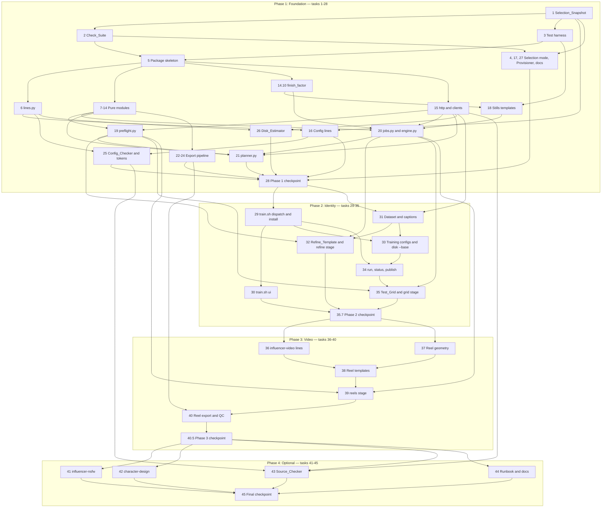

# Implementation Plan: ai-influencer-pipeline

Tasks follow the phase column of the design's File layout table. Every sub-task is required, the test
sub-tasks included: Requirement 27.5 requires the property tests, and every checkpoint runs the full
Check_Suite. Every task is verifiable on the Mac with no GPU, no `/workspace` and no
Vast Instance. No task creates a git commit, pushes, or contacts the Instance.

## Overview

The plan follows the four delivery phases of the design's File layout table, in order. Each phase ends
with a Check_Suite checkpoint that leaves the repo in a working state, so the tree is releasable at four
points rather than only at the end. The property tests of a phase arrive with that phase, which keeps
`tests/test_meta.py` an accurate map of what has landed and what has not. Work that needs the Vast
Instance or a GPU is written into the Runbook's first-session checklist rather than executed here,
because none of it can be verified on the Mac.

| Phase | Tasks | Delivers |
|---|---|---|
| 1. Foundation | 1–28 | The Selection_Snapshot, the Check_Suite and test harness, the Python package and its pure modules, the network clients, the Phase 1 config lines and Provisioner changes, the four stills templates, the plan and submit stages, the export pipeline, the checks with the offline Licence_Gate and the Phase 1 docs |
| 2. Identity | 29–35 | `scripts/train.sh` with its install and UI paths, the Dataset check and caption preparation, the Refine_Template and refine stage, the training configs and `disk --base`, the run, status and publish subcommands, and the Test_Grid and grid stage |
| 3. Video | 36–40 | The `influencer-video` config lines and install path, the Reel geometry, the four Reel templates, the reels stage, and the Reel export and QC |
| 4. Optional | 41–45 | The `influencer-nsfw` add-on, the `character-design` id and its patches, the Source_Checker with the online Licence_Gate, and the completed Runbook and docs |

## Tasks

### Phase 1: Foundation

- [x] 1. Capture the Selection_Snapshot before any config line changes
  - Runs first so that every later edit to the Catalog and the Config_Lists is compared against a
    recorded v6 baseline (design §M11)
  - Reads history only (`git show`); writes nothing outside `tests/`
  - _Requirements: 1.4, 27.6_

  - [x] 1.1 Write `tests/tools/snapshot_v6_selection.sh`
    - Extract `scripts/provision.sh` and `config/{catalog.txt,models.list,nodes.txt,ollama-models.txt}`
      from commit `a746fda` into a temp dir with `git show a746fda:<path>`
    - Strip the trailing `main "$@"` line, then source the extracted script with `CONFIG_DIR` pointed
      at the temp dir, so the snapshot uses v6's own `selected` and `trim`
    - Print, per run, a `### run: <id>` header followed by the §M10 sections in the fixed order
      `[models.list]`, `[nodes.txt]`, `[ollama-models.txt]`, with the tag field dropped and 5, 2 and 1
      fields respectively
    - Runs are `qwen21 qwen21-edit krea2 edit-2509 krea-style wan-i2v minimax-h3 wan-animate global flux`
      and `all`; bash 3.2 safe, `set -euo pipefail`, `LC_ALL=C`, temp dir removed on exit
    - _Requirements: 1.4, 27.6_

  - [x] 1.2 Generate `tests/fixtures/selection-v6.txt` into the working tree
    - First line is exactly
      `# Selection_Snapshot of v6 (a746fda…) — do not edit; regenerate with tests/tools/snapshot_v6_selection.sh`
    - File ends with a newline; its bytes are the generator's stdout, and the maintainer commits it
    - _Requirements: 1.4, 27.6_

  - [x] 1.3 Write the generator's own bash test
    - Re-running the generator reproduces the committed fixture byte for byte, because the inputs come
      from a fixed commit and not from the working tree
    - The run leaves the working tree unchanged and creates no file outside the system temp folder
    - _Requirements: 1.4, 27.6_

- [x] 2. Build the Check_Suite environment and script skeleton (design §C11, §M13)
  - `scripts/check.sh` is bash 3.2 compatible and is the single command that runs every check
  - _Requirements: 27.1, 27.3, 27.4, 27.7, 27.8, 27.9_

  - [x] 2.1 Write `tests/requirements-check.txt`
    - Direct pins from §M13: `pytest==9.1.1`, `hypothesis==6.168.3`, `PyYAML==6.0.3`, `pillow==12.3.0`
    - NumPy environment markers: `numpy==2.2.6; python_version < "3.11"`,
      `numpy==2.4.6; python_version == "3.11"`, `numpy==2.5.3; python_version >= "3.12"`
    - Transitive pins in the same file (`iniconfig`, `packaging`, `pluggy`, `pygments`,
      `sortedcontainers`, plus `exceptiongroup` and `tomli` on 3.10), each with its hashes
    - Generated once with `uv pip compile --universal --python-version 3.10 --generate-hashes` and
      committed; a header comment records that command
    - _Requirements: 27.3_

  - [x] 2.2 Implement the `.check-venv` build, stamp and interpreter search in `scripts/check.sh`
    - Search order `python3.14 python3.13 python3.12 python3.11 python3.10 python3`, taking the first
      whose version is at least 3.10; on this Mac `python3` is 3.9.6 and is skipped, so the search
      lands on `~/.local/bin/python3.11` or Homebrew's `python3.14`
    - Build with `python -m venv`, then
      `pip install --require-hashes --no-deps -r tests/requirements-check.txt`
    - Stamp records the SHA-256 of the requirements file and the interpreter version; rebuild when
      either changes or the last build failed; touch no other Python installation
    - No interpreter, or a failed install, marks steps 1–2 `failed` and states
      "Python 3.10 or later is required" or names the package that failed
    - _Requirements: 27.3, 27.9_

  - [x] 2.3 Implement the four steps, shell-script discovery, summary and exit rule
    - Steps in order: `config` (`.check-venv/bin/python -m influencer check-config`), `tests`
      (`.check-venv/bin/python -m pytest -q tests` with `HYPOTHESIS_PROFILE=check`), `bash -n`,
      `shellcheck` at default severity
    - Shell scripts come from `git ls-files -z --cached --others --exclude-standard`: names ending in
      `.sh`, or a first line with a `bash`/`sh` shebang
    - A missing shellcheck reports the step `skipped` and prints `brew install shellcheck` on macOS or
      `sudo apt-get install -y shellcheck` on Linux
    - Every remaining step runs after a failure; the summary prints one `name: passed|failed|skipped`
      line per step and exits 1 when any step failed, `skipped` not counting as failed
    - _Requirements: 27.1, 27.4, 27.7, 27.8_

  - [x] 2.4 Write the bash test of the Check_Suite's own step reporting
    - Drive the script with stubbed steps so each of passed, failed and skipped is produced, and assert
      the four summary lines, their order, and the exit status for every combination
    - Cover a missing shellcheck (skipped plus the install hint, remaining steps still run), a failing
      early step (later steps still run), and a missing 3.10+ interpreter (steps 1–2 failed with the
      version message)
    - _Requirements: 27.4, 27.7, 27.8, 27.9_

- [x] 3. Build the test harness the later tasks rely on (design Testing Strategy)
  - Creates the `tests/` layout: `conftest.py`, `strategies.py`, `test_meta.py`, `fakes/`, `fixtures/`,
    `tools/`, and the `phase1/`–`phase4/` folders
  - _Requirements: 27.2, 27.5_

  - [x] 3.1 Write `tests/conftest.py`
    - Session fixture patching `socket.socket.connect` to refuse any address outside 127.0.0.0/8 and
      `::1`, so no test can reach the internet or a real ComfyUI or Ollama on the host
    - Register the `check` Hypothesis profile: `max_examples=200`, `deadline=None`,
      `derandomize=True`, database in `.hypothesis/`
    - Temp `WORKSPACE`, `COMFYUI_DIR`, `CONFIG_DIR` and Influencer_Root fixtures, a shortened `Timing`
      fixture, the `instance` marker registered and skipped by default, and an ffmpeg-missing skip
    - Fixture handing out a freshly closed port for "unreachable" tests, never 18188 or 11434
    - _Requirements: 27.2_

  - [x] 3.2 Write `tests/strategies.py`
    - Shared generators the property tests import: `texts()` over all Unicode except surrogates,
      `field_text()`, `config_lists()` (Catalog plus the three lists, with tags), and the helpers that
      write a generated configuration into a temp `CONFIG_DIR`
    - _Requirements: 27.2, 27.5_

  - [x] 3.3 Write the fake servers `tests/fakes/comfy.py` and `tests/fakes/ollama.py`
    - Threaded `http.server` on `127.0.0.1:0`; the ComfyUI fake serves `/system_stats`, `/object_info`,
      `/models/*`, `/upload/image`, `/prompt`, `/queue`, `/history/*`, `/interrupt`, `/free`; the Ollama
      fake serves `/api/tags`, `/api/show`, `/api/ps`, `/api/chat`
    - Both take a script controlling accept, reject with 400, fail in execution, run forever, forget
      ids, pause answers, and write output files into a temp ComfyUI output folder
    - Tests receive their URLs through `COMFYUI_URL` and `OLLAMA_URL`
    - _Requirements: 27.2_

  - [x] 3.4 Write the bash stub `PATH` fixture
    - Stub `curl`, `wget`, `hf`, `git`, `ollama`, `apt-get`, `rclone`, `nvidia-smi` and `uv` scripts that
      record their arguments to a log file and exit with a scripted status, plus the pytest helper that
      runs a repo script under a chosen bash with that `PATH` and the temp env of 3.1
    - _Requirements: 27.2_

  - [x] 3.5 Write `tests/test_meta.py`
    - The Req 27.5 checklist and the 57 numbered properties are held as data in the test, each property with
      the phase that delivers it (1–47 Phase 1, 48–52 Phase 2, 53–57 Phase 3), so a missing property test
      fails with the item's name
    - `DELIVERED_PHASES`, a set in the same file, starts empty, so the file passes while task 3 lands and no
      property test exists yet; the checkpoints of tasks 28, 35.7 and 40.5 add phases 1, 2 and 3
    - Completeness is enforced only for delivered phases: each of their checklist items maps to a test tagged
      `# Feature: ai-influencer-pipeline, Property N: <title>` and each of their properties has exactly one
      property-based test, while a property of a later phase may still have none
    - Every tagged test is checked whatever its phase: no property has two tests, no property test lowers
      `max_examples` below 100, and the `check` profile stays at 200
    - _Requirements: 27.5_

- [x] 4. Add read-only Selection mode to `provision.sh` (design §C5, §M10)
  - bash 3.2 safe: no arrays, no `mapfile`, no `{fd}` redirection, no `flock`, every expansion quoted,
    `set -euo pipefail` kept
  - _Requirements: 1.6, 1.7, 1.9, 1.10, 27.6_

  - [x] 4.1 Implement `--selection <id>|global|all` in `main()` before any side effect
    - `export LC_ALL=C`, check `[ -f "$CATALOG" ]`, then accept an id via `catalog_has`, or `global`, or
      `all` for a full run; set `WORKFLOW` (unset for `all`) and call `print_selection`
    - `print_selection` walks `models.list`, `nodes.txt`, `ollama-models.txt` in that fixed order,
      prints a `[<file>]` header, and for each active line that `selected "$tag"` accepts prints the
      trimmed fields without the tag joined by `|`: 5, 2 and 1 fields, missing fields empty; output ends
      with a newline
    - Reuses the install phases' own `trim` and `selected`, so the printed Selection is the installed
      Selection
    - An unknown id prints `unknown workflow '<id>' — available:` plus `list_workflows` on stderr, prints
      no Selection, and exits 1
    - Creates no directory, lock, staging or log file and makes no network call; touches only the three
      lists and the Catalog
    - bash 3.2 writes every here-string (`<<<`) to a temp file in `/var/tmp` or `/tmp` and ignores `TMPDIR`,
      so the Selection path uses none, as `tests/tools/snapshot_v6_selection.sh` avoids them: `catalog_has`
      matches with a `case` over `catalog_ids` instead of `grep … <<<`, and each line is split without the
      install loops' `read … <<<` and without a temp file, so the Req 1.10 test of task 4.4 can point
      `TMPDIR` at a folder it watches
    - _Requirements: 1.6, 1.9, 1.10_

  - [x] 4.2 Write the bash test for byte-identical output under bash 3.2
    - Run each id, `global` and `all` under `/bin/bash` (3.2 on this Mac) and under the newest available
      bash, and assert status 0 and byte-identical stdout for every run
    - Run with a minimal `PATH` of macOS's own tools and no `/workspace`, and assert repeated runs are
      byte-identical
    - _Requirements: 1.7_

  - [x] 4.3 Write the bash test for the unknown-id branch
    - An id the Catalog does not list exits 1, names the id on stderr, lists the Catalog ids, and prints
      nothing on stdout
    - _Requirements: 1.9_

  - [x] 4.4 Write the bash test for no network and no writes
    - With the stub `PATH` of task 3.4, assert zero `curl`, `wget`, `hf`, `git` and `ollama` invocations
    - Snapshot the repo checkout and the temp `WORKSPACE`/`COMFYUI_DIR` trees before and after with
      names, sizes and mtimes, and assert nothing changed outside the system temp folder
    - _Requirements: 1.10_

  - [x] 4.5 Write the Selection_Snapshot regression test in `tests/phase1/test_provision_bash.py`
    - For every Existing_Id and for `global`, the current `--selection` output equals the run recorded in
      `tests/fixtures/selection-v6.txt`; for `all`, it equals the union of the snapshot's full-run lines
      and the `influencer` Selection
    - Compare tag-stripped lines so only `wf:` tags may differ, ignore order, and on failure name the run
      and each differing file, node pack or Ollama model
    - _Requirements: 1.4, 27.6_

- [x] 5. Create the Python package skeleton and launcher (design §C6)
  - `http.py` and its Property 46 (Loopback confinement) test are not in this task; the `LoopbackClient`
    and `ExternalClient` land with the later `http.py` task and `tests/phase1/test_http.py`, so no
    network client is written here
  - _Requirements: 25.1, 25.6, 25.7, 25.10_

  - [x] 5.1 Write `scripts/influencer.sh`
    - Interpreter order: `$INFLUENCER_PYTHON`, `/venv/main/bin/python`, `<repo>/.check-venv/bin/python`,
      then the first of `python3.14 … python3.10 python3` whose version is at least 3.10
    - Then `PYTHONPATH="scripts[:$PYTHONPATH]" exec "$PY" -m influencer "$@"`; bash 3.2 safe
    - _Requirements: 25.6, 25.7_

  - [x] 5.2 Write `scripts/influencer/__main__.py`
    - Parse the Phase 1 subcommands of the §C6 command table plus the common `--persona <slug>` and
      `--home <dir>` options, with usage text and an unknown-subcommand branch
    - Exit statuses: 0 success (waiting Jobs or Posts included), 1 invalid input or usage, 2 environment,
      preflight or connectivity failure, 3 one or more Jobs or Posts failed, 4 another process holds the
      lock; later tasks attach their command to this parser
    - _Requirements: 25.7_

  - [x] 5.3 Write `env.py`
    - The Architecture paths (Influencer_Root, Output_Root, ComfyUI dirs, `MODELS_PATH`), their
      environment overrides, and the helpers that report a missing `/workspace` instead of assuming it
    - Standard library only, so the module imports under the ComfyUI_Env unchanged
    - _Requirements: 25.6, 25.7_

  - [x] 5.4 Write `errors.py`
    - Frozen `Problem(path, field, line, reason)` and `ValidationError(problems: list[Problem])`, so the
      Readers and checkers report every failure of a run together
    - _Requirements: 25.7_

  - [x] 5.5 Write `yamlio.py`
    - `load_yaml(path)` on PyYAML `SafeLoader`, turning a syntax error into a `Problem` with its line
      number, and `dump_yaml(obj)` with the §A11 representer
    - _Requirements: 25.6, 25.7_

  - [x] 5.6 Write `atomic.py`
    - `write_atomic(path, data)`: temp file in the same folder, `fsync`, `os.replace`, folder `fsync`
    - _Requirements: 25.7_

  - [x] 5.7 Write `locks.py`
    - `ProcessLock(path)` using `fcntl.flock(LOCK_EX|LOCK_NB)` with the holder's PID written into the
      lock file, and the accessor the callers use to report that PID on exit 4
    - _Requirements: 25.7_

  - [x] 5.8 Add the Python-version and import guard
    - On package import, a running interpreter older than 3.10, or a missing PyYAML, Pillow or NumPy that
      the command needs, exits non-zero with a message naming the running version or the missing package,
      before any file is written or any connection is opened
    - Runs inside the package as well as in the launcher, so a wrong `INFLUENCER_PYTHON` fails cleanly
    - _Requirements: 25.10_

  - [x] 5.9 Write unit tests for the launcher, parser and primitives
    - Launcher picks the expected interpreter for each of the four cases with stub interpreters on `PATH`
      and skips a 3.9; the guard's exit status, message and "no file written, no socket opened" behaviour
    - Parser maps each Phase 1 subcommand and each exit status 0/1/2/3/4; `write_atomic` leaves no temp
      file behind and never a partial target; `ProcessLock` refuses a second holder and releases when the
      holder dies
    - _Requirements: 25.7, 25.10_

- [x] 6. Implement `lines.py`: config lines, install paths and the Python Selection model (design §A12)
  - Pure module with no I/O, so the property tests reach it directly
  - _Requirements: 26.2, 26.3, 26.13, 26.14_

  - [x] 6.1 Implement Line_Reader and Line_Printer
    - `Line_Reader(s)` strips a trailing `\r`/`\n` then splits on `|`, keeping fields as they are so
      validation can report whitespace; `Line_Printer(fields)` joins on `|`
    - The printer rejects a field containing `|`, a line break, or leading or trailing whitespace, and a
      first field that is empty or starts with `#`
    - _Requirements: 26.14_

  - [x] 6.2 Write the property test for Property 41: Config line round trip
    - `# Feature: ai-influencer-pipeline, Property 41: Config line round trip`
    - For any valid line record, `Line_Reader(Line_Printer(r)) == r`; strategy is
      `st.lists(field_text(), min_size, max_size)` per file kind, with the rejected shapes asserted to
      raise
    - _Requirements: 26.14_

  - [x] 6.3 Implement Config_Lists parsing and install paths
    - Active-line rule (neither blank nor starting with `#` after leading whitespace), per-file field
      records for the Catalog, `models.list`, `nodes.txt` and `ollama-models.txt`, and tag parsing as
      `wf:` followed by a comma list with spaces removed
    - `install_path(line)` is `models/<subdir or the kind's default folder>/<filename>`, and the ComfyUI
      workflows folder plus the filename for kind `workflow`
    - _Requirements: 26.2, 26.3_

  - [x] 6.4 Implement the Python Selection model and its §M10 printer
    - Mirror `selected()` in `provision.sh`: no id selects untagged lines plus lines with any `in_all` id;
      `global` selects untagged lines plus lines listing `global`; an id selects lines listing that id
    - Print the three sections in fixed order with the tag dropped and 5, 2 and 1 fields, ending with a
      newline, so the bytes match the Provisioner's Selection output
    - _Requirements: 26.13, 1.6_

  - [x] 6.5 Write the property test for Property 42: Python and bash Selections agree
    - `# Feature: ai-influencer-pipeline, Property 42: Python and bash Selections agree`
    - For any generated Catalog and Config_Lists and any run (each id, `global`, full), the Python
      Selection model and `provision.sh --selection` produce the same lines in the same order, byte for
      byte; `config_lists()` written to a temp `CONFIG_DIR` and run through `/bin/bash` with
      `@settings(max_examples=100)`, the only test allowed below the 200 default
    - _Requirements: 26.13_

  - [x] 6.6 Write unit tests for the parsing edge cases
    - Default folder per kind, empty and nested `subdir`, `workflow` lines, a trailing `|` adding an empty
      field, `wf:` with spaces, and two active lines sharing an install path with a different source or
      source id
    - _Requirements: 26.2, 26.3_

- [x] 7. Implement `safety.py`: the Safety_Guard and its committed term lists (design §A5, §M14)
  - Pure matcher over parsed values, so the Persona_Reader, plan validation, dataset captions, Test_Grid
    prompts and the Config_Checker all call the same code
  - _Requirements: 4.4, 26.8_

  - [x] 7.1 Write the two term lists in `config/influencer/safety/`
    - UTF-8, one term per line, `#` starts a comment
    - `minor-terms.txt` holds the §M14 minor-coded words and phrases (`child`, `kid`, `teen`, `schoolgirl`,
      `school uniform`, `little girl`, `barely legal`, `high school`, and the rest), plus the spelled-out
      ages one to twenty-four followed by `year old`, `years old` or `yo`
    - `resource-terms.txt` holds the §M14 resource terms (`face swap`, `faceswap`, `deepfake`, `reactor`,
      `roop`, `age slider`, `de-aging`, `age regression`, and the rest), used only by the Config_Checker
      together with the minor terms
    - The loader drops comments and blank lines, keeps file order, and reports a missing or term-free list
      as a Problem naming the file
    - _Requirements: 26.8, 26.17_

  - [x] 7.2 Implement normalisation and the whole-word term matcher
    - `unicodedata.normalize("NFKC", text).casefold()`; words are maximal runs of `[^\W_]`, and every
      other character separates words
    - A term matches when its own words appear as consecutive words of the text, so `face swap` matches
      `Face_Swap` and `face-swap` but not `faceswap`, and `kid` does not match `kidding`
    - `check_tree(value)` walks every string of a parsed structure, mapping keys included, and returns
      `(field path, matched term)` pairs, so a caller names the field
    - _Requirements: 4.4, 26.8_

  - [x] 7.3 Implement the numeric age matcher
    - The two §A5 patterns: digits followed by an age word (`years? old`, `yrs? old`, `yrs?`, `y/?o`,
      `y.o.`) and `aged?` with an optional `:` or `=` before the digits
    - A match is rejected when `int(number) < 25`, so `24 years old` is rejected and `25 years old` is not
    - _Requirements: 4.4, 27.5_

  - [x] 7.4 Write the property test for Property 38: Safety_Guard matches whole words only
    - `# Feature: ai-influencer-pipeline, Property 38: Safety_Guard matches whole words only`
    - For any term from either committed list and any surrounding text, the text is rejected when the
      term's words appear as consecutive whole words in any letter case with any non-alphanumeric
      separators, and accepted when the term appears only inside longer words and nothing else matches
    - Strategy: `st.sampled_from(terms)`, random case flips, separators from `" _-./"`, letters glued
      before or after for the negative case, other text drawn from a term-free alphabet
    - _Requirements: 4.4, 26.8, 27.5_

  - [x] 7.5 Write the property test for Property 39: Numeric ages are rejected exactly below 25
    - `# Feature: ai-influencer-pipeline, Property 39: Numeric ages are rejected exactly below 25`
    - For any n in 0–999 written in any supported age form (`n year old`, `n-year-old`, `nyo`, `n yrs`,
      `aged n`, …), the Safety_Guard rejects the text exactly when n < 25
    - Strategy: `st.integers(0, 999)` × `st.sampled_from(age_forms)` × case and spacing variants
    - _Requirements: 27.5_

  - [x] 7.6 Write unit tests for the term-list loader and `check_tree`
    - Comment lines, blank lines, a repeated term, a missing file and a file with only comments
    - A term hit in a mapping key, in a nested list item and in a deeply nested value each report the
      field path that names it
    - _Requirements: 26.8, 26.17_

- [x] 8. Implement `persona.py`: the Persona model, Persona_Reader and Persona_Printer (design §M1)
  - Pure apart from the optional file-existence check, so `check_files=False` keeps the property tests
    free of I/O
  - The Instagram_Allowlist checks stay out of the Reader because they need models.list; they land with
    `allowlist.py` in task 15
  - _Requirements: 4.1, 4.2, 4.3, 4.4, 4.5, 4.6, 4.7, 4.8, 4.9, 4.10, 4.11, 4.12, 4.13, 8.10, 26.12_

  - [x] 8.1 Implement the Persona model and the §M1 field rules
    - Unknown keys rejected at any level; `slug`, `name`, `voice`, `identity`, `trigger_word`,
      `hero_image` and `grade.lut` required and non-blank; a wrong type reported as such
    - `age` a YAML int (bool rejected) from 25 to 99; `slug` 1–32 of `[a-z0-9-]`; `trigger_word` 4–32 of
      `[a-z0-9_]`; `reference_pack` 0–5 items; location and outfit names unique within their list
    - `character_loras.stills/video` strength in (0, 2.0] default 1.0; `looks.<stills|video>.<instagram|other>`
      at most 8 entries with strength in [−2.0, 2.0], a plain string meaning strength 1.0; there is no edit
      look stack, so a `looks.edit` key is an unknown field (§M1)
    - `grade.grain` 0.0–1.0, `sharp_decode` bool default false, `captions.hashtag_limit` int ≥ 0 default 5
      with values above 5 counting as 5, `captions.disclosure` a single line without `#`, `ollama`
      defaults `qwen3:8b` and `dolphin3:8b`
    - `identity` carries the Decision 16 rules: no blank line, no leading or trailing whitespace, not a
      substring of `trigger_word`, so the Prompt_Assembler of task 13 can rely on them
    - Every string and every mapping key at any depth passes the Safety_Guard of task 7
    - _Requirements: 4.3, 4.4, 4.5, 4.6, 4.8, 4.12, 4.13, 8.10_

  - [x] 8.2 Implement path resolution, the file checks and the warnings
    - `hero_image`, `grade.lut` and each `reference_pack` item must be relative, hold no `..` segment and
      resolve, against the Influencer_Root and not the working directory, to an existing regular file; a
      folder does not count, and the check is skipped with `check_files=False`
    - `persona_warnings` reports a location count below 3 or above 4 with the count, without rejecting
    - _Requirements: 4.7, 4.9, 4.10_

  - [x] 8.3 Implement `read_persona` and `print_persona`
    - The Reader collects every failure and raises one `ValidationError` whose Problems each name the file
      path, the field with its item number for a list item (or the line number for a YAML syntax error)
      and the reason
    - `print_persona` writes through `yamlio.dump_yaml`, so multi-line `voice` and `identity` text keeps
      literal block style and YAML-ambiguous values come back as strings
    - _Requirements: 4.2, 4.11_

  - [x] 8.4 Write `config/influencer/examples/persona.yaml`, the Persona_Example
    - The §M1 example: a fictional Persona aged 29, every field given a non-empty value, the video
      Character_LoRA and the disclosure line included
    - Passes the Reader with `check_files=False` and produces no warning; its image, LUT and shot paths do
      not exist in the Repo, which Req 4.1 allows
    - _Requirements: 4.1, 26.12_

  - [x] 8.5 Extend `tests/strategies.py` with `personas()` and `faults("persona")`
    - `personas()` fills every free-text field from `texts()` and every list field across its allowed
      range, so the round trip meets emoji, `#`, `: `, `no`, `2026` and multi-line text
    - `faults("persona")` is the Property 2 catalogue: missing, blank, wrong-type and unknown fields; age
      out of range or not an int; bad Trigger_Word or slug; more than 5 references; duplicate names; a
      Safety_Guard term in any string or key; strengths and look lists out of bounds
    - _Requirements: 27.2_

  - [x] 8.6 Write the property test for Property 1: Persona_File round trip
    - `# Feature: ai-influencer-pipeline, Property 1: Persona_File round trip`
    - For any valid Persona_File model p, `read_persona(print_persona(p)) == p`, including multi-line
      voice text, emoji and YAML-ambiguous strings
    - Strategy: `personas()` with `texts()` in every free-text field, read with `check_files=False`
    - _Requirements: 4.11_

  - [x] 8.7 Write the property test for Property 2: Persona_Reader reports every failure
    - `# Feature: ai-influencer-pipeline, Property 2: Persona_Reader reports every failure`
    - For any valid Persona_File and any set of 1–6 independent faults from the catalogue, the Reader
      rejects the file and reports at least one Problem naming each faulted field, with its item number
      or line
    - Strategy: `personas()` × `st.sets(faults("persona"), min_size=1, max_size=6)`, filtered so no two
      faults target the same field
    - _Requirements: 4.2, 4.3, 4.4, 4.5, 4.6, 4.8, 4.12, 4.13, 8.10_

  - [x] 8.8 Write unit tests for the example and the I/O branches
    - The committed Persona_Example reads with `check_files=False` with no problem and no warning, and
      reports only file-existence problems with `check_files=True`
    - With `check_files=True` in a temp Influencer_Root: a missing file, a folder in place of a file, a
      `..` segment and an absolute path each name the field and the path
    - A location count of 2 and of 5 warns with the count; a YAML syntax error reports its line number; a
      `looks.edit` stack is rejected as an unknown field named `looks.edit`
    - _Requirements: 4.1, 4.2, 4.7, 4.9, 4.10, 4.12, 26.12_

- [x] 9. Implement `calendar_io.py`: the Content_Calendar model, Readers, Printers and skeleton (design §M2)
  - The two list encodings (`looks` as `name[@strength]` joined by `;`, dialogue as one line per cell
    line) are why the YAML Reader also rejects dialogue lines with line breaks and LoRA names containing
    `;` or `@`: both formats then describe the same set of calendars
  - _Requirements: 5.1, 5.2, 5.3, 5.4, 5.5, 5.6, 5.7, 5.8, 5.9, 5.11, 5.12, 5.13, 5.14, 5.15, 5.16, 5.17, 5.18, 5.19, 5.20_

  - [x] 9.1 Implement Week_Id validation and the Post model
    - `week` is `YYYY-Www` with `ww` from 01 to `date(Y,12,28).isocalendar()[1]`, so `2026-W53` passes and
      `2025-W53` fails
    - Post ids are 1–48 of `[a-z0-9-]`, not `other`, and unique; `type` is `single`, `carousel`, `story`
      or `reel`; `platform` is `instagram` (default) or `other`; `aspect` is `3:4` (default) or `4:5`
    - `slides` 2–20 for carousels, `candidates` 1–4 default 1, `duration` 5–10 seconds parsed with
      `Fraction(str(v))`; an integer field takes an int, an integral float or a numeric string, never a
      bool
    - `location` and `outfit` are exact Persona_File names, required for single, carousel and story Posts
    - Reel rules: exactly one of `source_post`, `mode: reference` and `mode: external`; `reference` needs
      a non-empty Reference_Pack and existing Location_Shots for the Post's location; `source_slide`
      defaults to 1 and must sit in the source Post's Slide range; an Instagram reel may not source an
      `other` Post; `dialogue` and `voice` come both or neither, with the voice path existing
    - `mode` is accepted only where the type allows it, and the rejection lists the modes that type takes
    - _Requirements: 5.1, 5.2, 5.3, 5.4, 5.5, 5.6, 5.7, 5.8, 5.20, 8.10, 11.6, 16.10, 16.11, 16.12_

  - [x] 9.2 Implement `CalendarResult` and the per-Post rejection rule
    - A rejected Post is reported under its id, or `#<position>` when it has none, with the faulted field
      and reason, and is removed; every other Post is kept with the values it has in a fault-free read,
      including a reel whose source Post was rejected, whose Slide number is then not range-checked
    - File-level problems (a missing or invalid `week`, duplicate ids, a `posts` value that is not a list)
      reject the whole file and leave `calendar: None`
    - `find_calendar(week)` names every `.yaml`, `.yml` and `.csv` file for a week and stops when more
      than one exists, writing nothing and opening no connection
    - _Requirements: 5.9, 5.19_

  - [x] 9.3 Implement the YAML Reader and `print_calendar_yaml`
    - Dates read as `datetime.date` become ISO strings, so the printed file reads back equal; a `date`
      outside the Week_Id warns without rejecting
    - _Requirements: 5.13_

  - [x] 9.4 Implement the CSV Reader and `print_calendar_csv`
    - `utf-8-sig` so a BOM is accepted, RFC 4180 quoting through Python's `csv`, one header row, one row
      per Post, and rows whose cells are all empty skipped
    - Required columns `week, id, type, date, location, outfit`; optional `platform, idea, aspect, slides,
      candidates, mode, looks, duration, source_post, source_slide, dialogue, voice`; an empty cell means
      the field is absent, and an empty mode cell means no mode
    - `looks` cells hold `name[@strength]` items separated by `;`; `dialogue` cells hold one line per line
      break after `\r\n` is normalised, with empty lines dropped
    - File-level rejections name each missing, unknown or repeated column, or give the spreadsheet row
      number (header as row 1) of each row whose Week_Id differs from the first Post row's
    - _Requirements: 5.14, 5.15, 5.18_

  - [x] 9.5 Implement `skeleton_calendar` and the `new-calendar` command
    - One `single` Post dated the Monday of the week, using the Persona_File's first location and outfit,
      written as `calendar.yaml` or, with `--csv`, `calendar.csv`
    - An invalid Week_Id or any existing calendar file for that week writes no file and reports the value
      or the existing path
    - Attaches `new-calendar --week W [--csv]` to the `__main__.py` parser of task 5.2
    - _Requirements: 5.11, 5.12, 5.17_

  - [x] 9.6 Write `config/influencer/examples/calendar.yaml` and `calendar.csv`
    - The §M2 example Posts: a single, a 5-Slide carousel, a story, a reference reel with a source Slide
      and an `external` reel
    - Both files hold the same Week_Id and the same Posts in the same order, and both read against the
      Persona_Example with no rejected Post
    - _Requirements: 5.16, 26.12_

  - [x] 9.7 Extend `tests/strategies.py` with `calendars(persona)` and `faults("post")`
    - `calendars(persona)` draws Posts of every type and platform with ids from the full alphabet
      (including `a--b` and `0`), `texts()` for `idea`, single-line `texts()` for dialogue lines, and reel
      sources that resolve
    - `faults("post")` is the Property 7 catalogue: unknown or missing type or platform; id rules;
      unknown location or outfit; slide count, duration and Candidate count out of range; an unresolved
      reel source; a mode the type does not accept; reel mode combinations; an Instagram reel sourcing an
      `other` Post; dialogue without voice and the reverse; look lists out of bounds
    - _Requirements: 27.2_

  - [x] 9.8 Write the property test for Property 3: Week_Id validation
    - `# Feature: ai-influencer-pipeline, Property 3: Week_Id validation`
    - For any year Y in 1900–2200 and week w in 0–60, `YYYY-Www` is accepted exactly when
      1 ≤ w ≤ the ISO weeks in Y, and any string not matching `\d{4}-W\d{2}` is rejected
    - Strategy: `st.integers(1900, 2200)`, `st.integers(0, 60)`, plus `texts()` for malformed ids
    - _Requirements: 5.3_

  - [x] 9.9 Write the property test for Property 4: Content_Calendar YAML round trip
    - `# Feature: ai-influencer-pipeline, Property 4: Content_Calendar YAML round trip`
    - For any calendar the Reader accepts with no rejected Post, reading `print_calendar_yaml(c)` gives
      the same Week_Id and the same Posts in the same order with equal field values
    - Strategy: `personas()` → `calendars(persona)`
    - _Requirements: 5.13_

  - [x] 9.10 Write the property test for Property 5: Content_Calendar CSV round trip
    - `# Feature: ai-influencer-pipeline, Property 5: Content_Calendar CSV round trip`
    - For any such calendar, reading `print_calendar_csv(c)` gives back c, with idea texts containing
      commas, double quotes, line breaks and emoji
    - Strategy: as Property 4, with `texts()` for `idea` and single-line `texts()` for dialogue lines
    - _Requirements: 5.18_

  - [x] 9.11 Write the property test for Property 6: CSV and YAML calendars are read identically
    - `# Feature: ai-influencer-pipeline, Property 6: CSV and YAML calendars are read identically`
    - For any calendar data, valid or with faults in some Posts, a CSV file and a YAML file holding that
      data give the same accepted calendar and the same rejected Post ids, or both are rejected; this
      holds with and without a BOM and with blank rows added to the CSV
    - Strategy: `calendars(persona)` with optional `faults("post")`, `st.booleans()` for the BOM and
      `st.lists(st.integers())` for blank-row positions
    - _Requirements: 5.14, 5.16_

  - [x] 9.12 Write the property test for Property 7: A rejected Post never affects the others
    - `# Feature: ai-influencer-pipeline, Property 7: A rejected Post never affects the others`
    - For any valid calendar and any single fault injected into one Post, the Reader rejects exactly that
      Post, naming its id or position and the faulted field, and every other Post is accepted with the
      values it has in the fault-free calendar, a reel sourcing the rejected Post included
    - Strategy: `calendars(persona)`, `st.sampled_from(post indices)`, `faults("post")`
    - _Requirements: 5.2, 5.4, 5.5, 5.6, 5.7, 5.8, 5.9, 5.20, 8.10, 11.6, 16.10, 16.11, 16.12_

  - [x] 9.13 Write the property test for Property 8: Skeleton calendars are valid
    - `# Feature: ai-influencer-pipeline, Property 8: Skeleton calendars are valid`
    - For any valid Persona_File and any valid Week_Id with no calendar file yet, the skeleton written as
      YAML or CSV has at least one Post, names only the Persona's locations and outfits, and is accepted
      with no rejected Post
    - Strategy: `personas()`, valid weeks from the Property 3 generator, `st.booleans()` for CSV
    - _Requirements: 5.11, 5.17_

  - [x] 9.14 Write unit tests for the file-level branches and the examples
    - The committed `calendar.yaml` and `calendar.csv` read against the Persona_Example with no rejected
      Post and give equal calendars
    - CSV: a BOM, an all-empty row, a missing column, an unknown column, a repeated column, and rows with
      mixed Week_Ids reported by spreadsheet row number
    - A week folder holding both `calendar.yaml` and `calendar.csv` names both files and writes nothing;
      `new-calendar` refuses an invalid week and an existing file
    - _Requirements: 5.12, 5.14, 5.15, 5.19, 26.12_

- [x] 10. Implement `prompt_sheet.py` and `manifest.py` (design §M3, §M4)
  - Both Printers feed their Reader unchanged, so the week's two state files survive editing and
    interruption; the Manifest is the only Phase 1 file written atomically on every status change
  - _Requirements: 6.12, 10.12_

  - [x] 10.1 Implement the Prompt_Sheet model, Reader and Printer
    - `format: influencer-prompt-sheet/1`, `week`, and per entry `post`, `approved`,
      `needs_manual_prompt`, `review`, `planned {model, at, attempts}`, `slides [{scene, alt, pick}]`,
      `caption`, `hashtags`, `motion` (reel Posts only) and `raw_response`
    - `pick` is a Candidate number or `null`; `null` with a Candidate count of 1 means Candidate 1, and a
      value outside `1..candidates` becomes a Problem the render stage reports while holding that Slide's
      dependent Jobs
    - An entry whose `slides` length differs from the calendar Post's Slide count counts as waiting for
      planning; entries for Posts that left the calendar are kept and reported, not deleted
    - The Printer writes through `yamlio.dump_yaml`, so multi-line text, `#`, `: `, `no`, `2026`, `~` and
      emoji read back character for character
    - _Requirements: 6.12, 11.7, 11.10_

  - [x] 10.2 Implement the Manifest model, Reader and Printer
    - `format: influencer-manifest/1`, `kind`, `scope` and the §M4 job records: `id`, `stage`, `template`,
      `post`, `slide`, `candidate`, `job_key`, `status`, `seed`, `prompt_id`, `resubmits`, the three
      timestamps, `duration_s`, `outputs [{path, bytes}]`, `error` and `waiting_for`
    - `status` is one of `waiting`, `submitted`, `done`, `failed`; records are unique by `job_key`, and a
      waiting record has `job_key: null` and is unique by `id`
    - Grid records add `checkpoint`, `strength` and `prompt`; refine records use `id: "refine/<base>"`;
      `outputs[].path` stays relative to ComfyUI's output folder
    - JSON written with `ensure_ascii=False`, so an error message keeps its non-ASCII text
    - _Requirements: 10.12_

  - [x] 10.3 Implement the Manifest's atomic write and unreadable-file branch
    - Every status change writes through `atomic.write_atomic` of task 5.6, so a process killed at any
      moment leaves a file the Manifest_Reader reads without error
    - A Manifest that exists but cannot be read is reported with its path and the error, and the caller
      leaves the file exactly as it was
    - _Requirements: 10.9, 10.16_

  - [x] 10.4 Write the property test for Property 11: Prompt_Sheet round trip
    - `# Feature: ai-influencer-pipeline, Property 11: Prompt_Sheet round trip`
    - For any valid Prompt_Sheet s, `read_prompt_sheet(print_prompt_sheet(s))` has the same entries and
      fields with every text value identical character for character, including multi-line text, text
      containing `#` or `:`, `no`, `2026`, `~` and emoji
    - Strategy: `st.builds(PromptSheet, …)` with `texts()` everywhere
    - _Requirements: 6.12_

  - [x] 10.5 Write the property test for Property 27: Manifest round trip
    - `# Feature: ai-influencer-pipeline, Property 27: Manifest round trip`
    - For any valid Manifest m covering every Job kind and status,
      `read_manifest(print_manifest(m)) == m`, including error messages with line breaks, quotes and
      non-ASCII text
    - Strategy: `st.builds(Manifest, jobs=st.lists(job_records()))` with `texts()` for `error`
    - _Requirements: 10.12_

  - [x] 10.6 Write unit tests for the rejection and write branches
    - Two records sharing a `job_key`, two waiting records sharing an `id`, an unknown `status`, and a
      grid record without `checkpoint` are each reported with the record's id
    - A Prompt_Sheet with a `pick` of 0, of 5 and of `"2"`, a `slides` length that disagrees with the
      calendar, and an entry for a Post no longer in the calendar
    - After a write the folder holds no temp file, and a write interrupted before `os.replace` leaves the
      previous Manifest readable and unchanged
    - _Requirements: 10.9, 10.12, 10.16, 11.10_

- [x] 11. Implement `ids.py`: seeds, Job_Keys, upload names and the output-path rules (design §A1, §A2, §M5)
  - Pure module, so the determinism properties run it directly and in a subprocess
  - _Requirements: 10.1, 10.2, 5.10, 21.8_

  - [x] 11.1 Implement `seed_for`
    - `base(W, P, s)` is the first 4 bytes of `sha256("influencer-seed/1|W|P|s")` read big-endian, and
      `seed_for(W,P,s,c) = (base + (c − 1) · 0x9E3779B1) mod 2**32`
    - No process, clock or environment state enters the value; reels use `(W, P, 1, 1)`, grid Jobs take
      the Test_Grid's own seed, and refine Jobs hash `(dataset version, image base name)` the same way
    - _Requirements: 10.1, 11.5_

  - [x] 11.2 Implement `job_key` and `upload_name`
    - `canonical(prompt)` is `json.dumps(prompt, sort_keys=True, separators=(",", ":"), ensure_ascii=False)`
      encoded UTF-8; `job_key` hashes `b"influencer-job/1\n"`, that canonical form, and the sorted
      `name=digest` lines of every input file the Job loads
    - `upload_name(bytes)` is `influencer/<sha256 of the bytes><ext>`, so the same bytes always upload to
      the same name and a changed input file gives both a new name and a new key
    - _Requirements: 10.2_

  - [x] 11.3 Implement the Job ids, output prefixes and the safe-name rule
    - The five §M5 rows: `render/<post>/s<NN>/c<k>`, `finish/<post>/s<NN>`, `reel/<post>`,
      `refine/<base>` and `grid/<ckpt-stem>/<strength>/p<NN>`, each with its `output_prefix` relative to
      ComfyUI's output folder and `<SSS>` as the strength × 100 zero-padded (`s080`)
    - Platform `other` adds the `other/` segment, so Instagram Posts land under `<W>/<post-id>/` and
      `other` Posts under `<W>/other/<post-id>/`
    - A safe name (Dataset image base, checkpoint stem) is lowercased, every character outside
      `[a-z0-9-]` becomes `-`, and the first 6 hex digits of the original name's SHA-256 are appended, so
      two different names never collide
    - Every component is a validated id, a two- or three-digit number or a safe name, which is what keeps
      every path inside the Output_Root
    - _Requirements: 5.10, 10.11, 21.8_

  - [x] 11.4 Write the property test for Property 24: Seeds are deterministic and in range
    - `# Feature: ai-influencer-pipeline, Property 24: Seeds are deterministic and in range`
    - For any Week_Id, Post id, Slide index 1–20 and Candidate index 1–4, `seed_for` returns an integer
      in 0–4,294,967,295, and a separate Python process returns the same value
    - Strategy: weeks, `post_ids()`, `st.integers(1, 20)`, `st.integers(1, 4)`; a batch is sent to one
      subprocess per run
    - _Requirements: 10.1_

  - [x] 11.5 Write the property test for Property 25: Candidate seeds differ within a Slide
    - `# Feature: ai-influencer-pipeline, Property 25: Candidate seeds differ within a Slide`
    - For any Week_Id, Post id and Slide index, the seeds of Candidates 1–4 are pairwise different
    - Strategy: as Property 24 without the Candidate index
    - _Requirements: 11.5_

  - [x] 11.6 Write the property test for Property 26: Job_Key tracks prompt values and input bytes
    - `# Feature: ai-influencer-pipeline, Property 26: Job_Key tracks prompt values and input bytes`
    - For any filled prompt and input byte strings, equal inputs give equal Job_Keys, and changing any
      single prompt value or any single input byte gives a different Job_Key
    - Strategy: `values_for(still)`, `st.binary(min_size=1)` for inputs, then a random one-step mutation
    - _Requirements: 10.2, 20.4_

  - [x] 11.7 Write the property test for Property 9: Every output path stays inside the Output_Root
    - `# Feature: ai-influencer-pipeline, Property 9: Every output path stays inside the Output_Root`
    - For any accepted calendar and every Job id, output prefix, export name, QC_Sheet and Publish_Sheet
      path built for it, `resolve(Output_Root / path)` lies inside `resolve(Output_Root)`, with Instagram
      Posts under `<W>/<post-id>/` and `other` Posts under `<W>/other/<post-id>/`
    - Strategy: `calendars(persona)` with ids from the full allowed alphabet, `a--b` and `0` included
    - _Requirements: 5.10, 10.11_

  - [x] 11.8 Write the property test for Property 10: Platform `other` files are confined to `other/`
    - ``# Feature: ai-influencer-pipeline, Property 10: Platform `other` files are confined to `other/` ``
    - For any accepted calendar, every render, export, QC_Sheet and Publish_Sheet path of a Post with
      platform `other` is inside `Output_Root/<W>/other/`, and every such path of an Instagram Post is
      outside it
    - Strategy: `calendars(persona)` with a mixed platform distribution
    - _Requirements: 21.8_

  - [x] 11.9 Write unit tests for the naming edge cases
    - Safe names for a Dataset base and a checkpoint stem holding spaces, non-ASCII characters, `..` and
      a leading dot, including two names that differ only in case
    - The `s080` strength form, a `refine/<base>` id, a three-digit Slide number, and `upload_name` for
      `.png`, `.jpg`, `.wav` and an extensionless input
    - _Requirements: 10.2, 10.11_

- [x] 12. Implement `templates.py`: template loading, metadata validation and the Filler (design §M6, §A3)
  - Pure module; the four stills Render_Templates themselves arrive with the render stage, so these tests
    run on generated templates
  - _Requirements: 7.1, 7.2, 7.3, 7.4, 7.5, 7.6, 7.7, 7.8_

  - [x] 12.1 Implement `load_template` and the §M6 metadata validation
    - `config/influencer/templates/<name>.json` is one object
      `{"format": "influencer-render-template/1", "meta": {…}, "prompt": {…}}`
    - `meta` carries `name`, `kind`, `catalog_id`, `identity_required`, `output_node`, `timeout_s`,
      `placeholders`, `sizes`, `node_packs`, `models` and `extra_files`; Reel kinds add `max_frames` and
      `fps`, and `ref_reel` adds `ref_slots`
    - Placeholder types are `int`, `float`, `text`, `file`, `bool` and `lora_list`; numbers declare
      `min`/`max` (a seed 0–4,294,967,295) and a `lora_list` declares `max_items` ≤ 16, the strength
      bounds, its `source` link, its `loader` and its `loader_inputs`
    - `timeout_s` defaults by kind when absent: 900 for stills kinds, 3600 for reel kinds
    - Rejects a template whose graph holds an undeclared placeholder, a node id at or above 900, a
      `lora_list` placeholder outside a whole value, or a cycle
    - _Requirements: 7.1, 10.7_

  - [x] 12.2 Implement the Filler's validation pass
    - Collect used names with `\{\{([a-z0-9_]+)\}\}` over every string plus the `lora_list` declarations,
      then report in one `FillError(template, problems)` every placeholder without a value, every supplied
      name matching no placeholder, and every type or bounds error, each with the placeholder, the rule
      and the value
    - Type rules: `int` takes `type(v) is int` only (no bool, no `1.0`); `float` takes ints and finite
      floats but no bool; `text` takes a `str`; `file` takes a non-empty `str`; `bool` takes
      `type(v) is bool`; `lora_list` takes at most `max_items` entries of a non-empty name and a strength
      inside the declared bounds
    - _Requirements: 7.3, 7.7_

  - [x] 12.3 Implement whole-value and in-string substitution
    - An input whose template value is exactly `{{x}}` becomes the typed value: `int` and `float` as JSON
      numbers, `text` and `file` as JSON strings, `bool` as a JSON bool
    - A placeholder inside a longer string is replaced in one regex pass over the original string with
      the supplied string or the decimal integer, so placeholder syntax inside a supplied value is never
      re-expanded and every character around it stays as it was
    - Node ids, node classes, input names and placeholder-free values are copied unchanged
    - _Requirements: 7.2, 7.4, 7.8_

  - [x] 12.4 Implement `lora_list` insertion
    - For each `lora_list` in sorted placeholder-name order with index i, entry k takes node id
      `str(900 + 20 * i + k)` with the declared loader class and `loader_inputs`; the first loader takes
      the declared `source`, each further loader the previous loader's output
    - Every whole-value occurrence of the placeholder becomes the last loader's output, or the `source`
      when the list is empty, so every link points at a node that exists and the prompt stays acyclic
    - Ids 900–1239 leave room for 16 loaders in each of up to 17 lists, and the ids depend only on the
      placeholder name order and the entry index, so a repeated fill keeps them
    - _Requirements: 7.5, 7.6_

  - [x] 12.5 Extend `tests/strategies.py` with `templates()`, `values_for(t)` and `lora_entries()`
    - `templates()` builds small valid Render_Templates: every placeholder type, whole-value and
      in-string placements, 0–2 `lora_list` placeholders with their consumers, and node ids below 900
    - `values_for(t)` draws a valid value per declared placeholder, with `texts()` seeded with
      `{{seed}}`-like strings, plus the Property 22 error kinds as an option
    - _Requirements: 27.2_

  - [x] 12.6 Write the property test for Property 17: Filling preserves the template's structure
    - `# Feature: ai-influencer-pipeline, Property 17: Filling preserves the template's structure`
    - For any template t and valid values v, `fill(t, v)` contains no `{{name}}` of a declared
      placeholder, and its node ids, classes, input names and placeholder-free values equal t's except
      the LoRA loaders and links a `lora_list` adds; supplied text containing `{{…}}` stays as supplied
    - Strategy: `templates()` × `values_for(t)`, with text values seeded with `{{seed}}`-like strings
    - _Requirements: 7.2_

  - [x] 12.7 Write the property test for Property 18: Whole-value placeholders take the supplied value unchanged
    - `# Feature: ai-influencer-pipeline, Property 18: Whole-value placeholders take the supplied value unchanged`
    - For any template and valid values, each input whose template value is exactly `{{x}}` equals the
      supplied value, with integers and floats as JSON numbers and text and file names as JSON strings,
      including quotes, backslashes, line breaks and emoji
    - Strategy: as Property 17, checking the JSON types after `json.loads(json.dumps(filled))`
    - _Requirements: 7.4_

  - [x] 12.8 Write the property test for Property 19: Placeholders inside longer strings
    - `# Feature: ai-influencer-pipeline, Property 19: Placeholders inside longer strings`
    - For any template string `prefix + "{{x}}" + suffix` and any valid text, file or int value, the
      filled string is `prefix + str(value) + suffix`, with ints in decimal and every other character
      unchanged
    - Strategy: `texts()` for prefix and suffix excluding `{{`, `st.integers(bounds)` or `texts()` for
      the value
    - _Requirements: 7.8_

  - [x] 12.9 Write the property test for Property 20: LoRA chains are well-formed
    - `# Feature: ai-influencer-pipeline, Property 20: LoRA chains are well-formed`
    - For any template with a `lora_list` placeholder L and any list of 0–16 valid entries, the filled
      prompt holds one loader per entry in list order with that entry's name and strength, the first
      taking L's source and each further one the previous loader's output, every consumer taking the last
      loader (or the source for an empty list), every link targeting an existing node, and no cycle
    - Strategy: `templates()` restricted to ones with `lora_list`s, `st.lists(lora_entries(), max_size=16)`
    - _Requirements: 7.5_

  - [x] 12.10 Write the property test for Property 21: Filling is repeatable
    - `# Feature: ai-influencer-pipeline, Property 21: Filling is repeatable`
    - For any template and values, filling twice, with the value mapping in any key order and in a
      separate process, gives byte-identical canonical JSON, the ids of inserted loaders included
    - Strategy: `values_for(t)` then `st.permutations(keys)`; one example per run spawns a subprocess
    - _Requirements: 7.6_

  - [x] 12.11 Write the property test for Property 22: Filling errors are complete
    - `# Feature: ai-influencer-pipeline, Property 22: Filling errors are complete`
    - For any template and valid values with a random set of injected errors (missing names, unknown
      names, wrong types including bool for int and `1.0` for int, empty file names, out-of-bound numbers
      or strengths, more than 16 LoRAs), `fill` returns no prompt and the error names the template and
      each injected error with its placeholder, rule and value
    - Strategy: `values_for(t)` × `st.sets(error_kinds)`
    - _Requirements: 7.3, 7.7_

- [x] 13. Implement `assembler.py` and `captions.py` (design §A4, §A10)
  - The Reel, Ref_Reel and dialogue prompt builders of §A4 land with the reels stage in Phase 3; this
    task builds the identity and Edit prompts
  - `with_trigger` of §A10 lands with the dataset captions in Phase 2
  - _Requirements: 6.6, 6.7, 6.8, 6.9, 11.3_

  - [x] 13.1 Implement `identity_prompt`
    - `strip_all(P, s)` removes the Identity_Paragraph to a fixpoint from the joined location and outfit
      descriptions and from the scene text, then the prompt is `"\n\n".join([T, P] + [LO] + [S])` with
      empty segments dropped
    - The Persona_Reader's guarantees from task 8.1 (no `\n\n` in P, no leading or trailing whitespace, P
      not a substring of T) are what make the count exactly one for every scene text
    - A carousel Post with `mode: regenerate` gets the Post's location and outfit descriptions on every
      Slide, so no Slide waits for the Pick of Slide 1
    - _Requirements: 6.6, 6.7, 11.4_

  - [x] 13.2 Implement `edit_prompt_value`
    - Returns the Slide's scene text as it stands; the fixed instruction lives in the Edit_Template's
      `"<EDIT_INSTRUCTION> {{scene}}"` string, the `prompt` of node 8, the positive
      `TextEncodeQwenImageEditPlus` encoder (§A4)
    - `{{scene}}` sits at the end and is never re-expanded, so every Edit prompt starts with the identical
      instruction; the encoder adds its `Picture 1:` label inside the node, so the `prompt` input itself
      still starts with the instruction
    - _Requirements: 11.3_

  - [x] 13.3 Implement `captions.py`
    - `add_disclosure(c, d)` drops every line equal to `d` after stripping, drops trailing blank lines,
      appends `d` and joins with `\n`
    - `full_text(entry)` is the caption with its disclosure plus `"\n\n" + " ".join(hashtags)` when there
      are hashtags; `utf16_len(s)` is `len(s.encode("utf-16-le")) // 2` and `hashtag_count(s)` counts the
      whitespace-split tokens starting with `#`
    - An Instagram attempt passes exactly when `utf16_len ≤ 2200` and `hashtag_count ≤ min(limit, 5)`
    - Flagged terms use the Safety_Guard's word matcher of task 7.2 against the caption and the hashtags
      with `#` stripped; hits fill `review` and never fail the attempt or change the caption
    - _Requirements: 6.8, 6.9, 6.10_

  - [x] 13.4 Write the property test for Property 12: Identity prompts contain the Identity_Paragraph exactly once, in order
    - `# Feature: ai-influencer-pipeline, Property 12: Identity prompts contain the Identity_Paragraph exactly once, in order`
    - For any valid Persona_File, location and outfit descriptions and scene text S, including empty S
      and S containing P one or more times, the prompt starts with T, holds P verbatim exactly once, and
      orders its parts T, P, location and outfit, scene
    - Strategy: `personas()`, `texts()` for S, then `st.sampled_from` insertion points that splice P into
      S and into the descriptions 0–3 times
    - _Requirements: 6.6, 6.7, 8.8, 12.3_

  - [x] 13.5 Write the property test for Property 23: Edit instruction invariant
    - `# Feature: ai-influencer-pipeline, Property 23: Edit instruction invariant`
    - For any scene text, the filled Edit_Template prompt starts with the template's fixed instruction
      followed by the scene text, and the instruction is identical for every Job
    - Strategy: `texts()` for the scene, run over every `edit`-kind template in
      `config/influencer/templates/` plus the minimal `edit`-shaped fixture in `tests/fixtures/`, which holds
      a positive and an empty negative `TextEncodeQwenImageEditPlus` as §C7 does; the prompt checked is the
      input whose template value holds `{{scene}}`, so the real `edit.json` is covered unchanged once it lands
    - _Requirements: 11.3_

  - [x] 13.6 Write the property test for Property 13: Disclosure line idempotence
    - `# Feature: ai-influencer-pipeline, Property 13: Disclosure line idempotence`
    - For any caption text c and disclosure line d, `add_disclosure(c, d)` has exactly one line equal to
      d, that line is the last one, and applying it twice changes nothing
    - Strategy: `texts()` for c, single-line `texts()` without `#` for d, and c pre-seeded with d on 0–3
      lines
    - _Requirements: 6.9_

  - [x] 13.7 Write the property test for Property 14: Instagram caption limits
    - `# Feature: ai-influencer-pipeline, Property 14: Instagram caption limits`
    - For any caption, disclosure line, hashtag list and limit L, an Instagram attempt passes the length
      and hashtag rule exactly when the full caption text has at most 2,200 UTF-16 code units and at most
      `min(L, 5)` words starting with `#`
    - Strategy: texts built near the boundary (2,190–2,210 units, mixing BMP and astral emoji), 0–8
      hashtags, `st.integers(0, 12)` for L
    - _Requirements: 6.8_

  - [x] 13.8 Write unit tests for the caption branches
    - A caption whose only line is the disclosure, an empty caption, a caption ending in blank lines,
      hashtags with no caption, and `hashtag_limit` of 0 and of 12
    - A flagged term inside a hashtag and inside the disclosure line fills `review` without changing the
      caption text
    - _Requirements: 6.8, 6.9, 6.10_

- [x] 14. Implement `geometry.py` crop boxes and `lut.py` (design §A7, §M8)
  - Reel geometry (`reel_frames`, `reel_size`, the Reel first-frame crop) stays in Phase 3, and
    `lut.apply` with the grain of §A9 lands with the Export_Tool
  - The finish upscale factor `finish_factor` (Decision 27) joins `crop_box` here, because the template
    graph rule of task 18.7 and the finish builder of task 20.3 both call it
  - _Requirements: 12.4, 13.4, 14.9, 14.10_

  - [x] 14.1 Implement `crop_box` and the refine sizing helper
    - Integer arithmetic with round-half-up, exactly as §A7 writes it: the source's longer axis is kept
      whole, the free side is rounded and clamped into the bounds, and the origin centres the box
    - The result spans the full width or the full height, stays inside the source, keeps each side at
      least 1 px, and leaves opposite margins differing by at most 1 px
    - The refine sizing helper derives a Dataset image's refine size from the source's own width and
      height with the same arithmetic, keeping its ratio
    - _Requirements: 13.3, 13.4, 18.7_

  - [x] 14.2 Implement the LUT model and the LUT_Reader
    - `Lut(title, size, domain_min, domain_max, table)` with N³ RGB entries and red changing fastest
    - The §M8 grammar: `TITLE "…"`, `LUT_3D_SIZE N`, `DOMAIN_MIN`, `DOMAIN_MAX`, then N³ data lines of 3
      finite floats, with `#` comments and blank lines anywhere and the default domain 0.0 to 1.0
    - Every §M8 fault is reported with the file path and the fault, the 1-based number of the first faulty
      line when the fault sits on a line, and expected versus actual for a wrong entry count:
      `LUT_1D_SIZE`, a missing or repeated `LUT_3D_SIZE`, N outside 2–65, a repeated keyword, a
      `DOMAIN_MIN` not below its `DOMAIN_MAX`, a data line that is not 3 finite numbers, and a count
      other than N³
    - _Requirements: 14.7, 14.8_

  - [x] 14.3 Implement the LUT_Printer
    - Always writes `TITLE` when set, then `LUT_3D_SIZE`, `DOMAIN_MIN` and `DOMAIN_MAX`, then the entries
      in `.cube` order
    - Numbers are formatted `'.17g'`, so every float reads back exactly
    - _Requirements: 14.9_

  - [x] 14.4 Write `tests/tools/make_luts.py` and the two repo LUTs
    - The generator writes `config/influencer/luts/identity-33.cube` (N = 33, entry (i,j,k)/32) and
      `example-grade-33.cube` (a warm, lifted-black film curve with at least one entry more than 1/255
      from the identity entry at the same lattice index)
    - Each file starts with
      `# origin: generated for comfyui-vastai by tests/tools/make_luts.py; licence: CC0-1.0`
    - Both files are committed, and both are accepted by the LUT_Reader
    - _Requirements: 14.10_

  - [x] 14.5 Extend `tests/strategies.py` with `luts()` and `faults("lut")`
    - `luts()` draws N in 2–65, an optional TITLE from `texts()`, any valid domain and finite entries from
      `st.floats(allow_nan=False, allow_infinity=False)`
    - `faults("lut")` is the Property 31 catalogue: a `LUT_1D_SIZE` line, a missing or repeated
      `LUT_3D_SIZE`, N outside 2–65, a repeated keyword, a `DOMAIN_MIN` not below `DOMAIN_MAX`, a
      malformed or non-finite entry line, and too many or too few entries
    - _Requirements: 27.2_

  - [x] 14.6 Write the property test for Property 29: Export crop box
    - `# Feature: ai-influencer-pipeline, Property 29: Export crop box`
    - For any source width and height in 1–16,384 and each target (1080×1440, 1080×1350, 1080×1920), the
      crop box lies inside the source, is at least 1×1, spans the full width or the full height, matches
      the target ratio to within 1 px on its free side, and its opposite margins differ by at most 1 px
    - Strategy: `st.integers(1, 16384)` twice × `st.sampled_from(targets)`
    - _Requirements: 13.4_

  - [x] 14.7 Write the property test for Property 30: LUT round trip
    - `# Feature: ai-influencer-pipeline, Property 30: LUT round trip`
    - For any valid LUT (N 2–65, optional TITLE, any valid domain, finite entries),
      `read_lut(print_lut(l)) == l`
    - Strategy: `luts()` with `st.floats(allow_nan=False, allow_infinity=False)` entries
    - _Requirements: 14.9_

  - [x] 14.8 Write the property test for Property 31: LUT faults are reported precisely
    - `# Feature: ai-influencer-pipeline, Property 31: LUT faults are reported precisely`
    - For any printed valid LUT with one injected fault, the LUT_Reader rejects the file and reports the
      path and the fault, the 1-based line of the first faulty line when the fault is on a line, and the
      expected and actual counts for a wrong entry count
    - Strategy: `luts()` × `faults("lut")`
    - _Requirements: 14.8_

  - [x] 14.9 Write unit tests for the committed LUTs and the geometry pins
    - Both repo LUTs read back with their N, domain and origin comment, and re-running
      `tests/tools/make_luts.py` reproduces them byte for byte
    - `example-grade-33.cube` has an entry more than 1/255 from the identity entry at the same index
    - `crop_box` pins for the three targets at a square, a very wide and a very tall source, plus 1×1 and
      16,384×1 sources
    - _Requirements: 13.4, 14.10_

  - [x] 14.10 Implement `finish_factor` in `geometry.py` and its unit tests
    - `finish_factor(w, h, export_w, export_h)` of §C6 returns the smallest integer f ≥ 2 with
      f·w ≥ 2·export_w and f·h ≥ 2·export_h (Decision 27), in integer arithmetic with no float rounding
    - VOSR2 scales a Pick to exactly f·w × f·h before restoring it, so that factor meets the Req 12.4 floor
      with the ratio unchanged: 2 for every Still Pick and 3 for both Edit Picks
    - The result is not clamped: `finish.json` bounds `upscale` to 2–4 (task 18.6), so a Pick that needs
      more than 4 fails the Filler's bounds check of task 12.2 by name instead of finishing below the floor
    - Unit tests in `tests/phase1/test_templates.py`, with no numbered property, as the design states: the
      five §C7 rows (1440×1920, 1536×1920 and 1080×1920 at their export sizes give 2; 864×1152 at 1080×1440
      and 896×1120 at 1080×1350 give 3), a Pick already twice its export size giving 2, one where only the
      width forces 3, and in each case f − 1 missing a side whenever f > 2
    - _Requirements: 12.4_

- [x] 15. Implement the network clients and the Instagram_Allowlist (design §Security, §A6, §C6.1, §C6.2)
  - Every test runs against the fake ComfyUI and Ollama servers of task 3.3 and the loopback-only socket
    fixture of task 3.1, so no test needs an Instance or a GPU
  - _Requirements: 25.1, 25.8, 25.9, 21.3, 21.6, 21.7_

  - [x] 15.1 Implement `LoopbackClient` in `http.py`
    - Resolves the host and opens a connection only when every resolved address is in 127.0.0.0/8 or is
      `::1`, reporting the URL and the refused address otherwise
    - Builds its opener with `ProxyHandler({})`, so `http_proxy` and `HTTPS_PROXY` cannot reroute it, and
      refuses every redirect
    - `COMFYUI_URL` and `OLLAMA_URL` are validated when the command starts, before any request
    - _Requirements: 25.1_

  - [x] 15.2 Implement `ExternalClient` in `http.py`
    - Allows only the hosts of Req 25.2 and 25.8 plus redirect targets reached from them, and reads at
      most the bytes it needs
    - Drops the `Authorization` header whenever a redirect changes host, which `urllib` would otherwise
      forward; HF_TOKEN goes only to Hugging Face hosts and CIVITAI_TOKEN only to `civitai.com`
    - Both tokens are read only from the environment, with no option, prompt or config entry, and error
      messages print URLs without query strings so no token value reaches stdout, stderr or a file
    - _Requirements: 25.2, 25.3, 25.8, 25.9_

  - [x] 15.3 Implement `allowlist.py`
    - The allowlist is the set of paths below `models/loras/` that active models.list lines of kind `lora`
      tagged `influencer` or `influencer-video` install, plus the Persona's Character_LoRA paths that are
      relative, hold no `..` segment and do not sit under `nsfw/`; `inside(name)` is an exact,
      case-sensitive match
    - At the start of the plan, render, finish and reels stages, one hit among the Persona_File's
      Character_LoRAs or its Instagram look stacks (`looks.stills.instagram` and `looks.video.instagram`;
      there is no edit stack) rejects the Persona_File, names the field and the LoRA, and stops the stage
      before any request
    - Each Instagram Post's own look list and its reel source are checked in turn; a failing Post gets no
      Jobs, is reported with its id and the LoRA or Slide, and makes the stage exit 3 at the end
    - _Requirements: 21.3, 21.6, 21.7_

  - [x] 15.4 Implement `comfy.py`
    - The §C6.1 calls with their timeouts: `/system_stats` (10 s, the answer must carry
      `system.comfyui_version`), `/object_info` (30 s), `/models/<folder>` (10 s), `/upload/image` (60 s),
      `/prompt` (30 s), `/queue`, `/history/<id>`, `/interrupt` and `/free` (10 s each)
    - `COMFY_AUTOGROW_V3` specs are expanded to `<group>.<prefix><i>` or `<group>.<name>`;
      `/upload/image` posts multipart `image`, `subfolder=influencer`, `type=input`, `overwrite=true`;
      `/prompt` sends our own UUID4 `prompt_id` and `client_id`, and a 400 carrying `node_errors` is
      reported as a rejection
    - `/history/<id>` reads `status.status_str`, the `status.messages` timestamps and
      `outputs[node].images` or `outputs[node].gifs`
    - Every request goes through the `LoopbackClient`
    - _Requirements: 9.1, 10.6, 25.1_

  - [x] 15.5 Implement `ollama.py`
    - The §C6.2 calls: `/api/tags` for the installed models, `/api/show` for `capabilities`, `/api/chat`
      with `stream:false`, `format` as a JSON schema, `options {temperature: 0.8, seed}` and
      `keep_alive:"10m"`, and the unload pair `/api/ps` plus `/api/chat` with `keep_alive: 0`
    - `think:false` is sent only when `thinking` is listed, and `vision` is required for captioning
    - Timeouts come from the `Timing` object of task 3.1, so the tests shorten the 600 s, 120 s and 10 s
      budgets
    - _Requirements: 6.15, 9.7, 25.1_

  - [x] 15.6 Write the property test for Property 46: Loopback confinement
    - `# Feature: ai-influencer-pipeline, Property 46: Loopback confinement`
    - For any ComfyUI or Ollama URL (scheme, host name or literal address, port) and any resolver answer,
      the `LoopbackClient` opens a connection only when every resolved address is in 127.0.0.0/8 or is
      `::1`, never uses proxy settings and never follows a redirect
    - Strategy: `st.ip_addresses()` and host names mapped by a fake resolver, `http_proxy` set randomly
    - _Requirements: 25.1_

  - [x] 15.7 Write the property test for Property 47: Tokens never leave their own service
    - `# Feature: ai-influencer-pipeline, Property 47: Tokens never leave their own service`
    - For any redirect chain of 1–4 hops across Hugging Face, Civitai, CDN and unrelated hosts, the
      `Authorization` header with HF_TOKEN reaches only Hugging Face hosts and the one with CIVITAI_TOKEN
      only `civitai.com`; the token values never appear in URLs, logs or raised messages, and no request
      goes to a host outside the Req 25.8 allowlist except a redirect target of an allowed service
    - Strategy: `st.lists(st.sampled_from(hosts), min_size=1, max_size=4)` through an injected transport
      that records headers, with canary token values
    - _Requirements: 25.8, 25.9_

  - [x] 15.8 Write the property test for Property 40: Instagram_Allowlist is exact
    - `# Feature: ai-influencer-pipeline, Property 40: Instagram_Allowlist is exact`
    - For any allowlist built from generated models.list lines and Persona Character_LoRAs, and any
      Instagram Post look list or Persona Instagram look stack drawn from allowlisted names, near misses
      (other case, `..` segments, an `nsfw/` prefix, an extra slash) and NSFW names, the Post or
      Persona_File is refused exactly when some entry is not in the allowlist, and the report names that
      entry
    - Strategy: `config_lists()`, `personas()`, `st.lists(st.one_of(allowed, near_miss, nsfw))`
    - _Requirements: 21.3, 21.6, 21.7_

  - [x] 15.9 Write unit tests against the fake servers
    - ComfyUI: an answer without `system.comfyui_version` fails the identity check with the URL; a 400
      with `node_errors` is a rejection; a forgotten prompt id, a paused answer that hits the shortened
      timeout, `/interrupt` and `/free` each report what happened
    - Ollama: a model missing from `/api/tags`, a model whose `capabilities` lack `thinking`, one whose
      capabilities lack `vision`, and the `/api/ps` plus `keep_alive: 0` unload pair
    - Both clients refuse a non-loopback `COMFYUI_URL` or `OLLAMA_URL` before opening a socket
    - _Requirements: 6.15, 9.1, 9.7, 10.6, 25.1_

- [x] 16. Add the Phase 1 config lines, the guide patch and the model-path key (design §C1–§C4)
  - File edits only, so the whole task is verified by the Config_Checker and by the Selection tests of
    tasks 4.5 and 6.5, which compare the edited lists against the committed Selection_Snapshot
  - The Catalog gains all four Influencer_Ids now, as §C1 writes them, while the models.list and nodes.txt
    lines of `influencer-video`, `influencer-nsfw` and `character-design` wait for Phases 3 and 4; a
    Catalog id that no active line tags breaks no rule, which is what lets the ids land together
  - Every models.list and ollama-models.txt line this task tags or adds carries a `# licence:` record in the
    §M15 form, and the lines whose licence fails the Licence_Gate stay commented out (Decision 26), so the
    offline gate of task 25 has a record for each
  - _Requirements: 1.1, 1.2, 1.3, 1.4, 2.1, 2.2, 2.3, 2.4, 2.5, 2.6, 3.2, 26.1, 26.2, 26.3, 26.4, 26.5, 26.6, 26.7, 26.11, 26.18_

  - [x] 16.1 Add the four Catalog lines
    - `influencer|yes||AI influencer stills: Krea 2 Raw realism recipe, carousel edits, face detail, VOSR2
      upscale, DeGrid` goes directly above the `global` line, and `influencer-video`, `influencer-nsfw` and
      `character-design` go after `flux`, each with `in_all` set to `no`, exactly as §C1 writes them
    - `influencer-video` carries `min_comfyui` `0.30.0`, the minimum of `minimax-h3`; the other three leave
      the field empty
    - `influencer-nsfw`'s description contains `add-on` and names `influencer` and `influencer-video` as
      separate ids
    - The `all` order becomes `qwen21 … wan-animate influencer global`, which `stock-setup.sh all` and
      `vast-provision.sh` with `WORKFLOWS=all` already walk top to bottom, so neither script changes
    - _Requirements: 1.1, 1.2, 1.3, 26.4_

  - [x] 16.2 Add the `wf:influencer` tag to the shared lines Req 3.2 names
    - Only the tag field changes: `lenovo_krea2_3000.safetensors` becomes `wf:krea2,influencer` and
      `qwen_image_vae.safetensors`, the VAE Qwen-Image-Edit-2511 uses, becomes
      `wf:krea2,krea-style,edit-2509,influencer`
    - nodes.txt: RES4LYF becomes `wf:qwen21,qwen21-edit,influencer` and rgthree
      `wf:global,minimax-h3,influencer`; the `qwen3:8b` tag is task 16.6's
    - Each models.list line gains a `# licence:` record in the comment block already above it (Req 2.4):
      `apache-2.0 (Danrisi/Lenovo_Krea2)` above the Lenovo LoRA, and above `qwen3vl_4b_fp8_scaled.safetensors`,
      the first line of the encoder-and-VAE run, `krea-2-community-license (repo-level licence of
      Comfy-Org/Krea-2; the VAE is byte-identical to the apache-2.0 copy in Comfy-Org/Qwen-Image_ComfyUI);
      conditions: ` followed by the Krea text of the §M15 conditions map, verbatim
    - The VAE keeps its `Comfy-Org/Krea-2` source, because moving it would change existing Selections;
      `krea2_raw_fp8_scaled.safetensors` keeps `wf:krea2`, and the four Qwen-Image 2.1 lines
      (`qwen_image_2.1_int8_convrot`, `qwen3vl_8b_int8_convrot`, `qwen_image_2.1_vae_bf16`, `lenovo_qwen21`)
      and the qwen21-edit `workflow` line keep their tags: no Influencer_Id uses them, because the Krea
      templates load the bf16 Raw of task 16.3 and Qwen-Image 2.1 is research-licensed (Decisions 24, 25)
    - The `minimax-h3`, VideoHelperSuite, KJNodes, `comfyui_controlnet_aux` and `character-design` rows of §C2
      and §C3 wait for their phase, and each tag keeps every id it already lists, so no line tagged
      `influencer` installs a file path, node pack or Ollama model that another active line also installs
    - _Requirements: 2.4, 3.2, 26.1_

  - [x] 16.3 Add the new `influencer` models.list lines with their provenance blocks
    - The §C2 block in its order: `krea2_raw_bf16.safetensors`, the turbo LoRA and
      `qwen3vl_4b_bf16.safetensors` from `Comfy-Org/Krea-2` under one block;
      `qwen_image_edit_2511_bf16.safetensors` from `Comfy-Org/Qwen-Image-Edit_ComfyUI` and
      `qwen_2.5_vl_7b.safetensors` from `Comfy-Org/Qwen-Image_ComfyUI`, both at their `split_files/…` paths
      and each under its own block; `Wan2_1_VAE_fp32.safetensors`, the upscale2x VAE, `face_yolov8m.pt` as
      kind `detection`, the five VOSR2 files with their `vosr2/VOSR2…` subdirs, the five active look LoRAs
      under `loras/looks` with the two of task 16.4 in their places, and the `krea2_simple.json` workflow line
    - Each line, or the first line of a consecutive group from one source page, carries a comment block of
      exactly three keyed lines: `# source: https://…`, `# licence: …` and `# verified: YYYY-MM-DD`;
      free-text notes may sit above the three lines
    - Each `# licence:` line is a §M15 record as §C2 writes it: a licence id with an optional note,
      `none stated`, or `Civitai permissions: commercial use …; credit …; derivatives …; relicensing …`; the
      Krea group adds `; conditions: ` and the `krea-2-community-license` text of the §M15 conditions map,
      verbatim, and Kijai's Wan VAE adds `; terms: upstream Wan-AI/Wan2.1-T2V-14B, apache-2.0`
    - The notes record the bf16 sizes and SHA-256 prefixes, the 2511 file's `__index_timestep_zero__`
      marker that ComfyUI 0.5.0 and later detects, that the 2511 Lightning LoRA is not installed, that the
      edit VAE is the shared `qwen_image_vae.safetensors`, and that Krea 2 outputs stay under the Krea
      conditions whatever a look LoRA's own permissions
    - `hf` lines always spell `repo::path`, even when the path equals the filename; `civitai` lines carry
      the version id; the workflow line uses `3092832::krea2_simple.json`, so only that one graph installs,
      and no new `workflow` line uses a `github.com` or `raw.githubusercontent.com` URL, so the 40-hex
      commit SHA rule has nothing to pin here
    - _Requirements: 2.1, 2.2, 2.3, 2.4, 2.5, 3.2, 26.2, 26.3_

  - [x] 16.4 Add the commented-out lines with their reason comments
    - The Krea 2 Identity Edit LoRA and the Krea2-Reference LoRA each stay commented out with a leading `#`
      directly below a comment that states the reason and the date it was checked: the linked HF file
      answered HTTP 401 and only mirrors were found, and the second source is unconfirmed
    - Aesthetic Amateur Photo Krea V4 (3284331, Civitai commercial use `RentCivit` only) and the Smartphone
      Photography Slider (3151907, `RentCivit, Rent`) fail the Licence_Gate: each keeps its
      `source/licence/verified` block in its place in the look-LoRA order, and its line is commented out
      directly below `# Commented out: fails the Licence_Gate (Civitai lists no Image commercial use), Req 2.6.`
    - The Krea2-Reference node pack line in nodes.txt is commented out under the same reason, so the pack
      and its LoRA move together when a host is confirmed
    - Carousel Slides use Qwen-Image-Edit-2511 instead (Decision 25), which is why `edit.json` of task 18.4
      is the installed path
    - _Requirements: 2.4, 2.6_

  - [x] 16.5 Add the new nodes.txt lines for `influencer`
    - Five lines tagged `wf:influencer`, each under its own `source/licence/verified` block:
      ComfyUI-DeGrid, ComfyUI-VAE-Utils, ComfyUI-VOSR2, ComfyUI-Impact-Pack and ComfyUI-Impact-Subpack
    - The DeGrid comment records the `ComfyUI-SaveSimple` collision on node id `VAEDeGrid` and the Impact
      Pack comment records the `skip_download_model` marker, so the guards of task 17 are documented where
      they act
    - Every pack of the four §C7 node-class-to-pack maps is now installed by a nodes.txt line in the
      `influencer` Selection, which is what the template rule of task 18.7 checks
    - _Requirements: 26.5, 26.11_

  - [x] 16.6 Add the ollama-models.txt tags
    - The untagged `qwen3:8b` line becomes `qwen3:8b|wf:global,influencer`, so `global` and full runs keep
      it and `influencer` pulls it too
    - Its existing comment block gains `# licence: apache-2.0 (Ollama licence layer: Apache License 2.0;
      upstream Qwen/Qwen3-8B)`: the registry states the licence only as layer text, so the record names the
      matching HF identifier by hand (§C4) and the line is gated offline only
    - The `dolphin3:8b` line's `influencer-nsfw` tag and its `llama3.1` record wait for Phase 4; the
      Persona_File's `other` model defaults to `dolphin3:8b`, which a Mac user pulls by hand as the Runbook
      states
    - _Requirements: 2.4, 3.2, 26.1_

  - [x] 16.7 Add `ultralytics_bbox: detection/` to `extra_model_paths.yaml`
    - The key sits with the other model-folder keys, beside the existing `detection: detection/`, so
      ComfyUI shows `/workspace/models/detection` as `ultralytics_bbox`
    - That is the folder key `UltralyticsDetectorProvider` reads and the one `finish.json` declares for
      `bbox/face_yolov8m.pt`, so `GET /models/ultralytics_bbox` answers the preflight file check of task 19
    - ComfyUI reads the file once at startup, so the key is in place before the first `finish` Job
    - _Requirements: 26.11_

  - [x] 16.8 Write `config/patches/krea2_simple.json.patch.json`
    - The three §C2 rows with their `expect` values and the node ids of the verified zip: `VAELoader` #210
      widget 0 from `wan21_vae_fp32.safetensors` to `Wan2_1_VAE_fp32.safetensors`, and rgthree
      `Power Lora Loader` #315 widgets 2 and 3
    - Widget 2 keeps the entry and swaps the file to `krea2_turbo_lora_rank_64_bf16.safetensors`; widget 3
      turns the paid 2-vector filter bypass off with `{"on":false,"lora":"None","strength":1,
      "strengthTwo":null}`, and rgthree's `"None"` entry names no file
    - `UNETLoader` #316 already names `krea2_raw_bf16.safetensors`, the file task 16.3 installs, and
      `CLIPLoader` #317 names `qwen3vl_4b_bf16.safetensors`, so neither needs a row (Decision 9)
    - The file is named `<filename>.patch.json` for an active non-zip `workflow` line, which is the shape
      the patch rule checks
    - _Requirements: 26.6_

  - [x] 16.9 Run the config and Selection checks over the edited files
    - `python -m influencer check-config` exits 0 over the edited Catalog, the three lists and the patch
      file; its tag, syntax, install-path, NSFW, provenance, Licence gate and template groups are the §C10
      rule groups, and the checker itself lands with its own task, so this sub-task is re-run then
    - The Licence gate group finds a `# licence:` record for every line this task tags or adds, no active
      line fails the gate, and each Krea record's `conditions:` equals the map text of task 25.11
    - The Selection_Snapshot regression test of task 4.5 passes for every Existing_Id and for `global`, and
      the `all` run equals the union of the snapshot's full-run lines and the `influencer` Selection
    - Property 42 of task 6.5 still agrees between the Python Selection model and
      `provision.sh --selection` for every id, `global` and `all`
    - Every check runs on the Mac with no network, no GPU, no `/workspace` and no Instance
    - _Requirements: 1.4, 2.4, 26.1, 26.2, 26.3, 26.7, 26.18_

- [x] 17. Extend the Provisioner: early access, DeGrid, VOSR2, ffmpeg and the disk hook (design §C5)
  - bash 3.2 safe, `set -euo pipefail` kept, every expansion quoted, no arrays, no `mapfile`, no `flock`
  - Every test drives the repo scripts under the stub `PATH` of task 3.4 with the temp `WORKSPACE` and
    `COMFYUI_DIR` of task 3.1, so nothing is downloaded, cloned or sent to an Instance
  - Task 17.9 also clears the two shellcheck findings the existing scripts carry and hardens the root
    lookup of `scripts/check.sh`, so the Check_Suite's `shellcheck` step passes wherever shellcheck is installed
  - _Requirements: 2.7, 2.8, 2.9, 3.3, 3.4, 3.6, 3.7, 16.1, 23.3, 23.4, 27.1, 27.7_

  - [x] 17.1 Implement the Civitai early-access probe in `curl_civitai`
    - Before resuming or starting a download, request the same URL without following redirects with
      `--range 0-65535 -o "$probe" -w '%{http_code}'`, `$probe` under `$STAGING_DIR/civitai/` and the token
      still on stdin, so a server that answers with the file sends at most 64 KB twice
    - A 2xx or 3xx answer deletes the probe and continues into today's resumable download; any other answer
      keeps today's handling
    - A 403 whose probe body contains `early access` in any letter case deletes the probe and calls
      `fail "early access: <filename> (Civitai version <vid>) — the version is in early access; it
      downloads once early access ends"`, leaves an earlier run's partial file untouched, keeps no file
      from the answer on disk or at the install path, and moves to the next line
    - `fail` adds the entry to `FAILURES`, so the closing summary names each affected filename and version
      id and the run exits non-zero
    - _Requirements: 2.7, 2.8, 2.9_

  - [x] 17.2 Implement the DeGrid collision guard in `install_nodes`
    - Before cloning or updating `ComfyUI-DeGrid`, a
      `find "$COMFYUI_DIR/custom_nodes" -maxdepth 1 -iname ComfyUI-SaveSimple` lookup skips the pack with
      no clone, no pull and no requirements install, and calls
      `fail "skipped ComfyUI-DeGrid: node id VAEDeGrid collides with <path>"`
    - Every remaining item still installs, the skip is named in the closing summary, and the run exits
      non-zero
    - _Requirements: 3.4, 3.6_

  - [x] 17.3 Implement the Impact Pack SAM opt-out
    - Before `install.py` runs for `ComfyUI-Impact-Pack`, create
      `$COMFYUI_DIR/custom_nodes/skip_download_model`, an empty file ComfyUI ignores and Impact Pack's
      `install.py` checks, so the unused 375 MB SAM model is never fetched
    - The marker is created only when it is missing, so a second run writes nothing
    - _Requirements: 3.3, 3.7_

  - [x] 17.4 Implement the VOSR2 prefetch and the `.pth` conversion
    - `common.sh ensure_model_paths` gains `ensure_pack_model_link vosr2`: it creates
      `$WORKSPACE/models/vosr2` first, then makes `$COMFYUI_DIR/models/vosr2` a symlink to it; an existing
      real folder has its contents moved over with no-clobber (`cp -rn`) and is then replaced, and
      `NEED_RESTART` stays unset because VOSR2 resolves the path when a Job loads it
    - After `download_models`, `provision.sh` runs `vosr2_convert`: when
      `models/vosr2/VOSR2/dinov2_vitl14_pretrain.pth` exists and `dinov2_vitl14.safetensors` does not, it
      runs the README's conversion (`torch.load(…, weights_only=True)` then
      `safetensors.torch.save_file`) with `$PYTHON` into a `.tmp` file and renames it; a failure calls
      `fail`
    - The `.pth` is kept, so a re-run skips its download, and the first Job that loads ComfyUI-VOSR2
      downloads no file
    - _Requirements: 3.3, 3.7_

  - [x] 17.5 Implement `need_tool` and the per-id system tools
    - `need_tool`, new in `common.sh`, calls the existing `apt_install ffmpeg` when `ffmpeg` is not on
      `PATH`; a failure is a reported problem and a non-zero exit
    - `install-workflow.sh` runs `case "$id" in influencer-video) need_tool ffmpeg ;; esac`, so only that
      id installs it and every other id is unchanged
    - _Requirements: 16.1, 3.6_

  - [x] 17.6 Implement the disk-estimate hook in `install-workflow.sh`
    - After `check_disk` and before the node, model and Ollama phases, run the §C5 block:
      `INFLUENCER_PYTHON="$PYTHON" timeout 120 bash "$SCRIPT_DIR/influencer.sh" disk --id "$id" --brief`,
      `say` its one line on success and `warn "disk estimate unavailable (continuing)"` otherwise
    - The estimator prints its own `WARNING` line when the size still to download exceeds free space, and a
      failure, non-zero exit or timeout changes neither the install steps nor the exit status
    - The `disk` subcommand needs only the standard library, so it runs in the ComfyUI_Env before any node
      requirements are installed
    - _Requirements: 23.3, 23.4_

  - [x] 17.7 Write the bash tests for the five Provisioner additions
    - Early access: a stubbed `curl` answering 403 with an `Early Access` body leaves no file at the install
      path, leaves an existing partial file byte-identical, names the filename and version id in the
      summary and exits non-zero; a 206 answer continues into the download; a 500 keeps today's handling
    - DeGrid: a `custom_nodes/comfyui-savesimple` folder in mixed case skips the pack with zero `git`
      calls, names the folder path, and still installs the remaining packs
    - Impact Pack: the marker exists before the stubbed `install.py` runs; VOSR2: the symlink replaces a
      real folder without losing a file, and the conversion runs once through a stubbed `$PYTHON` into a
      `.tmp` target
    - `need_tool`: a missing `ffmpeg` calls `apt_install` for `influencer-video` and for no other id, and
      its failure is reported with a non-zero exit
    - _Requirements: 2.7, 2.8, 2.9, 3.3, 3.4, 3.6, 16.1_

  - [x] 17.8 Write the idempotence test and the disk-hook test
    - A second run with unchanged lists and installed items asserts zero `curl`, `wget`, `hf` and `ollama`
      download calls, no probe, no symlink change and no conversion, and exit 0; node packs may still
      `git pull`, which Req 3.7 does not exclude
    - The hook's test asserts the `say` line on a stubbed estimator that prints the §C5 example, and the
      `warn` line with an unchanged exit status for a non-zero estimator, a hanging estimator and a missing
      `influencer.sh`
    - The Mac has no `timeout`, so the test puts a `timeout` stub on the task 3.4 `PATH` that passes its
      arguments through and records the budget, and skips cleanly when neither the stub nor a real
      `timeout` can be used
    - _Requirements: 3.7, 23.3, 23.4_

  - [x] 17.9 Fix the existing shellcheck findings and harden the `check.sh` root lookup
    - `scripts/common.sh:118` (SC2013): the `for d in $(awk …)` loop over the folder keys of
      `extra_model_paths.yaml` reads the awk output with a `while IFS= read -r d` loop instead, or keeps the
      loop under an inline `# shellcheck disable=SC2013` whose comment says why word splitting is safe there
    - `scripts/stock-setup.sh:79` (SC2012): the `ls -1 … | sed` that lists the installed workflows uses a
      glob or `find` instead, or keeps the display-only `ls` under an inline `# shellcheck disable=SC2012`
      with its reason
    - `scripts/check.sh`: with no `dirname` on `PATH`, `$(dirname …)` is empty, `cd "/.."` lands in `/` and
      ROOT becomes `/`; ROOT is now derived from `${BASH_SOURCE[0]}` by parameter expansion, and the script
      exits non-zero with a message before any step unless `$ROOT/scripts/check.sh` exists
    - `tests/phase1/test_check_suite.py` gains that case: `check.sh` run with a `PATH` that lacks `dirname`
      stops non-zero, names the problem and runs no step
    - Verification: shellcheck is not installed on the Mac, so a throwaway venv outside the Repo installs
      `shellcheck-py==0.11.0.1` (shellcheck 0.11.0) from PyPI, runs it at default severity over every script
      the discovery of task 2.3 finds, expects no finding, and is deleted afterwards; nothing is added to
      `tests/requirements-check.txt`
    - _Requirements: 27.1, 27.7_

- [x] 18. Write the four stills Render_Templates (design §C7, §M6)
  - Each file is one JSON object `{"format": "influencer-render-template/1", "meta": {…}, "prompt": {…}}`
    with numeric string node ids below 900 and `{{name}}` placeholders, so `templates.py` of task 12 reads
    and fills them unchanged and the filler's LoRA loaders start at 900
  - Every input name comes from the verified sources, and preflight of task 19 compares them with the live
    `/object_info` on every run, so a renamed input fails in seconds instead of mid-batch
  - _Requirements: 7.1, 8.1, 8.2, 8.3, 8.4, 8.5, 8.6, 8.7, 8.8, 8.9, 11.1, 11.2, 11.3, 11.4, 12.1, 12.2, 12.3, 12.4, 12.5, 12.6, 26.11_

  - [x] 18.1 Write `config/influencer/templates/still.json`
    - Nodes 1–15 of §C7: `UNETLoader` on `krea2_raw_bf16.safetensors` with `weight_dtype: "default"`, the
      file the realism guide itself names (Decision 24), `CLIPLoader` on `qwen3vl_4b_bf16.safetensors`
      with `type: "krea2"`, `VAELoader` on `Wan2_1_VAE_fp32.safetensors`, the turbo LoRA at
      `strength_model: 0.6`, the two `CLIPTextEncode` nodes (the guide's empty negative, unused at cfg 1),
      `EmptyLatentImage`, the two `ClownsharKSampler_Beta` passes, `VAEDecode`, `VAEDeGrid`, `ImageCrop`
      and `SaveImage`
    - The sampler rows copy the guide's two passes exactly: pass 1 `exponential/res_2s` with `beta`,
      6 steps, `denoise: 1.0`; pass 2 `multistep/deis_3m` with `bong_tangent`, 2 steps, `denoise: 0.2`;
      both with `eta: 0.5`, `cfg: 1.0`, `steps_to_run: -1`, `sampler_mode: "standard"`, `bongmath: true`
      and the Job's `{{seed}}`
    - `loras` is the `lora_list` placeholder with source `["4",0]` and consumers 10 and 11, so model-only
      loaders carry the stills Character_LoRA and then the look stack in order
    - `VAEDeGrid` carries the fixed settings (`enabled: true`, `mode: "auto"`, `limit: 0.02`,
      `skip_when_clean: true`, `grid_gain: 10.0`, `grid_view: "4x zoom"`) and is the only consumer of the
      decode's image output, with everything downstream reading DeGrid's `image`
    - _Requirements: 8.1, 8.2, 8.3, 8.4, 8.5, 12.2_

  - [x] 18.2 Write the `still` size table and its crop wiring
    - `sizes` holds the three §C7 rows: `3:4` latent 1440×1920, output 1440×1920 at crop (0,0); `4:5`
      latent 1536×1920, output 1536×1920 at (0,0); `9:16` latent 1088×1920, output 1080×1920 at (4,0)
    - `EmptyLatentImage` takes `{{latent_width}}` and `{{latent_height}}`, and `ImageCrop` takes
      `{{width}}`, `{{height}}`, `{{crop_x}}` and `{{crop_y}}`, so one template serves all three aspects
    - Each output pair's width-to-height ratio is exact (0.75, 0.8, 0.5625), which the graph rule of task
      18.7 re-checks
    - _Requirements: 8.6_

  - [x] 18.3 Write `still-sharp.json`
    - The `still` graph, on the same `krea2_raw_bf16.safetensors` UNet, with nodes 3 and 12 replaced and
      node 16 added: `VAEUtils_CustomVAELoader` on `Wan2.1_VAE_upscale2x_imageonly_real_v1.safetensors` with
      `disable_offload: true` and `precision: "auto"`; `VAEUtils_VAEDecodeTiled` with `upscale: -1` (auto 2×),
      `tile: false`, `tile_size: 512`, `overlap: 64`, `temporal_size: 4096`, `temporal_overlap: 64`
    - Node 16 is `ImageScaleBy` with `upscale_method: "lanczos"` and `scale_by: 0.5`, reading node 13 and
      feeding `ImageCrop`, so halving happens after grid removal and the output keeps the task 18.2 size
    - The tiled decode is a whole-image decode, so it too feeds exactly one `VAEDeGrid` and nothing else
    - _Requirements: 8.7, 8.6, 12.2_

  - [x] 18.4 Write `edit.json`
    - Nodes 1–16 of §C7, after the non-Lightning path of the official `image_qwen_image_edit_2511.json`:
      `UNETLoader` on `qwen_image_edit_2511_bf16.safetensors`, `ModelSamplingAuraFlow` with `shift: 3.1`,
      `CFGNorm` with `strength: 1.0` and no `pre_cfg`, `CLIPLoader` on `qwen_2.5_vl_7b.safetensors` with
      `type: "qwen_image"`, `VAELoader` on `qwen_image_vae.safetensors` and `LoadImage` on `{{reference_image}}`
    - Node 7 is an exact-ratio `ImageScale` of the Pick (`upscale_method: "lanczos"`, `width: "{{width}}"`,
      `height: "{{height}}"`, `crop: "center"`) to 864×1152 for 3:4 or 896×1120 for 4:5, in place of
      `FluxKontextImageScale`, whose ~1 MP size list breaks exact ratios; `VAEEncode` (12) encodes it as the
      canvas, so the output has the size-table size
    - Nodes 8 and 9 are `TextEncodeQwenImageEditPlus` with `clip: ["4",0]`, `vae: ["5",0]` and
      `image1: ["6",0]`, the full-resolution Pick; the positive takes `prompt: "<EDIT_INSTRUCTION> {{scene}}"`
      and the negative `prompt: ""`, and nodes 10 and 11, `FluxKontextMultiReferenceLatentMethod`, set
      `reference_latents_method: "index_timestep_zero"` on each
    - `<EDIT_INSTRUCTION>` is the §C7 text naming "Picture 1", the label the encoder gives `image1`, written
      once with `{{scene}}` at the end, so every Edit Job's prompt starts with the identical instruction and a
      scene text holding `{{…}}` is never re-expanded
    - `KSampler` (13) takes `["3",0]`, `["10",0]`, `["11",0]` and `["12",0]` and runs `steps: 40`,
      `cfg: 4.0`, `sampler_name: "euler"`, `scheduler: "simple"`, `denoise: 1.0` on `{{seed}}`, then
      `VAEDecode`, `VAEDeGrid` and `SaveImage` (14–16); there is no Lightning branch or LoRA and no `loras`
      placeholder, and the metadata leaves the template not identity-required
    - _Requirements: 11.1, 11.2, 11.3, 11.4, 12.2_

  - [x] 18.5 Write `finish.json`
    - Nodes 1–14 of §C7: nodes 1–4 as in `still`, on `krea2_raw_bf16.safetensors`, node 5 the
      Character_LoRA loader with `{{character_lora}}` and `{{character_strength}}`, the two `CLIPTextEncode`
      nodes, `LoadImage` on `{{pick_image}}`, `UltralyticsDetectorProvider` on `bbox/face_yolov8m.pt`,
      `FaceDetailer` with the §C7 settings, `VAEDeGrid`, `VOSR2ModelLoader`, `VOSR2Upscale` and `SaveImage`
    - `VOSR2Upscale` runs `upscale: "{{upscale}}"`, the integer the finish builder fills from
      `finish_factor` (×2 for Still Picks, ×3 for Edit Picks), with `{{seed}}`, `color_alignment: "wavelet"`,
      `tile_size: 512`, `tile_overlap: 32`, `vae_tile_size: 1024`, `vae_tile_overlap: 32`; VOSR2 scales to
      exactly f·w × f·h before restoring and tiles the upscaled target, so every Pick clears the Req 12.4
      floor (2160×2880, 2160×2700, 2160×3840) with its ratio exact and ×3 changes only the tile count
    - The graph has no whole-image VAE decode: FaceDetailer decodes face crops only, so Req 12.2 holds by
      construction, and node 11's extra `VAEDeGrid` sits before the upscaler and passes clean images
      through untouched
    - With no detected face FaceDetailer returns its input and the upscale still runs, so a face-free Pick
      finishes without an execution error
    - The prompt is the identity prompt of task 13.1, so the metadata flags the template identity-required
    - _Requirements: 12.1, 12.3, 12.4, 12.6, 12.2_

  - [x] 18.6 Write the §M6 metadata of the four templates
    - Each `meta` declares `name`, `kind`, `catalog_id: "influencer"`, `identity_required`, `output_node`,
      `timeout_s: 900`, `placeholders`, `sizes`, `node_packs`, `models` and `extra_files`; `output_node` is
      the `SaveImage` id (15 for the stills kinds, 16 for `edit`, 14 for `finish`)
    - Placeholder bounds as §M6 writes them: `seed` 0–4,294,967,295, the size and crop integers with their
      `min`/`max`, and `loras` in `still` and `still-sharp` with `max_items: 16`, strengths −2.0 to 2.0, its
      `source`, its `loader: "LoraLoaderModelOnly"` and its `loader_inputs`; `edit` declares
      `reference_image`, `scene`, `seed`, `width` and `height` (256–2048) and `output_prefix` and no `loras`,
      and `finish` adds `upscale` as an int from 2 to 4
    - `edit`'s `sizes` holds only `3:4` with output 864×1152 and `4:5` with output 896×1120, with no latent or
      crop entries because node 7 scales the Pick straight to the output size
    - `node_packs` maps every class to `core` or its nodes.txt repo name: RES4LYF and ComfyUI-DeGrid for
      `still`, those plus ComfyUI-VAE-Utils for `still-sharp`, ComfyUI-DeGrid for `edit` with every other
      class core, and ComfyUI-Impact-Pack, ComfyUI-Impact-Subpack, ComfyUI-VOSR2 and ComfyUI-DeGrid for `finish`
    - `models` gives each file its `kind`, `folder` key and `name`: `krea2_raw_bf16.safetensors` in `still`,
      `still-sharp` and `finish`, and `qwen_image_edit_2511_bf16.safetensors`, `qwen_2.5_vl_7b.safetensors`
      and `qwen_image_vae.safetensors` in `edit`, with `value` where the input spells a file differently
      (`bbox/face_yolov8m.pt` under the `ultralytics_bbox` key of task 16.7); `finish` adds the five VOSR2
      `extra_files` plus `VOSR2/dinov2_vitl14.safetensors` marked `derived: true`
    - `identity_required` is true for `still`, `still-sharp` and `finish` and false for `edit`, which is
      what makes every stills prompt carry the Trigger_Word and the Identity_Paragraph
    - _Requirements: 7.1, 8.8, 11.2, 12.3, 12.4_

  - [x] 18.7 Add the Config_Checker's Render_Template rules
    - The Req 26.11 group: the file is valid JSON, every placeholder in the graph is declared, every node
      class has a pack-map entry, every pack in the map is ComfyUI core or a pack a nodes.txt line of the
      template's `catalog_id` Selection installs, and every `models` entry is installed by a models.list
      line whose install path below the kind's default folder equals the name the template uses, with
      `extra_files` checked at `models/<folder>/<name>`
    - The §C10 extra graph rules: in a stills template every whole-image decode (`VAEDecode`,
      `VAEUtils_VAEDecodeTiled`) feeds exactly one `VAEDeGrid` and nothing else, and every still size row
      has an exact width-to-height ratio
    - The edit and finish rules: each `edit` size row has an exact 3:4 or 4:5 ratio, sides in multiples of
      16 and an area within 10 % of 1024×1024; `edit`'s `VAEEncode` takes its pixels from an `ImageScale` fed
      by the reference `LoadImage`; and `finish_factor` of task 14.10 stays inside `finish`'s `upscale`
      bounds for every still and edit size at the export sizes of its Post types
    - Each failure is reported with the file, the item and the rule, together with every other failure of
      the run
    - _Requirements: 26.11, 12.2, 8.6, 11.2, 12.4_

  - [x] 18.8 Write unit tests for the four committed templates
    - `load_template` of task 12.1 accepts each file, and every declared placeholder, pack and model file
      resolves: each declared placeholder occurs in the graph, each pack is a nodes.txt line of the
      `influencer` Selection, each `models` and `extra_files` entry matches a models.list install path, and
      each `folder` key is one `extra_model_paths.yaml` names
    - Filling each template with `values_for(t)` gives a prompt whose every link points at an existing node
      with no cycle, and Property 23 of task 13.5 now covers the real `edit.json` unchanged
    - The graph rules pin down: `still`, `still-sharp` and `edit` each have exactly one `VAEDeGrid` per
      whole-image decode, `finish` has no whole-image decode, the three still rows and the two edit rows give
      exact ratios, the edit rows sit 5.1 % and 4.3 % below 1024×1024, and the `still-sharp` halving
      restores the `still` output size
    - The `edit` graph: `ImageScale` sits before `VAEEncode` and both encoders take the reference `LoadImage`,
      there is no `FluxKontextImageScale`, no Lightning LoRA and no LoRA placeholder, the instruction names
      "Picture 1", and the sampler values are 40 / 4.0 / euler / simple; `still`, `still-sharp` and `finish`
      load `krea2_raw_bf16.safetensors`
    - `finish_factor` over every still and edit size at its Post types' export sizes gives 2 for the Still
      Picks and 3 for the Edit Picks, inside `upscale`'s bounds and at least twice each export side
    - The tests read the committed files only, so they need no GPU, no ComfyUI and no network
    - _Requirements: 7.1, 8.1, 8.6, 8.7, 11.2, 11.3, 12.2, 12.4, 26.11_

- [x] 19. Implement `preflight.py`: the pre-submission checks and one report (design §C6.1, §A13)
  - Calls the `comfy.py` and `ollama.py` clients of task 15, so every test runs against the fake servers of
    task 3.3 with the shortened `Timing` of task 3.1
  - One 55 s deadline from the stage start, each call's timeout the smaller of its own and the time left,
    so a stage always reports inside the 60 s of Req 9.8 without touching the Manifest
  - _Requirements: 9.1, 9.2, 9.3, 9.4, 9.5, 6.15_

  - [x] 19.1 Implement the ComfyUI identity check
    - `GET /system_stats` with a 10 s timeout; the answer must be JSON carrying `system.comfyui_version`
    - A refused connection, an error answer, an answer that is not a ComfyUI answer, and no answer in time
      are four distinct named failures, each reporting the URL that was tried
    - No Job is submitted and the Manifest is neither created nor changed
    - _Requirements: 9.1_

  - [x] 19.2 Implement the class and input comparison
    - `GET /object_info` with a 30 s timeout, then compare every node class and input name of every Job the
      stage would submit or hold as waiting with the reported definitions
    - `COMFY_AUTOGROW_V3` specs are expanded to `<group>.<prefix><i>` or `<group>.<name>`, so
      `ref_images.ref_image_0` counts as a present input, while the optional `vae` and `image1` of
      `TextEncodeQwenImageEditPlus` are compared by name like any other input
    - `edit`'s core classes (`ModelSamplingAuraFlow`, `CFGNorm`, `TextEncodeQwenImageEditPlus`,
      `FluxKontextMultiReferenceLatentMethod` with its `reference_latents_method` input) are compared too,
      so a core that lacks one fails here with the ComfyUI core note of task 19.5; the `index_timestep_zero`
      value itself is a combo value, which ComfyUI's own validation rejects on a core older than v0.5.0
    - The comparison covers the filled graph, so the LoRA loader class the filler inserts is checked too
    - _Requirements: 9.2_

  - [x] 19.3 Implement the model-file checks
    - `GET /models/<folder>` with a 10 s timeout for each folder the stage's Jobs name: the templates'
      `models` and `extra_files`, the LoRAs filled in from the Persona_File or a Post, and the grid stage's
      Character_LoRA checkpoints
    - For the render and finish stages that means `krea2_raw_bf16.safetensors` in `diffusion_models` for
      the Krea templates, and `qwen_image_edit_2511_bf16.safetensors`, `qwen_2.5_vl_7b.safetensors` and
      `qwen_image_vae.safetensors` in `diffusion_models`, `text_encoders` and `vae` for `edit`
    - A `models` entry with a `value` is looked up under that value, so `bbox/face_yolov8m.pt` is checked
      in `ultralytics_bbox` and the VOSR2 files in `vosr2`
    - Each folder is requested once however many Jobs name it
    - _Requirements: 9.2_

  - [x] 19.4 Implement the Ollama model and capability checks
    - `GET /api/tags` within 10 s lists the installed models, so every model a run needs is checked before
      the first request: the Persona_File's `ollama.<platform>` per Post for planning and the vision model
      for captioning
    - `POST /api/show` gives `capabilities`: `think:false` is sent only when `thinking` is listed, and
      `vision` is required for captioning
    - An unreachable Ollama, a missing model and a missing capability are each a named failure carrying the
      URL or the model name
    - _Requirements: 6.15, 9.1_

  - [x] 19.5 Implement the free-space check and the single report
    - `shutil.disk_usage(Output_Root)` below 20 GB reports the free space, the 20 GB minimum and the path
      that was checked
    - One report lists every missing item exactly once: a node class or input name with its pack and the
      Catalog ids whose Selection installs it; a core class with "ComfyUI core" and
      `UPDATE_COMFYUI=1 stock-setup.sh init`; an item no Catalog id installs with that note; and each
      missing model file with its folder key
    - Every failed check is reported together and the caller exits 2, and in a dry run the checks still run
      and are reported before the stage exits
    - _Requirements: 9.3, 9.4, 9.5_

  - [x] 19.6 Write unit tests against the fake servers
    - Identity: the closed-port fixture of task 3.1, a 500, an answer without `system.comfyui_version` and
      a paused answer that hits the shortened timeout each give their own failure with the URL
    - Missing items: a class the fake omits, a renamed input name, an autogrow group, a LoRA absent from
      `/models/loras`, a VOSR2 extra file absent from `/models/vosr2`, the 2511 UNet absent from
      `/models/diffusion_models`, `TextEncodeQwenImageEditPlus` absent from `/object_info` (named as ComfyUI
      core with the update command), and a Character_LoRA no Catalog id installs, each named once with its
      pack, its ids or the note
    - Ollama: a model missing from `/api/tags`, a model whose `capabilities` lack `vision`, and an Ollama
      that never answers
    - Free space: a temp Output_Root whose `disk_usage` is patched just below and just above 20 GB
    - The whole report arrives inside the shortened deadline, an existing Manifest is byte-identical
      afterwards, and a dry run still produces the report
    - _Requirements: 9.1, 9.2, 9.3, 9.4, 9.5, 6.15_

- [x] 20. Implement `jobs.py` and `engine.py`: the Job model, the submit loop and the summary (design §A13)
  - `jobs.py` is pure, so the builders are tested without I/O; `engine.py` has I/O only at its edges and
    every test drives it against the fake ComfyUI of task 3.3 with the shortened `Timing` of task 3.1
  - The reels, refine and grid builders arrive with their own phases; this task builds the render and
    finish builders and the loop every stage shares
  - _Requirements: 9.6, 9.8, 9.9, 9.10, 9.11, 10.3, 10.4, 10.5, 10.6, 10.7, 10.8, 10.9, 10.10, 10.11, 10.13, 10.14, 10.15, 11.2, 11.7, 11.8, 11.9, 11.10, 12.1, 12.4, 12.5_

  - [x] 20.1 Implement the `Job` value object
    - Frozen record of `id`, `stage`, `template`, `values`, `inputs` (the paths whose bytes enter the
      Job_Key), `waiting_for`, `output_prefix`, `seed` and `timeout_s`, so a Job is built once and the loop
      only changes its Manifest record
    - The key comes from `ids.py` over the filled prompt and the digests of the input files, so a new Pick
      gives a new key and an unchanged Job keeps its own
    - `output_prefix` comes from the §M5 row of the Job's stage, so an Instagram Post's outputs land under
      `<W>/<post-id>/` and an `other` Post's under `<W>/other/<post-id>/`
    - `timeout_s` is the template's metadata value, which defaults to 900 for the stills kinds
    - _Requirements: 10.3, 10.4, 10.11_

  - [x] 20.2 Implement the render builder
    - Slide 1 of every single, story and carousel Post, plus every Slide of a `regenerate` carousel, goes
      to `still`, or to `still-sharp` when the Persona_File enables sharp decoding, once per Candidate with
      the `ids.py` seed for `(W, post, slide, candidate)`
    - Carousel Slides 2..N go to `edit` with the Slide 1 Pick as `reference_image`, `width`/`height` from
      `edit`'s size table for the Post's aspect (864×1152 for 3:4, 896×1120 for 4:5), and wait until that
      Pick exists; with a Candidate count of 1 the Pick is Candidate 1, so the whole Post renders in one run,
      and with counts 2–4 the Slide waits and each rendered Candidate's number and output file is reported
    - A Still Job's `loras` value is the stills Character_LoRA, then the Post's own `looks` list when the
      Post sets one (an empty list included), else `looks.stills.<platform>`; an Edit Job carries no LoRA
      list, because `edit` has no `loras` placeholder
    - The stage stops before the first submission when the Persona_File names no stills Character_LoRA, and
      a Pick outside `1..candidates` is reported with the Post id, the Slide, the recorded value and the
      valid numbers while the stage's other Jobs still run
    - _Requirements: 11.2, 11.7, 11.8, 11.9, 11.10_

  - [x] 20.3 Implement the finish builder and the approval gate
    - One Job per Slide without a finished image in every single, carousel and story Post of the week, with
      the Slide's Pick as `pick_image`
    - `upscale` is `geometry.finish_factor` of task 14.10 over the Pick's width and height, read from the
      file, and the Post's export size (the Feed_Size of its aspect, or the Vertical_Size for a story Slide),
      so a Still Pick finishes at ×2 and an Edit Pick at ×3 (Decision 27)
    - A Slide's finished image is the `finish/<post>/s<NN>` record the Manifest records as done whose
      `job_key` equals the key computed from the current Pick and Persona_File, so an image finished from
      an earlier Pick is never used or exported
    - The gate render, finish and reels share: a Post with no Prompt_Sheet entry is reported as waiting for
      planning, one whose entry has no Approval as waiting for review, and neither produces a Job
    - _Requirements: 12.1, 12.4, 12.5, 9.11_

  - [x] 20.4 Implement the stage loop and the crash-safe submit
    - Classify every Job each pass: waiting (an input file is missing), done (its key is done and every
      recorded output exists and is over 0 bytes), attach (its key is submitted and ComfyUI still has the
      prompt id queued, running or in history), else ready
    - Submit ready Jobs while fewer than 2 are in flight: write the Manifest record `submitted` with a
      fresh UUID4 through `write_atomic` **before** `POST /prompt`, so a process killed between the two
      leaves a record the next run attaches to or re-checks; a 400 with `node_errors` records the Job
      failed with ComfyUI's message and no resubmit in this run
    - Every 2 s, `GET /queue` plus `GET /history/<id>` for the in-flight ids: a success checks each output
      exists and is over 0 bytes and takes `duration_s` from the `status.messages` timestamps; an execution
      error or interruption records the failure with `exception_message`; a Job absent from both, re-checked
      once, is resubmitted while `resubmits < 2` and otherwise failed "lost by ComfyUI"
    - An `edit` Job's output must also have the width and height of the size-table row for its Post's
      aspect, and a mismatch fails the Job with an error naming both sizes (the §C7 output check)
    - After each done Job, rebuild the dependent Jobs, so an Edit Slide waiting on a Slide-1 Pick with a
      Candidate count of 1 becomes ready inside the same run
    - Every status change writes the Manifest atomically before the next submission
    - _Requirements: 10.3, 10.4, 10.5, 10.6, 10.9, 10.13, 11.2_

  - [x] 20.5 Implement the timeout interrupt, the silence retry, the unload and the Ctrl-C path
    - `started_at` is the first moment a Job is seen running; past its `timeout_s` the loop sends
      `POST /interrupt {prompt_id}` and records the Job failed "timed out after N s" once history shows it
      or 30 s have passed, then continues with the rest
    - No answer for 10 s after preflight keeps retrying for up to 300 s without changing any Job's status,
      then exits 2 reporting the URL
    - Before the first Job of a render stage, the Ollama models are unloaded with `/api/ps` plus
      `/api/chat {keep_alive: 0}`; a refusal or a 10 s silence is a warning with the URL and the stage
      continues
    - Ctrl-C stops new submissions and exits 130, leaving queued Jobs recorded as `submitted` so the next
      run attaches to them
    - _Requirements: 10.7, 10.15, 9.10_

  - [x] 20.6 Implement the week lock and the dry run
    - `ProcessLock` of task 5.7 on the scope's lock path: a second process for the same Week_Id reports the
      holder's PID and exits 4 before submitting any Job or writing the Manifest, and a killed holder does
      not count
    - A dry run writes one JSON file per Job it would submit into
      `Output_Root/dry-run/<stage>-<scope>-<stamp>/`, each holding the same filled prompt the stage would
      submit in a form the ComfyUI UI loads, and creates or changes no Manifest
    - It reports that folder and, per Render_Template, the number of Jobs it would submit, skip as done and
      hold as waiting, plus the estimate: the median `duration_s` of done Jobs of that template across
      `weeks/*/manifest.json`, `grid/manifest.json` and `dataset/*-refined/.manifest.json` (the mean of the
      two middle values for an even count) times the Jobs to submit, rounded up to whole minutes, and
      `unknown` with no recorded duration
    - The dry run still runs the preflight checks of task 19 and reports them, then exits 0 or 2
    - _Requirements: 10.10, 9.5, 9.6, 9.9_

  - [x] 20.7 Implement the closing summary and the exit statuses
    - The summary lists each failed Job with its error and each waiting Job with the input it lacks, naming
      each by Post id, Slide and Candidate, or by Test_Grid prompt number, checkpoint and strength
    - It also lists the Posts waiting for planning or for review, every invalid Pick, and every Instagram
      Post the allowlist of task 15.3 refused
    - Exit 0 when no Job failed, waiting Jobs included; 3 when one or more Jobs failed or an Instagram Post
      was refused; 2 for an environment, preflight or connectivity failure; 4 when the lock is held
    - _Requirements: 10.8, 10.14, 9.8, 9.11_

  - [x] 20.8 Write the property test for Property 28: Approval gate
    - `# Feature: ai-influencer-pipeline, Property 28: Approval gate`
    - For any calendar and Prompt_Sheet with an arbitrary mix of missing entries, unapproved entries and
      approved entries, the render, finish and reels builders produce Jobs only for approved Posts, and
      every other Post is reported as waiting for planning or as waiting for review
    - Strategy: `calendars(persona)` × random approval maps, with entries missing, `approved: false` and
      `approved: true` drawn independently per Post
    - _Requirements: 9.11_

  - [x] 20.9 Write unit tests for the loop's branches against the fake ComfyUI
    - Resume after a kill: a Manifest holding a `submitted` record whose prompt id the fake still has
      queued attaches with no second `POST /prompt` and records its outputs; a record written with no
      prompt on the server is re-checked once and then resubmitted
    - A forgotten prompt id is resubmitted twice and then failed "lost by ComfyUI"; a 400 with
      `node_errors` fails the Job with ComfyUI's message and is not resubmitted; a paused Job past its
      shortened timeout is interrupted and failed "timed out after N s"
    - A 10 s silence retried to the shortened 300 s budget exits 2 with the URL; `SIGINT` during the loop
      exits 130 with the queued Jobs still recorded `submitted`
    - A held lock exits 4 with the holder's PID; a dry run writes its folder, leaves the Manifest
      byte-identical, prints `unknown` with no history and a minute figure with two recorded durations
    - A done Job whose output file was deleted is submitted again, and a Job whose input file is missing
      stays waiting while the others run
    - A 4:5 carousel's Edit Jobs carry `width: 896` and `height: 1120`, an edit output of another size
      fails its Job, and the finish Jobs fill `upscale: 3` for an 864×1152 Pick and `upscale: 2` for a
      1440×1920 one
    - _Requirements: 10.3, 10.5, 10.6, 10.7, 10.9, 10.10, 10.13, 10.15, 9.6, 11.2, 12.4_

- [x] 21. Implement `planner.py`: the plan stage (design §A14)
  - Runs on the Mac against a local Ollama, so the stage makes no ComfyUI request at any point and every
    test uses the fake Ollama of task 3.3 with the shortened `Timing` of task 3.1
  - _Requirements: 6.1, 6.2, 6.3, 6.4, 6.5, 6.11, 6.13, 6.14, 6.15, 6.16, 6.17, 21.3, 21.4, 21.6_

  - [x] 21.1 Implement the stage's opening steps and gates
    - Take the week lock, reporting the holder's PID and exiting 4 when another process holds it, then load
      the Persona_File and apply the Instagram_Allowlist check of task 15.3, then the calendar with its
      multi-file check, then the Prompt_Sheet
    - Select the Posts with no entry plus the ids named in `--replan`; an entry whose `slides` length
      differs from its Post's Slide count counts as waiting for planning and is selected too
    - Check the Instagram rules per Post: a refused Post gets no request, is reported with its id and the
      LoRA or Slide, and makes the stage exit 3 when it ends, while the other Posts continue
    - Check that the Ollama_API answers within 10 s and lists every model the selected Posts need, and
      otherwise stop with a non-zero status naming the URL or the missing model, keeping every entry
      written before the stop
    - _Requirements: 6.1, 6.11, 6.15, 21.3, 21.6_

  - [x] 21.2 Implement the chat request per Post
    - `POST /api/chat` to the model the Persona_File names for the Post's platform: the `other` model
      (default `dolphin3:8b`) only when the Post's platform is `other`, and the `instagram` model (default
      `qwen3:8b`) for every Instagram Post
    - The system prompt is built from the Persona_File (name, age, niche, voice, themes, caption rules,
      language, platform) and the Post (type, location and outfit descriptions, idea, Slide count,
      duration)
    - `format` is a JSON schema asking for `slides: [{scene, alt}]` with exactly N items, `caption`,
      `hashtags` and, for a reel Post, `motion`; the request sends `stream:false`,
      `options {temperature: 0.8, seed}` and `keep_alive: "10m"`, with `think:false` only for a
      thinking-capable model
    - Up to 4 attempts per Post in one run, each with a 600 s budget counted from its request
    - _Requirements: 6.2, 6.4, 6.13, 21.4_

  - [x] 21.3 Implement response validation
    - Validate in order: the 600 s budget, JSON parsing, the shape rules (exactly one non-empty `scene` and
      one non-empty `alt` per Slide, a non-empty `caption`, a list of hashtag strings, a non-empty `motion`
      for a reel Post), the Safety_Guard over every string, then the Instagram caption limits of task 13.3
    - A Safety_Guard hit fails the attempt and writes no part of that response anywhere, not even as
      `raw_response`
    - Flagged terms fill the entry's `review` with each matched term without changing the caption text and
      without failing the attempt
    - Each failed attempt is reported with the Post id, the attempt number and which rule it broke
    - _Requirements: 6.5, 6.13_

  - [x] 21.4 Implement the entry write and the merge
    - On success, `add_disclosure` of task 13.3 is applied, flagged terms are recorded, and the entry is
      written with `approved: false`
    - After the 4th failed attempt the entry is written with `needs_manual_prompt: true`, `raw_response`
      holding the most recent response the Safety_Guard did not reject (absent when there is none), and
      every other value the entry already had kept
    - The merge writes only the entries it was asked to write: every entry whose Post is not in the
      re-plan set and was already present keeps every value, its Approval, Picks and manual-prompt mark
      included, and entries for Posts that left the calendar are kept and reported
    - The Prompt_Sheet is rewritten through `write_atomic` after every Post, so a stop or a kill keeps
      exactly what was written
    - _Requirements: 6.11, 6.14, 6.16, 6.17_

  - [x] 21.5 Enforce the no-ComfyUI rule
    - The module imports no ComfyUI client and the stage opens no socket to `COMFYUI_URL`, so planning
      works on a Mac with no ComfyUI running and no GPU
    - _Requirements: 6.3_

  - [x] 21.6 Extend `tests/strategies.py` with `prompt_sheets()` and `plan_responses(post)`
    - `prompt_sheets()` builds valid Prompt_Sheets over a generated calendar with a random mix of missing
      entries, `approved` true and false, `needs_manual_prompt`, recorded Picks, `review` lists and
      `raw_response` text from `texts()`
    - `plan_responses(post)` draws valid responses for the Post's Slide count plus the near-valid
      catalogue: N±1 slides, an empty `scene`, `alt`, `caption` or `motion`, a non-string hashtag, a
      missing key, a non-object top level, and a Safety_Guard term injected into one string
    - _Requirements: 27.2_

  - [x] 21.7 Write the property test for Property 15: Plan responses are validated exactly
    - `# Feature: ai-influencer-pipeline, Property 15: Plan responses are validated exactly`
    - For any JSON value r returned for a Post with N Slides, the validator accepts r exactly when it is an
      object with exactly N slide items, each with a non-empty `scene` and `alt`, a non-empty `caption`, a
      hashtag list of strings, a non-empty `motion` for reel Posts, and no string the Safety_Guard rejects
    - Strategy: a recursive `st.recursive` JSON strategy mixed with `plan_responses(post)`, so near-valid
      answers (N±1 slides, empty strings, a term injected into one string) are reached often
    - _Requirements: 6.13, 6.5_

  - [x] 21.8 Write the property test for Property 16: Planning never changes entries it was not asked to write
    - `# Feature: ai-influencer-pipeline, Property 16: Planning never changes entries it was not asked to write`
    - For any existing Prompt_Sheet, any set of newly planned entries and any re-plan set R, the merged
      sheet leaves every entry whose Post is not in R and was already present unchanged, Approval, Picks
      and the manual-prompt mark included; every entry it writes has `approved: false`, and entries written
      with `needs_manual_prompt` keep their earlier values
    - Strategy: `prompt_sheets()`, `st.sets(post_ids)` for R, and a planned-entry strategy with random
      success or failure per Post
    - _Requirements: 6.11, 6.16, 6.17_

  - [x] 21.9 Write unit tests for the stage's branches against the fake Ollama
    - Four failed attempts mark the Post `needs_manual_prompt` with the last Safety_Guard-clean response
      and the entry's earlier values kept; a run whose every attempt was rejected by the Safety_Guard
      leaves `raw_response` unset
    - A model missing from `/api/tags`, an Ollama on the closed port of task 3.1, and a response arriving
      past the shortened 600 s budget each stop or fail as their requirement states, with the entries
      already written still on disk
    - An `other` Post goes to the `other` model and an Instagram Post to the `instagram` model; an
      Instagram Post whose look list holds a non-allowlisted LoRA gets no request and the stage exits 3
    - A `--replan` run over one Post of a full sheet leaves every other entry byte-identical, and no test
      opens a socket to `COMFYUI_URL`
    - _Requirements: 6.2, 6.3, 6.14, 6.15, 21.3, 21.4_

- [x] 22. Implement the grade and the still-image export pipeline (design §A9, §C8)
  - `lut.apply` and the new `grade.py` join `lut.py` of task 14 at the package root, which is where §A9
    names both functions, so the LUT_Reader, the apply and the grain all read the one model
  - Pillow and NumPy only, on images of at most a few hundred pixels in the tests, so every property and
    unit test runs on the Mac with no GPU, no ffmpeg and no Instance
  - _Requirements: 13.1, 13.2, 13.3, 13.5, 13.6, 13.7, 13.8, 13.9, 14.1, 14.2, 14.3, 14.4, 14.5, 14.6, 14.7, 14.8_

  - [x] 22.1 Implement `lut.apply`
    - §A9 exactly: per channel `x = clip((v/255 − dmin)/(dmax − dmin), 0, 1) · (N − 1)` in float64, floor
      index `i0 = min(floor(x), N − 2)`, fraction `f = x − i0`, then trilinear interpolation over the 8
      corners with the table reshaped `[b][g][r]`, because red changes fastest
    - The result is clamped to [0, 1] and scaled by 255, and the work is chunked by 256 rows, so a
      1080×1920 frame holds a few MB of float64 at a time
    - The input array is never written to, so the caller's image and the source file stay as they were
    - _Requirements: 14.1, 14.5_

  - [x] 22.2 Implement `grade.grain`
    - `seed = H("influencer-grain/1", W, P, slide)`, built the way `ids.seed_for` of task 11.1 builds its
      own, with the frame index in place of the Slide index for a Reel frame
    - `numpy.random.Generator(PCG64(seed))` draws one normal field `z` of shape H×W, added equally to R, G
      and B with σ = 16 · strength in 8-bit units: `out = clip(round(graded + σ·z), 0, 255)`
    - Strength 0.0 skips the draw and returns the graded pixels as they are, so an identity LUT at strength
      0 changes nothing beyond the rounding of task 22.1
    - No process, clock or environment state enters the seed, which is what makes a re-export repeatable
    - _Requirements: 14.2, 14.3, 14.4_

  - [x] 22.3 Implement the grade entry point and its validation gate
    - `load_grade(persona)` reads the Persona_File's LUT through the LUT_Reader of task 14.2 and checks
      that `grade.grain` is a number from 0.0 to 1.0
    - A rejected LUT or an invalid grain strength stops the caller before any folder is created or any file
      is opened, so nothing is written to the Output_Root; the report names the LUT path or the field and
      the reason, and the command exits 1
    - Every §M8 fault the Reader names travels through unchanged, so the file path, the 1-based line and
      the expected-versus-actual entry count reach the user
    - _Requirements: 14.6, 14.7, 14.8_

  - [x] 22.4 Implement `export/icc.py`
    - Builds the fixed ICC v2 sRGB display profile of §C8 in pure Python: the header, `desc`, `cprt`,
      `wtpt` (D50), the Bradford-adapted `rXYZ`/`gXYZ`/`bXYZ`, and a 1024-entry `curv` of the sRGB transfer
      function for each channel
    - The builder takes no argument and writes no creation date and no profile ID, so the bytes never
      change between runs, which is what keeps a re-export byte-identical
    - _Requirements: 13.7, 14.4_

  - [x] 22.5 Implement `export/xmp.py`
    - `insert(jpeg_bytes, packet)` adds one APP1 segment (`http://ns.adobe.com/xap/1.0/\0` plus the packet)
      directly after the JFIF APP0 segment, so the tool depends on no Pillow version's `xmp=` support
    - The packet is a module constant that sets `Iptc4xmpExt:DigitalSourceType` to
      `http://cv.iptc.org/newscodes/digitalsourcetype/trainedAlgorithmicMedia`, so every exported image
      carries the identical bytes
    - Bytes that do not start with SOI followed by APP0 are reported rather than silently written, and the
      segment stays inside the 65,533-byte payload limit
    - _Requirements: 13.9, 13.8_

  - [x] 22.6 Implement `export/images.py` and the target-size table
    - The §C8 steps in order: open with Pillow, apply the EXIF orientation, convert to RGB, crop with
      `geometry.crop_box` of task 14.1, `resize((tw, th), Image.LANCZOS)`, build a fresh `uint8` array from
      the pixels only, then `lut.apply` and `grade.grain`
    - Targets: 1080×1350 for a single or carousel Post that sets 4:5, 1080×1440 for every other single or
      carousel Post, and 1080×1920 for story Slides, so every Slide of one carousel gets the same size
    - A source narrower than the target width or shorter than the target height still exports and records
      the flag "upscaled at export" for the Slide, which the week index of task 24.3 prints
    - `Image.fromarray(arr, "RGB").save(buf, "JPEG", quality=95, subsampling=0, optimize=False,
      progressive=False, icc_profile=SRGB_V2, exif=b"")`, then `xmp.insert`; `comment` is never set and the
      fresh image has an empty `info`, so no ComfyUI prompt or workflow can travel from a source file
    - _Requirements: 13.1, 13.2, 13.3, 13.5, 13.6, 13.7, 13.8_

  - [x] 22.7 Write the property test for Property 32: Identity LUT leaves pixels unchanged
    - `# Feature: ai-influencer-pipeline, Property 32: Identity LUT leaves pixels unchanged`
    - For any identity LUT with N 2–65 (entries within 1e-6 of (i,j,k)/(N−1)) and any RGB image, applying
      it with grain 0.0 changes no channel of any pixel by more than 1
    - Strategy: `st.integers(2, 65)`, jitter within ±1e-6, `arrays(uint8, (h, w, 3))` with h, w ≤ 64
    - _Requirements: 14.5_

  - [x] 22.8 Write the property test for Property 33: More grain gives more variance
    - `# Feature: ai-influencer-pipeline, Property 33: More grain gives more variance`
    - For any strengths 0 ≤ s₁ < s₂ ≤ 1 with s₂ − s₁ ≥ 0.01 and the same Week, Post and Slide ids for both,
      grading a uniform mid-grey (128) image with an identity LUT gives a larger standard deviation at s₂
      than at s₁, and at strength 0.0 every pixel stays 128
    - Strategy: `st.floats(0, 1)` pairs, a 128×128 image, random Week, Post and Slide ids
    - _Requirements: 14.2_

  - [x] 22.9 Write the property test for Property 34: Grain patterns differ between Slides and between frames
    - `# Feature: ai-influencer-pipeline, Property 34: Grain patterns differ between Slides and between frames`
    - For any Week_Id, Post id and two different Slide indices, or two different frame indices of a Reel,
      the grain fields differ
    - Strategy: ids plus distinct pairs from `st.integers(1, 20)` or `st.integers(1, 400)`, 64×64 fields
    - _Requirements: 14.3_

  - [x] 22.10 Write the property test for Property 35: Re-exports are byte-identical
    - `# Feature: ai-influencer-pipeline, Property 35: Re-exports are byte-identical`
    - For any finished source image, Post, LUT and grain strength, exporting twice in the same environment
      writes byte-identical JPEG files
    - Strategy: small random PNG sources (≤ 256 px) written to a temp Output_Root, `luts()`,
      `st.floats(0, 1)`
    - _Requirements: 14.4_

  - [x] 22.11 Write unit tests for the profile, the packet and the pipeline's branches
    - `PIL.ImageCms` opens the profile and round-trips mid-grey; two builds give identical bytes and the
      bytes hold no date, which is what Property 35 relies on
    - The written file holds exactly one APP1 directly after APP0, `Image.open(...).info` carries the
      packet, and a source JPEG's own EXIF APP1 and a source PNG's `prompt` and `workflow` tEXt chunks
      appear nowhere in the exported bytes
    - EXIF orientation 6 rotates before the crop; a 900×1200 source flags "upscaled at export" and a
      2160×2880 source does not; a 4:5 Post exports 1080×1350 and every other single or carousel Post
      1080×1440, with a story Slide at 1080×1920
    - A LUT the Reader rejects, and a grain strength of `-0.1`, of `1.1` and of `"0.5"`, each stop the run
      with the path or the field named and leave the temp Output_Root empty
    - _Requirements: 13.1, 13.2, 13.5, 13.6, 13.7, 13.8, 13.9, 14.4, 14.6_

- [x] 23. Implement `export/run.py`: the per-Post export pipeline (design §C8, §M9)
  - Reel encoding stays in Phase 3: this task exports still images, and a reel Post gets a source, a status
    and an index row but no encode
  - `export/video.py` is created here with the §C8 `ffprobe`/`ffmpeg` decode and encode written down, and
    Phase 1 uses only its still-image paths — the one-time ffmpeg discovery and the single-frame grab the
    QC_Sheet of task 24.1 calls. Every video entry point reports "ffmpeg not available" instead of raising
    when `ffmpeg` or `ffprobe` is missing, and the ffmpeg-dependent tests skip through the fixture of task
    3.1, so the Mac's Check_Suite passes without ffmpeg installed
  - _Requirements: 13.11, 13.12, 13.13, 13.14, 13.15_

  - [x] 23.1 Implement the stage's opening steps and the source resolution
    - Take the week lock of task 5.7, reporting the holder's PID and exiting 4, then load the Persona_File,
      the calendar with its multi-file check, the Prompt_Sheet and the Manifest, then `load_grade` of task
      22.3, so an invalid LUT or grain strength stops the run before a folder is created
    - A Slide's finished image is the output of the finish Job whose Job_Key equals the key recomputed now
      from the Slide's current Pick bytes, the Persona_File and the Prompt_Sheet entry, through the same
      builder as task 20.3, so an image finished from an earlier Pick is never exported
    - A reel Post's source is, in order, the video registered in `weeks/<W>/external.yaml` and, only when
      the Post is not in mode `external`, the done Reel Job's output, which no Phase 1 run produces
    - _Requirements: 13.14, 13.15_

  - [x] 23.2 Implement the per-Post staging and the atomic replace
    - Every file of a Post is written into `<post>/.export-tmp-<pid>/` first; only when all of them succeed
      are they moved into place with `os.replace`, and `<post-id>_NN.jpg|mp4` files that this run did not
      produce are removed, so a carousel that lost a Slide leaves no stale `_05.jpg`
    - Names are `<post-id>_<NN>.jpg` and `<post-id>_<NN>.mp4`, with NN the two-digit Slide number in upload
      order and 01 for a Reel, inside the Post's §M5 output folder, so an `other` Post writes under
      `<W>/other/<post-id>/`
    - Any read or write error deletes the temp folder and leaves the Post's earlier exports byte-identical
    - A stale `.export-tmp-<pid>` whose PID no longer runs is removed at the start of the Post, and one
      whose PID is alive is left alone and reported
    - _Requirements: 13.12, 13.14, 13.15_

  - [x] 23.3 Implement `--external post-id=path` and `external.yaml`
    - Each `--external post-id=path` names a reel Post of the week and a path that exists and is a readable
      regular file; an unknown id, a repeated id, a missing path or an unreadable path is reported with the
      value and stops the run before anything is written
    - Registration writes the absolute path, not a copy, into `weeks/<W>/external.yaml` through
      `write_atomic` in the §M9 one-entry-per-Post form, and a later run without `--external` reads it back
    - A registered video replaces any Reel the Batch_Generator rendered and is the only source for a Post
      in mode `external`; a registered path that no longer exists makes the Post `waiting` with that path
      named and leaves its earlier exports as they are
    - _Requirements: 13.11, 13.14_

  - [x] 23.4 Create `export/video.py` and mark its Phase 1 boundary
    - The module holds the §C8 calls: `ffprobe -v error -count_frames -show_entries stream=…` for the frame
      rate, the frame count F and whether an audio stream exists; the rawvideo decode with
      `-fps_mode passthrough`, or `-vsync passthrough` on ffmpeg older than 5.1, detected once; and the
      libx264 encode with `-map_metadata -1`, `-map_chapters -1`, the bitexact flags, `+faststart` and
      `-c:a aac -b:a 192k` when the source has audio
    - Phase 1 calls only `ffmpeg_available()` and the single-frame grab (`-vf select=eq(n\,k)`); the decode
      and encode paths are first reached by the reels export in Phase 3, and this task adds no test that
      encodes a Reel
    - With ffmpeg missing, a reel Post is reported as waiting for ffmpeg rather than failed, so a Mac run
      of the export stage still finishes with its still images exported
    - _Requirements: 13.13, 13.11_

  - [x] 23.5 Implement the statuses, the counts and the exit codes
    - Each Post gets exactly one status: `exported` when every Slide, or its Reel, has an exported file;
      `failed` when it is not exported and either the Manifest records a failed Job for it or one of its
      files failed to export; `waiting` otherwise
    - A waiting Post names the missing Slide numbers or the missing Reel, and a failed Post names the file
      path and the error; the run continues with the next Post in both cases
    - The run prints the three counts, the absolute Output_Root and "Stop the Instance in the Vast console
      when you are done", then exits 0 when no Post failed, 3 when one or more did, 1 for an invalid
      Persona_File, LUT or grain strength, and 4 when the lock is held
    - _Requirements: 13.14, 13.15_

  - [x] 23.6 Write unit tests for the export branches
    - A Post whose Slide 3 has no finished image stays `waiting` with Slide 3 named, and its earlier
      `_01.jpg` and `_02.jpg` stay byte-identical
    - A Slide finished from an earlier Pick is not exported: the Manifest's done finish record keeps its old
      `job_key` after the Pick changes, and the Post is reported waiting for that Slide
    - An unreadable source, and a read-only Output_Root, each mark the Post `failed` with the path, leave no
      `.export-tmp-<pid>` behind and leave the earlier exports unchanged
    - A carousel re-exported with one Slide fewer drops the stale `_05.jpg`; a stale temp folder of a dead
      PID is removed, and one of a live PID is reported and left alone
    - `--external` with an unknown Post id, a duplicate id, a missing path and a folder path each stop the
      run before a write; a registered path deleted afterwards makes the Post waiting
    - The file runs with no `ffmpeg` on `PATH`, so every reel Post branch asserts a waiting status and no
      test encodes a video
    - _Requirements: 13.11, 13.12, 13.13, 13.14, 13.15_

- [x] 24. Implement `export/qc.py`, `export/publish.py` and `export/index.py` (design §C8)
  - The three writers run after the per-Post pipeline of task 23 and read only the Manifest, the
    Prompt_Sheet, the calendar and the exported files, so they need no ComfyUI, no Ollama and no GPU
  - Each sheet is built as a layout model first and drawn or printed second, so the tests assert rows,
    labels, order and text instead of pixels
  - _Requirements: 15.1, 15.2, 15.3, 15.4, 15.5, 15.6, 15.7, 15.8, 15.9_

  - [x] 24.1 Implement `export/qc.py`
    - One JPEG per exported Post at `<post>/<post-id>_qc.jpg`: a header with the Persona_File's signature
      items and the checks face, hands, teeth, jewellery continuity and legible background text, then one
      row per Slide in ascending Slide number
    - Each row holds the Hero_Image first, then every rendered Candidate of the Slide in ascending
      Candidate number, each scaled to a height of 1,024 px with its ratio kept
    - Each Candidate's label carries the Post id, the two-digit Slide number of the exported file, the
      Candidate number counting from 1, the seed the Manifest records and the Render_Template name, with a
      `PICK` mark on the Slide's Pick
    - A reel Post's row holds the Hero_Image then frames 1, ⌊F/2⌋+1 and F of the exported Reel through the
      frame grab of task 23.4; with no exported Reel the row is not drawn, and with no ffmpeg it is
      reported as unavailable, so the Reel row first appears in Phase 3
    - Text uses `ImageFont.load_default(size=28)`, so the tool checks for Pillow 10.1 or later at start and
      reports the running version otherwise
    - _Requirements: 15.1, 15.2, 15.3, 15.7_

  - [x] 24.2 Implement `export/publish.py`
    - One Markdown file per exported Post at `<post>/<post-id>_publish.md`: the exported files in upload
      order each with its Slide's alt text, then the caption, disclosure line and hashtags, then the Post's
      planned date from the calendar
    - The caption text is `full_text` of task 13.3, placed character for character inside a fenced block
      whose fence is one backtick longer than the longest backtick run in the text, so a caption holding
      its own fence stays readable and unchanged
    - An Instagram Post's sheet ends with the six-item disclosure checklist as `- [ ]` items in the Req
      15.9 order, held as one shared constant with the Runbook list of task 27.5; a Post with platform
      `other` gets no checklist
    - _Requirements: 15.5, 15.9_

  - [x] 24.3 Implement `export/index.py`
    - One `index.md` in `<Output_Root>/<W>/` with a row per Post in calendar order: the status, the
      QC_Sheet and Publish_Sheet paths where they exist, and each flag that applies — `review` from the
      Prompt_Sheet, `failed Jobs` from the Manifest and `upscaled at export` from task 22.6
    - Every Post of the calendar appears exactly once, Posts with no export included, and the three counts
      the run prints add up to the number of Posts
    - Written through `write_atomic` of task 5.6, so an interrupted run leaves the previous index readable
    - _Requirements: 15.4, 15.6, 15.8_

  - [x] 24.4 Write the property test for Property 36: Publish_Sheets keep caption text verbatim
    - `# Feature: ai-influencer-pipeline, Property 36: Publish_Sheets keep caption text verbatim`
    - For any caption, disclosure line and hashtag list, including backtick runs, Markdown syntax and
      emoji, the text extracted from the Publish_Sheet's fenced block equals the Prompt_Sheet's full
      caption text character for character
    - Strategy: `texts()` with inserted runs of 1–6 backticks
    - _Requirements: 15.5_

  - [x] 24.5 Write the property test for Property 37: Every Post gets exactly one status
    - `# Feature: ai-influencer-pipeline, Property 37: Every Post gets exactly one status`
    - For any week state (per Slide: finished image present or absent; per Post: failed Jobs in the
      Manifest, export errors), each Post gets exactly one status by the Req 15.8 rules, and the exported,
      failed and waiting counts add up to the number of Posts in the calendar
    - Strategy: `calendars(persona)` × random availability and failure maps
    - _Requirements: 15.6, 15.8_

  - [x] 24.6 Write unit tests for the three writers
    - A QC_Sheet for a 3-Slide Post with 2 Candidates each has 3 rows of 3 images in ascending order, the
      `PICK` mark on the recorded Pick, and the Manifest's seeds and template names in the labels; a Pillow
      older than 10.1 is reported with its version
    - An empty caption, a caption that is only the disclosure line, and an empty hashtag list each produce
      a sheet whose fenced block is present and whose alt texts stay in upload order
    - An Instagram Post's sheet holds the six checklist items in order and an `other` Post's holds none
    - An index over a calendar with an exported, a failed and a waiting Post lists all three with their
      flags and paths, and the counts add up to 3
    - _Requirements: 15.1, 15.3, 15.4, 15.5, 15.7, 15.8, 15.9_

- [x] 25. Implement `checks/config_checker.py` and `checks/tokens.py` (design §C10)
  - Every §C10 rule group runs in one pass and shares one report, so `influencer.sh check-config` — step
    `config` of the Check_Suite — is the single command that answers whether the config is sound
  - Every group reads the Repo checkout and `git` only, so the whole checker runs offline on the Mac; the
    Render_Template group is the one task 18.7 added, wired into this run
  - The offline Licence_Gate lives in `checks/licences.py` with its two committed policy files, and the
    Source_Checker of task 43 imports the same parser and gate, so offline and online apply one rule
  - _Requirements: 2.4, 26.1, 26.2, 26.3, 26.4, 26.5, 26.6, 26.7, 26.8, 26.9, 26.10, 26.11, 26.12, 26.13, 26.14, 26.15, 26.16, 26.17, 26.18, 25.4_

  - [x] 25.1 Implement the runner, the report and the exit rule
    - Each group returns `Problem`s of task 5.4; the run collects every group's Problems and prints them
      together, each with the file path, the numbers of the lines it concerns and the rule it breaks
    - A group that raises is reported as a failure of its own and the remaining groups still run, so one
      broken file never hides the rest of the report
    - Exit 0 only for a run that reported no failure, and non-zero for a run that reported one or more
    - Every line is read through the Line_Reader of task 6.1, so Property 41 already covers the round trip
      the report's line numbers rely on
    - _Requirements: 26.14, 26.15, 26.16_

  - [x] 25.2 Implement the presence and syntax groups
    - Presence: `git` on `PATH`, the checkout is a git work tree, the Catalog and the three Config_Lists
      exist, and both committed term lists of task 7.1 exist and list at least one term, each missing item
      named
    - Syntax, per active line: the field counts (4, 6, 1–3 and 1–2, with a trailing `|` adding an empty
      field), the models.list kinds and sources, the `hf`, `civitai`, `url` and `bundled` source-id shapes,
      the filename and subdir rules, and the tag field's placement, each failure naming the field
    - _Requirements: 26.2, 26.17_

  - [x] 25.3 Implement the tag, Catalog, install-path and nodes.txt groups
    - Tags: every `wf:` id matches a Catalog id exactly with spaces ignored and letter case kept, and an
      empty id (`wf:` or `wf:a,,b`) is a failure that names it
    - Catalog: unique ids, the `[a-z0-9-]` charset, `in_all` of `yes` or `no`, and a `min_comfyui` that is
      empty or 2 to 3 groups of digits joined by dots
    - Install paths: two active models.list lines with the same `install_path` of task 6.3 need the same
      source and source id, and both line numbers are reported
    - nodes.txt: the `https://github.com/<owner>/<repo>[.git]` shape, and a repo name unique when letter
      case and a `.git` suffix are ignored
    - _Requirements: 26.1, 26.3, 26.4, 26.5_

  - [x] 25.4 Implement the patch, NSFW and term groups
    - Patches: every file in `config/patches/` is valid JSON and is named `<filename>.patch.json` for the
      filename of an active non-zip `workflow` line
    - NSFW: an active NSFW_Set line's tag lists no id but `influencer-nsfw`, an NSFW_Set `lora` line
      installs under `models/loras/nsfw/`, and no line outside the NSFW_Set installs there
    - Terms: the whole-word matcher of task 7.2 over every Config_Lists line including comment lines, and
      over every node pack name in a Render_Template's pack map, each hit naming the term and the line
    - _Requirements: 26.6, 26.7, 26.8_

  - [x] 25.5 Implement the private-data, example, template and Selection groups
    - Private data: a tracked YAML file with the top-level structure of a Persona_File, Content_Calendar or
      Prompt_Sheet, or a tracked CSV whose header names every required calendar column, outside
      `config/influencer/examples/`, is a failure whatever the matching Reader would say about its contents
    - Examples: the Persona_Example passes the Reader with the file-existence check skipped, each example
      calendar reads against it, and the example Test_Grid holds exactly 20 prompts with integer seeds —
      that last check runs once its file exists, which is Phase 2, so Phase 1 reports nothing for it
    - Templates: the Req 26.11 group and the §C10 graph rules of task 18.7 are called from this run, so
      their failures join the same report
    - Selection: the Python Selection model of task 6.4 equals `provision.sh --selection` for every Catalog
      id, for `global` and for a full run, with the run and each differing item named
    - _Requirements: 26.10, 26.11, 26.12, 26.13_

  - [x] 25.6 Implement the provenance, graph and gitignore groups
    - Provenance, for influencer-only lines: the three keyed lines `# source:`, `# licence:` and
      `# verified:` are present, `hf` lines spell `repo::path`, a GitHub workflow URL carries a 40-hex
      commit SHA, and a commented-out line keeps its provenance block and sits directly under a comment
      stating its reason
    - Graph: the §C10 extra graph rules of task 18.7, that is every whole-image decode (`VAEDecode`,
      `VAEUtils_VAEDecodeTiled`) of a stills template feeding exactly one `VAEDeGrid` and nothing else, exact
      still ratios, the edit sizes' ratio, multiple-of-16 and 10 % area rules, the `ImageScale` that feeds
      `edit`'s `VAEEncode`, and `finish_factor` inside `finish`'s `upscale` bounds
    - Ignore: `git ls-files -ci --exclude-standard` prints nothing, so no `.gitignore` pattern of task 27.2
      matches a file git tracks
    - _Requirements: 2.2, 2.3, 2.4, 2.5, 2.6, 12.2, 8.6, 11.2, 12.4, 25.4_

  - [x] 25.7 Implement `checks/tokens.py`
    - The three Req 26.9 families: `hf_` followed by 30 or more letters or digits; `ghp_`, `gho_`, `ghu_`,
      `ghs_` or `ghr_` followed by 36 letters or digits and `github_pat_` followed by 22 or more letters,
      digits or underscores; and exactly 32 or exactly 64 hex characters with no letter or digit on either
      side, only on a line that also holds `civitai`, `vast`, `token` or `bearer` in any letter case
    - Every file git tracks is scanned twice: the index blob through `git cat-file --batch`, so a newly
      staged file is covered, and the working-tree copy, so an unstaged edit is covered too
    - The report gives the file path and the 1-based line number and never the matched string, and a file
      git treats as binary is skipped
    - _Requirements: 26.9_

  - [x] 25.8 Write the property test for Property 43: The Config_Checker reports every injected fault
    - `# Feature: ai-influencer-pipeline, Property 43: The Config_Checker reports every injected fault`
    - For any valid generated configuration and any set of 1–5 injected faults (unknown or empty tag ids,
      bad field counts, kinds, sources, source ids, filenames, subdirs, conflicting install paths, catalog
      field errors, bad or duplicate node URLs, NSFW placement errors), the run exits non-zero and reports
      each fault with its file, line numbers and rule; a fault-free configuration reports nothing and
      exits 0
    - Strategy: `config_lists()` × `st.sets(faults("config"), max_size=5)` written to a temp `CONFIG_DIR`
    - _Requirements: 26.1, 26.2, 26.3, 26.4, 26.5, 26.7, 26.15, 26.16_

  - [x] 25.9 Write the property test for Property 44: Tokens in tracked files are found and never echoed
    - `# Feature: ai-influencer-pipeline, Property 44: Tokens in tracked files are found and never echoed`
    - For any generated token of the three families embedded at a random line of a file committed or staged
      in a temp git repo, the Config_Checker reports that file and line and its output does not contain the
      token; hex strings on lines without `civitai`, `vast`, `token` or `bearer`, and strings one character
      short of a format, are not reported
    - Strategy: `st.from_regex` per format, `texts()` context lines, `st.booleans()` for staged versus
      committed
    - _Requirements: 26.9_

  - [x] 25.10 Write unit tests for the groups a generated configuration cannot reach
    - Presence: no `git` on the stub `PATH` of task 3.4, a folder that is no work tree, a missing Catalog,
      and a term list holding only comments, each named in the report
    - Private data: a tracked `persona.yaml` outside the examples folder and a tracked calendar CSV are
      failures, and the committed examples themselves are not
    - Provenance: a new influencer line without its block, an `hf` line spelling only the repo, a
      `github.com` workflow URL without a SHA, and a commented-out line with no reason comment
    - Ignore: a `.gitignore` pattern that matches a tracked file is reported with that file
    - The Repo's own checkout reports nothing and exits 0, which is what the Check_Suite's `config` step
      asserts on every run
    - _Requirements: 25.4, 26.10, 26.12, 26.13, 26.15, 26.16, 26.17_

  - [x] 25.11 Write the Noncommercial_List and the conditions map in `config/influencer/licences/`
    - `noncommercial.txt`: UTF-8, one identifier per line, `#` comments, compared in lower case, holding the
      §M15 seed under its header comment: `qwen-research`, `flux-1-dev-non-commercial-license`,
      `flux-non-commercial-license` and the eight `cc-by-nc-*` identifiers of HF's licence list
    - `conditions.txt`: one `licence-id|text` line per licence, `#` comments and no `|` inside a text,
      holding the §M15 texts for `krea-2-community-license`, `minimax-h3-community-license-agreement` and
      `llama3.1` verbatim
    - Those texts are the Krea, H3 and Llama 3.1 conditions that every record of tasks 16, 36, 41 and 42
      repeats, so a record that drifts from the map fails the licence-record rule of task 25.13
    - A new identifier joins `noncommercial.txt` when a line or the Source_Checker meets one, and the
      Runbook's licences section of task 27.10 gives the full wording behind each map entry
    - _Requirements: 2.4, 26.17_

  - [x] 25.12 Implement `checks/licences.py`: records, the two lists and the gate
    - `parse_record(text)` follows the §M15 grammar: it splits off `; terms: ` first, then `; conditions: `,
      then reads the primary, whose first token, lower-cased, is the identifier; a Civitai form (the primary,
      or a `terms:` text starting `Civitai permissions:`) gives `civitai_uses` and `credit_required`, and a
      malformed record raises `RecordError` with the reason
    - Loaders read `noncommercial.txt` into a frozenset of lower-cased identifiers and `conditions.txt` into
      a map, and report a missing file, or a list with no identifier, as a Problem naming the file
    - `gate(rec, noncommercial)` fails a record whose identifier is on the Noncommercial_List or whose
      Civitai form lists no `Image`, and otherwise passes it with the conditions to report: the
      `conditions:` text, plus "credit the creator" for `credit required`
    - Records the gate cannot classify (`other`, `civitai-model-license`, `none stated`) pass, as Req 24.3
      and 26.18 are written, while the Civitai rule still applies to a `civitai-model-license` record's
      `terms:`
    - The module is pure apart from the two loaders' reads, so the Source_Checker of task 43 imports the
      same parser and gate unchanged
    - _Requirements: 2.4, 24.3, 26.17, 26.18_

  - [x] 25.13 Add the Licence gate group, the Presence extension and the licence-record rule
    - Presence, the group of task 25.2, also requires the Noncommercial_List with at least one identifier
      and the conditions map, naming each missing item
    - Licence gate: every active models.list and ollama-models.txt line whose tag lists an Influencer_Id,
      shared lines included, has a `# licence:` record in the block Req 2.4 places for it, the run of
      comment lines directly above the line or above the first line of its run of consecutive active lines,
      with the record nearest the line counting when a block holds two; a record whose identifier is on the
      Noncommercial_List, or whose Civitai form lacks `Image`, fails
    - Each gate failure names the line and, when a record exists, its licence, and joins the one report of
      task 25.1 with the file, the line numbers and the rule
    - Licence-record rule for the same lines: the record parses; a licence in the conditions map carries
      the map's text as `conditions:`, compared with whitespace runs as one space; an `other`,
      `civitai-model-license` or `none stated` record carries `terms:`; and no identifier is both on the
      Noncommercial_List and in the map
    - _Requirements: 2.4, 2.6, 26.15, 26.17, 26.18_

  - [x] 25.14 Write unit tests for the Licence_Gate
    - Example-based tests in `tests/phase1/test_licences.py`, with no numbered property as the design
      states: record parsing for each form (an HF id with a note, `none stated` with `terms:`, Civitai with
      and without its optional parts, `civitai-model-license` with a Civitai `terms:`, `conditions:` and
      `terms:` together)
    - Gate: `qwen-research`, `QWEN-RESEARCH`, `cc-by-nc-4.0` and `flux-1-dev-non-commercial-license` fail;
      `apache-2.0`, `krea-2-community-license`, `llama3.1`, `other` and `none stated` pass; Civitai
      `RentCivit` and `RentCivit, Rent` fail, any list with `Image` passes, and `credit required` adds
      "credit the creator"
    - The committed Aesthetic Amateur and Smartphone slider records fail when their lines are uncommented
      in a temporary copy of models.list; task 41.4 adds the SNOFS case once its line exists
    - Placement: a line without a record fails naming the line, a record separated from its line by a
      blank line does not count, two records in one block resolve to the nearer one, and a run of
      consecutive lines shares the record above its first line
    - Rules and presence: a Krea, H3 or Llama 3.1 record whose `conditions:` differs from the map, an
      unclassifiable record without `terms:`, an identifier both listed and mapped, a missing
      Noncommercial_List, one holding only comments, and a missing map each fail by name; the real
      Config_Lists pass, and every shared line tagged with an Influencer_Id has a record
    - _Requirements: 2.4, 2.6, 26.17, 26.18_

- [x] 26. Implement `checks/disk.py`: the Disk_Estimator for Catalog ids (design §C10)
  - Ids only: the `--base` branch reads `training/base-models.txt` and lands with the Training_Kit in
    Phase 2, so this task names the base values but estimates none
  - Every size request goes through the `ExternalClient` of task 15.2, which the tests replace with a
    recorded transport, so no test reaches the network and the task is verifiable on the Mac
  - _Requirements: 23.1, 23.2, 23.3, 23.5, 23.6, 23.8_

  - [x] 26.1 Implement the item set and the present rule
    - Items are the distinct models.list install paths and Ollama models of the combined Selection of the
      given ids, taken from the Selection model of task 6.4, so an item that several ids or lines install
      counts once
    - Present means the Provisioner would skip it: a model file that exists and is non-empty, a workflow
      whose `.provisioned-<name>` marker exists, and an Ollama model that `GET /api/tags` on the loopback
      Ollama lists
    - With no answer from Ollama, every Ollama item counts as still to download instead of failing the run
    - _Requirements: 23.1_

  - [x] 26.2 Implement the five size sources
    - HF: `POST /api/models/<repo>/paths-info/main`, batched per repository, with the HF_TOKEN header when
      the variable is set; Civitai: `GET /api/v1/model-versions/<id>`, the primary file's `sizeKB` × 1024,
      or the archive's size for a `::member` line; URL: `HEAD` following redirects, reading
      `Content-Length`; bundled: the local file size; Ollama: the summed layer sizes of
      `https://registry.ollama.ai/v2/library/<name>/manifests/<tag>`
    - Each request has a 10 s timeout and 8 run at a time; a refused, unanswered or size-less item is
      listed as unknown by filename or repository, left out of every figure, and counted in the number of
      unknowns
    - Tokens travel only in headers to their own service and every reported URL drops its query string, so
      no token value can reach stdout, stderr or a file
    - _Requirements: 23.1, 23.2_

  - [x] 26.3 Implement the four figures, `--brief` and the free-space rule
    - Size already present, size still to download, total summed before rounding, and free space from
      `os.statvfs('/workspace')`, each in GB of 10⁹ bytes rounded to one decimal
    - Without `/workspace` every item counts as still to download and the free space reads "not measured",
      which is what the Mac reports
    - `--brief` prints the one line the install hook of task 17.6 shows, with the size still to download
      and the number of unknowns, followed by a `WARNING` line naming both sizes when the size still to
      download exceeds free space
    - _Requirements: 23.1, 23.3, 23.5, 23.6_

  - [x] 26.4 Implement the unknown-input branch
    - An id the Catalog does not list exits 1 before any request, names the value and lists the valid ids
      and base models, and prints no size figure
    - The base values are named in that list although the base estimate itself arrives in Phase 2
    - _Requirements: 23.8_

  - [x] 26.5 Write the property test for Property 45: Disk figures count each item once
    - `# Feature: ai-influencer-pipeline, Property 45: Disk figures count each item once`
    - For any set of Catalog ids and any fake size map (known sizes, refusals, timeouts, missing sizes),
      the Disk_Estimator lists each distinct install path or Ollama model once; unknown items are listed
      and excluded from every figure, total = present + still to download summed before rounding, and each
      figure is rounded to one decimal of 10⁹ bytes
    - Strategy: `config_lists()` × `st.dictionaries(items, st.one_of(sizes, st.just(UNKNOWN)))` through an
      injected transport
    - _Requirements: 23.1, 23.2_

  - [x] 26.6 Write unit tests for the sources and the figures
    - Each source shape through the recorded transport: two paths of one HF repository in a single request,
      a Civitai `::member` line taking the archive's size, a URL redirect chain ending in a
      `Content-Length`, a bundled file, and an Ollama manifest with three layers
    - A refused request, a timeout on the shortened `Timing` of task 3.1 and an answer carrying no size
      each list the item as unknown and leave the three size figures unchanged
    - A temp `WORKSPACE` with some files present gives the present and still-to-download split; with no
      `/workspace` the free space reads "not measured" and every item counts as still to download
    - `--brief` prints one line, and the `WARNING` line appears exactly when the download figure exceeds
      the patched free space
    - An unknown id exits 1 with the valid values listed and the transport records no request
    - _Requirements: 23.1, 23.2, 23.3, 23.5, 23.6, 23.8_

- [x] 27. Add the backups, the `.gitignore` patterns and the Phase 1 docs (design §C12)
  - Shell and text edits only, so the task is verified by `bash -n`, shellcheck, the stub-`rclone` bash
    test of 27.8 and `tests/phase1/test_docs.py` of 27.9, with no Instance and no network
  - Every section whose command, stage or id has not landed yet carries "Not yet available — arrives in
    Phase N", which is what lets the whole Runbook structure be written in Phase 1
  - _Requirements: 25.4, 25.5, 28.1, 28.2, 28.4, 28.5, 28.8, 28.9, 28.10, 28.11, 28.12, 28.13, 28.14_

  - [x] 27.1 Extend `save-progress.sh` with the state copies
    - Inside the existing `RCLONE_REMOTE` block, after the outputs copy: `state="${RCLONE_REMOTE%/}.state"`
      is a remote path the outputs copy never writes into
    - Each `"$WORKSPACE"/influencer/*/` folder is copied to `$state/influencer/$(basename "$d")` and
      `models/loras/characters/` to `$state/characters`, each with `rclone copy --progress`, so no two
      copies write into the same remote folder
    - A folder that does not exist is skipped, and a failed copy logs `rclone copy failed: <path>` without
      stopping the remaining copies or changing the script's exit status
    - bash 3.2 safe and confined to the existing block, so a run with `RCLONE_REMOTE` unset behaves exactly
      as it does today
    - _Requirements: 25.5_

  - [x] 27.2 Add the five `.gitignore` patterns
    - `/influencer/`, `/models/loras/characters/`, `/.check-venv/`, `.pytest_cache/` and `.hypothesis/`;
      `__pycache__/` is already there
    - The first three are anchored at the Repo root, so `scripts/influencer/` stays tracked
    - The ignore group of task 25.6 is what proves no pattern matches a file git tracks
    - _Requirements: 25.4_

  - [x] 27.3 Write the README section and the REFERENCE.md §13 skeleton
    - README.md gets a short "AI influencer pipeline" section: the four ids with their sizes, the one-line
      install and a link to the Runbook
    - REFERENCE.md gains §13 "AI influencer pipeline (Runbook)" after §12, with the eight Req 28.1
      subsections as headings in order, each opening with the commands it runs or the note that the stage
      is manual, and the files it reads and writes
    - §4 gains the four ids, §6 the tag and provenance-block rules, §8 the new disk figures and §11 the
      design's open items, each pointing at §13
    - _Requirements: 28.1, 28.13_

  - [x] 27.4 Write the Runbook's stage sections and the weekly checklist
    - The eight subsections in the Req 28.1 order: the Persona_File, closed-model character design, Dataset
      curation, Character_LoRA training with the Test_Grid, the weekly session, export, QC, and manual
      publishing from the Publish_Sheets
    - The weekly session lists the one-time Mac prerequisites — a Python 3.10 or later environment with the
      `plan` stage's packages, the Persona_File's Ollama models in the Mac's Ollama, and an Influencer_Root
      in the Repo's `influencer/` folder — then the numbered Req 28.2 checklist in its order, ending with
      stopping the Instance by hand
    - Phase 1 covers `plan`, `render`, `finish` and `export`; the Dataset, training, Test_Grid and reels
      steps keep their place in the order and carry the phase marker, so the checklist never renumbers
    - The Content_Calendar CSV format is documented with every column, which columns are required, how a
      list value is written in one cell, and one example row for each of `single`, `carousel`, `story` and
      `reel`
    - The QC section states that the QC_Sheet review is the human review the Krea 2 licence accepts as a
      content filter (4.2), so every image is reviewed there before it is posted
    - The start-the-Instance step gives the hardware guidance of Decision 28: one NVIDIA GPU of at least
      80 GB, sized for a 141–192 GB H200 or B200, with open item 12's check run first on a B200 and an H200
      rented while the template's torch lists no `sm_100`; it also says that weeks with Reels need a Vast
      host outside the H3-excluded territories, as Vast's offer list shows, a note under the Phase 3 marker
    - _Requirements: 28.1, 28.2, 28.8, 28.13, 28.14_

  - [x] 27.5 Write the Runbook's reference sections
    - Disk table: the Disk_Estimator's total for each Influencer_Id and each training base model with the
      date measured, the figure for `all`, and a disk size to rent of the four ids' combined total plus
      `krea/Krea-2-Raw` plus 50 GB; the `influencer` row reads about 107.7 GB, 102.1 GB of it new, as
      measured on 2026-09-28
    - The Instagram disclosure checklist, the same six items in the same order as the Publish_Sheet of task
      24.2 and from the same shared constant; a summary of Instagram's nudity rules with a link to the
      Community Guidelines and the date checked; and the NSFW separation
    - The persona statement (fictional, aged 25 or older, with real-person likeness, face/head/body swaps,
      minor-coded resources and age sliders excluded from the Repo), the HF_TOKEN rule (environment
      variable only, never ai-toolkit's settings page, a `.env` file or any other file), the clip and voice
      rights note (Req 28.7), the licences section of task 27.10, the SSH tunnel command (Req 28.6) and the
      character-design steps of Req 22.3 and 22.5
    - The four Req 28.9 open items plus the design's items 10 and 11, which must be settled before Reels, or
      the two LoRAs of item 11, are published, each with the check that resolves it, and Reels marked not
      cleared for publishing until item 10 is; the tunnel and the training rows carry the phase marker
    - _Requirements: 28.4, 28.5, 28.9, 28.11, 28.12, 28.13_

  - [x] 27.6 Write the first-session Instance checklist as documentation
    - A numbered checklist in §13 of the eleven §Testing Strategy acceptance checks: `install-workflow.sh
      influencer` then `--status influencer`; a second run that downloads nothing; the first finish Job
      downloading nothing (watching `models/vosr2`); a faceless Pick passing finish; `train.sh install`
      twice then `train.sh ui` with `/proc/net/tcp` showing `127.0.0.1:8675` only; one Krea 2 training run,
      publish and grid; `install-workflow.sh influencer-video` then one reel of each kind; the
      `influencer-nsfw` and `character-design` installs; one carousel at each aspect, Slides 2..N at 864×1152
      or 896×1120 finishing at ×3; the peak VRAM of each template; and, on a B200 Instance, the `/venv/main`
      torch architecture list and `train.sh install` picking cu130
    - Each item states what to watch and what counts as a pass; items 5 to 8 and the `train.sh install`
      half of item 11 carry the phase marker, so a Phase 1 first session runs items 1 to 4, 9, 10 and the
      torch check of item 11
    - The design's open-item checks sit beside them: the FaceDetailer denoise A/B over 10 Picks with the
      `face_yolov8m.pt` safe-loading fallback and its recorded SHA-256, the RES4LYF sampler names at the
      current HEAD, the H3 frame-count run on the minimum 80 GB card and the training-memory run of the
      later phases, and items 12 to 14: the B200 torch check with an H200 as the fallback host, the
      `nvidia-smi --query-gpu=memory.used` peaks that correct the Performance table, and three carousels per
      aspect compared for drift and grid patterns, with 912×1216 and Qwen-Image-Edit-2509 as the fallbacks
    - Items 10 and 11 are decisions rather than Instance checks, so the checklist points them at the
      licences section of task 27.10: MiniMax's authorisation before the first Reel is published, and the
      ruling on the Fedor and H3 NSFW Unlocked LoRAs before either is used
    - None of these can run on the Mac, so Phase 1 ships them as documentation and adds no test that needs
      an Instance; the `instance` marker registered in task 3.1 stays unused until then
    - _Requirements: 28.9, 28.13_

  - [x] 27.7 Add the CHANGELOG v7 entry
    - A dated `## v7 — YYYY-MM-DD` entry directly above the v6 entry, listing the four Influencer_Ids and
      every tool the feature adds: the `influencer.sh` launcher with its Phase 1 subcommands, the
      Export_Tool, the Config_Checker, the Disk_Estimator, the Check_Suite and the Provisioner's
      `--selection` mode
    - The current-version line at the top of the file changes from v6 to v7, and the entry marks the
      Training_Kit, the reels stage and the Source_Checker as arriving in later phases
    - _Requirements: 28.10, 28.13_

  - [x] 27.8 Write the bash test for the backup copies
    - With the stub `rclone` of task 3.4 and a temp `WORKSPACE`, two Influencer_Roots and a `characters`
      folder produce one `rclone copy` per folder, each into its own `${RCLONE_REMOTE%/}.state/…` target,
      and no target equals the outputs target
    - A missing `characters` folder is skipped, an empty `influencer/` folder adds no call, and a failing
      `rclone` logs its path while the remaining copies run and the exit status stays as it was
    - `RCLONE_REMOTE` unset makes zero `rclone` calls, and the git half of the script is untouched
    - _Requirements: 25.5_

  - [x] 27.9 Write `tests/phase1/test_docs.py`
    - REFERENCE.md §13 holds the eight Req 28.1 subsections as headings in order, and the weekly checklist
      holds the Req 28.2 steps in order and ends with stopping the Instance
    - The Publish_Sheet's six disclosure items and the Runbook's list come from one shared constant and are
      compared item by item and in order, so the two cannot drift
    - Every Phase 2–4 command, stage and id the docs name carries a "Not yet available — arrives in
      Phase N" marker, and no Phase 1 command carries one
    - The CSV section names every required calendar column and holds one example row per Post type;
      CHANGELOG.md has a dated v7 entry above v6 and a current-version line reading v7
    - `.gitignore` holds the five patterns, and `git check-ignore` confirms `scripts/influencer/` is not
      ignored
    - The QC section names the QC_Sheet review as the Krea 2 content-filter step, and the start-the-Instance
      step holds the hardware guidance and the Reel-week host rule, the latter under its Phase 3 marker
    - _Requirements: 25.4, 28.1, 28.2, 28.5, 28.8, 28.10, 28.13, 28.14_

  - [ ] 27.10 Write the Runbook's licences section
    - It opens with the rule that the licence and Civitai commercial-use permissions of every model used for
      monetised posts are checked before the first monetised post, then gives
      `bash scripts/influencer.sh sources --id influencer --id influencer-video --id influencer-nsfw --id character-design`,
      whose report lists them with the Licence_Gate results, under the Phase 4 marker; every item carries
      its check date, 2026-09-28
    - The Krea 2 Community License v1 of 22 June 2026, over Krea 2 Raw and Turbo, the turbo LoRA, every
      Comfy-Org/Krea-2 file, the lineart LoRAs and every Krea 2 output whatever a look LoRA's licence: the
      US$1,000,000 trailing-12-month revenue ceiling with affiliates (2.3), content filters with manual
      review as one (4.2), AI disclosure (4.3), no circumvention (4.1(c)), revocation (9.1, 9.2), and
      distribution terms only when a model or a Character_LoRA file is shared; then the six Krea 2 AUP bans
      of §C12
    - The MiniMax H3 Community License Agreement, over the seven shared H3 lines and every Reel: the
      Applicable Territory, the world except the EU, UK, Republic of Korea and USA, outside which using or
      displaying H3 Outputs is unlicensed (V.4, AUP 1), with the application route (II); H3 sessions on Vast
      hosts outside those territories; Reels shown there unlicensed until MiniMax authorises it (open item
      10); no H3 Output frame in a Dataset for the Krea 2 Character_LoRA (V.3); written authorisation above
      US$20M yearly revenue (IV.1); "MiniMax H3" shown on a commercial UI (IV.2); no safeguard circumvention
      (AUP 5); and a clear machine-generated disclosure on public content (AUP 12)
    - The Llama 3.1 terms of `dolphin3:8b`; Civitai credit for NiceGirls UltraReal, Amateur Hour H3 and
      MiniMax H3 NSFW Unlocked; the three LoRAs commented out for lacking `Image`; the Apache-2.0 resources
      with no conditions on outputs, Kijai's Wan VAE with its upstream licence, and the rule that a LoRA's
      permissive licence does not lift its base model's conditions; and Qwen-Image 2.1 with the `qwen21` and
      `qwen21-edit` graphs excluded from monetised posts under the Qwen Research License
    - `tests/phase1/test_docs.py` of task 27.9 gains the check that each of these licence groups is present
      with its date and that the `sources` command carries its Phase 4 marker
    - _Requirements: 28.8, 28.13_

- [ ] 28. Phase 1 checkpoint
  - Before running check.sh, add phase 1 to `DELIVERED_PHASES` in `tests/test_meta.py` of task 3.5, so the
    run below enforces every Phase 1 checklist item and Properties 1 to 47
  - Run `bash scripts/check.sh` and require every step to report `passed` or `skipped`: `config`, `tests`,
    `bash -n` and `shellcheck`, with `skipped` accepted only for a missing shellcheck; a failing step is
    fixed before the phase closes, and the summary's four lines and exit status are read as the phase's
    result
  - Confirm `tests/test_meta.py` of task 3.5 maps every Phase 1 item of the Req 27.5 checklist to a tagged
    property test, that Properties 1 to 47 each have exactly one, that Properties 48 onward are still absent
    because their phases have not landed, and that no property test lowers `max_examples` below 100
  - Confirm the Selection_Snapshot regression of task 4.5 still holds after the config edits of task 16:
    every Existing_Id and `global` match the committed fixture, and `all` matches the union of the
    snapshot's full-run lines and the `influencer` Selection
  - Confirm the repo is left in a working state: the committed fixtures, LUTs, templates and examples are
    the only generated files in the tree, the Phase 2–4 markers of tasks 27.3–27.7 and 27.10 are in place,
    and no task of this phase created a commit, pushed, or opened a connection to an Instance
  - This task writes no new code beyond the `DELIVERED_PHASES` edit. Ensure all tests pass, ask the user if
    questions arise.
  - _Requirements: 27.1, 27.5, 27.6, 27.7, 27.8, 1.4_

### Phase 2: Identity

- [ ] 29. Write `scripts/train.sh` and its install path (design §C9)
  - bash for the Instance, sourcing `common.sh` for `say`/`warn` and bash 3.2 safe, so the Mac's own
    `/bin/bash` runs every test; this task adds the subcommand dispatch of the §C9 table and the `install`
    path, and tasks 30, 31, 33 and 34 fill in `ui`, `dataset`, `config`, `run`, `status` and `publish`
  - Every install step runs under the stub `PATH` of task 3.4, so no test clones, downloads, builds a
    virtual environment or needs a GPU; the real install, the torch report and the GPU line are items 5,
    6 and 11 of the Runbook's first-session checklist of task 27.6 and stay documentation
  - The torch build follows the GPU architecture (Decision 19): `cu126` for sm_80 to sm_90 and `cu130` for
    sm_100 or newer, so one `/workspace` volume serves A100, H100, H200 and B200 hosts
  - _Requirements: 17.1, 17.2, 17.3, 17.4, 17.5, 17.9, 17.10_

  - [ ] 29.1 Write the dispatch, the shared environment block and the install lock
    - `AITK_DIR` defaults to `/workspace/ai-toolkit`; its resolved path must stay under `/workspace`, and
      it must be absent, empty, or a git checkout whose `origin` is `github.com/ostris/ai-toolkit`
    - A checkout at a commit other than the pin needs `git diff --quiet HEAD`; any of these checks failing
      stops before the script changes one file, printing the folder and the reason, and exits non-zero
    - The install takes `/workspace/.aitk/install.lock`: a second install prints
      `another Training_Kit install is running (PID n) — waiting`, then blocks on `flock`, touching no file
      in the install folder or the Training_Env while it waits
    - The shared environment block every subcommand exports: `HF_HOME=/workspace/.cache/huggingface`,
      `MODELS_PATH=/workspace/models`, `HF_HUB_DISABLE_TELEMETRY=1`, `NEXT_TELEMETRY_DISABLED=1`,
      `CHECKPOINT_DISABLE=1` and `DO_NOT_TRACK=1`; `HF_TOKEN` is only inherited, never echoed, never passed
      as an argument and never written to a file, and task 30.2 is where its Req 17.6 and 17.8 checks land
    - _Requirements: 17.5, 17.10_

  - [ ] 29.2 Implement the pinned checkout
    - `AITK_COMMIT=ecee894ed2b1f3716d9d7326693061ec1a3105bb`, spelled once as a full 40-character SHA
    - An absent or empty folder gets `git clone --filter=blob:none`; an existing checkout gets
      `git fetch origin <sha>`; both then run `git -c advice.detachedHead=false checkout <sha>`
    - A failing clone, fetch or checkout stops at that step, names it and the folder, and exits non-zero
    - _Requirements: 17.1, 17.10_

  - [ ] 29.3 Implement the uv bootstrap and the managed CPython
    - `uv` on `PATH` is used as it is; otherwise
      `/venv/main/bin/python -m pip download uv==0.12.19 --no-deps -d /workspace/.aitk/wheels` fetches the
      wheel and its `uv` binary is unpacked into `/workspace/.aitk/bin`, so the ComfyUI_Env's installed
      package list is unchanged — `pip download` installs nothing
    - `UV_PYTHON_INSTALL_DIR=/workspace/.aitk/python uv python install 3.12` puts the interpreter on the
      volume, so a new image with a reused volume finds it again
    - _Requirements: 17.1_

  - [ ] 29.4 Implement the Training_Env health check and the pinned installs
    - A missing `venv/bin/python`, or one that exits non-zero for `-V`, deletes `venv/` and nothing else,
      recreates it and prints that the Training_Env was rebuilt and why
    - The build is chosen before any download: `nvidia-smi --query-gpu=name,memory.total,driver_version,compute_cap
      --format=csv,noheader` gives each GPU's compute capability and the plain banner's `CUDA Version: X.Y`
      the newest CUDA the driver supports; every GPU sm_80 to sm_90 (A100, H100, H200) picks `cu126` with a
      driver of CUDA 12.6 or newer, and one or more GPUs sm_100 or newer (B200), none below sm_80, pick
      `cu130` with a driver of CUDA 13.0 or newer (R580)
    - No GPU, an unreadable compute capability, a GPU below sm_80 or a driver below the row's minimum stops
      the install there, naming the GPU, its compute capability, the driver's CUDA version and what the
      build needs; unlike ai-toolkit's own installer, which counts only compute capability 12.0 and above
      as Blackwell, a B200 on an older driver never falls back to `cu126`
    - torch first, all four pins with the build's suffix:
      `uv pip install --python venv/bin/python --index-url https://download.pytorch.org/whl/<build> torch==2.13.0+<build> torchvision==0.28.0+<build> torchaudio==2.11.0+<build> torchcodec==0.15.0+<build>`
    - Then `uv pip install -r requirements.txt nodejs-wheel-binaries==24.19.0` from PyPI under a constraints
      file with the same four pins, so the resolver keeps the installed build; `requirements.txt`'s
      `torchcodec==0.15.0` matches `0.15.0+<build>` under PEP 440's local-version rule, and the nodejs wheel
      puts `node` and `npm` in `venv/bin` for task 30
    - _Requirements: 17.1, 17.3, 17.9_

  - [ ] 29.5 Implement the stamp, the already-at-the-pin path and the report
    - `venv/.comfyui-vastai-install` holds `<sha> torch==2.13.0+<build>` and is written only after every step
      succeeded, so an install killed halfway leaves no stamp and the next run redoes the steps
    - With HEAD at the pin, a running `venv/bin/python` and a stamp naming the build the current GPUs need,
      the run prints `ai-toolkit is already at the pinned commit ecee894`, downloads nothing and changes no
      tracked file or installed package, the stamped path included
    - A stamp naming another build, as when the `/workspace` volume moves from an H200 host to a B200 host,
      reruns the torch install of task 29.4, which replaces the four packages, and prints both builds
    - Every run that ended with no failed step, a run that changed nothing included, prints the torch
      version, `torch.version.cuda` and each GPU's name and total memory from
      `venv/bin/python -c 'import torch; …'`, then checks that `torch.cuda.get_arch_list()` holds an `sm_XY`
      entry each GPU can run (same major version, minor not above the GPU's, `sm_100` on a B200) and runs
      one small CUDA operation
    - No GPU, a missing architecture or a failing operation is a failure with a non-zero exit, and each
      failing step names itself in the message
    - _Requirements: 17.2, 17.4, 17.9_

  - [ ] 29.6 Extend the stub `PATH` fixture for the Training_Kit
    - Add `flock`, `setsid`, `node`, `npm` and a stub Training_Env `python` to the stubs of task 3.4, each
      recording its arguments and exiting with a scripted status, because macOS ships neither `flock` nor
      `setsid` and no test may run a real one
    - The `git` stub gains scripted `rev-parse`, `remote get-url`, `diff --quiet`, `clone`, `fetch` and
      `checkout` answers, and the `uv` stub scripted `python install` and `pip install` answers, so every
      branch of tasks 29.2–29.5 is reachable without a network
    - The `nvidia-smi` stub answers the `--query-gpu=name,memory.total,driver_version,compute_cap` CSV query
      and the plain banner from a scripted GPU list and CUDA version, no GPU and an empty `compute_cap`
      included, and the stub Training_Env `python` reports a scripted `torch.cuda.get_arch_list()` and CUDA
      operation result
    - The helper of task 3.4 gains a temp `/workspace` stand-in with `AITK_DIR` inside it, so the
      under-`/workspace` rule is exercised on the Mac
    - _Requirements: 27.2_

  - [ ] 29.7 Write the bash tests for the install branches
    - An `AITK_DIR` outside the workspace stand-in, a non-empty folder that is no git checkout, one whose
      `origin` is another repository, and one at another commit with tracked changes, each exit non-zero,
      name the folder and the reason, and leave the folder's files byte-identical
    - A fresh install on a stub A100 records one `clone --filter=blob:none`, one `checkout <sha>`, the cu126
      torch line with its four `+cu126` pins and the constrained requirements line, in that order, and
      writes the stamp last
    - A second run with HEAD at the pin, a working stub interpreter and a stamp naming the build the stub
      GPUs need makes zero `git` fetch, `uv pip` and `pip download` calls and prints the already-at-the-pin
      line
    - A stub interpreter that fails `-V` deletes only `venv/`, prints the rebuild reason and reinstalls, and
      a stamp naming another SHA reinstalls; the build and driver cases are task 29.8's
    - `uv` absent from the stub `PATH` runs `pip download uv==0.12.19 --no-deps` and unpacks into
      `/workspace/.aitk/bin`; `uv` present runs no `pip download`
    - A second install with the lock held prints the waiting line with the holder's PID and writes nothing;
      torch reporting no GPU exits non-zero; `HF_TOKEN=secret` in the environment appears in no argument
      list, no line of output and no file the run wrote
    - _Requirements: 17.1, 17.2, 17.3, 17.4, 17.5, 17.9, 17.10_

  - [ ] 29.8 Write the bash tests for the torch build choice
    - Driven by the stub `nvidia-smi` of task 29.6: an A100 (8.0) with CUDA 12.8 and an H100 or H200 (9.0)
      with CUDA 12.6 or 13.0 pick `cu126`, and a B200 (10.0) with CUDA 13.0 picks `cu130`; each recorded `uv`
      call shows the row's index URL and all four `+<build>` pins
    - A B200 with CUDA 12.8 stops before the first `uv pip install`, naming the GPU, compute capability
      10.0, CUDA 12.8 and the R580 driver cu130 needs; an A100 with CUDA 12.4, a V100 (7.0), no GPU and an
      empty `compute_cap` stop there too, each with the facts it lacks named
    - A stamp naming `cu126` on stub B200 GPUs reinstalls the four packages as `+cu130` and prints both
      builds, while a stamp naming the build the GPUs need downloads nothing
    - A stub interpreter whose `get_arch_list()` lacks the GPU's architecture (no `sm_100` on a B200), or
      whose CUDA operation fails, fails the report step with a non-zero exit
    - _Requirements: 17.2, 17.4, 17.9_

- [ ] 30. Implement `train.sh ui` and the loopback preload (design §C9, Decision 20)
  - The ai-toolkit UI has no authentication of its own, so the only thing keeping it private is the
    loopback bind of this task plus the SSH tunnel; the script fails the start rather than leave a
    listener on another address
  - `scripts/training/aitk-loopback.cjs` is the whole reason no ai-toolkit file is edited: `ui/cron/fileServer.ts`
    calls `server.listen(8675)` with no host, and the preload supplies one
  - Verified on the Mac with the stub `node` of task 29.6, a fake `/proc/net/tcp` fixture and the host's
    own `node` when it happens to be installed; nothing is built and no port is opened for real
  - _Requirements: 17.6, 17.7, 17.8, 17.11, 25.2, 28.6_

  - [ ] 30.1 Write `scripts/training/aitk-loopback.cjs`
    - The module wraps `net.Server.prototype.listen` so a call whose arguments name no host binds
      `127.0.0.1`, and leaves a call that names a host alone, port, options-object and callback forms
      included
    - It touches nothing else in `net`, prints one line naming itself when it rewrites a bind, and is
      plain CommonJS so `--require` loads it under the UI's Node without a build step
    - _Requirements: 17.7_

  - [ ] 30.2 Implement the UI launch
    - The first start runs `npm run build_and_start` in `ui/` and later starts run `npm run start`, both
      under `setsid` with `PATH=venv/bin:$PATH` and
      `NODE_OPTIONS=--require <repo>/scripts/training/aitk-loopback.cjs`
    - The UI and every job it starts inherit the environment block of task 29.1, so their Hugging Face
      downloads land in `/workspace/.cache/huggingface` and nowhere off the volume, and `HF_TOKEN` reaches
      them only through that environment — the script writes no `.env` file and no settings-table row
    - Before a build, the script prints the download hosts the build contacts — the npm registry,
      `binaries.prisma.sh` for Prisma's engines and `fonts.googleapis.com` with `fonts.gstatic.com` for the
      Inter font — for information only, with no prompt and no way to answer
    - _Requirements: 17.6, 17.8, 25.2_

  - [ ] 30.3 Implement the listening-socket check and the tunnel line
    - The script waits up to 180 s for port 8675 to answer, then reads `/proc/net/tcp` and
      `/proc/net/tcp6` through one indirection an environment variable overrides, which is what lets the
      fixture of task 30.4 drive it on the Mac
    - A listener on 8675 at any address other than `127.0.0.1` sends TERM to the UI's process group and
      exits non-zero, naming the address it found; only a loopback-only listener is a successful start
    - A successful start prints `ssh -p <port> root@<host> -L 8675:127.0.0.1:8675` and
      `open http://127.0.0.1:8675`, with `<port>` and `<host>` filled from `VAST_TCP_PORT_22` and
      `PUBLIC_IPADDR` when they are set and left as placeholders otherwise
    - That command is the same form as the Runbook's tunnel line from task 27.5, so the two agree once the
      checkpoint of task 35.7 drops the section's phase marker
    - _Requirements: 17.7, 17.11, 28.6_

  - [ ] 30.4 Write the tests for the UI start
    - With the host's own `node` on `PATH`, requiring the preload and calling `listen(0)` with no host
      binds `127.0.0.1`, while `listen(0, '0.0.0.0')` still binds `0.0.0.0`; the test skips with a reason
      when no `node` is installed
    - With the stub `node` and `npm`, a first start records `build_and_start` and a later start `start`,
      each under `setsid`, each with `venv/bin` first on `PATH` and `NODE_OPTIONS` naming the preload
    - Fake `/proc/net/tcp` and `/proc/net/tcp6` fixtures cover a `127.0.0.1:8675` listener (the start
      succeeds and prints the tunnel line), a `0.0.0.0:8675` listener and a `::` listener (the start sends
      TERM to the group and exits non-zero naming the address), and 8675 held on both files
    - The tests that need the real `/proc/net/tcp` skip cleanly on the Mac, where the file does not exist,
      and the fixture-driven ones run everywhere
    - `VAST_TCP_PORT_22` and `PUBLIC_IPADDR` set give the filled tunnel line; unset gives the placeholder
      form; the printed host list holds the four Req 25.2 build hosts and the run waits for no answer
    - `HF_TOKEN=secret` appears in no argument list, no printed line and no file under `AITK_DIR`
    - _Requirements: 17.6, 17.7, 17.8, 17.11, 25.2_

- [ ] 31. Implement the Dataset check and the caption preparation (design §C9, §A10.4)
  - `training/dataset.py`, `training/captions.py` and `training/vision.py` are the Python side of
    `train.sh dataset`, which delegates to `influencer.sh dataset check V` and
    `influencer.sh dataset captions V [--vision-model M]`
  - Reading and the report are pure over a folder listing, so the property test reaches them directly; the
    vision path runs against the fake Ollama of task 3.3 with the shortened `Timing` of task 3.1, so no
    test loads a model or waits 120 s
  - _Requirements: 18.1, 18.2, 18.3, 18.4, 18.5, 18.6, 18.8, 18.9, 18.10_

  - [ ] 31.1 Implement `training/dataset.py` and the `dataset check` command
    - A Dataset is the non-dot entries directly inside `Influencer_Root/dataset/<version>/`: each `.jpg`,
      `.jpeg`, `.png` or `.webp` in any letter case is an image, and the `.txt` of the same base name is
      its caption file, so `.manifest.json` of task 32.3 is never part of a Dataset
    - Errors, each by file name: an image Pillow cannot decode (`verify` then `load`, on a fresh handle),
      an unsupported entry (a subfolder, or a file that is neither an image nor an image's caption), each
      group of byte-identical images by SHA-256, and each group of images sharing a base name
    - Warnings, each by file name: a shorter side below 1024 with the width and height, and an image with
      no caption or a caption holding only whitespace
    - The report prints the image count first, and a count outside 25 to 35 adds a warning naming the count
      and the recommended range
    - Exit non-zero when the folder is missing, holds no image, or the check listed any error; warnings
      alone exit 0
    - _Requirements: 18.1, 18.2, 18.3, 18.8_

  - [ ] 31.2 Implement `with_trigger` and the `dataset captions` command
    - `training/captions.py` holds the §A10.4 rule beside the Phase 1 caption rules of task 13.3:
      `with_trigger(caption, T)` removes every whole-word, case-insensitive occurrence of T through the
      matcher of task 7.2, collapses whitespace runs to single spaces, strips leading and trailing spaces
      and the characters `,;:.-`, and returns `T` when nothing is left or `f"{T}, {rest}"` otherwise
    - Each caption file is written as that text plus `\n` through `write_atomic` of task 5.6, so a second
      run leaves every file byte-identical: `rest` then holds no T and no leading punctuation
    - Before the first write, every existing caption of the Dataset is scanned with the Safety_Guard; one
      hit rejects the whole Dataset with a non-zero exit, naming each file and the matched term, and no
      caption file is written
    - The Trigger_Word comes from the Persona_File through the Reader of task 8.3, so a rejected
      Persona_File stops the command before it lists the folder
    - _Requirements: 18.4, 18.6_

  - [ ] 31.3 Implement `training/vision.py`
    - `--vision-model M` captions only the images that have no caption, in file-name order, leaving every
      existing caption for the rewrite of task 31.2
    - Before the first request, `GET /api/tags` must answer within 10 s and list M, and `POST /api/show`
      must list `vision` in its capabilities; otherwise the command stops non-zero before any write,
      reporting the URL it tried or the missing model name and its missing capability
    - Each request is `POST /api/chat` through the client of task 15.5 with the image bytes in `images` and
      a prompt asking for one sentence describing the clothing, pose, setting and lighting
    - A description is accepted when it is a single non-empty line of at most 300 characters that the
      Safety_Guard passes; anything else is discarded and retried, up to 3 retries with a 120 s budget per
      attempt
    - After the last failed attempt the image is left without a caption, the file is listed with the reason
      of the last attempt, the remaining images still run, and the command ends non-zero
    - Accepted descriptions are written as captions and then pass through the Trigger_Word rewrite, so a
      vision run ends with every new caption starting with the Trigger_Word
    - _Requirements: 18.5, 18.9, 18.10_

  - [ ] 31.4 Write the property test for Property 48: Trigger_Word caption preparation is idempotent
    - `# Feature: ai-influencer-pipeline, Property 48: Trigger_Word caption preparation is idempotent`
    - For any caption text and Trigger_Word T, the prepared caption starts with T as its first word and
      holds no other whole-word occurrence of T in any letter case, and preparing the Dataset again leaves
      every caption file byte-identical
    - Strategy: `texts()` with T spliced in at random positions, letter cases and punctuation, plus the
      captions that collapse to nothing, so the `return T` branch is generated too
    - _Requirements: 18.4_

  - [ ] 31.5 Write unit tests for the Dataset and vision branches
    - A folder with an upper-case `.JPG`, a dot file, a subfolder, a stray `.md`, a truncated PNG, two
      byte-identical images and `img01.jpg` beside `img01.png` reports each error and warning by file name
      and exits non-zero; 24, 25, 35 and 36 images give the count warning exactly outside 25 to 35
    - A missing folder and a folder with captions only each exit non-zero before any read of a caption
    - A caption holding a flagged term rejects the Dataset with the file and the term named, and every
      caption file stays byte-identical
    - Against the fake Ollama: no answer, an answer without M, and an M without `vision` each stop before
      any write with the URL or the model named; an empty answer, a two-line answer, a 301-character answer
      and one with a flagged term are each retried and then leave the image uncaptioned with a non-zero
      exit, while the remaining images are still captioned
    - A run with `--vision-model` where every image already has a caption makes no `/api/chat` request
    - _Requirements: 18.1, 18.2, 18.3, 18.6, 18.8, 18.9, 18.10_

- [ ] 32. Write the Refine_Template and implement the refine stage (design §C7, §A13)
  - The template is the only stills-side graph with no Character_LoRA, because no Character_LoRA exists
    before training and a look LoRA would bake a look into the Dataset
  - The stage reuses the loop, the lock and the dry run of task 20, so this task adds the builder, the
    pre-upload sizing, the result copy and the template, and every test drives the fake ComfyUI of task 3.3
  - _Requirements: 18.7, 18.11, 18.12_

  - [ ] 32.1 Write `config/influencer/templates/refine.json` and its metadata
    - Nodes 1–6 as in `still` with only the turbo LoRA in the chain, then 7 `LoadImage`
      `{{source_image}}` → 8 `VAEEncode` on the Wan fp32 VAE, 9 `ClownsharKSampler_Beta` with the guide's
      first-pass settings but `denoise: "{{denoise}}"` and `latent_image: ["8",0]`, 10 `VAEDecode`,
      11 `VAEDeGrid` with the fixed settings, 12 `SaveImage` `{{output_prefix}}`
    - §M6 metadata: `name: "refine"`, `kind: "refine"`, `catalog_id: "influencer"`, identity not required,
      node packs RES4LYF and ComfyUI-DeGrid, the same four model files as `still` with
      `krea2_raw_bf16.safetensors` among them (Decision 24), `timeout_s` 900, and
      placeholders `prompt` and `output_prefix` (text), `seed` (int), `source_image` (file) and `denoise`
      (float, `min` 0.10, `max` 0.50)
    - The template joins the Config_Checker's template group of task 18.7, so its metadata, its declared
      packs and the one-decode-to-one-`VAEDeGrid` rule are checked on every `check-config` run
    - _Requirements: 18.7_

  - [ ] 32.2 Implement the refine builder and the pre-upload sizing
    - One Job per Dataset image, id `refine/<base>`, output prefix
      `influencer/<slug>/refine/<version>/<safe-base>` through the safe-name rule of task 11.3, so two
      source names that differ only in case never collide
    - Each source is centre-cropped to multiples of 16 and scaled down so its long side is at most 1920,
      never up, through the refine sizing helper of task 14.1, and the result is what
      `/upload/image` of task 15.4 sends under the upload name of task 11.2
    - The prompt is the Identity_Paragraph followed by the image's caption text with every whole-word
      occurrence of the Trigger_Word removed, reusing the removal step of task 31.2
    - `--denoise` defaults to 0.30 and a value outside 0.10 to 0.50 exits 1 naming the value and the
      bounds, before any upload; `--dry-run` writes its prompt files through task 20.6 and submits nothing
    - _Requirements: 18.7_

  - [ ] 32.3 Implement the result copy, the dot-file Manifest and the refine lock
    - A done Job's output is copied to `<version>-refined/<base>.png` with its caption file copied beside
      it under the same base name; the source Dataset folder is opened read-only and never written
    - The Manifest is `<version>-refined/.manifest.json` with `kind: "refine"` and records of id
      `refine/<base>`, written through the Manifest writer of task 10.3, so done Jobs are skipped, writes
      are atomic, the round trip holds and a submitted Job is resumed on the next run
    - The dot file name is what keeps the Manifest out of the Dataset that task 31.1 reads, so
      `dataset check <version>-refined` reports the refined images and no unsupported entry
    - `ProcessLock` of task 5.7 on `Influencer_Root/dataset/.refine.lock`: a second refine for the same
      Persona reports the holder's PID and exits 4 before it submits a Job or writes the Manifest, and a
      killed holder does not count
    - _Requirements: 18.11, 18.12_

  - [ ] 32.4 Write the property test for Property 49: Refining never changes the source Dataset
    - `# Feature: ai-influencer-pipeline, Property 49: Refining never changes the source Dataset`
    - For any Dataset of 1–8 small images with or without captions, a refine run against the fake ComfyUI
      leaves every source file byte-identical, writes one result per image under its own base name with a
      copy of its caption into `<version>-refined/`, and leaves a Manifest that is a dot file the Dataset
      reader ignores
    - Strategy: `st.lists(small_images(), min_size=1, max_size=8)` with optional captions, digesting the
      source folder before and after the run
    - _Requirements: 18.7, 18.11_

  - [ ] 32.5 Write unit tests for the refine branches
    - The committed template loads through task 12.1, its placeholders fill through task 12.2, and its
      whole-image decode feeds exactly one `VAEDeGrid`
    - A landscape 4000×2000 source, a 1000×1000 source and a 1919×1080 source each give an upload size of
      multiples of 16 with a long side at most 1920 and no upscale, and the filled prompt holds the
      Identity_Paragraph once and no Trigger_Word
    - A denoise of 0.09, 0.51 and `abc` each exit 1 with the value and the bounds and upload nothing
    - A second run over a `<version>-refined/` that already holds every result submits no Job; a deleted
      result is rendered again; a failed Job leaves no file in the Dataset version
    - A held refine lock exits 4 with the holder's PID and writes no Manifest
    - _Requirements: 18.7, 18.11, 18.12_

- [ ] 33. Write the training configs and implement `train-config` and `disk --base` (design §C9, §M12)
  - Three committed files plus `training/configs.py` and the Disk_Estimator's base branch; the configs are
    data, so the tests compare documents instead of running ai-toolkit
  - Whether the H3 config trains inside one 80 GB GPU is open item 3: it stays a Runbook line with its
    100-step check, not a task, because no Mac test can answer it
  - _Requirements: 19.1, 19.2, 19.10, 23.7, 19.3_

  - [ ] 33.1 Write `config/influencer/training/krea2-character-lora.yaml`
    - ai-toolkit's UI defaults at `ecee894`: `type: diffusion_trainer`, `arch: krea2`,
      `name_or_path: krea/Krea-2-Raw`, `quantize: true`, `quantize_te: true`, `timestep_type: linear`,
      LoRA `linear 32` with `alpha 32` and no conv, `steps: 3000`, `save_every: 250`,
      `max_step_saves_to_keep: 12`, `lr: 1e-4`, `adamw8bit`, `bf16`, `caption_ext: txt`,
      `caption_dropout_rate: 0.05`, `resolution: [768, 1024, 1280]`, `cache_latents_to_disk: true` and
      `logging.use_ui_logger: false`
    - Samples every 250 steps use the first 4 prompts of the example Test_Grid of task 35.1, so the two
      committed files agree and a unit test compares them
    - The four values `train-config` fills carry placeholder values that name themselves, so a config used
      unedited fails loudly instead of training on the example's folder
    - _Requirements: 19.1_

  - [ ] 33.2 Write `config/influencer/training/minimax-h3-character-lora.experimental.yaml`
    - The same UI preset with `arch: minimax_h3`, `name_or_path: Comfy-Org/MiniMax-H3` and the training
      adapter `ostris/minimax_h3_training_adapter/minimax_h3_training_adapter_v3.safetensors`
    - The file's first line is the header comment `# EXPERIMENTAL — unverified on one 80 GB GPU`
    - REFERENCE.md §13's training section gains the same statement beside its phase marker, so the file
      header and the Runbook say the same thing and the docs test of task 27.9 compares them
    - _Requirements: 19.2_

  - [ ] 33.3 Write `config/influencer/training/base-models.txt`
    - The §M12 file: the header comment naming the three fields and the two `where` values, the three
      `krea/Krea-2-Raw` rows and the five `MiniMaxAI/MiniMax-H3` rows, each
      `base|repo::path-or-glob|where`
    - A comment records what the rows are: the files ai-toolkit `ecee894` downloads per arch, with the
      Krea 2 set at 35.4 GB and the H3 set at 42.8 GB as measured on 2026-09-28, of which 37.3 GB is
      already present once `minimax-h3` is installed
    - Those two figures are the base-model rows of the Runbook's disk table from task 27.5, so the
      checkpoint of task 35.7 only drops their phase marker
    - _Requirements: 23.7, 19.3_

  - [ ] 33.4 Implement `training/configs.py` and the `train-config` command
    - The committed Krea 2 example loads through `load_yaml` of task 5.5 and exactly four keys are set:
      `config.name` to the run name, `config.process[0].trigger_word` to the Persona_File's Trigger_Word,
      `config.process[0].datasets[0].folder_path` to `Influencer_Root/dataset/<version>/` and
      `config.process[0].training_folder` to `Influencer_Root/training/<run>/output`
    - The result is written to `Influencer_Root/training/<run>/config.yaml` with the §A11 printer and
      `write_atomic` of task 5.6, and every other key keeps the example's value
    - Checks before any write: the run name is 1 to 32 characters of `[a-z0-9-]`, the Dataset version
      exists under `Influencer_Root/dataset/` and holds at least one image, and
      `Influencer_Root/training/<run>/` holds no config yet; a failure writes nothing, names the value that
      failed and exits non-zero
    - `train.sh config RUN V` delegates to this command, so the Instance path and the Mac path run the same
      code
    - _Requirements: 19.1, 19.10_

  - [ ] 33.5 Implement the Disk_Estimator's `--base` branch
    - `--base krea/Krea-2-Raw|MiniMaxAI/MiniMax-H3` reads the rows of `base-models.txt` for that base and
      expands each `path-or-glob` against the repository's Hugging Face file listing
    - Present means the file sits in the HF cache at `$HF_HOME/hub/models--…/snapshots/*/<path>` for a
      `hf-cache` row, or at `MODELS_PATH/<path>` for a `models` row, which is why an installed
      `minimax-h3` already covers most of the H3 set; the installed `krea2_raw_bf16.safetensors` matches the
      gated `raw.safetensors` in byte size only, so the training copy is counted separately (§M12)
    - Sizes come from the HF `paths-info` source of task 26.2 with its 10 s timeout and its unknown rule,
      so a refused or size-less file is listed as unknown by repository and path and left out of the
      figures, and the size still to download reads unknown when any file of the base is unknown
    - The branch reports the size still to download and the free space on `/workspace` in GB of 10⁹ bytes
      to one decimal, with the free space "not measured" where there is no `/workspace`
    - An unknown base name exits 1 before any request through the branch of task 26.4, whose valid-value
      list already names both bases
    - _Requirements: 19.3, 23.7_

  - [ ] 33.6 Write the property test for Property 50: Training configs change exactly four values
    - `# Feature: ai-influencer-pipeline, Property 50: Training configs change exactly four values`
    - For any valid run name, Dataset version and Trigger_Word, the written config equals the committed
      Krea 2 example once the four filled keys are masked, and those four keys hold the given values; an
      invalid run name, a missing or empty Dataset version and an existing config each write nothing
    - Strategy: `st.from_regex(r"[a-z0-9-]{1,32}")` for the run name, Dataset folders created per example,
      and the invalid variants drawn alongside
    - _Requirements: 19.1, 19.10_

  - [ ] 33.7 Write unit tests for the configs and the base estimate
    - Both committed configs load as YAML, the H3 file's first line is its EXPERIMENTAL header, and the
      Krea 2 file's sample prompts are the first 4 prompts of the committed Test_Grid
    - Every row of `base-models.txt` has three fields and a `where` of `hf-cache` or `models`, and the two
      base names are exactly the ones the Disk_Estimator accepts
    - A 33-character run name, one with an upper-case letter, a Dataset version that does not exist, one
      holding only captions, and a run folder that already holds a config each exit non-zero naming the
      value, and the run folder stays as it was
    - With a temp `HF_HOME` holding part of the Krea 2 set and the rest answered by the recorded transport
      of task 26.2, the present and still-to-download split is the expected one; one refused file makes the
      size unknown; a `models` row present under a temp `MODELS_PATH` counts as present
    - _Requirements: 19.1, 19.2, 19.3, 19.10, 23.7_

- [ ] 34. Implement `train.sh run`, `status` and `publish` (design §C9)
  - The bash half is the detached launch and the kernel lock; the Python half is `training/unload.py` and
    `training/publish.py`, so the parts that need asserting run on the Mac
  - No test starts ai-toolkit: the runner command is driven with the stub Training_Env `python` of task
    29.6, and one real Krea 2 run stays item 6 of the Runbook's first-session checklist
  - _Requirements: 19.4, 19.5, 19.6, 19.7, 19.8, 19.9, 19.11, 19.12_

  - [ ] 34.1 Implement `training/unload.py`
    - `POST /free` to ComfyUI through the client of task 15.4, then `GET /api/ps` and, per loaded model,
      `POST /api/chat` with `keep_alive: 0` through the client of task 15.5
    - Each API gets at most 10 s; a refusal, an error or silence is a warning naming the URL and the run
      continues, because the unload is a courtesy to VRAM and not a gate
    - The module is called by `train.sh run` before the launch and is importable on its own, so the tests
      drive it against the fakes of task 3.3 without bash
    - _Requirements: 19.6_

  - [ ] 34.2 Implement the run's pre-launch checks
    - The config's `arch` and `name_or_path` select the base model, and the Disk_Estimator branch of task
      33.5 runs for it before any download: free space below the size still to download plus 20 GB,
      compared before rounding, or an unknown size, stops before training starts, exits non-zero and
      reports the free space and the required space
    - A gated-access probe sends `HEAD` for the base's first file with `HF_TOKEN` in a header; a 401 or 403
      stops before training with the repository named, whether `HF_TOKEN` is set, and the hint that the
      Hugging Face account must accept the licence or be approved
    - Both checks run before the lock is taken, so a run that cannot start leaves no lock file and no
      `active-run`
    - _Requirements: 19.4, 19.5_

  - [ ] 34.3 Implement the detached launch, the lock and the log
    - `exec 9>/workspace/.aitk/train.lock`, then `flock -n 9`; a failure prints the active run's name, PID
      and log file from `/workspace/.aitk/active-run` and exits 4, so two terminals starting at the same
      moment are serialised by the kernel
    - Otherwise `setsid bash -c '<runner>' 9>&9 </dev/null &` launches the runner, which writes
      `active-run`, runs `venv/bin/python run.py config.yaml` with stdout and stderr appended to
      `Influencer_Root/training/<run>/train.log`, appends `[train.sh] exit status <rc>` and removes
      `active-run`
    - The parent closes fd 9 and returns, so the lock lives in the detached runner and its Python child and
      the run survives the terminal, the SSH session and the browser tab closing
    - _Requirements: 19.7, 19.8, 19.11_

  - [ ] 34.4 Implement `train.sh status`
    - With the lock held, print the active run's name, its PID and the last lines of its log, all read from
      `active-run` and the log path it names
    - With no lock held, print that no run is active, and report an `active-run` file whose PID is gone as
      a leftover rather than as a run
    - _Requirements: 19.8_

  - [ ] 34.5 Implement `training/publish.py` and the publish command
    - An active run is a held `train.lock`, checked with `locks.py` of task 5.7 so the Mac tests reach the
      branch: a held lock copies no file, exits non-zero and reports that the run is still active
    - Otherwise every `*.safetensors` of `Influencer_Root/training/<run>/output/<run>/`, and no other file,
      is copied under its own name into `MODELS_PATH/loras/characters/<slug>/`, which ComfyUI then lists as
      `characters/<slug>/<file>`
    - A target that is already byte-identical is skipped, each copy goes through a temp file and
      `os.replace`, so publishing twice gives the same folder and a killed publish leaves no half file
    - `train.sh publish RUN` delegates to `influencer.sh train-publish RUN`; the folder is the one task
      27.2 keeps out of git and task 27.1 copies to the backup remote
    - _Requirements: 19.9, 19.12_

  - [ ] 34.6 Write the property test for Property 51: Publishing is idempotent
    - `# Feature: ai-influencer-pipeline, Property 51: Publishing is idempotent`
    - For any training output folder mixing checkpoint `.safetensors` files with other files, publishing
      once and publishing twice give the same `characters/<slug>/` folder, holding every checkpoint under
      its own name and no other file
    - Strategy: `st.lists(st.tuples(names, st.binary()))` written into temp folders, comparing the target
      folder's names and bytes after the first and the second run
    - _Requirements: 19.9_

  - [ ] 34.7 Write the tests for the run, status and publish branches
    - Against the fakes of task 3.3: a ComfyUI that answers `/free`, one that refuses it and one that stays
      silent past the shortened 10 s each leave the unload a warning and the run continuing; `/api/ps`
      listing two models sends two `keep_alive: 0` requests
    - With a patched free space: below and above the still-to-download plus 20 GB boundary, and an unknown
      size, give the two outcomes with both figures reported, and the refusing case leaves no lock file
    - A 401 and a 403 from the gated probe each stop with the repository and the HF_TOKEN state named, and
      the probe's URL carries no token in its query string
    - With the stub `flock`, `setsid` and Training_Env `python`: a first run records one `setsid` launch and
      writes `active-run`; a second run with the lock held exits 4 printing the name, PID and log path;
      the runner appends `[train.sh] exit status 0` to the log and removes `active-run`; `status` prints
      the active run and then the no-run line, and reports a stale `active-run` as a leftover
    - Publish with a held lock copies nothing and exits non-zero; an output folder of two checkpoints, a
      `.yaml` and an `optimizer.pt` copies exactly the two; a target byte-identical to its source is
      skipped, and one that differs is replaced
    - _Requirements: 19.4, 19.5, 19.6, 19.7, 19.8, 19.9, 19.11, 19.12_

- [ ] 35. Write the example Test_Grid and implement the grid stage (design §M7, §A13)
  - The grid is how a checkpoint is chosen, so its Jobs must differ from each other in nothing but the
    LoRA, its strength and the output names; that is what Property 52 pins
  - The stage reuses the loop, the lock, the dry run and the summary of task 20 and the QC layout model of
    task 24.1, and every test drives the fake ComfyUI of task 3.3
  - _Requirements: 20.1, 20.2, 20.3, 20.4, 20.5, 20.6, 20.7, 20.8, 27.5, 28.13_

  - [ ] 35.1 Write `config/influencer/examples/test-grid.yaml`
    - `format: influencer-test-grid/1` and exactly 20 prompts, each with `n`, `angle`, `expression`,
      `outfit`, `lighting`, `location`, `seed` and `scene`, in the §M7 shape
    - The 20 together use the 5 angles `front`, `three-quarter left`, `three-quarter right`,
      `profile left` and `profile right`, 4 or more expressions, 3 or more lighting setups, and 2 or more
      outfits and 3 locations of the Persona_Example of task 8.4, each seed a fixed integer in
      0 to 4,294,967,295
    - The file is what the Config_Checker's example group of task 25.5 was waiting for, so its 20-prompt
      and integer-seed check starts reporting on this commit, and the first 4 prompts are the sample
      prompts of the Krea 2 config of task 33.1
    - _Requirements: 20.1_

  - [ ] 35.2 Implement the Test_Grid Reader and its validation
    - The Reader loads `Influencer_Root/test-grid.yaml`, or the file `--test-grid` names, through
      `load_yaml` of task 5.5 and returns the 20 prompts in `n` order
    - It rejects a file holding other than 20 prompts, a missing seed, a seed outside 0 to 4,294,967,295, a
      non-integer seed, an outfit or location the Persona_File does not define, and any text the
      Safety_Guard rejects
    - Every error is reported together through the `Problem` list of task 5.4, each naming its reason and,
      for an error inside a prompt, that prompt's number, and the stage stops before it submits a Job
    - _Requirements: 20.1, 20.7_

  - [ ] 35.3 Implement the grid builder
    - One Job per (prompt, checkpoint, strength) with the prompt's Test_Grid seed, so 20 × checkpoints ×
      strengths Jobs, built through the same `still` template, Prompt_Assembler and 3:4 size as a `single`
      Post whose scene text, location and outfit are the prompt's
    - The `loras` value is the checkpoint at that strength in place of the stills Character_LoRA, with the
      Post's look stack untouched, which is what leaves two Jobs of one prompt differing only in the LoRA
      file, its strength and the output names
    - Defaults: every `.safetensors` in `MODELS_PATH/loras/characters/<slug>/` for the checkpoints and the
      Persona_File's stills Character_LoRA strength for the strengths
    - An empty checkpoint or strength list, more than 20 checkpoints, more than 5 strengths, or a strength
      outside 0.1 to 2.0 stops before any Job, naming the list, the offending value or count and the limit
    - The checkpoint file's bytes are part of the Job_Key through task 20.1, so a checkpoint replaced under
      the same file name renders again while an unchanged one is skipped as done
    - Job ids are `grid/<ckpt-stem>/<strength>/p<NN>` and output prefixes
      `influencer/<slug>/grid/<safe-stem>/s<SSS>/p<NN>` per §M5, with `<SSS>` the strength × 100
    - _Requirements: 20.2, 20.4, 20.5, 20.6_

  - [ ] 35.4 Implement the grid Manifest, lock and QC_Sheets
    - The Manifest is `Influencer_Root/grid/manifest.json` with `kind: "grid"`, each record carrying its
      `checkpoint`, `strength` and `prompt` fields beside the §M4 fields, written through task 10.3
    - `ProcessLock` of task 5.7 on `Influencer_Root/grid/.lock`: a second grid stage for the same Persona
      reports the holder's PID and exits 4 before submitting a Job or writing the Manifest
    - When every Job of one checkpoint and strength is done or failed, one QC_Sheet is written to
      `<Output_Root>/grid/<safe-stem>/s<SSS>/`, built on the layout model of task 24.1: a header with the
      checkpoint file name and the strength, the Hero_Image, then the 20 renders in prompt order, each
      labelled with its prompt number and angle, and a placeholder marked failed in place of each failed
      render
    - `grid [--checkpoints a,b] [--strengths 0.8,1.0] [--dry-run]` is wired into the parser of task 5.2,
      and the summary of task 20.7 already names grid Jobs by prompt number, checkpoint and strength
    - _Requirements: 20.3, 20.8_

  - [ ] 35.5 Write the property test for Property 52: Grid Jobs of one prompt differ only in the LoRA, its strength and output names
    - `# Feature: ai-influencer-pipeline, Property 52: Grid Jobs of one prompt differ only in the LoRA, its strength and output names`
    - For any Test_Grid, checkpoint list of 1–20 and strength list of 1–5 each in 0.1 to 2.0, the grid
      stage builds exactly 20 × checkpoints × strengths Jobs carrying the prompts' seeds, and any two Jobs
      of the same prompt have filled prompts differing only in the Character_LoRA file name, its strength
      and the output prefix
    - Strategy: the committed Test_Grid with random reorderings, `st.lists(ckpt_names, 1, 20, unique=True)`
      and `st.lists(st.floats(0.1, 2.0), 1, 5, unique=True)`
    - _Requirements: 20.2, 20.5_

  - [ ] 35.6 Write unit tests for the grid branches
    - The committed Test_Grid reads against the Persona_Example, holds 20 prompts, and meets the Req 20.1
      angle, expression, lighting, outfit and location counts
    - A 19-prompt and a 21-prompt file, a missing seed, a seed of 4,294,967,296, a float seed, an unknown
      outfit, an unknown location and a flagged scene each report every error together with the prompt
      number and submit nothing
    - An empty checkpoint list, an empty strength list, 21 checkpoints, 6 strengths, a strength of 0.09 and
      one of 2.01 each stop with the list, the value or count and the limit named
    - Two checkpoints × two strengths give 80 Jobs with distinct output prefixes; rewriting one checkpoint
      file under the same name makes only its own 20 Jobs render again; a held lock exits 4 with the PID
    - A checkpoint and strength whose 20 Jobs are done, and one with 18 done and 2 failed, each get one
      QC_Sheet whose rows are in prompt order, whose labels carry the prompt number and angle, and whose
      failed slots are marked, while an unfinished pair gets none
    - _Requirements: 20.1, 20.3, 20.4, 20.6, 20.7, 20.8_

  - [ ] 35.7 Phase 2 checkpoint
    - Before running check.sh, add phase 2 to `DELIVERED_PHASES` in `tests/test_meta.py` of task 3.5, so the
      run below enforces the Phase 2 checklist items and Properties 48 to 52
    - Run `bash scripts/check.sh` and require every step to report `passed` or `skipped`, with `skipped`
      accepted only for a missing shellcheck; `scripts/train.sh` is picked up by the `bash -n` and
      `shellcheck` steps through the discovery of task 2.3, and a failing step is fixed before the phase
      closes
    - Confirm `tests/test_meta.py` of task 3.5 registers Properties 48 to 52, each with exactly one tagged
      property test, that Properties 1 to 47 still have exactly one each, that Property 53 onward are still
      absent, and that no property test lowers `max_examples` below 100
    - Update the REFERENCE.md Phase 2 markers: drop "Not yet available — arrives in Phase 2" from the
      Training_Kit, Dataset, refine, training, grid, `disk --base` and SSH tunnel entries, from the
      base-model rows of the disk table and from items 5 and 6 and the `train.sh install` half of item 11 of
      the first-session checklist, leaving every Phase 3 and Phase 4 marker in place; the docs test of task
      27.9 is what proves none is left
    - Confirm the phase is left in a working state: the committed templates, configs, base-model list and
      example Test_Grid are the only generated files in the tree, the real Krea 2 training run, the H3
      experiment and the 80 GB memory measurement of open item 3 stay first-session documentation behind
      the `instance` marker, and no task of this phase created a commit, pushed or opened a connection to
      an Instance
    - This task writes no new code beyond the marker and `DELIVERED_PHASES` edits. Ensure all tests pass,
      ask the user if questions arise.
    - _Requirements: 27.1, 27.5, 28.13_

### Phase 3: Video

- [ ] 36. Add the `influencer-video` config lines and its install path (design §C2, §C3, §C5)
  - File edits plus the `install-workflow.sh` case of task 17.5, so the whole task is verified by the
    Config_Checker of task 25, the Selection tests of tasks 4.5 and 6.5 and the stub-`PATH` bash tests of
    task 3.4, with nothing downloaded and no Instance touched
  - The Catalog line and its `min_comfyui` of `0.30.0` landed in task 16.1; this task adds the models.list
    and nodes.txt rows that §C2 and §C3 held back for this phase
  - _Requirements: 2.1, 2.2, 2.3, 2.4, 2.5, 2.6, 3.5, 16.1, 26.1, 26.2, 26.3, 26.5, 26.11, 26.18_

  - [ ] 36.1 Add the `wf:influencer-video` tag to the shared lines
    - The seven minimax-h3 model lines — the FL2VA and REF2VA UNets, the H3 text encoder, the video and the
      audio VAE, the FL2V 8-step turbo LoRA and taeh3 — each become `wf:minimax-h3,influencer-video`, with
      only the tag field changed
    - nodes.txt: VideoHelperSuite becomes `wf:wan-i2v,minimax-h3,wan-animate,influencer-video`, because the
      Reel templates of task 38 write their MP4 through `VHS_VideoCombine`
    - Every tag keeps the ids it already lists, so `minimax-h3` installs exactly what it installs today and
      no line tagged `influencer-video` installs a file path or node pack another active line also installs
    - The Instagram_Allowlist of task 15.3 counts the LoRAs of lines tagged `influencer-video`, so the H3
      turbo LoRA and the two look LoRAs of task 36.2 enter the allowlist on this commit
    - Each retagged line gains a `# licence:` record in the comment block already above it (Req 2.4):
      `minimax-h3-community-license-agreement (https://huggingface.co/MiniMaxAI/MiniMax-H3/blob/main/LICENSE);
      conditions: ` plus the H3 text of the conditions map, once above the five consecutive weight lines and
      once above the turbo LoRA, and `apache-2.0 (Kijai/MiniMax-H3-TAE)` above taeh3; the H3 file names stay
      as they are
    - _Requirements: 2.4, 16.1, 26.1, 26.5_

  - [ ] 36.2 Add the two H3 look-LoRA lines with their provenance blocks
    - The §C2 block in its order: `AmateurHour_H3_000017500.safetensors` from Civitai version 3317385 and
      `relim_v2_lora_500.safetensors` from version 3322046, both kind `lora`, subdir `loras/MINIMAX`, tagged
      `wf:influencer-video`, under the section comment naming the shared minimax-h3 weights
    - Each line carries the three keyed comment lines `# source: https://…`, `# licence: Civitai
      permissions: commercial use …; credit …; derivatives …; relicensing …` and `# verified: YYYY-MM-DD`,
      and names the version id, which is what a free account downloads; both list `Image`, so both pass the
      Licence_Gate, and Amateur Hour's `credit required` is reported as "credit the creator"
    - The section comment states that every Reel is an H3 Output under the MiniMax H3 licence, whatever a
      look LoRA's own permissions say
    - `MINIMAX/AmateurHour_H3_000017500.safetensors` and `MINIMAX/relim_v2_lora_500.safetensors` are the
      names the Persona_Example's `looks.video` stacks already use, so that stack resolves against the
      allowlist for the first time here
    - The id adds no `hf` line, so the `repo::path` rule spells out nothing new, and no `workflow` line, so
      the 40-hex commit SHA rule pins nothing; no line of this id is commented out, because the two
      unconfirmed hosts stay with `influencer` from task 16.4
    - _Requirements: 2.1, 2.2, 2.3, 2.4, 2.5, 2.6, 26.2, 26.3_

  - [ ] 36.3 Wire the id's install and record what it adds beyond the tags
    - `install-workflow.sh influencer-video` runs the `case` branch of task 17.5, so this id is the one that
      calls `need_tool ffmpeg`, and the disk hook of task 17.6 prints the id's own download figure before
      the node, model and Ollama phases
    - The id installs no `workflow` line, so it has no UI workflow whose loaders a patch must rename and
      `config/patches/` gains no file for it; every model file its Render_Templates name comes from the
      minimax-h3 lines of task 36.1 and the two lines of task 36.2
    - Nothing else in the Provisioner changes: the early-access probe, the DeGrid guard and the VOSR2
      prefetch of task 17 are untouched, and `influencer-video` stays `in_all=no`, so full runs are unchanged
    - _Requirements: 16.1, 3.5_

  - [ ] 36.4 Run the config, Selection and install checks for `influencer-video`
    - `python -m influencer check-config` exits 0 over the edited lists: the tag group accepts the new id,
      the syntax and install-path groups accept the two `civitai` lines with their `loras/MINIMAX` subdir,
      and the provenance group of task 25.6 finds all three keyed lines above each
    - The Selection_Snapshot regression of task 4.5 still holds for `minimax-h3`, every other Existing_Id
      and `global`, the full run still equals the snapshot's full-run lines plus the `influencer` Selection,
      and Property 42 of task 6.5 still agrees with `provision.sh --selection` for the new id
    - The `influencer-video` Selection holds every model file and node pack the four Reel templates of task
      38 declare, which is the Req 26.11 rule those templates are checked against
    - The Licence gate group of task 25.13 finds the H3 records above the five weight lines and the turbo
      LoRA, the `apache-2.0` record above taeh3 and the Civitai records of the two look LoRAs, each H3 record
      repeating the conditions-map text, and none fails the gate
    - The bash test asserts that `need_tool ffmpeg` is called for this id and for no other, that a second
      run with the items installed downloads nothing, and that no `curl`, `hf` or `ollama` call leaves the
      stub `PATH` of task 3.4
    - _Requirements: 2.4, 16.1, 26.1, 26.2, 26.3, 26.5, 26.11, 26.18_

- [ ] 37. Add the Reel geometry to `geometry.py` (design §A8)
  - Pure integer and `Fraction` arithmetic beside `crop_box` of task 14.1, so all three property tests reach
    it directly with no GPU, no ffmpeg and no ComfyUI
  - _Requirements: 16.3, 16.7, 16.8_

  - [ ] 37.1 Implement `reel_frames`
    - §A8 exactly: `t = 24·d` as a `Fraction`, `n = max(1, floor((t − 5)/17))`, the neighbouring grid values
      `lo = 17n + 5` and `hi = lo + 17`, the nearer of the two with the larger one on a tie, a `t` of 22 or
      less forced to 22, then the cap `17·floor((max_frames − 5)/17) + 5`
    - `Fraction` arithmetic makes the tie test exact, so a `t` of 132.5 gives 141 and not 124
    - With `max_frames` 243 the pins are 5 s → 124, 7.5 s → 175, 8 s → 192 and 10 s → 243, and a lower
      `max_frames` lowers the result to the largest 17n+5 value that fits
    - _Requirements: 16.7_

  - [ ] 37.2 Implement `reel_size` and its cache
    - The §A8 search over widths 32–1344 and heights 32–32,256 in steps of 32, leaving a row as soon as
      `w·h > 768·1344`, keeping the largest area whose ratio sits within 1 % of 9:16 and, among equal areas,
      the ratio closest to 9:16
    - The result is computed once and cached, and for the 9:16 target it is 736×1312, 0.27 % from 9:16
    - The signature keeps the §C6 defaults (`ratio`, `max_area`, `multiple`, `tol`), so another ratio needs
      no second implementation
    - _Requirements: 16.8_

  - [ ] 37.3 Implement the Reel first-frame preparation
    - `crop_box(w, h, 736, 1312)` of task 14.1 centre-crops the Slide's finished image to the canvas ratio,
      and the crop is then resized to exactly 736×1312 with Lanczos, because `MiniMaxH3ImageToVideo`
      stretches the first frame instead of cropping it
    - The helper returns the prepared image and writes no file, so the upload and the Job_Key digest stay
      with the reels stage of task 39
    - The crop box of the canvas is the same function the export crop uses, so Property 29 of task 14.6 and
      Property 53 below test one implementation
    - _Requirements: 16.3_

  - [ ] 37.4 Write the property test for Property 53: Reel first-frame crop
    - `# Feature: ai-influencer-pipeline, Property 53: Reel first-frame crop`
    - For any source width and height in 256–8,192, the crop box for the 736×1312 canvas lies inside the
      source, matches the canvas ratio to within 1 px on its free side, and is centred to within 1 px
    - Strategy: `st.integers(256, 8192)` twice
    - _Requirements: 16.3_

  - [ ] 37.5 Write the property test for Property 54: Reel frame counts follow the H3 grid
    - `# Feature: ai-influencer-pipeline, Property 54: Reel frame counts follow the H3 grid`
    - For any duration from 5 to 10 s with fractions allowed and any metadata maximum M ≥ 22, the frame
      count has the form 17n+5 with n ≥ 1 and does not exceed M; where the cap does not lower it, it is
      within 8.5 frames of 24·d, taking the larger value on a tie
    - Strategy: `st.fractions(5, 10, max_denominator=1000)` × `st.integers(22, 1000)`, plus the fixed
      examples 5 → 124, 8 → 192 and 10 → 243
    - _Requirements: 16.7_

  - [ ] 37.6 Write the property test for Property 55: Reel size is the best 9:16 fit
    - `# Feature: ai-influencer-pipeline, Property 55: Reel size is the best 9:16 fit`
    - For any pair (w, h) of multiples of 32 with `w·h ≤ 768·1344`, a pair within 1 % of 9:16 never has a
      larger area than the chosen size, and with equal area its ratio is never closer to 9:16; the chosen
      size itself meets all three conditions
    - Strategy: `st.integers(1, 42).map(lambda k: 32*k)` for w and h, compared against `reel_size()`
    - _Requirements: 16.8_

  - [ ] 37.7 Write unit tests for the geometry pins
    - `reel_size()` is exactly (736, 1312), its cached second call returns the same object, and the ratio is
      0.5610 to four places
    - `reel_frames` pins: the four requirement examples, a duration of 5 s at `max_frames` 22 giving 22, a
      `max_frames` of 130 lowering 10 s to 124, and 132.5/24 s giving 141
    - The first-frame preparation of a 2160×2880, a 3840×2160 and a 1080×1920 source each gives exactly
      736×1312 with the crop centred, and the 9:16 source is cropped on neither axis by more than 1 px
    - _Requirements: 16.3, 16.7, 16.8_

- [ ] 38. Write the four Reel Render_Templates (design §C7, §M6)
  - Each file is one JSON object `{"format": "influencer-render-template/1", "meta": {…}, "prompt": {…}}`
    with numeric string node ids below 900, so `templates.py` of task 12 reads and fills them unchanged and
    the filler's LoRA loaders still start at 900
  - Voice clips are separate files of each kind, not a switch, because ComfyUI validates every node of a
    prompt even behind a lazy branch (Decision 5); every statement about a kind holds for both its variants
  - _Requirements: 16.4, 16.5, 16.6, 16.13, 26.11_

  - [ ] 38.1 Write `config/influencer/templates/reel.json`
    - Nodes 1–15 of §C7: `UNETLoader` on `minimax_h3_fl2va_pruned_int8_convrot.safetensors`,
      `LoraLoaderModelOnly` on `MINIMAX/minimax_h3_fl2v_turbo_8step_v1.0_comfyui_bf16.safetensors` at
      `strength_model: 1.0`, `CLIPLoader` on `qwen3vl_32b_minimax_h3_nvfp4_awq.safetensors` with
      `type: "minimax"`, the video and audio `VAELoader` pair, `LoadImage` on `{{first_frame}}` and
      `MiniMaxH3ImageToVideo` taking `{{prompt}}`, `{{width}}`, `{{height}}` and `{{frames}}`
    - The sampling chain: `BasicGuider` and `BasicScheduler` both on `{{loras}}`, the scheduler at
      `scheduler: "simple"`, `steps: 8`, `denoise: 1.0`, `KSamplerSelect` on `res_multistep`, `RandomNoise`
      on `{{seed}}` and `SamplerCustomAdvanced` over the encoder's latent
    - `VAEDecode` and `VAEDecodeAudio` feed `VHS_VideoCombine` with `frame_rate: 24`, `loop_count: 0`,
      `filename_prefix: "{{output_prefix}}"`, `format: "video/h264-mp4"`, `pix_fmt: "yuv420p"`, `crf: 10`,
      `save_metadata: false`, `trim_to_audio: false`, `pingpong: false` and `save_output: true`
    - `loras` has source `["2",0]` and consumers 8 and 9, so the chain is the turbo LoRA, then the video
      Character_LoRA when the Persona_File names one, then the video look stack in its listed order
    - _Requirements: 16.5, 16.6_

  - [ ] 38.2 Write `reel-voice.json`
    - The `reel` graph plus node 19 `LoadAudio` on `{{voice_clip}}` and node 20 `MiniMaxH3AddGuide` with
      `positive: ["7",0]`, `audio_vae: ["5",0]`, `latent: ["7",1]`, `audio: ["19",0]` and `frame_idx: 0`
    - `BasicGuider` reads `["20",0]` in place of `["7",0]`, so the guide sits between the encoder and the
      sampler and the clip is anchored from frame 0, which is how FL2VA lip-syncs to given audio
    - Everything else, the LoRA chain and the `VHS_VideoCombine` settings included, is byte-identical to
      `reel.json`, which a unit test asserts by comparing the two graphs with nodes 19 and 20 removed
    - _Requirements: 16.5, 16.9_

  - [ ] 38.3 Write `ref-reel.json` with the nine lazy reference slots
    - Node 1 loads `minimax_h3_ref2va_pruned_int8_convrot.safetensors`; nodes 2–5 and 8–15 are as in `reel`,
      so both kinds keep the FL2V 8-step turbo LoRA and 8 steps (open item 6 records the alternative)
    - Node 7 is `MiniMaxH3ReferenceToVideo` with `clip`, `vae`, `audio_vae: ["5",0]`, `{{prompt}}`,
      `{{width}}`, `{{height}}`, `{{frames}}`, `ref_image_size: "match"` and
      `ref_images.ref_image_{k−1}: ["3{k}",0]` for k = 1…9
    - Each slot k is two nodes: `2{k}` is `LoadImage` on `{{ref_{k}}}` and `3{k}` is `ComfySwitchNode` with
      `switch: "{{use_ref_{k}}}"` and `on_true: ["2{k}",0]`, with `on_false` left unconnected, so ids 21–29
      and 31–39 carry the slots and an unused one returns `None`, which the node skips
    - The nine slots are fixed in the file, so a Job with 1 reference and one with 9 submit the same graph
      with different `use_ref_k` values and no conditional wiring
    - _Requirements: 16.4, 16.13_

  - [ ] 38.4 Write `ref-reel-voice.json`
    - The `ref-reel` graph plus node 19 `LoadAudio` on `{{voice_clip}}` feeding
      `ref_audios.ref_audio_0` on node 7, which the R2V prompt of task 39.4 calls `<Audio 1>`
    - `BasicGuider` keeps `conditioning: ["7",0]`, because the reference kind takes the voice as a reference
      audio and not through `MiniMaxH3AddGuide`
    - The nine reference slots, the LoRA chain and the output node are unchanged, which the unit test of
      task 38.6 asserts by the same graph comparison as `reel-voice`
    - _Requirements: 16.4, 16.9_

  - [ ] 38.5 Write the §M6 metadata of the four templates
    - Each `meta` declares `name`, `kind` (`reel` for the two FL2VA files, `ref_reel` for the two REF2VA
      files), `catalog_id: "influencer-video"`, `identity_required: false`, `output_node: "15"`,
      `timeout_s: 3600`, `placeholders`, `node_packs`, `models` and `extra_files: []`
    - `identity_required` is false because a Reel prompt is the motion text, the R2V preamble and the
      dialogue lines, with no Trigger_Word and no Identity_Paragraph, and there is no `sizes` table because
      `reel_size` of task 37.2 computes the canvas
    - Placeholder bounds: `seed` 0–4,294,967,295, `width` and `height` 32–1344, `frames` 22–`max_frames`,
      `first_frame`, `voice_clip` and `ref_1`…`ref_9` of type `file`, `use_ref_1`…`use_ref_9` of type
      `bool`, `prompt` and `output_prefix` of type `text`, and `loras` with `max_items: 16`, strengths −2.0
      to 2.0, `source: ["2",0]`, `loader: "LoraLoaderModelOnly"` and its `loader_inputs`
    - The Reel extras: `max_frames: 243` and `fps: 24` in all four files, with `ref_slots: 9` in the two
      `ref_reel` files; 243 is open item 2, so both Reel kinds carry the same number and it is lowered in
      one place if the first-session render fails
    - `node_packs` maps `VHS_VideoCombine` to ComfyUI-VideoHelperSuite and every other class, the H3 nodes
      and `ComfySwitchNode` included, to `core`; `models` gives the FL2VA or REF2VA UNet, the H3 text
      encoder, both H3 VAEs and the turbo LoRA their `kind`, `folder` key and `name`, with the LoRA's name
      spelled `MINIMAX/…` as its install path below `models/loras/` reads
    - _Requirements: 16.5, 16.6, 16.13, 26.11_

  - [ ] 38.6 Write unit tests for the four committed templates
    - `load_template` of task 12.1 accepts each file, every declared placeholder occurs in the graph, every
      pack in the map is ComfyUI core or a nodes.txt line of the `influencer-video` Selection of task 36,
      and every `models` entry matches a models.list install path of that Selection
    - Filling each template with `values_for(t)` gives a prompt whose every link points at an existing node
      with no cycle, and the filled LoRA chain runs turbo → character → looks from source `["2",0]`
    - The graph pins: `reel` and `reel-voice` load the FL2VA UNet and the two `ref-reel` files the REF2VA
      one, all four sample 8 steps with the FL2V turbo LoRA at 1.0, the two `ref_reel` files hold nine
      `ComfySwitchNode` slots wired to `ref_image_0`…`ref_image_8`, and each voice variant equals its base
      file once its audio nodes are removed
    - The tests read the committed files only, so they need no GPU, no ComfyUI and no network
    - _Requirements: 16.4, 16.5, 16.6, 16.13, 26.11_

- [ ] 39. Implement the reels stage (design §A13, §A4, §C7)
  - The builders join `jobs.py` and the stage reuses the loop, the week lock, the dry run, the approval gate
    and the summary of task 20, so this task adds builders and prompts and no second scheduler
  - The reel rules of Req 16.10–16.12 and 16.14 land with the Calendar_Reader of task 9.1; this stage is
    their first consumer, and its tests assert that a rejected reel Post reaches no builder
  - Every test drives the fake ComfyUI of task 3.3 with the shortened `Timing` of task 3.1, so no Reel is
    ever rendered on the Mac
  - _Requirements: 16.2, 16.9, 16.10, 16.11, 16.12, 16.14, 16.15_

  - [ ] 39.1 Implement the reel Job builder
    - One Job per reel Post that names a source Slide, on `reel` or, with dialogue and a voice clip, on
      `reel-voice`: the Slide is the Post's `source_slide`, or Slide 1 when the source Post has no Slide
      number, and its finished image of task 20.3 is the first frame
    - `frames` comes from `reel_frames(duration, meta.max_frames)` and `width`/`height` from `reel_size()`,
      the seed from `ids.seed_for(W, post, 1, 1)`, the Job id is `reel/<post>` and the output prefix the §M5
      row `…/<post>/reel/<post>`, with `timeout_s` the template's 3600
    - `loras` is the video Character_LoRA at the Persona_File's strength when one is named, then
      `looks.video.<platform>`, or the Post's own `looks` list when it sets one
    - A Post whose source Slide has no finished image stays waiting with that Post id and Slide named, and a
      Post whose finished image changed gets a new Job_Key and renders again
    - _Requirements: 16.2_

  - [ ] 39.2 Implement the first-frame preparation and upload
    - The finished image is prepared with the helper of task 37.3 and uploaded under the content-addressed
      name `influencer/<sha256>.png` of §A2 through `POST /upload/image` with `overwrite=true`, only when
      the Job is submitted and never in a dry run
    - The prepared bytes, not the source file's, are the upload and the digest that enters the Job_Key, so a
      re-run with the same finished image submits the same prompt and skips the Job as done
    - _Requirements: 16.2, 16.3_

  - [ ] 39.3 Implement the ref-reel builder and the reference slot order
    - One Job per reel Post in mode `reference`, on `ref-reel` or `ref-reel-voice`: the used slots hold the
      Reference_Pack images in the Persona_File's order, then the first `min(4, shots)` Location_Shots of
      the Post's location in the Persona_File's order, so at most 9 slots are used
    - Each used slot k gets `use_ref_k: true` and the upload name of its image; each unused slot gets
      `use_ref_k: false` and the first used slot's upload name, so ComfyUI's validation finds a file and the
      lazy switch loads nothing
    - Every reference image is uploaded content-addressed like the first frame, and every upload digest
      enters the Job_Key, so adding a Location_Shot re-renders the Post and reordering the pack does too
    - A Post in mode `reference` with an empty Reference_Pack or a missing shot file never reaches the
      builder, because the Calendar_Reader of task 9.1 rejected it with its id and the missing item
    - _Requirements: 16.4, 16.13, 16.14_

  - [ ] 39.4 Implement the Reel prompts and the voice clip
    - `assembler.reel_prompt` per §A4: the I2V prompt is the Prompt_Sheet's `motion` text, followed by one
      `(S1) says, <d>[{language}] {line}</d>` line per dialogue line when dialogue is given
    - The R2V prompt opens with the preamble `"<Subject 1> is the woman shown in <Picture 1>…<Picture k>."`,
      adds `" <Picture k+1>…<Picture m> show the location."` when shots are used and
      `" <Audio 1> is the exact voice track of <Subject 1> (S1), used as it is."` in the voice variant, then
      the motion text, then the dialogue lines
    - The motion text is placed verbatim and each dialogue line unchanged inside its own `<d>…</d>` pair in
      the listed order, and the `language` tag is the Persona_File's `language`
    - The voice clip is uploaded content-addressed like an image and fills `{{voice_clip}}`; dialogue with
      no clip, a clip with no dialogue and a clip that does not exist were already rejected by task 9.1, so
      the builder only ever sees both or neither
    - _Requirements: 16.2, 16.4, 16.9, 16.12_

  - [ ] 39.5 Wire the stage, the external mode and the summary
    - `reels --week W [--dry-run]` is attached to the parser of task 5.2 and runs through `run_stage` of
      task 20.4: the week lock, the Persona_File and allowlist gates of task 15.3, the approval gate of
      task 20.3, the preflight of task 19 and the Manifest of task 10.3 with the `reel/<post>` records
    - A Post in mode `external` produces no Job and is reported as waiting for an external video, so it
      stays waiting until the Export_Tool is given a file with `--external` in task 23.3
    - An Instagram reel Post sourcing a Slide of an `other` Post was rejected by the Calendar_Reader, and
      one whose source Post is refused by the allowlist gets no Job and makes the stage exit 3
    - The summary names each failed Reel with its error and each waiting Reel with what it lacks — a
      finished image, a rendered Reel or an external video — and the exit statuses stay those of task 20.7
    - _Requirements: 16.10, 16.11, 16.15_

  - [ ] 39.6 Write the property test for Property 56: Reel prompts carry motion and dialogue verbatim
    - `# Feature: ai-influencer-pipeline, Property 56: Reel prompts carry motion and dialogue verbatim`
    - For any motion text, 0–6 dialogue lines and Reference_Pack size, the Reel prompt contains the motion
      text verbatim, each dialogue line appears unchanged inside its own `<d>…</d>` pair in the listed
      order, and no other `<d>` pair exists
    - Strategy: `texts()` without `<d>`/`</d>` for the motion text and single-line `texts()` for the
      dialogue lines, over both the I2V and the R2V prompt
    - _Requirements: 16.2, 16.4, 16.9_

  - [ ] 39.7 Write the property test for Property 57: Reference slots follow pack-then-shots order
    - `# Feature: ai-influencer-pipeline, Property 57: Reference slots follow pack-then-shots order`
    - For any Reference_Pack of 1–5 images and 0–8 Location_Shots for the Post's location, the used slots
      hold the pack images in Persona_File order followed by the first `min(4, shots)` shots in order, at
      most 9 slots are used, every used slot has `use_ref=true`, and every unused slot has `use_ref=false`
      and names the first used upload
    - Strategy: `st.lists(names, min_size=1, max_size=5)` × `st.lists(names, max_size=8)`
    - _Requirements: 16.4, 16.13_

  - [ ] 39.8 Write unit tests for the reels branches
    - A Post naming a source Slide builds one `reel` Job with that Slide's finished image, its duration's
      frame count and a 736×1312 canvas; adding dialogue and a voice clip switches it to `reel-voice` and
      uploads the clip once
    - A Post in mode `reference` with a 3-image pack and a location holding 6 shots uses 7 slots in
      pack-then-shots order, leaves slots 8 and 9 at `use_ref=false` naming the first upload, and switches
      to `ref-reel-voice` when a clip is given
    - A Post in mode `external` submits no Job and is reported as waiting for an external video; a Post
      whose source Slide has no finished image waits with the Slide named while the other Reels run
    - The Calendar_Reader cases reach the stage as rejections, not Jobs: two of the three reel modes at
      once, none of them, `reference` with an empty Reference_Pack, a missing Location_Shot, dialogue
      without a voice clip and an Instagram reel sourcing an `other` Post
    - A dry run writes one prompt file per Reel it would submit, uploads nothing and leaves the Manifest
      byte-identical; a held week lock exits 4 with the holder's PID
    - _Requirements: 16.2, 16.9, 16.10, 16.11, 16.12, 16.14, 16.15_

- [ ] 40. Implement the Reel export and QC, and close Phase 3 (design §C8)
  - The decode, grade and encode paths were written down in task 23.4 and are first executed here; the
    still-image pipeline, the statuses, the atomic replace and `--external` of tasks 22 and 23 are unchanged
  - Every ffmpeg-dependent test skips with a reason through the fixture of task 3.1, so the Mac's
    Check_Suite passes with no ffmpeg installed and a Mac export run still finishes its still images
  - _Requirements: 13.10, 13.13, 14.2, 14.3, 15.2, 27.5, 28.13_

  - [ ] 40.1 Execute the decode and encode paths of `export/video.py`
    - `ffprobe -v error -count_frames -show_entries stream=codec_type,width,height,r_frame_rate,nb_read_frames`
      gives the frame rate as a rational, the frame count F and whether an audio stream exists
    - The decoder streams `ffmpeg -v error -i SRC -map 0:v:0 -f rawvideo -pix_fmt rgb24 <passthrough> -`,
      with `<passthrough>` `-fps_mode passthrough` or `-vsync passthrough` on ffmpeg older than 5.1,
      detected once per run
    - The encoder streams into `libx264 -preset slow -crf 16 -profile:v high -pix_fmt yuv420p -frames:v F`
      at the source's rate, with `-map_metadata -1`, `-map_chapters -1`, the bitexact flags and
      `+faststart`, writing `<post-id>_01.mp4` inside the Post's §M5 folder
    - Frames cross two pipes, so memory stays at a few frames whatever the Reel's length, and a non-zero
      ffmpeg status marks the Post failed with the command's stderr and leaves the earlier exports as they
      were
    - _Requirements: 13.10_

  - [ ] 40.2 Grade the Reel's frames and mux the audio
    - Each decoded frame goes through `geometry.crop_box`, Lanczos to the Vertical_Size 1080×1920,
      `lut.apply` of task 22.1 and `grade.grain` of task 22.2, with the grain seeded by the frame index in
      place of the Slide index, so two frames of one Reel never share a pattern
    - A source with an audio track adds `-i SRC -map 1:a:0 -c:a aac -b:a 192k -t F/R`, so the exported MP4
      carries one AAC track, and a source without one is encoded video-only
    - An external video registered in task 23.3 takes the same crop, grade, encode and file name as a
      rendered Reel, so a wan-animate clip and an H3 Reel leave the tool identical in form
    - Property 34 of task 22.9 already pins the per-frame grain difference; this sub-task is where its frame
      half runs against real decoded frames
    - _Requirements: 14.2, 14.3, 13.13_

  - [ ] 40.3 Complete the QC_Sheet reel row and the week index
    - The reel row of task 24.1 is now drawn: the Hero_Image, then frames 1, ⌊F/2⌋+1 and F of the exported
      Reel through the single-frame grab of task 23.4, each scaled to height 1,024 with its ratio kept
    - The row's labels carry the Post id, the exported file name and the frame numbers, and the header keeps
      the signature items and the five checks
    - With no exported Reel the row is not drawn, and with no ffmpeg it is reported as unavailable, so a
      reel Post's QC_Sheet and its `exported` row in the week index of task 24.3 first appear here
    - _Requirements: 15.2_

  - [ ] 40.4 Write unit tests for the Reel export
    - A 24-frame 720×1280 test clip, generated with ffmpeg in the test and skipped when ffmpeg is missing,
      exports to 1080×1920 yuv420p H.264 with the source's rate and frame count, and `ffprobe` on the
      result reports no source tag and no chapter
    - The same clip with an audio track exports with one AAC track whose duration matches F/R; without one
      the result has no audio stream
    - Exporting the same clip twice gives byte-identical MP4 bytes, and two frames of one Reel differ in
      their grain while an identity LUT at strength 0 leaves the decoded frames within 1 per channel
    - A clip whose decode fails mid-stream marks the Post failed with the path, leaves no
      `.export-tmp-<pid>` behind and leaves the earlier `_01.mp4` byte-identical
    - A reel Post's QC_Sheet holds one row of four images with the three frame numbers in its labels, and
      with `ffmpeg` removed from `PATH` the Post is reported waiting for ffmpeg and the row unavailable
    - _Requirements: 13.10, 13.13, 14.2, 14.3, 15.2_

  - [ ] 40.5 Phase 3 checkpoint
    - Before running check.sh, add phase 3 to `DELIVERED_PHASES` in `tests/test_meta.py` of task 3.5, so the
      run below enforces the Phase 3 checklist items and Properties 53 to 57
    - Run `bash scripts/check.sh` and require every step to report `passed` or `skipped`, with `skipped`
      accepted only for a missing shellcheck, and fix a failing step before the phase closes
    - Confirm `tests/test_meta.py` of task 3.5 registers Properties 53 to 57, each with exactly one tagged
      property test, that Properties 1 to 52 still have exactly one each, that no property beyond 57 is
      registered, and that no property test lowers `max_examples` below 100
    - Update the REFERENCE.md Phase 3 markers: drop "Not yet available — arrives in Phase 3" from the
      `influencer-video` entries, the Reel_Template and Ref_Reel_Template entries, the `reels` step of the
      weekly checklist, the Reel-week host note of its start-the-Instance step, the Reel export and QC
      entries, the `influencer-video` row of the disk table and item 7 of the first-session checklist,
      leaving every Phase 4 marker in place; the docs test of task 27.9 is what proves none is left behind
    - Confirm the phase is left in a working state: the four Reel templates and the two new config lines are
      the only generated files added, the real Reel renders of both kinds, the 243-frame memory question of
      open item 2 and the FL2V-turbo-on-REF2VA question of open item 6 stay first-session documentation
      behind the `instance` marker, and no task of this phase created a commit, pushed or opened a
      connection to an Instance
    - This task writes no new code beyond the marker and `DELIVERED_PHASES` edits. Ensure all tests pass,
      ask the user if questions arise.
    - _Requirements: 27.1, 27.5, 28.13_

### Phase 4: Optional

- [ ] 41. Add the `influencer-nsfw` add-on (design §C2, §C4)
  - File edits only, verified by the Config_Checker's NSFW group of task 25.4, the allowlist tests of task
    15.8 and the docs test of task 27.9, with nothing downloaded and no Instance touched
  - The separation rules themselves shipped in Phase 1 with tasks 15.3 and 21; this task is what first gives
    them lines to act on, so the add-on's blast radius is the Config_Lists and the Runbook
  - _Requirements: 2.4, 2.6, 21.1, 21.2, 21.5, 26.7, 26.18_

  - [ ] 41.1 Add the five NSFW_Set lines with their provenance blocks
    - The §C2 block in its order: `snofs_krea_v1_4.safetensors` (Civitai 3290120),
      `krea2_nud3.safetensors` (3066702), `fedor_bypass.safetensors` (3089754),
      `MysticXXX_MMH3-V4.safetensors` (3266628) and `M3_Unlocked_V2.1.safetensors` (3345855), each kind
      `lora`, subdir `loras/nsfw`, tagged `wf:influencer-nsfw` and no other id
    - SNOFS lists only `RentCivit` on Civitai, so it keeps its provenance block and its line is commented out
      directly below `# Commented out: fails the Licence_Gate (Civitai lists no Image commercial use), Req 2.6.`,
      leaving four NSFW_Set lines active (Decision 11)
    - Each line carries the three keyed comment lines with its Civitai permissions record, and the Mystic
      XXX comment records that a version id downloads the primary FL2VA file only, so its separate `ref2va`
      file is not fetched (open item 9)
    - The Fedor LoRA stays active, its comment flagging open item 11 (whether a filter bypass breaches the
      Krea 2 licence 4.1(c) and AUP item 8), and the H3 NSFW Unlocked comment raises the same question under
      H3 AUP item 5
    - The section comment states that `loras/nsfw/` is the folder the Instagram_Allowlist excludes and that
      the Krea 2 and H3 AUPs apply to these outputs as to any other; the excluded paid filter-bypass versions
      stay out of the lists, as Appendix A records
    - _Requirements: 2.4, 2.6, 21.1, 21.2, 26.7_

  - [ ] 41.2 Add the `influencer-nsfw` tag to `dolphin3:8b`
    - The shared line becomes `dolphin3:8b|wf:krea2,influencer-nsfw`, so the id pulls the model and `krea2`
      keeps it, which is the Persona_File's default `ollama.other` model
    - Its existing comment block gains `# licence: llama3.1 (Ollama licence layer: LLAMA 3.1 COMMUNITY
      LICENSE; upstream cognitivecomputations/Dolphin3.0-Llama3.1-8B); conditions: ` plus the Llama 3.1 text
      of the conditions map; the registry carries no licence identifier, so the line is gated offline only
    - `qwen3:8b` is untouched, so the plan stage still uses it for every Instagram Post while `other` Posts
      use `dolphin3:8b`, the split task 21 implemented
    - _Requirements: 2.4, 21.1, 26.18_

  - [ ] 41.3 Complete the Runbook's NSFW sections
    - Drop the phase marker from the `influencer-nsfw` install line, the NSFW separation section and the
      id's disk row, and state the install command with its `loras/nsfw/` target; the disk row is the
      Disk_Estimator's figure with SNOFS commented out
    - The section states the summary of what Instagram's Community Guidelines allow and forbid in nudity and
      sexual content, with the link and the date the summary was checked, and that adult content goes only
      into Posts with platform `other`, for platforms whose terms allow labelled AI adult content
    - It also states that the Krea 2 and H3 AUPs apply to adult content as to any other, and that the Fedor
      and H3 NSFW Unlocked LoRAs wait for the open item 11 decision, recorded in the licences section, before
      either is used for an `other` Post
    - _Requirements: 21.5, 28.8, 28.13_

  - [ ] 41.4 Write the tests that exercise the separation end to end
    - `check-config` exits 0 over the edited lists, and the NSFW group reports a failure for each injected
      fault: a second id on an NSFW_Set tag, an NSFW_Set `lora` line outside `models/loras/nsfw/` and a
      non-NSFW line inside it
    - The allowlist of task 15.3, built from the real lists, excludes the four active NSFW_Set LoRAs: an
      Instagram Post listing one is refused with the Post id and the LoRA and the stage exits 3, a
      Persona_File naming one in an Instagram look stack or as a Character_LoRA is refused before any
      request, and an `other` Post renders with them
    - The Selection for `influencer-nsfw` holds exactly the four active files and `dolphin3:8b`, the full
      run still excludes the id, and the Selection_Snapshot regression of task 4.5 still holds for `krea2`
    - The licence tests of task 25.14 gain the SNOFS case: its committed record fails the Licence_Gate when
      the line is uncommented in a temporary copy of models.list, while the `dolphin3:8b` record passes
      offline with the Llama 3.1 conditions
    - The docs test asserts the Instagram nudity summary, its link and its date, and that no
      `influencer-nsfw` marker is left in REFERENCE.md
    - _Requirements: 2.6, 21.1, 21.2, 21.5, 26.7, 26.18_

- [ ] 42. Add the `character-design` id and its workflow patches (design §C2, §C3)
  - File edits only, verified by the Config_Checker of task 25 and the Selection tests of tasks 4.5 and 6.5;
    the three UI workflows are run by hand on an Instance, which the Runbook of task 44 documents
  - All three patches point their UNet at `krea2_turbo_fp8_scaled.safetensors`, which is already installed
    by `krea2` and saves the 13.5 GB int8 file
  - _Requirements: 2.4, 22.1, 22.2, 22.4, 26.6, 26.11, 26.18_

  - [ ] 42.1 Add the `character-design` models.list lines and tags
    - New lines from the §C2 block: `krea2_lineart_edit_v1`, `krea2_lineart_coarse_edit_v1` and
      `lineart_example.json` from HF `Cierpliwy/krea2_lineart_edit`, plus `QuadView_krea2_v1`,
      `DynamicCharacterSheet_krea2_v1` and their two `workflows/*.json` graphs from HF
      `Alissonerdx/CharacterSheet`, each `hf` line spelling `repo::path` under its three keyed comment lines
    - The lineart group's record is `krea-2-community-license; conditions: ` plus the Krea text of the
      conditions map, and the CharacterSheet group's is `civitai-model-license (HF license other, the card
      links https://civitai.red/models/2764727/tripleview); terms: Civitai permissions: commercial use Image,
      RentCivit, Rent, Sell, SellMerge; credit not required`, whose `terms:` the gate checks by the Civitai rule
    - Tags on shared lines, tag field only: `krea2_turbo_fp8_scaled.safetensors` becomes
      `wf:krea2,character-design`, `qwen3vl_4b_fp8_scaled.safetensors` becomes
      `wf:krea2,krea-style,character-design` and `qwen_image_vae.safetensors` becomes
      `wf:krea2,krea-style,edit-2509,character-design,influencer`, keeping the `influencer` tag of task 16.2,
      so no second line installs the same path
    - `krea2_turbo_fp8_scaled.safetensors` gains `# licence: krea-2-community-license; conditions: ` plus the
      Krea text in its comment block, while the encoder and the VAE share the record task 16.2 put above the
      first line of their run; the fp8 Turbo stays this id's base, since none of its graphs is a stills, edit
      or finishing template (Decision 24)
    - No Flux.2 Klein LoRA of the CharacterSheet repository and no workflow of it that loads a Flux.2 Klein
      model is added, because that base needs Black Forest Labs approval; a comment records the reason
    - The CharacterSheet comment records that the LoRA name stored in each workflow differs from the file in
      the repository and that each workflow loads its own file, which is what the patches of task 42.3 fix
    - _Requirements: 2.4, 22.1, 22.2, 22.4_

  - [ ] 42.2 Add the `character-design` nodes.txt lines and tags
    - Two new lines under their own `source/licence/verified` blocks:
      `ostris/ComfyUI-Krea2-Ostris-Edit` for `TextEncodeKrea2OstrisEdit` and `Krea2OstrisEditModelPatch`,
      and `lbouaraba/comfyui-krea2edit` for `Krea2EditGroundedEncode` and `Krea2EditModelPatch`, the node
      pack only, with its Identity Edit LoRA still commented out in models.list
    - Tags: KJNodes becomes `wf:global,minimax-h3,wan-animate,character-design` for `AddLabel`,
      `ImageConcatMulti` and `ImageResizeKJv2`, and the untagged `comfyui_controlnet_aux` line becomes
      `wf:global,character-design`, so `global` and full runs still select it
    - `lineart_example.json` also uses `SaveImageWebsocket`, which ships with ComfyUI as
      `custom_nodes/websocket_image_save.py`, so the Config_Checker's map counts it as core and no line is
      added for it
    - _Requirements: 22.1, 22.4_

  - [ ] 42.3 Write the three workflow patches
    - `config/patches/lineart_example.json.patch.json` sets `UNETLoader` widget 0 from
      `krea2-turbo-mxfp8-simple.safetensors` to `krea2_turbo_fp8_scaled.safetensors`
    - `QuadView_krea2_v1.json.patch.json` sets `UNETLoader` widget 0 from
      `Downloads/krea2_turbo_int8_convrot.safetensors` to `krea2_turbo_fp8_scaled.safetensors` and
      `LoraLoaderModelOnly` widget 0 from `Downloads/krea2_4panel_hia_1536.safetensors` to
      `QuadView_krea2_v1.safetensors`
    - `DynamicCharacterSheet_krea2_v1.json.patch.json` sets the same `UNETLoader` row and
      `LoraLoaderModelOnly` widget 0 from `krea/krea2_charactersheet_full_v1.safetensors` to
      `DynamicCharacterSheet_krea2_v1.safetensors`
    - Each row carries its `expect` value, so a workflow that changed upstream fails the patch loudly
      instead of renaming the wrong widget, and each file is named `<filename>.patch.json` for an active
      non-zip `workflow` line
    - _Requirements: 22.1, 26.6_

  - [ ] 42.4 Run the config and Selection checks for `character-design`
    - `check-config` exits 0 over the edited lists and the three new patch files: the patch group accepts
      each name, the syntax and provenance groups accept the six new `hf` lines, and the tag group accepts
      the four tag edits
    - The Licence gate group finds a record for every line the id adds or tags, the lineart record repeats
      the Krea text of the conditions map, and the CharacterSheet `terms:` pass the Civitai rule because they
      list `Image`
    - The Req 26.11 template group still reports nothing for this id, because it ships UI workflows and no
      Render_Template; what covers those workflows is the patch group above and the Req 3.5 rule that every
      file their loaders name is installed under that name or a patched one
    - Every model file the three patched graphs load resolves to an install path of the id's Selection:
      `krea2_turbo_fp8_scaled.safetensors`, `qwen3vl_4b_fp8_scaled.safetensors`, `qwen_image_vae.safetensors`
      and the two CharacterSheet LoRAs, which a unit test asserts from the committed graph names
    - The Selection_Snapshot regression of task 4.5 still holds for `krea2`, `krea-style` and `edit-2509`,
      `global` still selects `comfyui_controlnet_aux`, and the full run still excludes `character-design`
    - _Requirements: 2.4, 22.1, 22.2, 22.4, 26.6, 26.11, 26.18_

- [ ] 43. Implement `checks/sources.py`: the Source_Checker (design §C10)
  - Every HTTP check goes through the `ExternalClient` of task 15.2 and every git check through
    `git ls-remote`, so the tests replace the transport with a recorded one and put a stub `git` on the
    `PATH` of task 3.4; no test reaches the network
  - Property 47 of task 15.7 already pins the token confinement this tool relies on; this task adds the
    Source_Checker's own requests to that test's host set
  - The online Licence_Gate reuses `checks/licences.py` of task 25 unchanged, so the parser, the
    Noncommercial_List and the gate rule are the offline ones and only the licence's source differs
  - _Requirements: 24.1, 24.2, 24.3, 24.4, 24.5, 24.6, 24.7, 25.8, 25.9, 26.18_

  - [ ] 43.1 Implement the runner, the scope and the report
    - `sources [--id X…]` is attached to the parser of task 5.2 and checks every active line of the
      Selections of the given ids, defaulting to every Catalog id, with 8 checks running at a time
    - Each line is reported exactly once with its Config_Lists file, its line number and its source, and
      whether the source resolves, with the host's answer when it does not
    - A `bundled` line is reported as local and contacts nothing, and a line that several ids select is
      still reported once
    - Every reported URL drops its query string and no token value reaches stdout, stderr or a file
    - _Requirements: 24.1, 25.9_

  - [ ] 43.2 Implement the per-source checks
    - HF: `GET …/resolve/main/<path>`, with the filename as the path when the line has none and the
      `HF_TOKEN` header when the variable is set
    - Civitai: `GET /api/v1/model-versions/<id>` first; early access or paid access reports the line as not
      free in place of any other result, with `earlyAccessEndsAt` in ISO 8601 UTC when Civitai returns one;
      otherwise `GET /api/download/models/<id>` with the token header
    - URL: `GET` following redirects, resolving on HTTP 200; git: `git ls-remote --heads --tags <url>` plus
      the named ref when the line has one; Ollama: the registry manifest for the line's tag, `latest` when
      it has none
    - Every HTTP check reads at most 1 MB and then closes the connection, so checking a 13 GB weight file
      costs a megabyte
    - _Requirements: 24.1, 24.2, 25.8_

  - [ ] 43.3 Implement the licences, the access-denied rule and the retries
    - Each resolving HF or Civitai line gets its licence from the source now: HF `GET /api/models/<repo>`,
      reading `cardData.license`, or `cardData.license_name` when that is `other` (`other` when the card
      names none, `none stated` when it gives no licence, a list item by item); Civitai the version answer's
      `modelId`, then `GET /api/v1/models/<modelId>`, whose `allowCommercialUse` and credit, derivative and
      relicensing fields form a Civitai record
    - For a line whose tag lists no Influencer_Id the licence is information only and never changes the
      exit status, so the `qwen21` lines report `qwen-research`; the Influencer lines go through the gate of
      task 43.6
    - A 401 or 403, or a missing token for a line that needs one, is reported as access denied and names the
      variable, `HF_TOKEN` or `CIVITAI_TOKEN`, with the gated-repository case named as such
    - A 30 s timeout, a connection error, a 429 or a 5xx is retried up to 2 times, at least 5 s apart, and
      then reported as unreachable with the last attempt's error; the delay comes from the `Timing` object
      of task 3.1, so the tests shorten it
    - _Requirements: 24.3, 24.6, 24.7_

  - [ ] 43.4 Implement the unknown-id branch and the exit rule
    - An id the Catalog does not list names the id, lists the Catalog ids and exits non-zero before any
      source is contacted, which the test asserts by an empty transport log
    - Otherwise every selected line is checked and reported first, and the run then exits non-zero when any
      line was reported as not resolving, not free, failing the Licence_Gate of task 43.6, access denied or
      unreachable, and 0 when none was
    - _Requirements: 24.4, 24.5_

  - [ ] 43.5 Write unit tests for the Source_Checker through the recorded transport
    - One line per source shape: an HF file that resolves and declares a licence, a Civitai version that is
      published and free, a URL redirect chain ending in 200, a git URL with and without a named ref, an
      Ollama tag, and a `bundled` line reported as local with no request
    - A Civitai version with `earlyAccessConfig` set and one with `paidAccess` set are each reported as not
      free with the end date, and their download endpoint is never called
    - A 401 and a 403 on an HF line, and a Civitai line with `CIVITAI_TOKEN` unset, each report access
      denied naming the variable, and the recorded requests carry the token only in a header to its own
      service and never in a URL
    - A timeout, a 429 and a 503 are each retried twice with the shortened delay and then reported
      unreachable with the last error; a 200 on the third attempt is reported as resolving
    - Every check reads at most 1 MB from a transport that would serve more; a run over the repo's own
      lists with every answer scripted as resolving, and each licence answer matching its line's record,
      exits 0, one failing line makes it exit non-zero after every line is reported, and an unknown id exits
      non-zero with no request recorded
    - _Requirements: 24.1, 24.2, 24.3, 24.4, 24.5, 24.6, 24.7, 25.8, 25.9_

  - [ ] 43.6 Implement the online Licence_Gate through `checks/licences.py`
    - For a line whose tag lists an Influencer_Id, the licence task 43.3 read becomes a record through
      `parse_record` of task 25.12 and goes through the same `gate` with the committed Noncommercial_List, so
      offline and online apply one rule
    - The report gives the result: failed with the reason, or passed with the conditions of the line's
      `# licence:` record, plus "credit the creator" for a Civitai form with `credit required`
    - When the online identifier or permission list differs from the record's, the line also reports
      "licence record out of date", for information only
    - Ollama lines get no online licence result, because the registry carries the licence only as layer
      text with no identifier, so the Config_Checker gates their records offline; git, URL and bundled lines
      get none either
    - A gate failure makes the run exit non-zero through the rule of task 43.4 once every line is reported,
      and the licence of a line without an Influencer_Id never changes the exit status
    - _Requirements: 24.3, 24.4, 26.18_

  - [ ] 43.7 Write unit tests for the online Licence_Gate
    - `tests/phase4/test_sources.py` against fake HF and Civitai answers through the recorded transport,
      example-based with no numbered property, as the design states
    - HF: `license: other` with `license_name: qwen-research` fails, `apache-2.0` passes with the record's
      conditions, and a card without a licence reads as `none stated` and passes
    - Civitai: `allowCommercialUse: ["RentCivit"]` fails, and `["Image", "Rent"]` passes
    - A failure exits non-zero after every line is reported, a non-Influencer line's licence never changes
      the exit status, a changed online licence adds "licence record out of date", and Ollama lines get no
      online licence result
    - _Requirements: 24.3, 24.4, 26.18_

- [ ] 44. Complete the Runbook and the docs (design §C12)
  - Text edits only, verified by the docs test of task 27.9 extended here, so the task needs no Instance and
    no network
  - This is where the last "Not yet available — arrives in Phase N" markers leave REFERENCE.md, which is
    what task 45 confirms
  - _Requirements: 22.3, 22.5, 28.3, 28.7, 28.8, 28.9, 28.13_

  - [ ] 44.1 Write the character-design steps
    - The numbered sketch-to-Hero_Image steps: load the sketch into `lineart_example.json`, choose
      `krea2_lineart_edit_v1` or `krea2_lineart_coarse_edit_v1` with a line on which kind of sketch each
      suits, and set the chosen render as the Persona_File's `hero_image`
    - The numbered steps for filling missing Dataset angles: find the gaps in the Test_Grid QC_Sheets or by
      comparing the Dataset with the shot list, render a sheet from the Hero_Image or a Dataset image with a
      QuadView or DynamicCharacterSheet workflow, crop each view into its own file with a shorter side of at
      least 1024 px, copy the crops into a new Dataset version leaving the source version unchanged, then
      prepare captions and run the Dataset check and confirm 25–35 images
    - The section names the three patched workflows of task 42.3 and states that they are run by hand in
      ComfyUI, so no step claims a command the Repo does not have
    - _Requirements: 22.3, 22.5_

  - [ ] 44.2 Write the Dataset shot list and the Location_Shots list
    - One entry per shot group, each with an image count, an angle, an expression, an outfit and a lighting
      condition, the counts adding up to 30–40 images and covering the 5 angles, at least 4 expressions,
      2–3 outfits and at least 3 lighting conditions
    - The list states that curation keeps 25–35 images, the range in which the Dataset check of task 31
      gives no warning, so the numbers the Runbook and the checker use are the same
    - A separate Location_Shots list holds at least one empty shot of each recurring location and states
      that Location_Shots stay outside the Dataset, so the Training_Kit writes no Trigger_Word caption for
      them and the reels stage of task 39.3 can use them as references
    - _Requirements: 28.3_

  - [ ] 44.3 Complete the licence, clip-rights and source-check sections
    - The clip and voice rights note states that driving clips and voice clips must be the user's own or
      licensed, which is the rule the reels stage's voice clips and wan-animate's driving videos rely on
    - The licences section of task 27.10 is complete: the check-before-the-first-monetised-post rule and every
      §C12 item with its check date, and the command
      `bash scripts/influencer.sh sources --id influencer --id influencer-video --id influencer-nsfw --id
      character-design` with its phase marker dropped now that task 43 has landed, its report giving the
      Licence_Gate result of every line of the four ids
    - The section holds a place for the two decisions it still waits for: MiniMax's written authorisation
      for Reels shown in the excluded territories (open item 10), with Reels marked not cleared for
      publishing until it is recorded, and the user's ruling on the Fedor and H3 NSFW Unlocked LoRAs (open
      item 11)
    - _Requirements: 28.7, 28.8_

  - [ ] 44.4 Write the open-items section
    - The four Req 28.9 items with the check that resolves each: the Krea 2 Identity Edit and
      Krea2-Reference LoRA hosts, whether H3 LoRA training fits one 80 GB GPU, the H3 maximum frame count,
      and whether Krea 2 LoRAs from ai-toolkit load in ComfyUI without missing-key warnings
    - The design's remaining open items sit beside them with their own checks, so the section covers items 1
      to 14: the FaceDetailer settings and detector loading (5), the FL2V turbo LoRA on the REF2VA UNet (6),
      the RES4LYF sampler names at the current HEAD (7), the lineart workflow's Qwen3-VL vision weights (8),
      the Mystic XXX `ref2va` file (9), the H3 display territory (10), the Fedor and H3 NSFW Unlocked LoRAs
      against the circumvention clauses (11), B200 support in the template's torch (12), the real VRAM of the
      bf16 templates (13) and the edit size and upscale factor (14)
    - Items 10 and 11 are decisions the user records in the licences section before Reels, or the two LoRAs
      of item 11, are published; each other item names where its answer is recorded when it is found, so an
      item that closes leaves the section by an edit and not by being forgotten
    - _Requirements: 28.9_

  - [ ] 44.5 Drop the remaining markers and finish the CHANGELOG v7 entry
    - Drop the last "Not yet available — arrives in Phase 4" markers: the `influencer-nsfw` and
      `character-design` entries, the `sources` command, the character-design steps, their disk rows and
      item 8 of the first-session checklist
    - The v7 entry of task 27.7 loses its "arriving in a later phase" notes and names every tool the feature
      added: the `influencer.sh` launcher with its full subcommand set, the Export_Tool, the Training_Kit,
      the reels stage, the Config_Checker, the Disk_Estimator, the Source_Checker, the Check_Suite and the
      Provisioner's `--selection` mode, with the four ids
    - The entry keeps its date and stays directly above v6, and the current-version line still reads v7
    - _Requirements: 28.13_

  - [ ] 44.6 Extend the docs test
    - The character-design sections hold both numbered step lists in the Req 22.3 and 22.5 order, and each
      names the workflow it uses
    - The shot list's counts add up to 30–40, it covers the 5 angles, 4 expressions, 2–3 outfits and 3
      lighting conditions, it states the 25–35 curation range, and the Location_Shots list holds at least
      one shot per recurring location
    - The licences section's `sources` command is spelled exactly as the parser of task 43.1 accepts it and
      carries no marker, every §C12 licence group is present with its date, and the clip-rights note is
      present
    - The open-items section lists items 1 to 14, the four Req 28.9 items among them, each with a check or,
      for items 10 and 11, the decision it waits for, and no "Not yet available — arrives in Phase N" marker
      remains anywhere in README.md or REFERENCE.md
    - _Requirements: 22.3, 22.5, 28.3, 28.7, 28.8, 28.9, 28.13_

- [ ] 45. Final checkpoint
  - Run `bash scripts/check.sh` and require all four steps to report `passed` or `skipped`, with `skipped`
    accepted only for a missing shellcheck; the summary's four lines and its exit status are read as the
    feature's result
  - Confirm `tests/test_meta.py` of task 3.5, with `DELIVERED_PHASES` holding phases 1, 2 and 3 (Phase 4
    adds no property), maps every item of the Req 27.5 checklist to a tagged property test, that all 57
    properties are registered with exactly one test each, that no property test lowers `max_examples` below
    100, and that the ffmpeg-dependent and `instance`-marked tests skip with a reason rather than fail
  - Confirm the Selection_Snapshot regression of task 4.5 still holds after every config edit of tasks 16,
    36, 41 and 42: every Existing_Id and `global` match the committed fixture, and the full run equals the
    union of the snapshot's full-run lines and the `influencer` Selection, with the three opt-in ids still
    outside it
  - Confirm no "Not yet available — arrives in Phase N" marker remains in README.md or REFERENCE.md, that
    the first-session Instance checklist is complete with all eleven items and their pass conditions, and
    that the open-items section names every item of 1 to 14 still unresolved
  - Confirm the repo is left in a working state: the committed fixtures, LUTs, templates, examples, configs
    and patches are the only generated files in the tree, the real Reel renders, the character-design
    workflow runs, the H3 memory measurements and every other GPU check stay first-session documentation,
    and no task of any phase created a commit, pushed or opened a connection to an Instance
  - This task writes no new code. Ensure all tests pass, ask the user if questions arise.
  - _Requirements: 27.1, 27.5, 27.6, 27.7, 1.4, 28.13_

## Task Dependency Graph



The waves below are the dependency layers of the graph above: every task of a wave can run in parallel once the previous waves are complete.

```json
{
  "waves": [
    { "wave": 1, "tasks": ["1"], "description": "The v6 Selection_Snapshot, taken before any config line changes" },
    { "wave": 2, "tasks": ["2", "3"], "description": "Check_Suite environment and the test harness" },
    { "wave": 3, "tasks": ["4", "5", "17", "27"], "description": "Selection mode, the package skeleton, the Provisioner changes, backups and docs" },
    { "wave": 4, "tasks": ["6", "7", "10", "11", "14", "15"], "description": "lines.py, Safety_Guard, Prompt_Sheet and Manifest, ids, geometry and LUT, http and clients" },
    { "wave": 5, "tasks": ["8", "12"], "description": "persona.py and templates.py" },
    { "wave": 6, "tasks": ["9", "13", "18"], "description": "calendar_io.py, assembler and captions, the four stills templates" },
    { "wave": 7, "tasks": ["16", "19", "20", "22", "26"], "description": "Phase 1 config lines, preflight, jobs and engine, the grade, the Disk_Estimator" },
    { "wave": 8, "tasks": ["21", "23", "25"], "description": "planner.py, the per-Post export pipeline, and the Config_Checker with the offline Licence_Gate over task 16's lines" },
    { "wave": 9, "tasks": ["24"], "description": "QC sheets, publish sheets and the week index" },
    { "wave": 10, "tasks": ["28"], "description": "The Phase 1 checkpoint" },
    { "wave": 11, "tasks": ["29", "31"], "description": "train.sh install, the Dataset check and captions" },
    { "wave": 12, "tasks": ["30", "32", "33"], "description": "train.sh ui, the Refine_Template and refine stage, the training configs and disk --base" },
    { "wave": 13, "tasks": ["34"], "description": "run, status and publish" },
    { "wave": 14, "tasks": ["35"], "description": "The Test_Grid, the grid stage and the Phase 2 checkpoint" },
    { "wave": 15, "tasks": ["36", "37"], "description": "The influencer-video config lines and the Reel geometry" },
    { "wave": 16, "tasks": ["38"], "description": "The four Reel templates" },
    { "wave": 17, "tasks": ["39"], "description": "The reels stage" },
    { "wave": 18, "tasks": ["40"], "description": "The Reel export, QC and the Phase 3 checkpoint" },
    { "wave": 19, "tasks": ["41", "42", "43", "44"], "description": "influencer-nsfw, character-design, the Source_Checker, the Runbook and docs" },
    { "wave": 20, "tasks": ["45"], "description": "The final checkpoint" }
  ]
}
```

The edges above are the real ordering constraints; they are the ones that break something when reversed.

| Must land first | Before | Why |
|---|---|---|
| 1 Selection_Snapshot | 16, and every other task | The v6 baseline is read from history before any Catalog or Config_List line changes, so a snapshot taken later would record the new lines as the baseline |
| 2 Check_Suite, 3 Test harness | Every test-bearing task | The pinned environment, the fakes, the stub `PATH` and the strategies are what the tests of every later task run in |
| 2 Check_Suite | 17 | Task 17.9 hardens the root lookup of `scripts/check.sh` itself and clears the two findings its `shellcheck` step reports on the existing scripts |
| 5 Package skeleton | Every Python module | The package layout and the launcher are what the modules are imported through |
| 6 lines.py | 16, 25, 26 | The config-line grammar and the install-path rules are what the new lines are written against and what the Config_Checker and Disk_Estimator parse |
| 7-14 Pure modules | 19, 20, 21, 22-24 | The stages compose the persona, calendar, ids, templates, assembler, geometry and LUT modules; none of them is reimplemented in a stage |
| 14.10 `finish_factor` | 18, 20 | The graph rule of task 18.7 checks the factor against `finish`'s `upscale` bounds, and the finish builder of task 20.3 fills `{{upscale}}` with it |
| 15 http and clients | 19, 20, 21, 26, 31, 43 | The ComfyUI and Ollama clients, the retry rules and the Instagram_Allowlist are the only network path, and each of these tasks goes through it |
| 16 Config lines | 25 | The Licence gate tests of task 25.14 run over the real Config_Lists, so every line task 16 tags or adds must already carry its `# licence:` record |
| 12 templates.py, 18 Stills templates | 20 | The submit loop needs a filled template to turn into a Job, and the metadata validation is what rejects a malformed one |
| 19 preflight.py, 20 jobs.py and engine.py | 21, 32, 35, 39 | Every later stage submits through the same preflight, Job model and summary rather than its own |
| 22-24 Export pipeline | 40 | The Reel export extends the grade, the per-Post pipeline, the QC_Sheet and the index instead of duplicating them |
| 25 Config_Checker (`checks/licences.py`) | 43 | The Source_Checker's online Licence_Gate imports the offline parser, lists and gate rather than a second copy |
| 28 Phase 1 checkpoint | All of Phase 2 | Closes Phase 1 in a working state and is the gate the Identity phase starts from |
| 29 train.sh dispatch and install | 30, 33, 34 | The subcommand dispatch and the shared environment block are what `ui`, `config`, `run`, `status` and `publish` are filled into |
| 31 Dataset and captions | 32, 33 | The refine stage feeds the Dataset, and the training configs point at a checked Dataset |
| 33 Training configs and `disk --base` | 34 | A run needs its config and base-model set on disk first |
| 34 run, status, publish | 35 | The grid stage reads published checkpoints |
| 35.7 Phase 2 checkpoint | All of Phase 3 | Closes Phase 2 in a working state and is the gate the Video phase starts from |
| 36 influencer-video lines, 37 Reel geometry | 38 | The templates reference the new model paths and the Reel crop boxes |
| 38 Reel templates | 39 | The reels stage fills those templates |
| 39 reels stage | 40 | The Reel export reads the clips the stage produced |
| 40.5 Phase 3 checkpoint | All of Phase 4 | Closes Phase 3 in a working state and is the gate the Optional phase starts from |
| 41, 42, 43, 44 | 45 | Independent of each other and in any order; the final checkpoint reads the result of all four |

Tasks within a phase that share no edge are independent and can run in parallel. Tasks 41 to 44 are the
clearest case: each touches its own files and none reads another's output.

## Notes

These rules are stated in the task bodies where they apply and are gathered here once.

- Every sub-task is required, the test sub-tasks included: Requirement 27.5 requires the property
  tests, and every checkpoint (tasks 28, 35.7, 40.5 and 45) runs the full Check_Suite.
- Every task is verifiable on the Mac: no GPU, no `/workspace` and no Vast Instance. The fake ComfyUI and
  Ollama servers of task 3.3 and the stub `PATH` of task 3.4 stand in for the real services and binaries.
- No task creates a git commit, pushes, or opens a connection to an Instance, and no task writes a token
  to a file.
- The only network access is the Check_Suite installing its pinned, hashed packages from PyPI, and the
  throwaway `shellcheck-py` that task 17.9 installs from PyPI outside the Repo to verify its fixes.
  Nothing else in any task reaches the network.
- The design's fourteen open items are resolved from the Runbook: items 10 and 11 by decisions the user
  records in its licences section before Reels, or the two LoRAs of item 11, are published, and the rest on
  the Instance during the first session, from the first-session checklist. No task here resolves one; the
  tasks only record them with the check that does.
