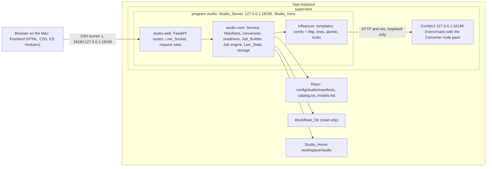
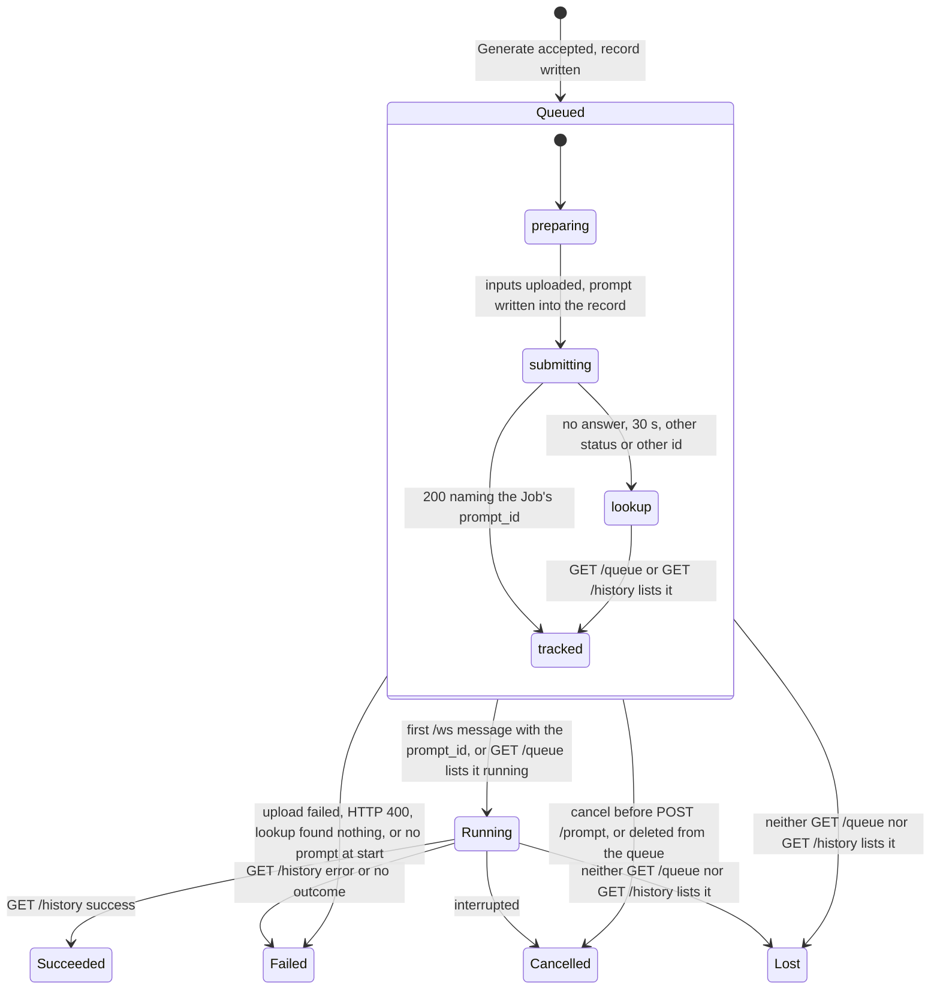
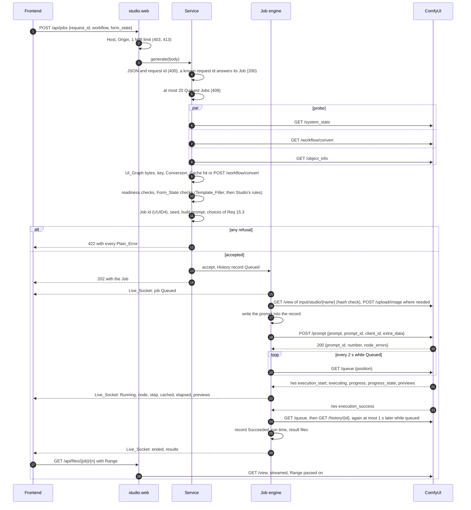
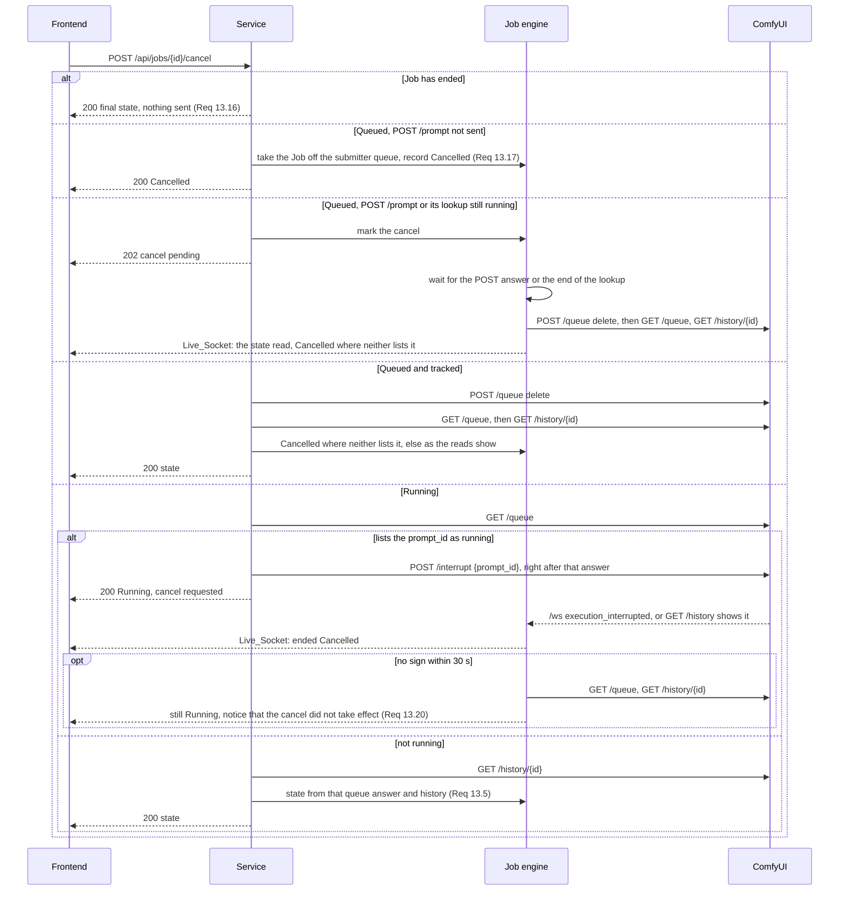
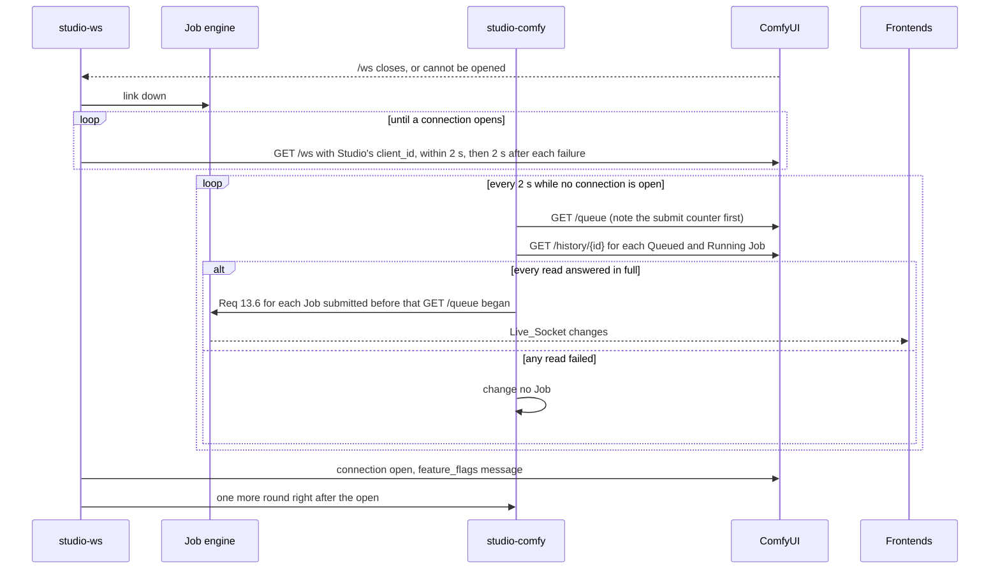
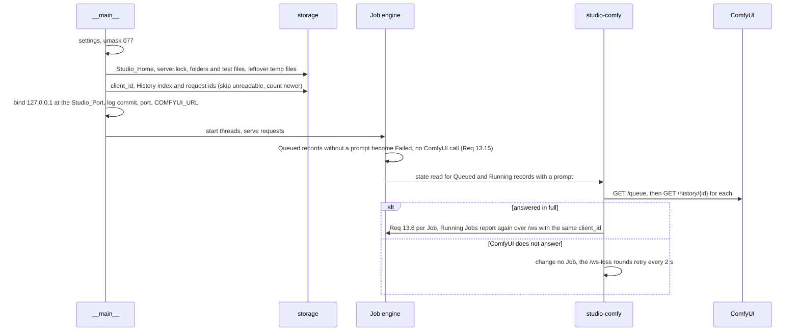

# Design Document: studio

## Overview

Studio is a web front end for the ComfyUI of a Vast.ai Instance made from the stock ComfyUI template. It runs beside ComfyUI as the supervisor program `studio`, listens only on 127.0.0.1:18190, and reaches ComfyUI only through its API on 127.0.0.1:18188. It runs the UI-format graphs this repo installs: ComfyUI's Converter endpoint turns each graph into API format, a committed Manifest says which node inputs each form control sets, and the Job_Builder applies the user's Form_State to a copy of the converted graph. The user opens Studio through an SSH tunnel, picks a workflow and a model, drops input images, stacks LoRAs, sets the controls, presses Generate, watches progress and previews, and takes the results from the Gallery. History, Presets and input images live in Studio_Home on /workspace, so a Vast volume keeps them.

This design follows the approved requirements (Requirements 1 to 27) and the repo's conventions: pinned and hashed Python packages, idempotent bash that passes `bash -n` under bash 3.2 and ShellCheck, atomic writes, loopback-only clients, and tests that run offline in `scripts/check.sh`. None of the proposals P-1 to P-7 (Requirement 23) is approved, so the default design depends on none of them and edits none of `scripts/stock-setup.sh`, `scripts/common.sh`, `scripts/vast-provision.sh`, `scripts/provision.sh`, `scripts/install-workflow.sh`, `config/nodes.txt`, `config/catalog.txt`, `config/models.list` or `tests/requirements-check.txt`. Studio installs with `bash scripts/studio.sh install` and opens through the Tunnel_Command. Every other default under "Decisions for review" applies.

The design was written from the repo and from the sources the requirements already verified; no new web research was done. Facts that need an Instance stay in the requirements' Open items, which this document cites by number.

### What the repo shows

Reading the reused modules, the fakes and the test harness gave these facts, which the design builds on:

1. The influencer package (`scripts/influencer/`), the tests, `scripts/check.sh` and `tests/requirements-check.txt` exist only in the working tree: the last commit (`a746fda`, v6) holds none of them, and several tracked scripts carry uncommitted edits. Requirement 5 criterion 6 and Requirement 26 criterion 11 refer to "the last Repo commit before Studio"; this design assumes the ai-influencer-pipeline's files are committed before Studio lands, so that commit holds the tests and pins those criteria name.
2. The modules Studio reuses import only the standard library and each other: `templates` (errors), `comfy` (env, http, timing), `http` (errors, timing), `timing`, `env` (errors), `errors`, `atomic`, `locks` and `lines` (errors). `ids` does not: it imports `calendar_io`, which imports `yamlio` and so PyYAML. Studio imports no module that reaches `yaml`, so the Studio_Venv needs no package for the reused code. The canonical JSON of ai-influencer-pipeline design §A2 is one `json.dumps` call, which the Manifest_Printer makes itself instead of importing `ids.canonical`. Importing `influencer` runs its version guard (exit status 2 below Python 3.10), which CPython 3.10 to 3.14 pass.
3. `templates.parse_template` cannot make the Template of Requirement 5 criterion 2: `meta.output_node` must name a node of the prompt, and a lora_list `source` must link to a node the prompt holds. `Template` and `Placeholder` are public frozen dataclasses, and `check_values` and `fill` read only `name`, `placeholders`, `used` and `prompt` (and `lora_lists`, derived from `placeholders`), so Studio builds them directly. `check_values` compares every `int` and `float` value with its placeholder's `min` and `max`, which must therefore be numbers: Studio passes −∞ and +∞ where neither the Manifest nor /object_info gives a bound.
4. `fill` numbers the loaders of a Template's only lora_list `901`, `902`, …, links loader 1 to the declared source and loader k to `[str(900 + k − 1), 0]`, and returns them after the Template's own nodes, in entry order.
5. `ComfyClient.submit` raises `Rejected` only for a 400 whose JSON holds `node_errors` or `error`, turns every other non-2xx status into `StatusError`, and drops a 200 answer's `node_errors`; `queue()` drops the queue numbers; `parse_history` keeps only `images` and `gifs` and the exception message; `LoopbackClient.request` reads each whole answer, up to 64 MiB; and nothing in the package speaks WebSocket. These are the gaps Requirement 5 criterion 3 lists; component C20 fills them with new methods only. `comfy.is_prompt_id` already implements "a lowercase UUID" (Requirement 13 criterion 11).
6. `atomic.write_atomic` (temp file in the target's folder, fsync, rename, folder fsync) is the write of Requirement 19 criterion 2, but it creates its temp file with mode 0666 less the umask, as `locks.ProcessLock` creates its lock file. Studio sets the umask to 077 before it creates anything, which makes every file 0600 and every folder 0700 from its creation (Requirement 19 criterion 8) without a change to either module. `ProcessLock` (flock, holder PID in the file, released by the kernel when the holder exits) is the lock of Requirement 19 criterion 9.
7. `influencer.lines` reads `catalog.txt` and `models.list` as the bash does (`parse_catalog`, `parse_models`, `ModelLine.ids`); Studio reads both through it.
8. `timing.Timing` has no field for the Converter's 30 s limit. Studio passes explicit time limits to the new client calls and leaves `Timing` unchanged.
9. The Fake_ComfyUI's base (`tests/fakes/_server.py`) answers each request from one `handle()` call with a status, a body and one content type. Byte ranges of GET /view need more headers, and /ws needs the connection after a 101 answer, so the base gains an optional header field on `Response` and an upgrade hook; both are additions that leave the existing endpoints, script API and tests as they are (Requirement 26 criterion 6).

### Key design decisions

1. **Two layers in one process** (Req 24.1, 26.11–26.13). Everything that decides something lives in the Studio_Core package `studio.core`, which imports only the standard library, the influencer modules of finding 2 and Pillow. The FastAPI layer `studio.web` turns HTTP requests and Live_Socket connections into calls on one `Service` object, turns its answers into HTTP, and applies request rules that the Studio_Core defines as pure functions (Host, Origin, headers, body limits, ranges, attachment names). The Check_Suite therefore tests every rule in `.check-venv` without P-6, and only the wiring is left to the Instance checks of Requirement 27 criterion 14.
2. **A synchronous core with named threads** (Req 14.5, 21.11). The ComfyUI_Client blocks, so the Studio_Core does too: a submitter, a /ws reader, a ComfyUI reader and a ticker thread, plus FastAPI's thread pool for requests. The one bridge to asyncio is the Live_State Hub, whose subscriptions wake their Live_Socket's sender task through `loop.call_soon_threadsafe`.
3. **Reuse through the public surface, never a copy** (Req 5). Form_State values are checked with `templates.check_values` on a check Template built from the Manifest, and Chain_Loaders are made with `templates.fill` on one node-less chain Template per non-empty LoRA_Stack, renumbered to Studio's ids. The ComfyUI_Client keeps every existing call as it is and gains new methods (C20). Studio also reuses `lines`, `atomic.write_atomic`, `locks.ProcessLock`, `errors.Problem`, `comfy.is_prompt_id` and `comfy.expand_autogrow` (through `object_info()`).
4. **The converted graph is the source, the Manifest a map** (Req 3, 4, 12). Studio stores no second copy of a graph. The Conversion_Cache holds the Converter's answer under the four-part key, one file per UI_Graph file name; a changed key part converts again, and concurrent needs of one key share one conversion.
5. **Readiness is decided, not remembered** (Req 1.3, 4.7). Each workflow list request, Form opening or refresh, and Generate request makes one probe (GET /system_stats, GET /workflow/convert and GET /object_info, run in parallel) and runs every readiness check against that one /object_info answer. Only Converted_Graphs are cached.
6. **A pure, ordered Job_Builder** (Req 5.7, 11.8, 12). A prompt is a function of the Manifest, the Converted_Graph, /object_info, the checked Form_State, the seed and the Job id, built in the six steps of Requirement 12 criterion 9, with no I/O, clock or randomness. Inserted nodes take ids above every id of the Converted_Graph.
7. **Accept first, submit behind** (Req 13). Every refusal happens before a Job exists, in one answer. An accepted Generate request is answered once its History record says Queued; uploads and POST /prompt then run on one first-in, first-out submitter thread, so ComfyUI receives Jobs in acceptance order, and the prompt enters the record just before POST /prompt.
8. **State comes from ComfyUI's own records** (Req 13.6, 14.4, 14.6). /ws messages drive the Live_State, but a Job ends only after GET /queue and then GET /history have been read as Requirement 13 criterion 6 states. While /ws is down, rounds every 2 s read the same two sources; a round applies all or nothing and skips Jobs submitted after its GET /queue read began.
9. **One file per Job, per workflow's Presets and per input** (Req 17, 18, 19). Every write goes through `write_atomic` under umask 077; a lock per Job and per workflow serializes read-modify-write; in-memory indexes are rebuilt from the files at start.
10. **Exact numbers** (Req 2.4, 3.8, 8.6, 11.7, 11.16). Python ints and floats carry the values; step and offset checks run on `Fraction`s of each number's shortest decimal form; seeds are decimal strings in every answer, request, History record and Preset; the Frontend steps LoRA strengths in whole hundredths, so 0.28 + 0.01 is sent as 0.29.
11. **Loopback only, on Studio's own socket** (Req 20.1, 20.2, 20.14). The Studio_Server binds 127.0.0.1:<Studio_Port> itself and hands the socket to uvicorn, so neither the address nor the bind error is uvicorn's. Every ComfyUI connection goes through the ComfyUI_Client's loopback rules, the /ws connection included.
12. **No build step and no library in the Frontend** (Req 24.2). Plain ES modules served as committed, DOM built with `textContent` only, native `<dialog>` for confirmations.
13. **An installer beside the existing scripts** (Req 21, 22, 23). `scripts/studio.sh` sources `scripts/common.sh` only for `say`, `warn` and `have_supervisor`, and changes no existing script, config list or check pin.

## Architecture

### Where each part runs



Studio places files in ComfyUI's folders only through the ComfyUI_API: uploads land in `ComfyUI/input/studio/`, results in `ComfyUI/output/studio/<Manifest name>/`. Vast's Portal serves Studio only once P-4 or P-5 is approved; the default design has no Portal entry.

### Module layout

New files are marked **new**, changed files **changed**.

| Path | Status | Purpose |
|---|---|---|
| `scripts/studio/__init__.py` | new | package; Python ≥ 3.10 guard |
| `scripts/studio/__main__.py` | new | `python -m studio`: start checks, socket bind, uvicorn (C1) |
| `scripts/studio/core/` | new | Studio_Core, no web framework (C1–C18) |
| `scripts/studio/web/app.py`, `asgi.py` | new | FastAPI routes, Live_Socket, request-rule middleware (C21) |
| `scripts/studio/static/` | new | Frontend (C22) |
| `scripts/influencer/comfy.py`, `http.py` | changed: additions only | ComfyUI_Client additions (C20) |
| `scripts/influencer/templates.py`, `lines.py`, `atomic.py`, `locks.py`, `errors.py`, `env.py`, `timing.py` | unchanged | reused (C19) |
| `config/studio/manifests/*.json` | new | the seven first-version Manifests (C23, M1) |
| `config/studio/requirements.txt` | new | Studio_Requirements (C24) |
| `scripts/studio.sh` | new | Studio_Installer (C25) |
| `tests/studio/test_studio_*.py`, `tests/strategies_studio.py`, `tests/fixtures/studio/` | new | Studio's tests, strategies and fixtures (Req 26.9) |
| `tests/fakes/comfy.py`, `tests/fakes/_server.py` | changed: additions only | Fake_ComfyUI: /workflow/convert, /view, POST /queue `delete`, /ws (Req 26.6) |
| `REFERENCE.md`, `README.md`, `CHANGELOG.md` | changed | Studio section, layout rows, version entry (Req 25) |
| `scripts/stock-setup.sh`, `common.sh`, `vast-provision.sh`, `provision.sh`, `install-workflow.sh`; `config/nodes.txt`, `catalog.txt`, `models.list`; `tests/requirements-check.txt` | unchanged | P-1 to P-7 are not approved |

The Studio_Core modules, each described under Components:

```
scripts/studio/core/
  settings.py    C1   environment, paths, start checks, repo commit
  jsonio.py      C2   strict JSON, canonical JSON, exact numbers
  catalog.py     C3   Catalog order and descriptions; Install_Names and Providing_Ids
  manifest.py    C4   Manifest model, Manifest_Loader, Manifest_Printer
  objectinfo.py  C5   input specs, choices, bounds, outputs, output nodes, class digest
  graphs.py      C6   Converted_Graph helpers, Node_Selector resolution, UI_Graph classes
  conversion.py  C7   Converter calls, Conversion_Cache, single flight
  readiness.py   C8   probe and readiness decision
  forms.py       C9   Form description, prefill, Form_State checks
  builder.py     C10  Job_Builder
  plain.py       C11  Plain_Errors and Node_Labels
  storage.py     C12  Studio_Home, History, Presets, Stored_Inputs, client_id
  images.py      C13  input image checks (Pillow)
  jobs.py        C14  Job engine: accept, submit, track, cancel, state reading
  comfyws.py     C15  /ws session: reconnect, messages, preview frames
  live.py        C16  Live_State and Hub
  httprules.py   C17  Host, Origin, headers, limits, attachment names, media types, ranges
  service.py     C18  the facade the web layer calls
```

The Studio_Service runs `<Studio_Home>/venv/bin/python -m studio` in `<Repo>/scripts` (Req 21.7), so `studio` and `influencer` load from the checkout and every other package from the Studio_Venv. The WebSocket protocol client is an addition to `influencer/http.py`, because Requirement 5 criterion 3 and Requirement 26 criterion 15 make it part of the ComfyUI_Client; the /ws session built on it (reconnects, ComfyUI's messages and preview frames) is `studio/core/comfyws.py`.

### Threads and lifecycle

| Thread | Work |
|---|---|
| main | start checks (C1), then uvicorn's event loop: the async part of every route and every Live_Socket |
| FastAPI thread pool | every route handler (plain `def`), so `Service` calls may block on ComfyUI |
| `studio-submit` | the first-in, first-out queue of accepted Jobs: input uploads, prompt write, POST /prompt |
| `studio-ws` | the /ws session: connect, read, hand messages and frames to the Job engine, reconnect |
| `studio-comfy` | ComfyUI reads the Job engine schedules: settle reads after a terminal /ws message, rounds while /ws is down, queue positions, the lookups of Req 13.13, deferred cancels, the 30 s check of Req 13.20, start-up reconciliation |
| `studio-tick` | once a second: elapsed time of Running Jobs, and due timed tasks |

**Start** (Req 19.6, 19.7, 19.9, 19.10, 20.14, 20.15, 21.5, 21.12): read STUDIO_HOME, STUDIO_PORT, STUDIO_ALLOWED_HOSTS and COMFYUI_URL, checking the first three; set the umask to 077; create Studio_Home when missing; take `server.lock`; create the other folders and write, flush and delete a test file in each; delete leftover temp files; read or create the client_id; read every History record into the index; bind 127.0.0.1:<Studio_Port>; log the start line; start uvicorn. A failing check logs one line and exits with status 1, all within 10 s of the process start. The lifespan start then starts the threads, and `studio-comfy` reconciles the Jobs of the History while requests are already served.

**Stop** (Req 21.11): on SIGTERM uvicorn stops accepting requests and closes every Live_Socket; the lifespan shutdown sets the stop flag, closes the /ws socket, lets a file write in progress finish (a `write_atomic` call is short), abandons ComfyUI requests in flight (their threads are daemons), and the process exits with status 0 within 10 s. uvicorn's graceful-shutdown timeout is 5 s.

### Job states



The phases inside Queued are the Job engine's own and never reach the History. Any final Job_State can also follow Queued directly when GET /history is the first source to show the Job (a Job that ran while /ws was down).

### Sequence: Generate to result



A 400 answer to POST /prompt records the Job as Failed with its Plain_Error (Req 15.1); an ambiguous answer starts the 30 s lookup of Req 13.13; an upload failure records Failed before any POST /prompt (Req 7.13).

### Sequence: cancel



A cancel request to ComfyUI that gets no connection or no answer ends the cancel: the Job keeps its Job_State and the answer is 503 with the Plain_Error of Requirement 1 criterion 7 (Req 13.18). Studio sends POST /queue `delete` and POST /interrupt only for its own prompt_ids and only for a user's cancel (Req 13.19).

### Sequence: /ws loss and polling



### Sequence: start-up reconciliation



## Components and Interfaces

### C1. Settings and start (`studio/__main__.py`, `studio/core/settings.py`)

```python
@dataclass(frozen=True)
class Settings:
    home: Path                           # STUDIO_HOME, absolute; default /workspace/studio
    port: int                            # STUDIO_PORT, 1-65535; default 18190
    comfyui_url: str                     # COMFYUI_URL; default env.DEFAULT_COMFYUI_URL
    allowed_hosts: tuple[HostRule, ...]  # STUDIO_ALLOWED_HOSTS (C17)
    repo: Path                           # two levels above scripts/studio/
    workflows_dir: Path                  # /workspace/comfyui-user/default/workflows

def read_settings(environ: Mapping[str, str]) -> Settings   # StartError naming variable, value and rule
def prepare_home(settings: Settings) -> HomeLock            # umask, folders, lock, test files, temp cleanup
def repo_commit(repo: Path) -> str                          # reads .git directly; "unknown" outside a checkout
```

`__main__` turns a `StartError` or `locks.LockHeld` into one log line (the path, and the holder's PID where the lock file records one) and exit status 1. The Workflows_Dir and the Repo paths are constructor arguments of every component, so tests point them at temp folders; the Studio_Service's environment carries no other path (Req 21.8). A COMFYUI_URL that the LoopbackClient refuses is no start failure: the probe reports it, and every workflow is not Ready with a Plain_Error naming COMFYUI_URL and the refusal (Req 4.7). When Studio_Home's real path lies outside /workspace, the start logs a warning and `Service.status()` repeats it (Req 19.11).

### C2. JSON and exact numbers (`jsonio.py`)

```python
def parse_strict(data: bytes, where: str) -> Any      # JsonError(line, column, reason)
def dumps(value: Any) -> bytes                        # answers and files: UTF-8, non-ASCII kept
def canonical(value: Any) -> bytes                    # §A2: sort_keys, separators (",", ":"), ensure_ascii=False
def json_equal(a: Any, b: Any) -> bool                # same kinds: bool, int and float differ
def exact(number: int | float) -> Fraction            # Fraction(Decimal(repr(x))) for a float
def on_step(value, step, offset) -> bool              # (exact(value) - exact(offset)) / exact(step) is whole
def hundredths(number: int | float) -> int | None     # 100 × exact value, None when not whole
```

`parse_strict` refuses what Requirement 2 criterion 6 and Requirement 20 criterion 12 refuse: bytes that are not UTF-8 (a leading byte-order mark is skipped, as `templates.load_template` skips it), a key given twice in one object (`object_pairs_hook`), NaN and Infinity (`parse_constant`), a float literal that overflows to infinity (`parse_float`), and any string holding a lone surrogate. Its error names the line and column. Python's `json` reads integers of any size exactly and floats as the nearest double, whose `repr` is the shortest form, so storing and reading back keeps every value (Req 3.8, 17.5).

### C3. Catalog and models.list (`catalog.py`)

```python
@dataclass(frozen=True)
class CatalogView:
    ids: tuple[str, ...]                          # Catalog_Ids in Catalog order
    descriptions: Mapping[str, str]
    providers: Mapping[str, frozenset[str]]       # Install_Name -> Providing_Ids

def read_catalog(config_dir: Path) -> CatalogView     # lines.parse_catalog + lines.parse_models
def install_name(line: lines.ModelLine) -> str | None
def providing_ids(view: CatalogView, file_name: str, first: str) -> tuple[str, ...]
```

`install_name` gives the file name, prefixed with the part of `subdir` below its first folder and a `/` where that part is not empty; lines of kind `workflow` install no loader file and give None. A line's Providing_Ids are `ModelLine.ids`, or `global` for an untagged line. `providing_ids` orders them with the Manifest's Catalog_Id first where it is one and the rest in Catalog order, so `qwen_image_vae.safetensors` on the edit-2509 Form gives edit-2509, krea2, krea-style (Req 6.6, 15.2). Both files are read again at each workflow list request (Req 1.3).

### C4. Manifest_Loader and Manifest_Printer (`manifest.py`)

```python
@dataclass(frozen=True)
class Selector:   title: str | None; class_type: str | None; node_id: str | None
@dataclass(frozen=True)
class Binding:    node: Selector; input: str
@dataclass(frozen=True)
class Control:    id: str; kind: str; label: str; bindings: tuple[Binding, ...]
                  width: tuple[Binding, ...]; height: tuple[Binding, ...]      # size only
                  default: Any; min: Number | None; max: Number | None
                  step: Number | None; offset: Number; max_pixels: int | None; path: str
@dataclass(frozen=True)
class ImageSlot:  id: str; label: str; required: bool; loader_class: str; loader_input: str
                  node: Selector | None; consumers: tuple[Binding, ...]; path: str
@dataclass(frozen=True)
class LoraTarget: id: str; label: str; node: Selector; output: int; loader_class: str
                  model_input: str; name_input: str; strength_input: str; path: str
@dataclass(frozen=True)
class GraphLora:  id: str; label: str; node: Selector; switch: Binding | None; off: bool | None; path: str
@dataclass(frozen=True)
class Manifest:
    name: str; label: str; catalog_id: str; graph: str; file: str
    result_nodes: tuple[Selector, ...]; remove_nodes: tuple[Selector, ...]
    controls: tuple[Control, ...]; image_slots: tuple[ImageSlot, ...]
    lora_targets: tuple[LoraTarget, ...]; graph_loras: tuple[GraphLora, ...]
    document: Mapping[str, Any]       # the checked JSON document
    sha256: str                       # SHA-256 of canonical(document) (Req 17.1)
    seed_control: Control | None

def load_manifests(folder: Path, catalog: CatalogView) -> ManifestSet   # .accepted, .rejected
def parse_manifest(data: bytes, file_name: str, catalog: CatalogView) -> Manifest
def print_manifest(manifest: Manifest) -> bytes                         # jsonio.canonical(document)
```

`load_manifests` takes the regular files directly in `config/studio/manifests/` whose names end in `.json`, in byte order. `parse_manifest` checks every rule of Requirement 2 and Requirement 11 criterion 11 from the file and the Catalog alone and raises one `ManifestError(file, problems)`; each problem holds a key path (`controls[3].step`, positions from 1) and the rule. A rejected file changes nothing for the others. `path` in each entry is its key path, used in Plain_Errors (Req 4.3, 4.5). Default loader classes are filled in here: LoadImage with `image` for an Image_Slot, LoraLoaderModelOnly with `model`, `lora_name` and `strength_model` for a LoRA_Target (Req 2.9, 2.10, 8.6). The format is M1.

### C5. /object_info helpers (`objectinfo.py`)

```python
@dataclass(frozen=True)
class InputSpec:
    section: str                        # "required" or "optional"
    type: str                           # "INT", "FLOAT", "STRING", "BOOLEAN", "IMAGE", ..., "COMBO" for a list
    choices: tuple[str, ...] | None     # either list form of Req 4.4
    options: Mapping[str, Any]          # min, max, control_after_generate, ...

def input_spec(info: Mapping, class_type: str, name: str) -> InputSpec | None
def outputs(info: Mapping, class_type: str) -> tuple[str, ...] | None
def is_output_node(info: Mapping, class_type: str) -> bool
def bounds(spec: InputSpec) -> tuple[Number | None, Number | None]
def classes_digest(info: Mapping, classes: Iterable[str]) -> str    # Req 3.2, fourth key part
```

`info` is `ComfyClient.object_info()`, whose inputs are already expanded with `expand_autogrow` (names such as `images.image0`). `classes_digest` is the SHA-256 of `canonical({class: entry or None})` over the sorted classes, so a class that appears later changes the digest.

### C6. Graphs and Node_Selectors (`graphs.py`)

```python
def is_link(value: Any) -> bool                  # [node id: str, output index: int >= 0]
def resolve(selector: Selector, graph: Mapping) -> Resolved
    # Resolved.node_id | None, .matched (ids by title and class), .id_reasons
def takers(graph: Mapping, node_id: str, output: int) -> list[tuple[str, str]]   # (node, input) linked to it
def find_cycle(graph: Mapping) -> list[str] | None
def needed_by_outputs(graph: Mapping, info: Mapping) -> frozenset[str]   # nodes some Output_Node depends on
def ui_classes(ui_document: Mapping) -> frozenset[str]
def id_base(graph: Mapping) -> int               # 1 + the largest whole-number first part of any node id
```

`resolve` implements Requirement 4 criteria 1 and 2: titles compared case-sensitively after trimming both, class types exactly, nodes inside subgraphs included; the node id is a fallback only for no match, or for a tie it breaks. `ui_classes` collects the `type` of every node of the UI_Graph and of `definitions.subgraphs[].nodes`, less the ids of the subgraphs themselves.

### C7. Conversion and Conversion_Cache (`conversion.py`)

```python
@dataclass(frozen=True)
class Key:
    graph_sha256: str; converter_version: str; comfyui_version: str; classes_sha256: str

class Conversions:
    def __init__(self, client: ComfyClient, cache_dir: Path, convert_s: float = 30.0): ...
    def get(self, file_name: str, graph_bytes: bytes, key: Key) -> Converted | ConversionFailure
```

`get` reads `cache/conversions/<SHA-256 of the file name>.json` (M2); an entry that reads back in the required shape with an equal key is used without POST /workflow/convert, also after a restart (Req 3.3). Otherwise it sends the file's bytes unchanged (Req 3.1) and checks the answer (Req 3.6): HTTP 200 and a JSON object of one or more nodes, each with a `class_type` string and an `inputs` object. A good answer replaces the entry through `write_atomic`; a failure changes nothing and becomes the Plain_Error of Requirement 3 criterion 6 (with the file size for HTTP 413). One in-flight table keyed by (file name, key) makes concurrent callers wait for the same outcome (Req 3.11). Callers never change a Converted_Graph; the Job_Builder works on a deep copy (Req 12.9).

### C8. Readiness (`readiness.py`)

```python
@dataclass(frozen=True)
class Probe:
    comfyui_version: str | CallFailure
    converter: ConverterInfo | CallFailure
    object_info: Mapping | CallFailure

@dataclass(frozen=True)
class Decision:
    ready: bool
    reasons: tuple[PlainError, ...]         # ordered as Req 15.13
    graph_sha256: str | None
    key: Key | None
    converted: Mapping | None
    object_info: Mapping | None
    resolved: Mapping[str, str]             # entry key path -> node id
    versions: Versions                      # Manifest SHA-256, UI_Graph SHA-256, Converter, ComfyUI

def probe(client: ComfyClient) -> Probe                     # the three calls in parallel threads
def decide(manifest: Manifest, probe: Probe, workflows_dir: Path, conversions: Conversions) -> Decision
```

`decide` stops at the first failure that leaves nothing to check, and otherwise runs every check:

| Order | Check | Requirement |
|---|---|---|
| 1 | every probe call without connection or answer: the one reason "ComfyUI does not answer at COMFYUI_URL" | 1.7 |
| 2 | GET /workflow/convert answered, but not 200 with a name and version | 3.5 |
| 3 | another probe call failed or was refused | 3.10 |
| 4 | UI_Graph file unreadable, not JSON (line and column), or without a `nodes` list | 3.9 |
| 5 | conversion failed | 3.6 |
| 6 | a Node_Selector selects no node | 4.3 |
| 7 | Bindings: class listed, input listed, type fits the kind, one choice list per choice or model Control, no input bound twice | 4.4, 4.5 |
| 8 | node classes /object_info does not list, removal-listed nodes excepted | 4.6 |
| 9 | Image_Slots: Consumer_Inputs are IMAGE inputs, optional slots feed only optional inputs; the Image_Loader class is listed with its file input and an IMAGE output | 7.11 |
| 10 | LoRA_Targets, checks (a) to (e) | 8.11 |
| 11 | Graph_LoRAs: loader outputs and inputs, `lora_name` holds a file name, the switch is a BOOLEAN value on another node | 9.6 |
| 12 | a Control's first Binding holds a link or no input, and the Control has no default | 10.3 |
| 13 | links into removed nodes, and removed nodes that other entries select | 12.3 |
| 14 | Result_Nodes are Output_Nodes with a STRING `filename_prefix` that no Binding sets | 12.10 |

A check whose node did not resolve is skipped, since check 6 already reports the selector. The Image_Loader class check of row 9 is this design's addition under Requirement 7 criterion 11: without it, a Manifest naming a missing class for a new Image_Loader would break the graph property of Requirement 12 criterion 7.

### C9. Form description and Form_State checks (`forms.py`)

```python
def describe(manifest: Manifest, decision: Decision, catalog: CatalogView) -> FormDescription   # M8
def prefill(manifest: Manifest, decision: Decision) -> FormState          # Req 6.2, 9.2, 10.2
def control_limits(control: Control, decision: Decision) -> ControlLimits # Glossary: Control_Limits
def check(manifest: Manifest, decision: Decision, form_state: Any, inputs: InputStore) -> Checked
    # Checked.values (typed Form_State, seed as int) or Checked.problems (Plain_Errors)
```

`control_limits` takes the highest minimum and the lowest maximum of the Manifest and of every Binding's /object_info spec (for a size Control, width Bindings for the width and height Bindings for the height), the Manifest's step, offset and maximum pixel count, the choices of the first Binding for a choice Control, and 20,000 code points for a text Control. The seed range is the same intersection clipped to 0 and 18446744073709551615 (Req 11.7).

`check` collects every finding in one pass and returns them together (Req 5.9, 10.6, 11.15, 12.8):

1. Shape: the Form_State is an object of exactly `controls`, `image_slots`, `loras`, `graph_loras`, and `randomize` when the Manifest declares a seed Control (Req 11.13); a size value is an object of exactly `width` and `height`.
2. The seed text: one or more digits without a sign, a point, an exponent, white space or a leading zero ("0" itself allowed), within the seed range (Req 11.14, 11.15). A malformed seed is left out of step 3, so it is reported once.
3. `templates.check_values(check_template, values)` with the placeholders below. Each `Problem.field` maps back to its Form item: a placeholder that is not declared is an unknown id, a declared one without a value a missing id, anything else the rule the Filler's `reason` states.
4. Studio's own rules: steps and offsets (Req 2.4), the maximum pixel count, the text length, a choice Control's value among its choices, LoRA strengths as whole hundredths (Req 8.10), and the Image_Slots: every declared slot present, no unknown slot, a required slot filled, and every named Stored_Input held in the Studio_Data_Dir (Req 7.14).

The check Template is `Template(name=<Manifest name>, kind="still", timeout_s=900, placeholders=…, meta={}, prompt={}, used=<every name>, path=<Manifest file>)`; neither `check_values` nor `fill` reads `kind`, `timeout_s`, `meta` or `path`, so they carry valid, unused values. Placeholder names keep to the Filler's alphabet and cannot collide, because entry ids are unique across a Manifest (Req 2.11):

| Form item | Placeholder | Filler type and bounds |
|---|---|---|
| text or choice Control `x` | `c_x` | `text` |
| model Control `x` | `c_x` | `file` |
| integer or frame count Control `x` | `c_x` | `int`, Control_Limits' min and max, else −∞ and +∞ |
| seed Control `x` | `c_x` | `int`, the seed range |
| float Control `x` | `c_x` | `float`, Control_Limits' min and max, else −∞ and +∞ |
| boolean Control `x` | `c_x` | `bool` |
| size Control `x` | `w_x`, `h_x` | `int`, the width's and the height's bounds |
| Graph_LoRA `x` | `g_x` | `bool` |
| LoRA_Target `x` | `l_x` | `lora_list`, `max_items` 16 (`templates.MAX_LORAS`), strengths −2 to 2 |
| the randomize switch | `randomize` | `bool` |

A choice Control's value outside its choices gives one Plain_Error that names the Control, the value, the node's Node_Label and the input, serving Requirement 10 criterion 6 and Requirement 15 criterion 3 at once (Req 15.13 gives each distinct Plain_Error once).

### C10. Job_Builder (`builder.py`)

```python
@dataclass(frozen=True)
class Built:
    prompt: dict[str, Any]
    roles: Mapping[str, NodeRole]   # inserted id -> ("chain_loader", target id, entry, file) | ("image_loader", slot id)
    removed: frozenset[str]

def build(manifest: Manifest, decision: Decision, form: Checked, seed: int | None, job_id: str) -> Built
def outside_choices(built: Built, info: Mapping) -> list[ChoiceFinding]    # Req 15.3
```

`build` deep-copies the Converted_Graph and applies, in this order (Req 12.9):

1. **Removal**: delete every node the Manifest lists for removal (Req 12.2).
2. **LoRA chains**: for each LoRA_Target at Manifest position t (from 1) with a non-empty LoRA_Stack, call `templates.fill` on a chain Template with no node and one `lora_list` placeholder `chain`, whose `source` is the Target_Output, `loader` the Chain_Loader class and `loader_inputs` `((model, "$prev"), (name, "$name"), (strength, "$strength"))`; strengths are passed as floats of their whole hundredths. The k-th loader `fill` returns becomes node `str(B + 16·(t − 1) + (k − 1))`, B being `id_base(Converted_Graph)`. The `$prev` input of loaders 2 to n, `[str(900 + k − 1), 0]` as `fill` gives it, becomes the Studio id of loader k − 1; loader 1's `$prev`, the Target_Output, stays as it is, even where the graph holds a node numbered 901 to 916. Every other input that took the Target_Output is relinked to output 0 of the last Chain_Loader (Req 5.2, 8.5, 8.6).
3. **Graph_LoRAs**: set each switch Binding to the on or off value (Req 9.3); remove each off Graph_LoRA's loader and relink the takers of its output 0 and output 1 to the nearest kept output upstream of its `model` and `clip` inputs, passing over other removed loaders (Req 9.4).
4. **Image_Slots**: a filled slot sets `studio/<Stored_Input name>` on its existing loader's file input, or adds an Image_Loader node `str(B + 1024 + (s − 1))` for slot position s and links every Consumer_Input to that node's first IMAGE output; an empty optional slot removes its existing loader, and deletes every input key that took that loader's outputs and every Consumer_Input key (Req 7.8, 7.9).
5. **Controls**: every Binding of every non-seed Control takes the Control's value, replacing a link; a size Control's width and height go to their Bindings; every seed Binding takes the Job's seed as a JSON integer (Req 10.7, 11.5). Bindings on removed nodes are skipped.
6. **Result_Nodes**: `filename_prefix` becomes `studio/<Manifest name>/<Job id>` (Req 12.4).

The inserted ids stay clear of every Converted_Graph id, removed nodes included, depend only on the graph's ids, the entry's Manifest position and the LoRA_Entry's position, and never collide with each other: at most 64 LoRA_Targets of 16 entries fill B to B + 1023, and at most 64 Image_Slots fill B + 1024 to B + 1087 (Req 5.7). Everything else keeps its id, keys, JSON types and values (Req 12.5). `outside_choices` lists every input of a node some Output_Node depends on whose value lies outside the choices /object_info gives, the `studio/…` image references excepted.

### C11. Plain_Errors and Node_Labels (`plain.py`)

```python
@dataclass(frozen=True)
class PlainError:
    kind: str              # stable code for tests and the Frontend, e.g. "not_installed"
    message: str           # the plain-English text: workflow, Node_Label, file or value, next step
    target: str            # where the Frontend shows it (M8)
    next_step: str | None
    order: tuple[int, ...] # (0, node_errors position) for ComfyUI's, (1, requirement, criterion, entry) for Studio's
    details: str | None    # ComfyUI's full error answer as text (Req 15.5, 15.6)

def node_label(node_id: str, prompt: Mapping, roles: Mapping, manifest: Manifest | None) -> str
def ordered(errors: Iterable[PlainError]) -> tuple[PlainError, ...]     # distinct, in Req 15.13's order
def quote(text: str) -> str                                            # first 2,000 code points, marked (Req 15.12)
```

One factory per error kind builds each message from the facts it needs (for example `not_installed(file, node label, providing ids, lora=True)` for Requirement 15 criterion 2). `node_label` gives a graph node's `_meta.title`, class type and id; an inserted node's class and the Form item it serves, never its id (a Chain_Loader by file, LoRA_Target label and entry number; an Image_Loader by slot label); any other id as ComfyUI sent it.

### C12. Storage (`storage.py`)

```python
class HistoryStore:
    def load(self) -> HistoryIndex                      # summaries, request ids, skipped files, newer count
    def create(self, record: dict) -> None
    def update(self, job_id: str, changes: Mapping) -> dict
    def read(self, job_id: str) -> dict
    def delete(self, job_id: str) -> tuple[str, ...]    # the Stored_Input ids it may delete (Req 17.6)
class PresetStore:
    def list(self, workflow: str) -> PresetList
    def save(self, workflow: str, name: str, form_state: Mapping, replace: bool) -> PresetList
    def delete(self, workflow: str, preset_id: str) -> PresetList
class InputStore:
    def put(self, data: bytes, info: ImageInfo) -> StoredInput
    def read(self, input_id: str) -> bytes
    def exists(self, input_id: str) -> bool
    def delete(self, input_ids: Iterable[str]) -> None
def client_id(data_dir: Path) -> str                     # read, or create once (Req 5.10)
def remove_temp_files(folders: Iterable[Path]) -> int    # write_atomic's temp names only (Req 19.10)
def disk_use(home: Path) -> DiskUse                      # Stored_Inputs and Conversion_Cache (Req 19.12)
```

Every write is `write_atomic` (Req 19.2). Each Job's record has its own lock, so concurrent state changes of different Jobs never touch one file (Req 17.1); each workflow's Preset file has its own lock, so concurrent saves and deletes act as if handled one at a time (Req 18.5). A record or Preset file that cannot be read or parsed is left alone, skipped, and reported with its path (Req 19.4); a newer History_Version or Preset format version is left out and counted (Req 17.8, 19.15). `HistoryStore.delete` withholds every Stored_Input while such a file exists (Req 17.6). Names are Studio-made (M6), and Preset names are data inside the workflow's file (Req 19.3).

### C13. Input images (`images.py`)

```python
@dataclass(frozen=True)
class ImageInfo:
    type: str            # "png", "jpg" or "webp", from the content
    width: int           # after the EXIF orientation turn
    height: int
    transparency: bool   # some pixel not fully opaque: LoadImage drops it

def inspect(data: bytes) -> ImageInfo   # ImageRefused(rule, limit) in Req 7.5's order
```

The type comes from the magic bytes, never from the file name or the browser's content type (Req 7.6). The pixel limits are checked from the header before any decoding; then the frame count (`n_frames` above 1 for PNG or WebP), a complete decode (`load()`, truncated files refused), the orientation tag (5 to 8 swap width and height) and the alpha channel after conversion to RGBA, which also catches a `tRNS` chunk. The 64 MiB limit is the web layer's body limit (C17), and a write error comes from `InputStore.put`.

### C14. Job engine (`jobs.py`)

```python
class JobEngine:
    def __init__(self, client, history, inputs, live, timing: StudioTiming): ...
    def start(self) -> None
    def stop(self) -> None
    def job_for_request(self, request_id: str) -> JobSummary | None          # Req 13.10
    def queued_count(self) -> int                                            # Req 13.21
    def accept(self, job: NewJob) -> JobSummary                              # record Queued, enqueue
    def cancel(self, job_id: str) -> CancelAnswer                            # Req 13.3-13.5, 13.16-13.20
    def on_message(self, message: ComfyMessage) -> None                      # from C15
    def on_frame(self, frame: PreviewFrame) -> None
    def on_link(self, open_: bool) -> None
    def reconcile(self) -> None                                              # start: Req 13.15, then 13.6
```

`accept` runs under one lock with `job_for_request`, so two requests with one request id give one Job, and the request-id index is rebuilt from the History at start (Req 13.10). The submitter checks each distinct Stored_Input with GET /view (`type=input`, `subfolder=studio`) and uploads it with POST /upload/image only when the file is missing or its SHA-256 differs; it refuses an answer naming another file or subfolder (Req 7.7, 7.13). It then writes the prompt into the record and sends POST /prompt with `extra_data={"preview_method": "auto"}` and Studio's client_id (Req 13.1, 13.14). Each POST /prompt takes the next value of a submit counter, which lets a round skip Jobs submitted after its GET /queue read began (Req 14.6).

State reading follows Requirement 13 criterion 6 everywhere: GET /queue first, then `history_entry` for each Job concerned; GET /history's outcome wins (`comfy.parse_history(...).outcome`), then running, then pending, else Lost; a read without a full answer changes nothing. Result files come from the whole history entry: every output list of every Result_Node whose items hold a `filename` and have type `output`, in Result_Node order, each once (Req 16.1). Queue positions come from `queue_entries()` every 2 s while a tracked Job is Queued (Req 14.1). `StudioTiming` holds Studio's own limits (Converter 30 s, lookup 30 s at 2 s, rounds and reconnects 2 s, settle re-read 0.5 s, interrupt check 30 s, preview gap 0.25 s); the tests shorten it as they shorten `Timing`.

### C15. /ws session (`comfyws.py`)

```python
class ComfySocket:
    def __init__(self, client: ComfyClient, engine: JobEngine, timing: StudioTiming): ...
    def run(self) -> None        # studio-ws thread body
def decode_frame(data: bytes) -> PreviewFrame | None
```

`run` opens `/ws?clientId=<client_id>` with `ComfyClient.websocket()` and sends `{"type": "feature_flags", "data": {"supports_preview_metadata": true}}`, so a release that knows the flag sends type-4 frames; a release that does not sends type 1, which Studio also reads. It then reads without a time limit, apart from a 1 s poll of the stop flag. JSON messages of the nine types of Requirement 14 criterion 4 that carry a prompt_id go to the Job engine; every other message is dropped. `decode_frame` reads the big-endian 4-byte type: type 1 is a 4-byte image type (1 JPEG, 2 PNG) and the image; type 4 is a 4-byte metadata length, the JSON metadata (with `prompt_id` and the image type) and the image, as ComfyUI packs it (Open item 5). A frame larger than 1 MB, whose image is neither JPEG nor PNG by its magic bytes, or that belongs to no Running Job is dropped (Req 14.10). On a close or failed open, `run` reports the link down, retries within 2 s and every 2 s after, and reports the link up once a connection opens (Req 14.6).

### C16. Live_State and Hub (`live.py`)

```python
class Live:
    def subscribe(self, wake: Callable[[], None]) -> tuple[dict, Subscription]   # snapshot and later changes
    def publish(self, message: dict) -> None                                     # one Live_State change
    def publish_preview(self, job_id: str, media_type: str, data: bytes) -> None
class Subscription:
    def take(self) -> tuple[list[dict], Preview | None]   # changes in order, newest preview once 250 ms passed
    overflowed: bool                                      # more than 1,000 unsent changes
    def close(self) -> None
```

`subscribe` takes the snapshot and registers the subscription under the Live_State lock, so a Live_Socket starts with the whole Live_State and neither misses nor replays a change (Req 14.8). `publish` appends to every subscription's queue and calls its `wake` without blocking, so a Live_Socket that reads nothing delays no other (Req 14.5); one that falls 1,000 changes behind is closed, and its tab reconnects and starts from a new snapshot (Req 14.9). Each subscription keeps only its newest preview (Req 14.10). The messages are M7.

### C17. HTTP rules (`httprules.py`)

```python
def parse_allowed_hosts(text: str) -> tuple[HostRule, ...]                             # Req 20.15, 22.31
def host_allowed(host: str | None, rules: tuple[HostRule, ...]) -> bool                # Req 20.3
def origin_allowed(method: str, origin: str | None, host: str, websocket: bool) -> bool  # Req 20.4
SECURITY_HEADERS: tuple[tuple[str, str], ...]                                          # Req 20.10
def body_limit(method: str, path: str) -> int         # 64 MiB for POST /api/inputs, else 1 MiB (Req 20.11)
def attachment(name: str) -> str                      # Content-Disposition (Req 16.4)
def media(name: str) -> MediaType                     # type, kind, attachment only (Req 16.7)
def byte_range(header: str | None, total: int) -> ByteRange | None   # Req 16.8; RangeUnsatisfiable
def log_line(method: str, path: str, status: int, ms: float) -> str  # no query, cookie or authorization (Req 20.7)
```

Pure functions, tested without FastAPI (Req 26.12); the Security section of this document gives their exact rules.

### C18. Service (`service.py`)

```python
class Service:
    def workflows(self) -> Answer
    def open_form(self, name: str) -> Answer                     # also the refresh
    def store_input(self, body: bytes) -> Answer
    def input_bytes(self, input_id: str) -> FileAnswer
    def input_info(self, input_id: str) -> Answer
    def generate(self, body: bytes) -> Answer
    def history_page(self, cursor: str | None) -> Answer
    def history_record(self, job_id: str) -> Answer
    def cancel(self, job_id: str) -> Answer
    def delete_record(self, job_id: str) -> Answer
    def gallery_page(self, cursor: str | None) -> Answer
    def result_file(self, file_id: str, range_header: str | None, download: bool) -> StreamAnswer
    def presets(self, workflow: str) -> Answer
    def save_preset(self, workflow: str, body: bytes) -> Answer
    def delete_preset(self, workflow: str, preset_id: str) -> Answer
    def status(self) -> Answer
    def live(self, wake: Callable[[], None]) -> tuple[dict, Subscription]
```

`Answer` is a status and a JSON-ready body. Request bodies arrive as bytes and are parsed with `jsonio.parse_strict`, so an invalid body gives 400 naming where the JSON breaks (Req 20.12). No GET method creates, changes or deletes a Job, record, Preset or Stored_Input, or sends POST /upload/image, /prompt, /queue or /interrupt (Req 20.9); a Conversion_Cache entry may be stored. Unknown ids answer 404 (Req 20.6). An exception that no criterion answers is logged with its stack trace and answered 500 with a plain message naming the route (Req 20.13).

### C19. Reused influencer modules

| Module | What Studio uses | What stays unused |
|---|---|---|
| `templates` | `Template`, `Placeholder`, `check_values`, `fill`, `MAX_LORAS` | `load_template`, `parse_template`, the Render_Template format and its checks (Req 5.4) |
| `comfy` | `ComfyClient` (with `client_id=`), `system_stats`, `version`, `object_info`, `upload(…, subfolder="studio")`, `interrupt`, `parse_history`, `is_prompt_id`, the additions of C20 | `submit`, `queue`, `history`, `models`, `free` |
| `http` | `LoopbackClient`, `HttpError` and its subclasses, `answer_excerpt`, the additions of C20 | `ExternalClient` |
| `lines` | `parse_catalog`, `parse_models`, `ModelLine.ids` | the Selection code |
| `atomic`, `locks`, `errors`, `env`, `timing` | `write_atomic` and its temp-name pattern; `ProcessLock`, `LockHeld`; `Problem`; `DEFAULT_COMFYUI_URL`; `Timing` | — |

`ids`, `manifest`, `persona`, `calendar_io`, `yamlio` and every other influencer module stay unimported (finding 2). A Check_Suite test imports every Studio_Core module and fails where `yaml`, `numpy` or a web framework got loaded (Req 26.11).

### C20. ComfyUI_Client additions (`influencer/comfy.py`, `influencer/http.py`)

Every existing function and method keeps its code and behaviour (Req 5.5): `submit` still sends exactly `prompt`, `prompt_id` and `client_id`, `upload` still defaults to `influencer`, and `history`, `parse_history` and `queue` return what they return today. The additions:

| Addition | Call | Time limit | Returns or raises |
|---|---|---|---|
| `ComfyClient.converter()` | GET /workflow/convert | `request_s` (10 s) | `ConverterInfo(name, version)`; `StatusError` with the status for any answer but 200 holding both |
| `ComfyClient.convert(graph: bytes, *, timeout=30.0)` | POST /workflow/convert, the bytes unchanged, `application/json` | 30 s | the `Response`, whatever its status |
| `ComfyClient.post_prompt(graph, prompt_id, *, extra_data=None)` | POST /prompt `{prompt, prompt_id, client_id[, extra_data]}` | `submit_s` (30 s) | `PromptAnswer(status, body, data, prompt_id, number, node_errors)`; raises only `TimedOut`, `Unreachable` or `Refused` |
| `ComfyClient.queue_entries()` | GET /queue | `request_s` | `QueueEntries(running, pending)` of `QueueEntry(number, prompt_id)` |
| `ComfyClient.delete_queued(prompt_ids)` | POST /queue `{"delete": [...]}` | `request_s` | nothing; `StatusError` for a non-2xx answer |
| `ComfyClient.history_entry(prompt_id)` | GET /history/<id> | `request_s` | the whole entry, or None |
| `ComfyClient.view(filename, subfolder, type, *, byte_range=None)` | GET /view, query built with `urlencode`, `Range` passed on | `request_s` per connection and read | a `Streamed` answer |
| `ComfyClient.websocket()` | GET /ws?clientId=<client_id>, upgrade | `request_s` for the handshake | a `LoopbackWebSocket` |
| `LoopbackClient.stream(method, path, *, headers=None, timeout)` | any, not read into memory | as given | `Streamed(url, status, headers, read(), close())`; a 3xx is `RedirectRefused` |
| `LoopbackWebSocket` | RFC 6455 over `LoopbackClient.open_socket()` | handshake as given; `receive(timeout)` | `receive() -> WsMessage(kind, data)`, `send_text()`, `close()`; `WebSocketClosed(Unreachable)` |

`LoopbackWebSocket` checks the 101 answer and `Sec-WebSocket-Accept`, masks every frame it sends, joins fragmented messages up to `MAX_LOOPBACK_BYTES`, answers pings and offers no extension, all with the standard library (Req 26.15). Every addition connects only through `open_socket`, so it keeps the loopback rules: loopback addresses only, no proxy, no redirect followed (Req 20.2). Each time limit is at most 60 s, reads while waiting for /ws messages apart (Req 5.3).

### C21. Web layer (`studio/web/`)

`asgi.py` holds one ASGI middleware that applies C17 to every HTTP request and Live_Socket handshake: Host (403), Origin (403), Content-Length and a counting `receive` wrapper (413 with a plain message naming the limit; reading stops there), the security headers on every answer, the 500 handler, and one access-log line. `app.py` builds `create_app(service)` with FastAPI's `/docs`, `/redoc` and `/openapi.json` turned off (the docs page would load scripts from a CDN), maps each route of M8 to a `Service` method in a plain `def` handler, streams result files with `StreamingResponse`, and serves the static files from a table read at start. `/api/live` accepts the WebSocket, sends the snapshot, then runs a sender task (subscription changes, and previews as binary messages) and a receiver task that reads and drops whatever the browser sends (Req 20.9). uvicorn runs on the pre-bound socket with `http="h11"`, `ws="websockets"`, `lifespan="on"`, `access_log=False`, `log_config=None`, `proxy_headers=False`, `server_header=False` and `timeout_graceful_shutdown=5`.

### C22. Frontend (`studio/static/`)

| File | Role |
|---|---|
| `index.html` | page skeleton with `lang="en"`, landmarks, the Form, Progress_View, Gallery and History regions, one live region, native `<dialog>` |
| `studio.css` | layout that reflows at 320 CSS pixels, focus indicator, target sizes; animations only inside `@media (prefers-reduced-motion: no-preference)` |
| `app.js` | start: workflow list, status, Live_Socket; view switching |
| `api.js` | same-origin `fetch` wrapper, error envelope, request ids as UUID4 from `crypto.getRandomValues` (which also works outside secure contexts) |
| `dom.js` | element builders with `textContent` only, labels, `aria-describedby` and `aria-invalid` wiring |
| `form.js`, `limits.js` | Controls, checks against Control_Limits, the seed rule, Generate enabling (Req 13.8), reset, refresh |
| `combobox.js` | WAI-ARIA combobox with a list popup for Model_Pickers and LoRA pickers (Req 24.14) |
| `slots.js` | Image_Slots: drop, file picker, multi-file placement, previews from blob URLs, clear |
| `loras.js` | LoRA_Stacks (strengths kept as whole hundredths), Graph_LoRA switches |
| `presets.js`, `history.js`, `gallery.js` | Presets, the History list with Load and Delete, Gallery pages and downloads |
| `live.js` | Live_Socket client: snapshot and changes, pause notice, reconnect every 2 s, previews, announcements |
| `dialog.js` | confirmation dialogs with focus kept inside and returned on close |

No file holds inline script or style, event-handler attributes, `innerHTML` or `eval`, and nothing loads from another origin (Req 15.14, 20.8, 24.21). Seeds stay strings from answer to request. Other numbers are JSON numbers, which JavaScript holds exactly for the non-seed integer inputs of the first-version graphs (steps, sizes, batch sizes, frame counts); the Studio_Server checks every value exactly in any case.

### C23. Manifests (`config/studio/manifests/`)

| File | UI_Graph | Catalog_Id |
|---|---|---|
| `qwen21-t2i.json` | `image_qwen_image_2_1_t2i.json` | qwen21 |
| `qwen21-edit.json` | `image_qwen_image_2_1_image_edit.json` | qwen21-edit |
| `krea2-nsfw-llm.json` | `simpleKrea2NSFWLLM_v10.json` | krea2 |
| `krea2-turbo-t2i.json` | `image_krea2_turbo_t2i.json` | krea2 |
| `edit-2509.json` | `image_qwen_image_edit_2509.json` | edit-2509 |
| `krea-style.json` | `image_krea2_turbo_int8_image_style_reference.json` | krea-style |
| `wan-i2v.json` | the graph `uncensoredWan22Remix_v10.zip` extracts (Open item 7) | wan-i2v |

Each is written from the Converted_Graph fixture captured on an Instance (Open item 2, Req 26.8). Within krea2 the picker lists `krea2-nsfw-llm` before `krea2-turbo-t2i` (byte order, Req 1.2).

### C24. Studio_Requirements (`config/studio/requirements.txt`)

Kept as `tests/requirements-check.txt` is kept: a header of `#> ` direct pins, then the output of `uv pip compile --universal --python-version 3.10 --generate-hashes` for them, installed with `--require-hashes --no-deps`. The direct pins are `fastapi`, `uvicorn` without extras (so no httptools, uvloop, watchfiles, python-dotenv or PyYAML), `websockets` (uvicorn's WebSocket protocol), `pillow==12.3.0` (the Check_Suite's version, so tests and Instance decode alike) and `pip` as a hashed entry of its own (Req 22.15). The versions are fixed when the file is generated.

### C25. Studio_Installer (`scripts/studio.sh`)

Subcommands `install`, `restart`, `status` and `help`, with the exit statuses of Requirement 22 (0; 1; 2 for a usage error; 3 when Studio is not installed). It sources `common.sh` for `say` (with `TAG=studio`), `warn` and `have_supervisor`, keeps its own files in Studio_Home (M6), and writes `/etc/supervisor/conf.d/studio.conf` through a temp file and a rename. The "Service and Installer" section of this document gives its steps.

## Data Models

### M1. Manifest (`studio-manifest/1`)

Top level: exactly these keys, each present even when its list is empty (Req 2.1).

| Key | Value |
|---|---|
| `format` | `"studio-manifest/1"` |
| `name` | the file name without `.json`: 1–64 of `a-z 0-9 - _`, first a letter or digit |
| `label` | 1–80 characters, not all white space |
| `catalog_id` | a Catalog_Id the Catalog lists |
| `graph` | the UI_Graph file name: `.json` after one or more characters, at most 255 UTF-8 bytes, no `/`, `\` or control character |
| `result_nodes` | 1–64 Node_Selectors |
| `remove_nodes` | 0–64 Node_Selectors |
| `controls`, `image_slots`, `lora_targets`, `graph_loras` | 0–64 entries each |

Entries (optional keys in brackets):

| Entry | Keys |
|---|---|
| Node_Selector | `title` and/or `class_type` (non-empty strings), [`id`, such as `7` or `30:19`] |
| Binding | `node` (a Node_Selector), `input` (a non-empty string) |
| Control | `id`, `kind`, `label`, `bindings` (1–64), [`default`]; a size Control has `width` and `height` (1–64 Bindings each) in place of `bindings`; integer, float, size and frame count Controls take [`min`], [`max`], [`step`] and [`offset`, only with `step`]; a size Control also takes [`max_pixels`] |
| Image_Slot | `id`, `label`, `required`, [`loader`: {`class_type`, `input`}], and exactly one of `node` or `consumers` (1–64 Bindings) |
| LoRA_Target | `id`, `label`, `node`, `output` (an integer from 0), [`loader`: {`class_type`, `model`, `name`, `strength`}, three different input names] |
| Graph_LoRA | `id`, `label`, `node`, [`switch`: {`node`, `input`, `off`: true or false}] |

Control kinds are `text`, `integer`, `float`, `choice`, `boolean`, `seed`, `size`, `frame_count` and `model`, with defaults typed as Requirement 2 criterion 3 states (a size default is `{"width": int, "height": int}`; a seed default an integer from 0 to 18446744073709551615). A Manifest holds at most one seed Control (Req 11.11). Entry ids are 1–64 of `a-z 0-9 _`, unique across Controls, Image_Slots, LoRA_Targets and Graph_LoRAs; no two Bindings are equal; no removal selector equals another selector of the Manifest (Req 2.11).

Example: `config/studio/manifests/krea2-turbo-t2i.json`, shown formatted (the committed file may be formatted in any way, since its hash is taken from the canonical form). The selectors follow REFERENCE.md §5 and requirements Open item 2; the committed Manifest takes titles, classes and input names from the captured Converted_Graph fixture, which also decides whether a negative prompt Control exists (Req 10.1).

```json
{
  "format": "studio-manifest/1",
  "name": "krea2-turbo-t2i",
  "label": "Krea 2 Turbo, text to image",
  "catalog_id": "krea2",
  "graph": "image_krea2_turbo_t2i.json",
  "result_nodes": [{"class_type": "SaveImage"}],
  "remove_nodes": [],
  "controls": [
    {"id": "prompt", "kind": "text", "label": "Prompt",
     "bindings": [{"node": {"class_type": "PrimitiveStringMultiline", "title": "Prompt"}, "input": "value"}]},
    {"id": "seed", "kind": "seed", "label": "Seed",
     "bindings": [{"node": {"class_type": "KSampler"}, "input": "seed"},
                  {"node": {"class_type": "TextGenerate"}, "input": "seed"}]},
    {"id": "steps", "kind": "integer", "label": "Steps", "min": 1, "max": 100,
     "bindings": [{"node": {"class_type": "KSampler"}, "input": "steps"}]},
    {"id": "cfg", "kind": "float", "label": "CFG",
     "bindings": [{"node": {"class_type": "KSampler"}, "input": "cfg"}]},
    {"id": "sampler", "kind": "choice", "label": "Sampler",
     "bindings": [{"node": {"class_type": "KSampler"}, "input": "sampler_name"}]},
    {"id": "scheduler", "kind": "choice", "label": "Scheduler",
     "bindings": [{"node": {"class_type": "KSampler"}, "input": "scheduler"}]},
    {"id": "size", "kind": "size", "label": "Size", "min": 256, "max": 2048, "step": 16,
     "width": [{"node": {"class_type": "EmptySD3LatentImage"}, "input": "width"}],
     "height": [{"node": {"class_type": "EmptySD3LatentImage"}, "input": "height"}]},
    {"id": "batch_size", "kind": "integer", "label": "Batch size", "min": 1, "max": 4,
     "bindings": [{"node": {"class_type": "EmptySD3LatentImage"}, "input": "batch_size"}]},
    {"id": "model", "kind": "model", "label": "Diffusion model",
     "bindings": [{"node": {"class_type": "UNETLoader"}, "input": "unet_name"}]}
  ],
  "image_slots": [],
  "lora_targets": [
    {"id": "model_loras", "label": "LoRAs on the diffusion model",
     "node": {"class_type": "UNETLoader"}, "output": 0}
  ],
  "graph_loras": [
    {"id": "darkbrush", "label": "Darkbrush LoRA (in the graph)",
     "node": {"class_type": "LoraLoaderModelOnly"}}
  ]
}
```

Entries the example does not use, in the forms the other Manifests need (edit-2509's slots and Lightning switch, wan-i2v's two loaders, MiniMax H3's limits):

```json
{
  "image_slots": [
    {"id": "image", "label": "Image to edit", "required": true,
     "node": {"class_type": "LoadImage", "title": "Load Image"}},
    {"id": "image2", "label": "Reference 2", "required": false,
     "consumers": [{"node": {"class_type": "TextEncodeQwenImageEditPlus", "title": "Positive"}, "input": "image2"},
                   {"node": {"class_type": "TextEncodeQwenImageEditPlus", "title": "Negative"}, "input": "image2"}]}
  ],
  "graph_loras": [
    {"id": "lightning", "label": "Lightning LoRA (4 steps)",
     "node": {"class_type": "LoraLoaderModelOnly", "title": "Lightning", "id": "12"},
     "switch": {"node": {"class_type": "PrimitiveBoolean", "title": "Enable Lightning LoRA"}, "input": "value", "off": false}}
  ],
  "lora_targets": [
    {"id": "high_loras", "label": "LoRAs on the high-noise model",
     "node": {"class_type": "UNETLoader", "title": "High"}, "output": 0,
     "loader": {"class_type": "LoraLoaderModelOnly", "model": "model", "name": "lora_name", "strength": "strength_model"}}
  ],
  "controls": [
    {"id": "fps", "kind": "integer", "label": "Frame rate", "min": 24, "max": 24, "default": 24,
     "bindings": [{"node": {"class_type": "CreateVideo"}, "input": "fps"}]},
    {"id": "frames", "kind": "frame_count", "label": "Frames", "min": 5, "step": 17, "offset": 5,
     "bindings": [{"node": {"class_type": "EmptyH3Latent"}, "input": "length"}]},
    {"id": "size", "kind": "size", "label": "Size", "step": 32, "max_pixels": 1032192,
     "width": [{"node": {"class_type": "EmptyH3Latent"}, "input": "width"}],
     "height": [{"node": {"class_type": "EmptyH3Latent"}, "input": "height"}]}
  ]
}
```

The last three Controls state MiniMax H3's limits (Req 2.5); their class and input names are placeholders until minimax-h3's Manifest is written. The Manifest_Printer's canonical form is `jsonio.canonical(document)`, and History records hold its SHA-256 (Req 17.1).

### M2. Conversion_Cache entry (`cache/conversions/<SHA-256 of the UI_Graph file name>.json`)

```json
{
  "format": "studio-conversion/1",
  "graph_file": "image_krea2_turbo_t2i.json",
  "key": {
    "graph_sha256": "9f2c…",
    "converter_version": "2.3.0",
    "comfyui_version": "0.3.60",
    "classes_sha256": "41be…"
  },
  "converter_name": "…",
  "converted": {
    "57:12": {"class_type": "KSampler",
              "inputs": {"seed": 18446744073709551615, "steps": 8, "cfg": 1.0, "sampler_name": "euler",
                         "scheduler": "simple", "denoise": 1.0, "model": ["57:3", 0],
                         "positive": ["57:6", 0], "negative": ["57:7", 0], "latent_image": ["57:5", 0]},
              "_meta": {"title": "KSampler"}}
  }
}
```

An entry reads back in the required shape when it parses with `parse_strict`, holds these keys, names the same file, and `converted` passes Requirement 3 criterion 6's shape check; any other entry counts as missing (Req 3.1). There is at most one file per UI_Graph file name, and a new conversion replaces it (Req 3.1, 19.13).

### M3. Form_State and the Generate request

The Form_State of the example Manifest:

```json
{
  "controls": {
    "prompt": "a lighthouse at dusk, film grain",
    "seed": "18446744073709551615",
    "steps": 8,
    "cfg": 1.0,
    "sampler": "euler",
    "scheduler": "simple",
    "size": {"width": 1024, "height": 1344},
    "batch_size": 1,
    "model": "krea2_turbo_fp8_scaled.safetensors"
  },
  "randomize": false,
  "image_slots": {},
  "loras": {"model_loras": [{"name": "lenovo_krea2_3000.safetensors", "strength": 0.8}]},
  "graph_loras": {"darkbrush": true}
}
```

| Field | Value |
|---|---|
| `controls.<id>` | text, choice, model: a string; integer, frame count: an integer; float: an integer or finite float; boolean: true or false; size: `{"width", "height"}` of integers; seed: a decimal string (Req 11.14, 11.16) |
| `randomize` | true or false; present only when the Manifest declares a seed Control |
| `image_slots.<id>` | a Stored_Input id `<64 lowercase hex>.<png, jpg or webp>`, or null for an empty slot |
| `loras.<id>` | 0–16 objects of exactly `name` and `strength` (−2 to 2, whole hundredths), in stack order |
| `graph_loras.<id>` | true (on) or false (off) |

Every declared item appears once and nothing else does (Req 12.8). The Generate request:

```json
{
  "request_id": "5b0c6b7e-3c1e-4c7a-9a39-1d5f3f0a2b11",
  "workflow": "krea2-turbo-t2i",
  "form_state": {"…": "as above"}
}
```

`request_id` is a lowercase UUID the browser made (Req 13.9, 13.11); `workflow` is a Manifest name.

### M4. History record (`data/history/<Job id>.json`, History_Version 1)

```json
{
  "history_version": 1,
  "job_id": "0d9c2f44-8a53-4c3e-9f1e-8f4b7f3a6c21",
  "request_id": "5b0c6b7e-3c1e-4c7a-9a39-1d5f3f0a2b11",
  "manifest": "krea2-turbo-t2i",
  "workflow_label": "Krea 2 Turbo, text to image",
  "manifest_sha256": "c1d0…",
  "graph_sha256": "9f2c…",
  "converter": {"name": "…", "version": "2.3.0"},
  "comfyui_version": "0.3.60",
  "form_state": {"…": "M3, as the request held it"},
  "seed": "18446744073709551615",
  "state": "Succeeded",
  "times": {
    "queued": "2026-10-02T09:05:03.042Z",
    "running": "2026-10-02T09:05:04.310Z",
    "ended": "2026-10-02T09:05:19.877Z"
  },
  "prompt": {"…": "the submitted prompt"},
  "node_roles": {
    "1200": {"role": "chain_loader", "lora_target": "model_loras", "entry": 1, "file": "lenovo_krea2_3000.safetensors"}
  },
  "results": [
    {"node": "57:9", "filename": "0d9c2f44-8a53-4c3e-9f1e-8f4b7f3a6c21_00001_.png",
     "subfolder": "studio/krea2-turbo-t2i", "type": "output", "media": "image"}
  ],
  "errors": [],
  "comfyui_error": null
}
```

| Field | Rule |
|---|---|
| `job_id` | the Job's prompt_id, a lowercase UUID4; also the file name |
| `seed` | a decimal string, or null when the Manifest declares no seed Control (Req 11.13) |
| `state` | `Queued`, `Running`, `Succeeded`, `Failed`, `Cancelled` or `Lost` |
| `times` | UTC ISO 8601 with milliseconds; `running` and `ended` absent until reached |
| `prompt` | absent until the submitter writes it, just before POST /prompt (Req 13.14) |
| `node_roles` | the Form item each inserted node serves, for Node_Labels after a restart |
| `results` | Req 16.1, with `media` `image`, `video` or `other` by extension (Req 16.7) |
| `errors` | Plain_Errors (`kind`, `message`, `target`, `next_step`, `order`) |
| `comfyui_error` | ComfyUI's full error answer: `{"source": "prompt", "status": 400, "body": <JSON or text>}` or `{"source": "execution_error", "message": {…}}` (Req 15.5) |

A record of an older History_Version is read with every field it lacks counted as not held; a newer one is left unchanged and unlisted (Req 17.8).

### M5. Preset file (`data/presets/<Manifest name>.json`, Preset format version 1)

```json
{
  "preset_version": 1,
  "manifest": "krea2-turbo-t2i",
  "presets": [
    {
      "name": "Portrait",
      "saved": "2026-10-02T09:10:00.000Z",
      "form_state": {
        "controls": {"prompt": "…", "seed": "42", "steps": 8, "cfg": 1.0, "sampler": "euler",
                     "scheduler": "simple", "size": {"width": 896, "height": 1152},
                     "batch_size": 1, "model": "krea2_turbo_fp8_scaled.safetensors"},
        "randomize": true,
        "loras": {"model_loras": []},
        "graph_loras": {"darkbrush": false}
      }
    }
  ]
}
```

A Preset holds no `image_slots` (Req 18.1). `name` is stored trimmed of Unicode White_Space and in NFC; two names are one when their full case foldings are equal (Req 18.2). Presets are kept in ascending code point order of their case-folded names (Req 18.3), at most 100 per file (Req 18.6). The API names a Preset by its id, the SHA-256 in hex of the UTF-8 of its case-folded name, which is derived and not stored (Req 20.6).

### M6. Studio_Home layout

```
<Studio_Home>/                          0700; /workspace/studio unless STUDIO_HOME
├── venv/                               Studio_Venv (installer); venv/.studio-stamp
├── venv.new/                           a build in progress (installer, Req 22.16, 22.17)
├── install.lock/                       Install_Lock (installer, mkdir; holder file inside)
├── service.record                      the installer's record of its last start (Req 22.6)
├── server.lock                         the Studio_Server's ProcessLock (Req 19.9)
├── cache/
│   └── conversions/<sha256>.json       Conversion_Cache (M2)
└── data/                               Studio_Data_Dir
    ├── client_id                       one lowercase UUID4 and a newline (Req 5.10)
    ├── history/<Job id>.json           History records (M4)
    ├── presets/<Manifest name>.json    Preset files (M5)
    └── inputs/<sha256>.<png|jpg|webp>  Stored_Inputs, byte for byte as sent (Req 7.4)
```

Temporary files are `write_atomic`'s `.<target>.<16 hex>.tmp` in the target's folder; the start removes them from `cache/conversions/`, `data/` and its subfolders only (Req 19.10). Everything the Studio_Server creates is 0600 or 0700 through umask 077 (Req 19.8), and the installer's files use the same modes (Req 22.33). In ComfyUI's folders, reached only through the API: `input/studio/<sha256>.<ext>` and `output/studio/<Manifest name>/<Job id>_NNNNN_.<ext>`.

### M7. Live_State messages (`/api/live`)

Text messages are JSON objects with a `type`:

| `type` | Body | When |
|---|---|---|
| `snapshot` | `comfyui`, `jobs` (every Queued and Running Job) | first message on every Live_Socket (Req 14.8) |
| `job` | `job` | a Job entered the Live_State or one of its fields changed |
| `ended` | `job_id`, `state`, `run_time_s` (null when Lost or never Running), `errors` | a Job left the Live_State (Req 14.7) |
| `results` | `job` (History summary), `files` (Gallery entries) | result files recorded (Req 16.3) |
| `notice` | `job_id`, `error` | a Plain_Error for a Job that stays tracked (Req 13.20, 15.9) |
| `comfyui` | `comfyui` | ComfyUI's answering state or the /ws link changed (Req 13.7) |
| `inputs_deleted` | `ids` | Stored_Inputs a History deletion removed, so every tab empties those slots |

A Live_State Job:

```json
{
  "job_id": "0d9c2f44-8a53-4c3e-9f1e-8f4b7f3a6c21",
  "workflow": "krea2-turbo-t2i",
  "label": "Krea 2 Turbo, text to image",
  "seed": "18446744073709551615",
  "state": "Running",
  "queued_at": "2026-10-02T09:05:03.042Z",
  "position": null,
  "node": "KSampler (KSampler, 57:12)",
  "step": {"value": 3, "max": 8},
  "cached": {"count": 4, "total": 14},
  "elapsed_s": 11,
  "preview": true,
  "errors": []
}
```

`position` is set only while Queued (Req 14.1); `node`, `step`, `cached` and `elapsed_s` only while Running (Req 14.2). `comfyui` is `{"answering": bool, "link": "open" | "down", "reason": PlainError | null}`. A preview is one binary message: a 4-byte big-endian header length, the UTF-8 JSON header `{"job_id": "…", "media_type": "image/jpeg"}`, then the image bytes, which the Frontend shows from a blob URL (Req 20.8).

### M8. HTTP API

Conventions: JSON bodies are UTF-8; seeds are decimal strings; times are UTC ISO 8601 with milliseconds; ids are Studio-made (Job ids, `<Job id>/<n>` for result files, Stored_Input names, Preset ids, Manifest names), and any other id answers 404 (Req 20.6). Every error answer is `{"error": {"status": <code>, "message": "<plain text>", "problems": [PlainError, …]}}`, where a PlainError on the wire is `{"kind", "message", "target", "next_step", "details"}` and `target` is `workflow`, `generate`, `job`, `presets`, `controls.<id>`, `controls.<id>.width`, `controls.<id>.height`, `image_slots.<id>`, `loras.<id>[<n>]` or `graph_loras.<id>`. Every answer carries the headers of Requirement 20 criterion 10; 403 (Host or Origin), 413 (body) and 500 can answer any route.

| Method and path | Purpose | Success | Other answers |
|---|---|---|---|
| GET `/` | `index.html` | 200 | |
| GET `/static/<file>` | a committed Frontend file | 200 | 404 |
| GET `/api/workflows` | workflow list with readiness (Req 1.3, 1.4) | 200 | |
| GET `/api/workflows/<name>` | open or refresh a Form (Req 4.7, 6.4) | 200 | 404 with why it is not offered (Req 1.9) |
| POST `/api/inputs` | store an image sent as the raw body | 201 new, 200 already held | 413, 422 (the Req 7.5 rule and its limit), 500 (write error) |
| GET `/api/inputs/<id>` | the Stored_Input's bytes | 200 | 404 |
| GET `/api/inputs/<id>/info` | the Stored_Input's `ImageInfo` | 200 | 404 |
| POST `/api/jobs` | Generate request (M3) | 202 new Job, 200 known request id | 400 (JSON, request id), 409 (20 Queued), 422 (Form_State refusals) |
| GET `/api/jobs?cursor=<c>` | History list, 50 newest first (Req 17.2) | 200 | 400 (cursor) |
| GET `/api/jobs/<id>` | one record for Load, without its prompt, with `inputs_present` | 200 | 404 |
| POST `/api/jobs/<id>/cancel` | cancel | 200, 202 (pending) | 404, 503 (Req 13.18) |
| DELETE `/api/jobs/<id>` | delete an ended Job's record (Req 17.6) | 200 | 404, 409 (not ended) |
| GET `/api/gallery?cursor=<c>` | result files, 50 newest first (Req 16.2) | 200 | 400 (cursor) |
| GET `/api/files/<Job id>/<n>` | a result file inline, with Range (Req 16.8) | 200, 206 | 404, 416, 502 (/view error), 504 (no answer within 10 s) |
| GET `/api/files/<Job id>/<n>/download` | the same, as an attachment (Req 16.4) | 200, 206 | as above |
| GET `/api/presets/<workflow>` | a workflow's Presets (Req 18.3) | 200 | 404 |
| POST `/api/presets/<workflow>` | save `{"name", "form_state", "replace"}` | 201, 200 (replaced) | 409 (name taken and `replace` false), 422 (name rules, a 101st Preset), 500 (Req 18.7) |
| DELETE `/api/presets/<workflow>/<Preset id>` | delete a Preset | 200 | 404 (gone), 500 (Req 18.7) |
| GET `/api/status` | disk use, warnings, skipped files, newer versions, commit | 200 | |
| GET `/api/live` | Live_Socket (M7) | 101 | 403 at the handshake |

The workflow list:

```json
{
  "comfyui": {"answering": true, "version": "0.3.60", "converter": {"name": "…", "version": "2.3.0"}, "reasons": []},
  "workflows": [
    {"name": "qwen21-t2i", "label": "Qwen-Image 2.1, text to image", "catalog_id": "qwen21",
     "description": "Qwen-Image 2.1 text-to-image + Lenovo UltraReal LoRA", "ready": true, "reasons": []}
  ],
  "rejected": [{"file": "broken.json", "message": "broken.json: controls[3].step: must be above 0"}]
}
```

A Form (GET `/api/workflows/<name>`), shortened:

```json
{
  "workflow": {"name": "krea2-turbo-t2i", "label": "…", "catalog_id": "krea2", "description": "…", "ready": true, "reasons": []},
  "versions": {"manifest_sha256": "c1d0…", "graph_sha256": "9f2c…", "converter": {"name": "…", "version": "2.3.0"}, "comfyui_version": "0.3.60"},
  "choices_read": true,
  "controls": [
    {"id": "steps", "kind": "integer", "label": "Steps", "limits": {"min": 1, "max": 100, "step": null, "offset": 0}, "default": null},
    {"id": "size", "kind": "size", "label": "Size",
     "limits": {"width": {"min": 256, "max": 2048, "step": 16, "offset": 0},
                "height": {"min": 256, "max": 2048, "step": 16, "offset": 0}, "max_pixels": null}},
    {"id": "sampler", "kind": "choice", "label": "Sampler", "choices": ["euler", "euler_ancestral", "…"]},
    {"id": "model", "kind": "model", "label": "Diffusion model",
     "choices": ["krea2_raw_fp8_scaled.safetensors", "krea2_turbo_fp8_scaled.safetensors"]},
    {"id": "seed", "kind": "seed", "label": "Seed", "limits": {"min": "0", "max": "18446744073709551615"}}
  ],
  "image_slots": [],
  "lora_targets": [{"id": "model_loras", "label": "LoRAs on the diffusion model",
                    "choices": ["Krea2/Krea2 NSFW+.safetensors", "…"], "max_entries": 16}],
  "graph_loras": [{"id": "darkbrush", "label": "Darkbrush LoRA (in the graph)", "file": "krea2_darkbrush.safetensors",
                   "strengths": [{"input": "strength_model", "value": 1.0}], "has_switch": false, "installed": true}],
  "prefill": {"…": "a Form_State (M3) from the Converted_Graph, randomize on; null without a Converted_Graph"},
  "providers": {"qwen_image_vae.safetensors": ["krea2", "edit-2509", "krea-style"], "…": "…"}
}
```

`choices_read` is false when this read of /object_info failed, and the Form then keeps its choices and values (Req 6.7). `providers` maps every Install_Name to its Providing_Ids in C3's order for this Manifest, so the Form can give the next step for any file it marks as not installed (Req 6.6, 9.7). A linked strength of a Graph_LoRA reads `{"input": "strength_clip", "linked": true}` (Req 9.1). The Generate answer is `{"job": {"job_id", "workflow", "label", "state", "seed", "queued_at"}}`; a cancel answer is `{"job": {"job_id", "state"}, "cancel": "done" | "requested" | "pending" | "ended"}`; a delete answer adds `deleted_inputs` and `disk_use` (Req 19.12).

## Algorithms

The pseudocode is Python-like and leaves out logging. In it, `g` is the prompt being built, `info` a decision's /object_info answer, and `node(x)` the node id that `decision.resolved` holds for the selector of entry or Binding `x` (A1).

### A1. Node_Selector resolution (`graphs.resolve`; Req 4.1–4.3)

```python
def resolve(sel: Selector, graph: Mapping) -> Resolved:
    def matches(node) -> bool:
        if sel.title is not None:
            meta = node.get("_meta")
            title = meta.get("title") if isinstance(meta, dict) else None
            if not isinstance(title, str) or title.strip() != sel.title.strip():
                return False                         # no string title: no match for a titled selector
        return sel.class_type is None or node["class_type"] == sel.class_type

    matched = [nid for nid, node in graph.items() if matches(node)]   # graph order, subgraph nodes included
    if len(matched) == 1:
        return Resolved(matched[0], matched, ())                     # whatever id the selector holds (Req 4.1)
    reasons = []                                                      # why the id cannot decide (Req 4.2, 4.3)
    if sel.node_id is None:
        reasons.append(NO_ID)
    elif sel.node_id not in graph:                                    # ids compared as text
        reasons.append(NO_SUCH_NODE)
    else:
        found = graph[sel.node_id]["class_type"]
        if sel.class_type is not None and found != sel.class_type:
            reasons.append((CLASS_DIFFERS, found))
        if len(matched) >= 2 and sel.node_id not in matched:
            reasons.append(NOT_AMONG_MATCHED)
    chosen = sel.node_id if sel.node_id is not None and not reasons else None
    return Resolved(chosen, matched, tuple(reasons))
```

`strip()` is Python's `str.strip()` without an argument, so leading and trailing Unicode white space goes. `readiness.decide` resolves every selector of the Manifest once per decision, in Manifest entry order (A8), and keeps `resolved[key path] = node id`. The Form description and the Job_Builder read that map, so a Job is built on the nodes its decision checked. A None result is C8 row 6's Plain_Error: the Manifest, the key path, the selector's title, class type and id, `matched` (or that none matched), and each reason.

### A2. Readiness decision over one probe (`readiness.decide`; Req 4.7)

`probe` makes its three calls in parallel threads. Each gives its value or a `CallFailure` of kind `silent` (no connection, or no answer within the call's limit) or `answered` (an HTTP status, or an answer the ComfyUI_Client refuses). `decide` runs C8's rows against that one probe:

```python
def decide(m, p, workflows_dir, conversions) -> Decision:
    calls = (("/system_stats", p.comfyui_version), ("GET /workflow/convert", p.converter),
             ("/object_info", p.object_info))
    if all(is_failure(v) and v.kind == "silent" for _, v in calls):
        return not_ready([plain.comfyui_silent()])                 # row 1: the one reason (Req 1.7)
    reasons = []
    for call, v in calls:
        if is_failure(v) and call == "GET /workflow/convert" and v.kind == "answered":
            reasons.append(plain.no_converter(v))                  # row 2 (Req 3.5)
        elif is_failure(v):
            reasons.append(plain.call_failed(call, v))             # row 3 (Req 3.10)
    data, doc = read_ui_graph(workflows_dir / m.graph, reasons)    # row 4 (Req 3.9): read once, parse_strict, a `nodes` list
    if reasons:                                                    # no key, or no bytes: nothing else can run
        return not_ready(reasons, data=data, probe=p)
    key = conversion_key(data, doc, p)                             # A5
    got = conversions.get(m.graph, data, key)                      # row 5 (Req 3.6), C7
    if isinstance(got, ConversionFailure):
        return not_ready([got.error], data=data, probe=p, key=key)
    graph, info, resolved = got.converted, p.object_info, {}
    for path, sel in m.selectors():                                # row 6 (Req 4.3), Manifest entry order
        r = graphs.resolve(sel, graph)
        if r.node_id is None:
            reasons.append(plain.unresolved(m, path, sel, r))
        else:
            resolved[path] = r.node_id
    for row in (bindings, classes, image_slots, lora_targets, graph_loras, control_links, removals, result_nodes):
        reasons += row(m, graph, info, resolved)                   # rows 7-14; an entry whose node did not resolve is skipped
    return Decision(ready=not reasons, reasons=plain.ordered(reasons), graph_sha256=key.graph_sha256, key=key,
                    converted=graph, object_info=info, resolved=resolved, versions=versions(m, key, p))
```

A check that cannot run for want of /object_info or of the Converted_Graph therefore counts as failed under the failed call's Plain_Error alone (Req 4.7), and a probe failure never touches the Conversion_Cache (Req 3.10). Rows 7 to 14 run in full and report every finding. `plain.ordered` sorts the reasons as Req 15.13 states (A8), so a missing Converter (3.5) comes before an unreadable UI_Graph (3.9) and a failed /object_info read (3.10).

**Design addition to row 11** (under Requirement 9 criteria 4 and 6, as row 9's Image_Loader check is under Requirement 7 criterion 11): every Graph_LoRA's loader must hold a link at `model`, and at `clip` where its class has a CLIP output. An off Graph_LoRA whose loader holds no link there cannot be bypassed: step 3 of A4 would find no upstream output for the takers of that output, and the built prompt would break the bypass property (Req 9.5) and the graph property (Req 12.7). The Form can turn any Graph_LoRA off, so the check runs for every Graph_LoRA, whatever its prefilled state, and a failure makes the workflow not Ready. Its Plain_Error names the Graph_LoRA, the loader's Node_Label, the input and the rule, and sorts under Requirement 9 criterion 6.

### A3. Form_State checks (`forms.check`; Req 5.1, 5.9, 7.14, 8.10, 9.8, 10.6, 11.15, 12.8)

C9's four steps, with the bookkeeping that reports each finding once:

```python
SEED_TEXT = re.compile(r"0|[1-9][0-9]*")                  # ASCII digits; no sign, point, exponent, space or leading zero

def check(m, d, fs, inputs) -> Checked:
    if not isinstance(fs, dict):
        return Checked(problems=(plain.form_state_not_object(),))
    found, values, left_out = [], {}, set()
    origin = declared_origins(m)                           # C9's placeholder names -> their Form items
    sections = shape(m, fs, found)                         # step 1
    for section, prefix in (("controls", "c_"), ("loras", "l_"), ("graph_loras", "g_")):
        items = sections[section]                          # {} when missing, so its items are reported missing
        if items is None:                                  # present but not an object: step 1 reported it
            left_out |= {name for name, item in origin.items() if item[0] == section}
            continue
        for item_id, v in items.items():
            entry = m.entry(section, item_id)              # None for an id the Manifest does not declare
            kind = entry.kind if entry is not None and section == "controls" else None
            if kind == "size":
                if isinstance(v, dict) and v.keys() == {"width", "height"}:
                    values["w_" + item_id], values["h_" + item_id] = v["width"], v["height"]
                else:
                    found.append(plain.size_shape(entry, v))            # reported here only
                    left_out |= {"w_" + item_id, "h_" + item_id}
            elif kind == "seed":
                seed = seed_value(entry, v, d, found)                   # step 2
                if seed is None:
                    left_out.add("c_" + item_id)                        # reported here only
                else:
                    values["c_" + item_id] = seed
            else:
                values[prefix + item_id] = v
                origin.setdefault(prefix + item_id, (section, item_id))  # an unknown id keeps its section
    if m.seed_control is not None and "randomize" in fs:
        values["randomize"] = fs["randomize"]
    template = check_template(m, d, left_out)
    for problem in templates.check_values(template, values):            # step 3
        found.append(plain.from_filler(problem, template, values, origin, m, d))
    found += own_rules(m, d, values, sections["image_slots"], inputs)   # step 4
    return Checked(problems=plain.ordered(found)) if found else Checked(values=typed(m, values, sections))

def seed_value(control, v, d, found) -> int | None:       # the seed text rule (Req 11.14, 11.15)
    if not (isinstance(v, str) and SEED_TEXT.fullmatch(v)):
        found.append(plain.seed_form(control, v))
        return None
    if len(v) > 20:                                        # above 18446744073709551615, refused without int()
        found.append(plain.seed_range(control, v, forms.control_limits(control, d)))
        return None
    return int(v)                                          # its range is the placeholder's bounds (step 3)
```

- `shape` (step 1) reports each top-level key other than `controls`, `image_slots`, `loras`, `graph_loras` and, where the Manifest declares a seed Control, `randomize`, and each of those sections that is present but not an object (it then gives None). A missing section reads as `{}` and a missing `randomize` stays in `used`, so their items are reported as missing, once each, by steps 3 and 4.
- The seed text rule is one of Studio's own rules, run before `check_values` because only a well-formed text can become the `int` the Filler checks.
- `check_template` builds C9's check Template: one Placeholder per row of C9's table (`c_x`, `w_x`, `h_x`, `g_x`, `l_x`, `randomize`). Each `int` and `float` bound is the Control_Limits' where one exists and `-math.inf` or `math.inf` where none does, because `check_values` compares every value with both (finding 3). The seed takes its seed range. Each `lora_list` takes `max_items=16`, `strength_min=-2` and `strength_max=2`; its `source`, `loader` and `loader_inputs`, which only `fill` reads, stay empty. `used` is every declared name less `left_out`, so a malformed seed or size, already reported, is not reported again as missing.
- `from_filler` splits a field such as `l_x[3].strength` into the placeholder, the LoRA_Entry's position and the field, then maps the placeholder through `origin`. A name the Template does not declare is an unknown id, and a declared name in `used` without a value is a missing id; a missing size Control's `w_x` and `h_x` both map to the one finding for the Control, which `plain.ordered` keeps once. Anything else is the rule the Filler's `reason` states, rewritten with the item's label and only its finite bounds.
- `own_rules` (step 4) judges only values of the kind's number type, so a value the Filler refused for its type is not reported twice: `type(v) is int` for integer, frame count and size, and an int or finite float for float.
  - Steps and offsets (Req 2.4): where a step is given, `jsonio.on_step(v, step, offset)`, which tests whether `(exact(v) − exact(offset)) / exact(step)` is whole. `exact` reads a float through `Decimal(repr(x))`, its shortest decimal form, so with step 0.01, 0.07 passes and 0.075 fails. A size Control is judged on its width and its height separately.
  - The pixel cap: `width × height ≤ max_pixels` where the Manifest gives one and both are integers.
  - A text Control's value of at most 20,000 code points.
  - A choice Control's value among its first Binding's choices, as the one Plain_Error of C9 that serves Req 10.6 and 15.3.
  - Each LoRA_Entry's strength that is a number in whole hundredths, `jsonio.hundredths(s) is not None` (Req 8.10).
  - Image_Slots, where `image_slots` is an object: each declared slot present; each value `null` or the name of a Stored_Input the Studio_Data_Dir holds (a string that is no name of the form `<64 lowercase hex>.<png, jpg or webp>` counts as not held); a required slot not `null`; and each undeclared key reported as an unknown slot (Req 7.14, 12.8).

### A4. Job_Builder (`builder.build`; Req 12.9)

`build` runs only for a Ready decision and a passed check, and does no I/O. The six steps of Requirement 12 criterion 9, each on the previous step's result:

```python
def build(m, d, form, seed, job_id) -> Built:
    g = copy.deepcopy(d.converted)                       # the Converted_Graph and its cache entry stay unchanged
    B = graphs.id_base(d.converted)                      # taken before removal, so removed ids count (Req 5.7)
    roles, removed = {}, set()

    # 1. Removal (Req 12.2)
    for sel in m.remove_nodes:
        removed.add(node(sel)); del g[node(sel)]

    # 2. LoRA chains (Req 5.2, 8.5-8.7)
    for t, target in enumerate(m.lora_targets, 1):
        stack = form.loras[target.id]
        if not stack:
            continue                                     # no node added, no link changed (Req 8.7)
        source = [node(target), target.output]           # the Target_Output
        takers = graphs.takers(g, *source)               # read before the chain exists
        chain = templates.Template(
            name=m.name, kind="still", timeout_s=900, meta={}, prompt={}, path=m.file, used=frozenset({"chain"}),
            placeholders={"chain": templates.Placeholder(
                "chain", "lora_list", max_items=16, strength_min=-2, strength_max=2,
                source=tuple(source), loader=target.loader_class,
                loader_inputs=((target.model_input, "$prev"), (target.name_input, "$name"),
                               (target.strength_input, "$strength")))})
        entries = [{"name": e["name"], "strength": jsonio.hundredths(e["strength"]) / 100} for e in stack]
        made = templates.fill(chain, {"chain": entries})              # {"901": loader 1, "902": loader 2, ...}
        ids = [str(B + 16 * (t - 1) + (k - 1)) for k in range(1, len(stack) + 1)]
        for k, new_id in enumerate(ids, 1):
            loader = made[str(900 + k)]
            if k > 1:                                    # fill's [str(900 + k - 1), 0] becomes loader k - 1's id
                loader["inputs"][target.model_input] = [ids[k - 2], 0]
            # loader 1 keeps fill's source link, the Target_Output, even where g holds a node numbered 901 to 916
            g[new_id] = loader
            roles[new_id] = ("chain_loader", target.id, k, stack[k - 1]["name"])
        for taker, name in takers:
            g[taker]["inputs"][name] = [ids[-1], 0]      # every other input that took the Target_Output

    # 3. Graph_LoRA switching and bypass (Req 9.3, 9.4)
    off = [node(gl) for gl in m.graph_loras if not form.graph_loras[gl.id]]
    for gl in m.graph_loras:
        if gl.switch is not None:
            on = form.graph_loras[gl.id]
            g[node(gl.switch)]["inputs"][gl.switch.input] = (not gl.off) if on else gl.off

    def upstream(link):                                  # the nearest kept output, passing over off loaders
        while link[0] in off:
            link = g[link[0]]["inputs"]["model" if link[1] == 0 else "clip"]   # a link, by A2's row 11 addition
        return link

    for loader_id in off:
        for output in (0, 1):                            # MODEL, CLIP
            for taker, name in graphs.takers(g, loader_id, output):
                if taker not in off:                     # an off loader is bypassed through its own inputs
                    g[taker]["inputs"][name] = list(upstream([loader_id, output]))
    for loader_id in off:
        removed.add(loader_id); del g[loader_id]

    # 4. Image_Slots (Req 7.8, 7.9)
    for s, slot in enumerate(m.image_slots, 1):
        name = form.image_slots[slot.id]                 # a Stored_Input name, or None: an empty optional slot
        if slot.node is not None:                        # the slot's existing Image_Loader
            loader_id = node(slot)
            if name is not None:
                g[loader_id]["inputs"][slot.loader_input] = f"studio/{name}"
            else:
                for other in g.values():                 # every input that took any output of it
                    for key, v in list(other["inputs"].items()):
                        if graphs.is_link(v) and v[0] == loader_id:
                            del other["inputs"][key]     # left unconnected
                removed.add(loader_id); del g[loader_id]
        elif name is not None:                           # a new Image_Loader for the Consumer_Inputs
            new_id = str(B + 1024 + (s - 1))
            g[new_id] = {"class_type": slot.loader_class, "inputs": {slot.loader_input: f"studio/{name}"}}
            first_image = objectinfo.outputs(d.object_info, slot.loader_class).index("IMAGE")   # C8 row 9
            for c in slot.consumers:
                g[node(c)]["inputs"][c.input] = [new_id, first_image]
            roles[new_id] = ("image_loader", slot.id)
        else:
            for c in slot.consumers:
                g[node(c)]["inputs"].pop(c.input, None)  # left unconnected

    # 5. Controls and the seed (Req 10.7, 11.5)
    for c in m.controls:
        v = form.controls[c.id]
        if c.kind == "seed":
            pairs = [(b, seed) for b in c.bindings]      # the Job's seed, a JSON integer
        elif c.kind == "size":
            pairs = [(b, v["width"]) for b in c.width] + [(b, v["height"]) for b in c.height]
        else:
            pairs = [(b, v) for b in c.bindings]         # the value as the Form_State holds it
        for b, value in pairs:
            if node(b) in g:                             # Bindings on removed nodes are skipped
                g[node(b)]["inputs"][b.input] = value    # replaces a link or a value

    # 6. Result_Node filename prefixes (Req 12.4)
    for sel in m.result_nodes:
        g[node(sel)]["inputs"]["filename_prefix"] = f"studio/{m.name}/{job_id}"
    return Built(prompt=g, roles=roles, removed=frozenset(removed))
```

- Step 2: the chain Template holds no node and one lora_list, so `fill` returns exactly its loaders, numbered `str(900 + k)` (finding 4), each with the Chain_Loader class and the inputs in `loader_inputs` order, without `_meta`. Only the ids change, which keeps each Chain_Loader's class and inputs equal to `fill`'s (Req 5.2). The `$prev` link is renamed by position, never by value, so a Target_Output on a Converted_Graph node `901` stays correct. Strengths go in as `hundredths(s) / 100`, the float nearest the whole hundredths, whose shortest form has at most two decimals: 0.29 stays 0.29, and an integer strength 1 becomes 1.0. C10 gives the id ranges.
- Step 3 runs on step 2's result. An off loader that took the Target_Output therefore hands its takers to the last Chain_Loader, or to the Target_Output when the stack is empty (Req 12.9). The on value of a switch is the negation of the Manifest's `off`. `upstream` assumes an acyclic Converted_Graph, as every graph ComfyUI runs is; the fixture tests check each captured graph with `graphs.find_cycle`.
- Step 4 deletes the input keys of an empty optional slot rather than setting them to null; C8 row 9 checked that every such input is optional.

### A5. Conversion key and class digest (Req 3.1–3.4)

```python
def conversion_key(data: bytes, doc: Mapping, p: Probe) -> Key:          # readiness
    return Key(graph_sha256=hashlib.sha256(data).hexdigest(),               # the bytes C7 sends, unchanged (Req 3.1)
               converter_version=p.converter.version,                        # as GET /workflow/convert reports it
               comfyui_version=p.comfyui_version,                            # as /system_stats reports it
               classes_sha256=objectinfo.classes_digest(p.object_info, graphs.ui_classes(doc)))

def ui_classes(doc) -> frozenset[str]:                                     # graphs
    subgraphs = as_list(as_dict(doc.get("definitions")).get("subgraphs"))
    nodes = as_list(doc["nodes"]) + [n for sg in subgraphs for n in as_list(as_dict(sg).get("nodes"))]
    types = {n.get("type") for n in nodes if isinstance(n, dict)}
    return frozenset(t for t in types if isinstance(t, str)) - {as_dict(sg).get("id") for sg in subgraphs}

def classes_digest(info, classes) -> str:                                  # objectinfo
    return hashlib.sha256(jsonio.canonical({c: info.get(c) for c in sorted(classes)})).hexdigest()
```

`as_dict` and `as_list` read a value of another JSON type as empty, so no UI_Graph shape makes the key fail. A subgraph's instances carry the subgraph's id as their `type`, which is why the ids are subtracted. The digest uses the UI_Graph's classes, not the Converted_Graph's, because the key must be known before converting. `info.get(c)` is the entry as `object_info()` returns it (C5), choice lists included, and `null` for a class /object_info does not list, so installing that class changes the key (Req 3.2). `canonical` sorts object keys at every level, so the order in which ComfyUI lists classes or inputs does not matter, while any changed value, and any reordered choice list, does. /object_info may hold non-finite floats, which `canonical` writes as Python's `json` does. The key is computed at each decision from that decision's probe and the bytes read then, so a changed graph, Converter, ComfyUI version or node pack converts again at the next need (Req 3.4). An M2 entry is used when its four parts equal the key's, compared as strings.

### A6. Job state reading and the /ws-loss round (`jobs`; Req 13.6, 14.4, 14.6)

```python
def read(jobs, queue=None) -> dict[str, Reading]:        # Req 13.6; raises HttpError without a full answer
    if queue is None:
        queue = client.queue_entries()                    # GET /queue first, unless the caller holds its answer
    entries = {j.id: client.history_entry(j.prompt_id) for j in jobs}          # then GET /history/<id>, one per Job
    histories = {j.id: comfy.parse_history(j.prompt_id, entries[j.id], history_url(j.prompt_id))
                 for j in jobs if entries[j.id] is not None}                  # BadAnswer for an entry of another shape
    running = {e.prompt_id for e in queue.running}
    pending = {e.prompt_id for e in queue.pending}
    readings = {}
    for j in jobs:
        h = histories.get(j.id)
        if h is not None:                                 # GET /history's outcome wins
            state = {comfy.SUCCESS: SUCCEEDED, comfy.INTERRUPTED: CANCELLED}.get(h.outcome, FAILED)
            readings[j.id] = Reading(state, results=result_files(entries[j.id], j),
                                     error=plain.comfy_failed(entries[j.id], j) if state == FAILED else None)
        elif j.prompt_id in running:
            readings[j.id] = Reading(RUNNING)
        elif j.prompt_id in pending:
            readings[j.id] = Reading(QUEUED)
        else:
            readings[j.id] = Reading(LOST, error=plain.no_record(j))   # as after a ComfyUI restart
    return readings

def read_states(jobs, queue=None) -> dict[str, Reading] | None:
    try:
        return read(jobs, queue)
    except HttpError:                                     # no connection, no answer, a status, a refused answer
        return None                                       # change no Job

def apply(j, r) -> None:                                  # under the engine lock
    if j.state in ENDED or r.state == j.state or (j.state == RUNNING and r.state == QUEUED):
        return                                            # an ended Job stays; the state diagram has no edge back
    state = CANCELLED if r.state == LOST and j.delete_sent else r.state         # A7
    engine.record(j, state, r.results, r.error)          # History record, Live_State change, j.version += 1

def ws_loss_round() -> None:        # studio-comfy: every 2 s while /ws is down, and once right after it opens
    with engine.lock:
        mark = engine.submit_counter                      # noted before GET /queue (C14)
        targets = {j.id: j.version for j in engine.jobs.values()
                   if j.state in (QUEUED, RUNNING) and j.tracked and j.submit_no <= mark}
    readings = read_states([engine.jobs[jid] for jid in targets])
    if readings is None:
        return                                            # all or nothing (Req 14.6)
    with engine.lock:
        for jid, version in targets.items():
            if engine.jobs[jid].version == version:       # a Job changed since the note keeps its newer state
                apply(engine.jobs[jid], readings[jid])
```

`j.tracked` is set under the engine lock when the Job's POST /prompt is answered with HTTP 200 naming its prompt_id (Req 13.12) or its lookup finds it (Req 13.13); Jobs that the start reads from the History with a submitted prompt count as tracked. A round takes its targets in the same critical section in which it notes the submit counter, before its GET /queue. A Job whose POST /prompt is still unanswered, or whose lookup still runs, is therefore never a target, so no round records it Lost; its answer or its lookup decides it. A Job tracked at the note was submitted before it, so C14's counter rule still holds, and Jobs submitted during the round stay out of it (Req 14.6).

Every other state read goes through `read` and `apply` too: the settle read after `execution_success`, `execution_error` or `execution_interrupted`, repeated 0.5 s later while GET /queue still lists the prompt (Req 14.4); the start-up reconciliation after Req 13.15's Failed records, whose failure leaves the Jobs to the rounds; the cancel (A7); and the 30 s interrupt check. The lookup of Req 13.13 reads with `read` too, but applies a reading only once it lists the prompt_id, which also makes the Job tracked; a reading of neither waits for the next attempt, and the end of the 30 s records Failed, never Lost. `result_files` and the Plain_Errors of Req 15.4 and 15.11 come from the whole entry `history_entry` returns (C14).

### A7. Cancel (`JobEngine.cancel`; Req 13.3–13.5, 13.16–13.20)

The cancel sequence as pseudocode:

```python
def cancel(job_id) -> CancelAnswer:                      # a request thread
    with engine.lock:
        j = engine.find(job_id)                           # live Jobs, then the History index
        if j is None:
            return CancelAnswer(404)
        if j.state in ENDED:
            return CancelAnswer(200, j, "ended")          # change nothing, send nothing (Req 13.16)
        if j.state == QUEUED and j.phase == "preparing":  # POST /prompt not sent
            submitter.discard(j)                          # the submitter re-reads the state under the lock before POST /prompt
            engine.record(j, CANCELLED)                   # Req 13.17
            return CancelAnswer(200, j, "done")
        if j.state == QUEUED and j.phase in ("submitting", "lookup"):
            j.cancel_pending = True                       # after_answer carries it out
            return CancelAnswer(202, j, "pending")
    return cancel_tracked(j)

def cancel_tracked(j) -> CancelAnswer:                    # j is Queued and tracked, or Running
    try:
        if j.state == QUEUED:
            j.delete_sent, version = True, j.version
            client.delete_queued([j.prompt_id])           # POST /queue delete (Req 13.3)
            settle(j, version, read([j]))                 # GET /queue, GET /history; neither: Cancelled (apply)
            if j.state != RUNNING:
                return CancelAnswer(200, j, "done")
        version = j.version                               # Running (Req 13.4)
        queue = client.queue_entries()
        if j.prompt_id in {e.prompt_id for e in queue.running}:
            client.interrupt(j.prompt_id)                 # right after that answer, no request between
            engine.after(timing.interrupt_check_s, interrupt_check, j)    # 30 s (Req 13.20)
            return CancelAnswer(200, j, "requested")
        settle(j, version, read([j], queue=queue))        # that answer, then GET /history (Req 13.5)
        return CancelAnswer(200, j, "done")
    except (Unreachable, TimedOut):
        return CancelAnswer(503, j, plain.comfyui_silent())      # no further request, state kept (Req 13.18)
    except HttpError as error:
        return CancelAnswer(503, j, plain.call_failed(error.url, error))    # likewise, naming the call and the failure

def settle(j, version, readings) -> None:
    with engine.lock:
        if j.version == version:
            apply(j, readings[j.id])

def after_answer(j) -> None:        # studio-submit, once POST /prompt is answered or the lookup has ended
    with engine.lock:
        pending, j.cancel_pending = j.cancel_pending, False
    if pending and j.state not in ENDED:                  # a Job that ended meanwhile keeps its end (Req 13.3)
        engine.defer(cancel_tracked, j)                   # on studio-comfy; the outcome reaches the tabs as a Live_State change

def interrupt_check(j) -> None:     # studio-comfy, 30 s after POST /interrupt
    if j.state != RUNNING or j.interrupt_confirmed:       # an execution_interrupted, or a history entry read since
        return
    version = j.version
    readings = read_states([j])
    if readings is not None:
        settle(j, version, readings)
    if j.state == RUNNING:
        live.notice(j, plain.cancel_not_effective())      # shown beside the Job (Req 13.20)
```

`j.delete_sent` makes every later reading that finds neither queue nor history record the Job Cancelled, not Lost, also after a 503 left it Queued (A6 `apply`). A deferred cancel that fails sends its Plain_Error as a notice beside the Job, since its 202 answer has gone. Every call names the Job's own prompt_id and serves only the user's cancel (Req 13.19).

### A8. Plain_Error order, Node_Labels and Providing_Ids (`plain`; Req 15.13, 6.6, 15.2)

`PlainError.order`, refining C11's key:

| Finding | Key |
|---|---|
| ComfyUI's own error: the `error` of a POST /prompt answer, or the history entry's `execution_error` | `(0, 0)` |
| ComfyUI's i-th node error (from 0), in the order of the answer's `node_errors` keys, which `parse_strict` keeps | `(0, 1 + i)` |
| Studio's findings | `(1, requirement, criterion, *entry)` |

For Studio's findings, `(requirement, criterion)` is the lowest criterion that raises the finding, which each factory in `plain.py` states. For example, an unknown or missing Form item takes 5.9, though 8.10, 9.8 and 12.8 raise it too; a seed outside its range takes 10.6, though 11.15 raises it too; C8 row 9's addition takes 7.11 and row 11's takes 9.6. `entry` orders the findings of one criterion:

- A Manifest entry: `(rank, position, *sub)`. The rank follows M1's key order (`result_nodes` 0, `remove_nodes` 1, `controls` 2, `image_slots` 3, `lora_targets` 4, `graph_loras` 5), the position counts from 1, and `sub` is the Binding's place in the entry (`bindings`, then `width`, then `height`, or `consumers`; `node` before `switch`), then a LoRA_Entry's position and field (`name` before `strength`).
- A Form item under an id the Manifest does not declare: `(6, the rank of its section as above, id)`, after every entry, ids in code point order.
- An input of Req 15.3 that serves no Manifest entry: `(7, the node's position in the built prompt, input name)`.
- A finding about no entry (a probe call, the UI_Graph file, the conversion, a top-level Form_State key): `()`. Req 4.6's one-per-class findings take the position of each class's first node in the Converted_Graph.

```python
def ordered(errors) -> tuple[PlainError, ...]:
    kept = {}
    for e in errors:                                      # distinct: unequal apart from `order`
        k = (e.kind, e.message, e.target, e.next_step, e.details)
        if k not in kept or e.order < kept[k].order:
            kept[k] = e
    return tuple(sorted(kept.values(), key=lambda e: e.order))    # stable: ties keep the order the check found
```

A finding that two checks raise alike therefore appears once, under its lower key.

```python
def node_label(node_id, prompt, roles, manifest) -> str:
    if node_id in roles:                                  # inserted: class and Form item, never the Studio id
        role, cls = roles[node_id], prompt[node_id]["class_type"]
        if role[0] == "chain_loader":                     # ("chain_loader", target id, entry, file)
            return f'{cls} for LoRA {role[2]} "{role[3]}" of "{manifest.lora_target(role[1]).label}"'
        return f'{cls} for the image slot "{manifest.image_slot(role[1]).label}"'
    node = prompt.get(node_id)
    if isinstance(node, dict):
        meta = node.get("_meta")
        title = meta.get("title") if isinstance(meta, dict) else None
        if isinstance(title, str):
            return f'"{title}" ({node["class_type"]}, node {node_id})'   # the whole id, such as 30:19
        return f'{node["class_type"]} (node {node_id})'
    return f"node {quote(node_id)}"                       # any other id, as ComfyUI sent it

def install_step(view, file_name, m) -> str:              # the next step of a file that is not installed
    ids = catalog.providing_ids(view, file_name, m.catalog_id)   # the Catalog_Id first, then Catalog order, each once
    if not ids:
        return "No install of the Repo provides this file."
    return ("Install it with " + " or ".join(f"bash scripts/stock-setup.sh {i}" for i in ids)
            + ", then press Refresh.")
```

`prompt` is the Converted_Graph for readiness findings and the built prompt for everything about a Job. An untagged `config/models.list` line gives `bash scripts/stock-setup.sh global`. The not-installed message names the file, calls it a LoRA file for a Chain_Loader or a Graph_LoRA's loader and a model file otherwise, gives the Node_Label, and ends with `install_step` (Req 15.2).

### A9. Nesting limit in `jsonio.parse_strict` (Req 20.12)

CPython's JSON decoder recurses once per nesting level, so a 1 MiB body of `[` raises RecursionError. `parse_strict` therefore refuses nesting deeper than 64 levels, arrays and objects together, before `json.loads` runs:

```python
MAX_DEPTH = 64
_STRUCTURE = re.compile(r'"[^"\\]*(?:\\.[^"\\]*)*"?|[\[\]{}]', re.S)   # a whole string (to the end if unclosed), or a bracket

def check_depth(text: str, where: str) -> None:           # on the decoded text, after the byte-order mark
    depth = 0
    for m in _STRUCTURE.finditer(text):
        c = m.group()
        if c in ("[", "{"):
            depth += 1
            if depth > MAX_DEPTH:
                line, column = line_column(text, m.start())   # counted as json.JSONDecodeError counts them
                raise JsonError(line, column, f"nests arrays and objects deeper than {MAX_DEPTH} levels")
        elif c in ("]", "}"):
            depth -= 1
```

The scan runs in the regular-expression engine, skipping strings whole, so it stays fast over the History at start. `parse_strict` decodes the UTF-8 and skips a byte-order mark, runs `check_depth`, then `json.loads` with C2's hooks. A request body over the limit is answered 400 with the line and column (Req 20.12). A Manifest, UI_Graph, Conversion_Cache entry, History record or Preset over it is refused by its reader with the same error. Studio's own formats nest fewer than ten levels. A limit this low also keeps later recursive steps on parsed data (`repr` in the Filler's reasons, `copy.deepcopy`, `canonical`) far from Python's recursion limit.

## First-version Manifests

C23 names the seven Manifests but not what they bind. All follow the M1 example and these shared rules:

- Controls `prompt`, `negative_prompt`, `seed`, `steps`, `cfg`, `sampler`, `scheduler`, `size` and `batch_size`, each where the Converted_Graph holds that setting as a node input (Req 10.1), with `batch_size` from 1 to 4 (Req 10.9).
- A seed Control that binds every seed input on a kept node, prompt-refinement nodes included (Req 11.6).
- One Control binds several nodes only where the fixture holds equal values there (Req 10.10); otherwise each gets its own Control.
- A `model` Control on the diffusion model loader's file input.
- A LoRA_Target on that loader's output 0, with the default LoraLoaderModelOnly Chain_Loader.
- `result_nodes` on the save nodes.

Every class, title and input name below is the expected one from REFERENCE.md §5, `config/models.list` and the requirements. Each is to be confirmed, or replaced, from the fixture captured on an Instance, which also decides whether an entry exists at all. The last column names what else to confirm there.

### `qwen21-t2i` (`image_qwen_image_2_1_t2i.json`, Comfy-Org at `371a7b7`, whole fixture)

| Part | Binds | Also confirm |
|---|---|---|
| Controls | the shared Controls; `model` → `UNETLoader.unet_name` | the encoder class and the titles that tell the positive and negative encoders apart; the latent class; that RES4LYF's `res_2s` and `beta` are among the choices (REFERENCE.md §5) |
| Image_Slots | none (Req 7.1) | — |
| LoRA_Targets | `model_loras` → `UNETLoader` output 0, where REFERENCE.md §5 inserts the Lenovo LoRA | a taker of output 0 besides removed nodes (Req 8.11 (d)) |
| Graph_LoRAs | none | that the template loads no LoRA |
| Result_Nodes | `SaveImage` | — |
| Removals | none | — |

### `qwen21-edit` (`image_qwen_image_2_1_image_edit.json`, `371a7b7`, whole fixture)

| Part | Binds | Also confirm |
|---|---|---|
| Controls | the shared Controls the graph holds (an edit graph may take its size from the edit image); `model` → `UNETLoader.unet_name` | which settings are node inputs |
| Image_Slots | `image_1` required (the edit target), `image_2` to `image_10` optional (Req 7.1): each on an existing LoadImage (`node`), or with `consumers` on the image inputs the graph's loaders leave free (autogrow names such as `images.image1`) | the number and titles of the LoadImage nodes; that optional slots feed only optional inputs (Req 7.11); the three slots of Req 27.4 |
| LoRA_Targets | `model_loras` → `UNETLoader` output 0 (the Lenovo LoRA line also serves qwen21-edit) | as qwen21-t2i |
| Graph_LoRAs | none | — |
| Result_Nodes | `SaveImage` | — |
| Removals | `ImageCompare` (Req 12.2) | that only Bindings and Consumer_Inputs link to it (Req 12.3) |

### `krea2-nsfw-llm` (`simpleKrea2NSFWLLM_v10.json`, Civitai 3087685, reduced fixture)

| Part | Binds | Also confirm |
|---|---|---|
| Controls | the shared Controls the graph holds: `prompt` → the PrimitiveStringMultiline prompt's `value`; `seed` → `KSampler.seed` and AdvPromptEnhancer's seed input (Req 11.6); `model` → `UNETLoader.unet_name` (Turbo or Raw, REFERENCE.md §5) | AdvPromptEnhancer's seed input and its bounds (Open item 8); whether a negative prompt exists; "Refine Prompt?" stays unbound (Decisions for review) |
| Image_Slots | none (Req 7.1) | — |
| LoRA_Targets | `model_loras` → `UNETLoader` output 0 | that the NSFW+ loader takes it, so the Chain_Loaders come first (Req 8.5) |
| Graph_LoRAs | `nsfw_plus` → the loader of `Krea2/Krea2 NSFW+.safetensors` (0.85 in the graph); switch → the boolean "Enable LoRA?" (Req 9.2 calls it "Boolean (Enable LoRA?)"), off `false` | the loader's class and title; that the switch stays one BOOLEAN value after conversion (Open item 14), and which ComfySwitchNode it drives |
| Result_Nodes | `SaveImage` | — |
| Removals | none | — |

### `krea2-turbo-t2i` (`image_krea2_turbo_t2i.json`, Comfy-Org at `98fd32c`, whole fixture)

| Part | Binds | Also confirm |
|---|---|---|
| Controls | as the M1 example: `prompt` on PrimitiveStringMultiline "Prompt"; `seed` on KSampler and TextGenerate (Req 11.6); `steps`, `cfg`, `sampler`, `scheduler` on KSampler; `size` and `batch_size` on EmptySD3LatentImage; `model` | whether a negative prompt exists; the example's size limits against /object_info; the TextGenerate switch stays unbound (Decisions for review) |
| Image_Slots | none (Req 7.1) | — |
| LoRA_Targets | `model_loras` → `UNETLoader` output 0 | that the darkbrush loader takes it |
| Graph_LoRAs | `darkbrush` → the loader of `krea2_darkbrush.safetensors`, no switch | whether the graph has a switch for it |
| Result_Nodes | `SaveImage` | — |
| Removals | none | — |

### `edit-2509` (`image_qwen_image_edit_2509.json`, `98fd32c`, whole fixture)

| Part | Binds | Also confirm |
|---|---|---|
| Controls | `prompt` and `negative_prompt` → the "Positive" and "Negative" TextEncodeQwenImageEditPlus nodes; `seed`, `sampler`, `scheduler` → KSampler; `steps` and `cfg` only where the graph holds them outside the Lightning switch's path, since by default they follow the switch (Req 9.3, Decisions for review); `size` and `batch_size` where held; `model` → `UNETLoader.unet_name` | how steps and cfg reach KSampler; the encoders' prompt input |
| Image_Slots | `image` required → the existing LoadImage "Load Image"; `image2` and `image3` optional → `consumers` `image2` and `image3` of both encoders (M1 example) | whether the graph holds loaders for images 2 and 3 (then `node` in place of `consumers`) |
| LoRA_Targets | `model_loras` → `UNETLoader` output 0 | that the Lightning loader takes it |
| Graph_LoRAs | `lightning` → the loader of `Qwen-Image-Edit-2509-Lightning-4steps-V1.0-bf16.safetensors`; switch → PrimitiveBoolean "Enable Lightning LoRA", off `false` (M1 example, REFERENCE.md §5) | Open item 14 |
| Result_Nodes | `SaveImage` | — |
| Removals | none | — |

### `krea-style` (`image_krea2_turbo_int8_image_style_reference.json`, `98fd32c`, whole fixture)

| Part | Binds | Also confirm |
|---|---|---|
| Controls | the shared Controls the graph holds (`size` is 1024 × 1024 in the graph); `model` → `UNETLoader.unet_name` (`krea2_turbo_int8_convrot.safetensors`) | `prompt_enhance` stays unbound (Decisions for review); whether its node has a seed input for the seed Control (Req 11.6) |
| Image_Slots | `style_1` required, `style_2` and `style_3` optional (Req 7.1) | how the graph takes one to three images (loaders or consumers), and that images 2 and 3 feed optional inputs (Req 7.11) |
| LoRA_Targets | `model_loras` → `UNETLoader` output 0 | that the style LoRA's loader takes it |
| Graph_LoRAs | `style_reference` → the loader of `krea2_style_reference.safetensors` (strength 1), no switch | the loader's class |
| Result_Nodes | `SaveImage` | — |
| Removals | none | — |

### `wan-i2v` (the graph `uncensoredWan22Remix_v10.zip` extracts, Civitai 2415176, reduced fixture)

| Part | Binds | Also confirm |
|---|---|---|
| Controls | `prompt`, `negative_prompt`; `seed` → the `noise_seed` or `seed` of each sampler stage (Req 11.6); `steps`, `cfg`, `sampler`, `scheduler` → both stages where they hold equal values; `size` and `batch_size` → the image-to-video latent node; `frames` (frame count 5 to 121, step 4, offset 1) → its `length`; `fps` (1 to 60) → the video node's frame rate (Req 10.9); `high_model` and `low_model` → the two diffusion loaders (Req 6.5); `clip`, `vae` and `upscale_model` → the three loaders REFERENCE.md §5 sets by hand | all of it (Open items 7 and 15): the file name and classes; how the stages split the steps (`start_at_step` and `end_at_step` stay as the graph holds them); whether the frame rate input is INT or FLOAT, which decides the `fps` kind |
| Image_Slots | `start_image` required → the existing LoadImage (Req 7.1) | its title |
| LoRA_Targets | `high_loras` and `low_loras` → output 0 of the high and low diffusion loaders (M1 example) | the loaders' titles |
| Graph_LoRAs | each LoRA loader the fixture holds, without a switch unless the graph has one | whether there are any |
| Result_Nodes | the video save node or nodes | the class and its output list (`images` or `gifs`, Req 16.1) |
| Removals | none | — |

## Fixture capture

The Manifests and the fixture-driven tests need each first-version graph as the Instance's Converter returns it (Open item 2, Req 26.8). `tests/tools/capture_studio_fixtures.py` (new) captures them on an Instance, once the graphs are installed and C20's client calls exist:

```
python3 tests/tools/capture_studio_fixtures.py [--graph FILE]... [--full-to DIR] [--out tests/fixtures/studio]
```

### How it runs

- It runs under the Instance's system `python3` (CPython 3.10 or later, Open item 17) or the Studio_Venv's interpreter, never under ComfyUI's `/venv/main`: it exits with status 2 when `sys.prefix` resolves inside `/venv/main`.
- It needs no package beyond the standard library. Like `make_luts.py`, it puts `scripts/` on `sys.path` and imports the influencer client (`comfy`, `http`, `env`, `lines`, `atomic`). For the shape check and the reduction it also imports the Studio_Core modules that use only the standard library (`jsonio`, `catalog`, `manifest`, `graphs`, `objectinfo`, `conversion`), never Pillow.
- Every call goes through the LoopbackClient to COMFYUI_URL (default `env.DEFAULT_COMFYUI_URL`), which refuses any address that is not loopback. The tool only reads: GET /system_stats, GET /workflow/convert, GET /object_info, and one POST /workflow/convert per graph, which converts and stores nothing. It sends no /prompt, /upload/image, /queue or /interrupt, and writes nothing outside its output folders.

Steps:

1. Graphs: the six file names C23 gives, the `graph` of every committed Manifest (wan-i2v's comes from its Manifest or `--graph`, Open item 7) and each `--graph`, each once. A file the Workflows_Dir does not hold is reported and skipped.
2. Gating: a graph counts as a Comfy-Org template only when an active `config/models.list` line of kind `workflow`, source `url` and a URL under `https://raw.githubusercontent.com/Comfy-Org/` installs that exact file name, read with `influencer.lines`. Every other graph, from a Civitai line or extracted from a zip, counts as login-gated.
3. Reads: the ComfyUI version, the Converter's name and version, and the raw GET /object_info answer, parsed without `expand_autogrow`, so that tests expand it through `object_info()` as the Instance does.
4. Conversion: each graph's bytes, unchanged, to POST /workflow/convert, with C7's shape check on the answer (Req 3.6). A graph that fails gets no fixture, and the failure is printed.
5. Converted_Graph fixture `converted/<file stem>.json`: `{"graph", "reduced", "comfyui_version", "converter": {"name", "version"}, "converted"}`, with `converted` in the order received (node order decides the order of `matched` and of `takers`), indented for review.
   - A Comfy-Org graph gets the whole answer.
   - A gated graph with a committed Manifest gets the reduced graph below.
   - A gated graph without a Manifest gets nothing in the Repo. With `--full-to DIR`, where DIR lies outside the Repo (the tool refuses one inside), the whole answer goes to DIR; the Manifest is written from it, and a second run writes the reduced fixture.
6. /object_info fixture `object_info/<file stem>.json`: the raw entry of every class the fixture's Converted_Graph holds, and of the Chain_Loader and Image_Loader classes its Manifest names (LoraLoaderModelOnly and LoadImage by default), which the Job_Builder inserts. A class /object_info does not list is written as `null`.
   - A choice is kept when it is an Install_Name of `config/models.list`, a value the fixture holds, or a text without a `.`.
   - Other choices, most likely files added by hand such as persona LoRAs, are cut and listed in the output, so no private file name enters the Repo.

Each file is written with `atomic.write_atomic` and holds no time or host name, so a second run on an unchanged Instance writes the same bytes. The tool exits with 0 when every listed graph got both fixtures, 1 when any did not, and 2 for a usage error.

### Reduction of login-gated graphs (Req 26.8)

A reduced fixture keeps every node a selector of the Manifest resolves to (A1), and the nodes one link away along the links Studio's rules read:

- the takers of each Target_Output, of each Graph_LoRA loader's outputs, of each Image_Slot's existing loader and of each removal-listed node;
- the nodes that a Graph_LoRA loader's `model` and `clip` inputs link to.

It drops every other node, and every input of a kept node that links to a dropped one.

It replaces each string input value that is not one of the choices /object_info lists for that input with `text <n>`, n counting distinct strings in the order met, so equal texts stay equal (Req 10.10). Titles, choices, numbers, booleans and links stay.

A reduced fixture cannot show two rules, so the tool first checks them on the whole graph and writes no fixture for a graph that fails either:

- the seed Control binds every seed input of Req 11.6;
- /object_info lists every class the graph uses (Req 4.6).

### Tests before and after the capture

Until the fixtures are committed, the Check_Suite tests the Studio_Core on synthetic data from `tests/strategies_studio.py`:

- `object_infos()`: answers over a small set of classes shaped like the first-version graphs' classes:
  - a diffusion loader, LoRA loaders with and without a CLIP output, and LoadImage;
  - a sampler with an INT `seed` marked `control_after_generate`, a FLOAT `cfg`, and choice inputs in both list forms (Open item 11);
  - an empty-latent node, an encoder with optional IMAGE inputs and an autogrow input, and BOOLEAN primitives;
  - output nodes with and without a STRING `filename_prefix`.
- `converted_graphs(info)`: acyclic API graphs over those classes, with:
  - subgraph ids such as `30:19`, and ids at and above 900;
  - titles padded with white space, and repeated titles and classes that need the id fallback;
  - Target_Outputs with several takers, Graph_LoRA loaders in series, and boolean switches.
- `manifests(graph, info)`: Manifests that are Ready for their graph by construction, and copies that each break one readiness rule (C8's rows and A2's addition).
- `form_states(manifest, decision)`: Valid_Form_States and states that each break one rule. The Valid_Form_States hold:
  - seeds up to 18446744073709551615;
  - LoRA_Stacks of 0 to 16 entries in whole hundredths, with repeated file names;
  - Image_Slots from none to all filled.

These drive the readiness, Form_State and Plain_Error tests and every property of Req 26.10 except the fixture property of Req 10.10, which needs the committed fixtures. Meanwhile the Fake_ComfyUI answers /workflow/convert from small hand-made UI_Graphs and their conversions in `tests/fixtures/studio/` (Req 26.9).

The captured fixtures land in one commit with the seven Manifests written from them. From then on, the tests below take them as cases, parametrized per graph, with the `check` profile's 200 examples each:

- every committed Manifest loads and resolves against its fixtures (Req 26.2);
- the chain and bypass properties (Req 8.8, 9.5, 26.3);
- the binding, frame, graph and determinism properties, with Image_Slots from none to all and seeds up to 18446744073709551615 (Req 12.5–12.7, 11.8, 26.4);
- the fixture property (Req 10.10);
- the bound seed inputs (Req 11.6), which for a gated graph the tool has also checked on the whole graph;
- the slot counts (Req 7.1), and one Manifest per first-version graph (Req 1.6).

The Fake_ComfyUI's Generate flows (Req 26.5) then answer POST /workflow/convert with a captured fixture. The synthetic strategies keep running beside the fixtures, since they reach shapes the seven graphs lack. A pairing test fails when a committed Manifest has no fixture pair, or a fixture has no Manifest.

## Correctness Properties

*A property is a characteristic or behavior that should hold true across all valid executions of a system-essentially, a formal statement about what the system should do. Properties serve as the bridge between human-readable specifications and machine-verifiable correctness guarantees.*

Each property is one Hypothesis test in `tests/studio/test_studio_*.py` under the `check` profile of `tests/conftest.py` (200 examples, no deadline, derandomized), with no test-level setting below 200 examples (Req 26.10). The tests run offline: on the synthetic data of `tests/strategies_studio.py`, on the committed fixtures once Fixture capture lands them, and against the Fake_ComfyUI where ComfyUI takes part. Property 11 needs the committed fixtures and arrives with them.

The tag `# Feature: studio, Property N: <title>` stands on the line above each test, with N and the title of the heading below, and the test's docstring names the criteria of the property's Validates line. `tests/test_meta.py` reads only the ai-influencer-pipeline's tags, so `tests/studio/test_studio_meta.py` reads the `### Property N: <title>` headings of this file and refuses a tag with an unknown number or another title, a tagged function without `@given`, a second test for one property, a `max_examples` below 200, and a docstring that leaves out a criterion of the Validates line. Each property gets its one tagged test as the tasks deliver it.

Properties 14, 15 and 18 share the acyclic and link conditions, and 12 and 13 the seed refusals, because Req 8.8, 9.5, 12.7, 10.6 and 11.15 each state them; each test checks its own criterion's whole list. Criteria that only the Frontend, the installer or an Instance decides are left to the example, static and Instance tests of the Testing Strategy.

### Property 1: The workflow list offers exactly the installed Manifests

*For any* folder of Manifest files (accepted, rejected, not ending in `.json`, in a subfolder, not a regular file), any Workflows_Dir (a name that differs from a Manifest's graph only in letter case, a graph in a subfolder) and any Catalog, whether the Fake_ComfyUI answers or not, `Service.workflows()` offers exactly one workflow per accepted Manifest whose UI_Graph file is a regular file directly in the Workflows_Dir under exactly that name, with the Manifest's label and its Catalog line's description, ordered by that line's position in the Catalog and then by Manifest name in byte order. It lists every rejected Manifest with its file name and the Manifest_Loader's message, and a Generate request naming any other name records nothing and says whether the Manifest is gone, rejected or its UI_Graph file missing. The name test compares the names the folder lists as strings, so the Mac's case-insensitive file system cannot pass `Graph.json` for `graph.json`.

Exercises: `manifest.load_manifests` (C4), `catalog.read_catalog` (C3), `Service.workflows` and `Service.generate` (C18).

**Validates: Requirements 1.1, 1.2, 1.4, 1.9**

### Property 2: Manifest round trip

*For any* valid Manifest document, in any formatting and key order, `parse_manifest`, `print_manifest` and `parse_manifest` again give an equal Manifest: `json_equal` documents, lists in the same order, every number of the same kind and value. The printed bytes are the canonical form of Req 2.7 (UTF-8 without a byte order mark, keys in code point order at every level, no white space outside strings, only `"`, `\` and U+0000 to U+001F escaped), identical for equal Manifests, and `Manifest.sha256` is their SHA-256.

Exercises: `manifest.parse_manifest` and `print_manifest` (C4), `jsonio.canonical` (C2), M1.

**Validates: Requirements 2.7, 2.8, 17.1**

### Property 3: The Manifest_Loader reports every broken rule

*For any* valid Manifest document and any set of faults, each breaking one rule of Req 2 or Req 11.11 at its own key path (a wrong type, length or character set; a missing, unknown or kind-foreign key; a selector with neither title nor class type; a minimum above its maximum; a step of 0 or less; an offset without a step; a default outside the limits; a second seed Control; a duplicate id, Binding or removal selector; a list over 64 entries), `parse_manifest` raises one `ManifestError` naming the file, whose problems hold each fault's rule under its key path (`a.b[2].c`, positions from 1) and nothing at a path the faults left intact. `load_manifests` over a folder of such files and valid ones accepts exactly the valid ones, each as it loads alone. Faults that make the file unparseable are Property 4's.

Exercises: `manifest.parse_manifest` and `load_manifests` (C4).

**Validates: Requirements 2.1, 2.2, 2.3, 2.4, 2.6, 2.9, 2.10, 2.11, 11.11**

### Property 4: Strict JSON with the nesting limit

*For any* byte string, `jsonio.parse_strict` returns a value exactly when the bytes, after an optional byte order mark, are UTF-8 JSON text with no key twice in one object, no NaN, Infinity or float literal that overflows, no escaped lone surrogate and no nesting deeper than 64 arrays and objects; otherwise it raises `JsonError` with a line and column, for the depth those of the 65th opening bracket, brackets inside strings not counted. *For any* JSON value within these rules, `parse_strict(dumps(v))` and `parse_strict(canonical(v))` are `json_equal` to v.

Exercises: `jsonio.parse_strict`, `dumps`, `canonical` and `json_equal` (C2, A9).

**Validates: Requirements 2.6, 20.12**

### Property 5: Steps and hundredths are exact

*For any* integers or finite floats v and o and any positive step s, `jsonio.on_step(v, s, o)` holds exactly when v − o is a whole multiple of s, computed in integers on the digits and exponents of each number's `repr` (with step 0.01, 0.07 passes and 0.075 fails). `jsonio.hundredths(x)` is 100·x exactly when the `repr` of x has at most two digits after the point, and None otherwise. *For any* whole h from −200 to 200, the strength the Job_Builder writes for h hundredths is a float whose `repr` is h/100 with at most two digits after the point (0.29 stays 0.29).

Exercises: `jsonio.exact`, `on_step` and `hundredths` (C2), A3 step 4, C10 step 2.

**Validates: Requirements 2.4, 8.6, 8.10**

### Property 6: Conversion_Cache round trip and reuse

*For any* Converted_Graph of Req 3.6's shape (integers of any size, 18446744073709551615 among them, floats, any Unicode text), which the Fake_ComfyUI answers, and any key, `Conversions.get` stores it, and a later `get` with an equal key, also from a new `Conversions` over the same folder, gives a `json_equal` graph without a second POST /workflow/convert. *For any* sequence of needs with changing keys and failing conversions, some sent at once from several threads, the folder holds at most one entry per UI_Graph file name, that of the last good conversion; a failed conversion leaves every entry byte for byte as it was; and concurrent needs of one file name and key send one POST /workflow/convert and all get its outcome.

Exercises: `conversion.Conversions.get` (C7), M2.

**Validates: Requirements 3.1, 3.3, 3.6, 3.8, 3.11**

### Property 7: The conversion key follows its four parts

*For any* two UI_Graph byte strings and two probes, the A5 keys are equal exactly when the file bytes, the Converter versions, the ComfyUI versions and the canonical JSON of the /object_info entries of the classes `ui_classes` finds (null for a class /object_info lacks) are equal. Reordering /object_info's classes, inputs or object keys, or changing a class the UI_Graph does not use, keeps the key; changing or reordering a used class's choice list, a used class appearing or disappearing, and a change to a class used only inside a subgraph alter it. A subgraph's own id counts as no class.

Exercises: the conversion key (A5), `objectinfo.classes_digest` (C5), `graphs.ui_classes` (C6).

**Validates: Requirements 3.2, 3.4**

### Property 8: Node_Selector resolution

*For any* Converted_Graph (subgraph ids such as `30:19`, titles padded with white space or missing, repeated titles and classes) and any Node_Selector, `graphs.resolve` selects what a direct reading of Req 4.1 and 4.2 selects: the only node whose trimmed `_meta.title` equals the selector's trimmed title (case-sensitive; a node without a string title matches no titled selector) and whose `class_type` equals the selector's class where it gives one; failing that, the node of the selector's id where that node has the selector's class and, when two or more matched, is one of them; otherwise none. `matched` lists the matched ids in graph order, and `id_reasons` holds exactly the reasons of Req 4.3 that apply.

Exercises: `graphs.resolve` (C6, A1).

**Validates: Requirements 4.1, 4.2, 4.3**

### Property 9: Readiness reports every fault

*For any* probe whose three calls each succeed, fail silent or fail answered, `readiness.decide` gives, where all three fail silent, not Ready with the one reason `comfyui_silent`, and otherwise one Plain_Error per failed call (`no_converter` for an answered GET /workflow/convert, `call_failed` for the rest), running no later check and leaving the Conversion_Cache unchanged; an unreadable UI_Graph file (C8 row 4) or a failed conversion (row 5) likewise gives its one Plain_Error. *For any* Ready triple of Converted_Graph, /object_info and Manifest from `manifests(graph, info)` and any set of faults, each breaking one check of C8's rows 6 to 14 or A2's addition on its own Manifest entry or class, `decide` is Ready with no reason for the intact triple, and otherwise not Ready with a Plain_Error of each fault's check naming its entry or class, none about an entry the faults left intact, each distinct reason once and in A8's order.

Exercises: `readiness.probe` and `decide` (C8, A2) with the Fake_ComfyUI.

**Validates: Requirements 1.7, 3.5, 3.6, 3.9, 3.10, 4.3, 4.4, 4.5, 4.6, 4.7, 7.11, 8.11, 9.6, 10.3, 12.3, 12.10**

### Property 10: Prefill takes the graph's values unchanged

*For any* Ready decision over a synthetic Converted_Graph, `forms.prefill` gives each Control the JSON value its first Binding holds, of the same kind and unchanged where it breaks the Control_Limits (a text keeps its line breaks), or the Manifest's default where that input holds a link or is missing, a size Control's width and height each on its own. Each model Control gets the file name its first Binding holds, whether or not the choices list it; the seed is the decimal string of the integer held; every LoRA_Stack is empty; each Graph_LoRA with a switch Binding is off exactly where the graph holds the Manifest's off value there, and every other Graph_LoRA is on; the randomize switch is on.

Exercises: `forms.prefill` (C9).

**Validates: Requirements 6.2, 8.1, 9.2, 10.2**

### Property 11: Fixture property

*For any* first-version Manifest with its committed Converted_Graph and /object_info fixtures, every value `forms.prefill` gives meets its Control's Control_Limits, and every Binding of a non-seed Control that holds a value holds the value of the Control's first Binding (for a size Control, of its first width or first height Binding).

Exercises: `forms.prefill` and `control_limits` (C9) over the fixtures of C23's Manifests.

**Validates: Requirements 10.10**

### Property 12: Form_State refusals come in one answer

*For any* Ready decision and any Form_State made from a Valid_Form_State by a set of faults (a missing, unknown or extra item or top-level key; a value of another type; a broken limit, step, offset or pixel cap; a malformed or out-of-range seed; more than 16 LoRA_Entries; a strength outside −2 to 2 or not in whole hundredths; a Graph_LoRA state other than true or false; a required Image_Slot empty; an undeclared Image_Slot; a Stored_Input the Studio_Data_Dir does not hold; a choice outside its choices), `forms.check` gives no values and one Plain_Error per rule each faulty item breaks, naming its id (a LoRA_Entry also by its position from 1) and the rule, none about an intact item, in A8's order. *For any* Valid_Form_State it gives the typed values and no problem. `Service.generate` answers such a Form_State, and any Form_State for a workflow that is not Ready, with one 422 holding every finding and every readiness reason, and records, uploads and submits nothing.

Exercises: `forms.check` (C9, A3), `Service.generate` (C18).

**Validates: Requirements 4.8, 5.1, 5.9, 7.14, 8.10, 9.8, 10.6, 11.15, 12.8, 13.1**

### Property 13: Seeds are exact and in range

*For any* Manifest with or without a seed Control, any /object_info bounds on its seed Bindings and any JSON value sent as the seed, `forms.check` accepts exactly the strings matching `0|[1-9][0-9]*` whose integer lies in the seed range, from the highest of 0 and the Bindings' minimums to the lowest of 18446744073709551615 and their maximums, whatever the randomize switch, and refuses every other value with the Control's id, the value and the broken rule (the range with its bounds). An accepted Generate request gives the Job that exact integer with the switch off and a seed drawn in the range with it on, and every answer carries the seed as its decimal string. A Manifest without a seed Control gives Jobs without a seed and refuses a `randomize` key as unknown.

Exercises: `forms.control_limits` and `check` (C9, A3), `Service.generate` (C18).

**Validates: Requirements 11.2, 11.3, 11.7, 11.13, 11.15, 11.16**

### Property 14: Chain property

*For any* Converted_Graph, on/off combination of its Graph_LoRAs and LoRA_Stacks of 0 to 16 entries per LoRA_Target (strengths from −2 to 2 in hundredths, repeated file names included), the prompt `builder.build` gives is acyclic, and every link names a node of the prompt and an output its class has in /object_info. Each LoRA_Stack has one Chain_Loader per LoRA_Entry, holding the entries' file names and strengths in stack order, each equal in class and inputs to the loader `templates.fill` makes for that entry once its ids are replaced. For each non-empty stack, the first Chain_Loader's model input is the only input that takes the Target_Output, and every other input that took it in the Converted_Graph, directly or through the model outputs of removed Graph_LoRA loaders, takes output 0 of the last Chain_Loader; an empty stack adds no node, and those inputs take the Target_Output.

Exercises: `builder.build` steps 1 to 3 (C10, A4).

**Validates: Requirements 5.2, 8.5, 8.7, 8.8, 12.9**

### Property 15: Bypass property

*For any* Converted_Graph, every on/off combination of its Graph_LoRAs and LoRA_Stacks of 0 to 16 entries per LoRA_Target, the built prompt holds no loader of an off Graph_LoRA; holds each on Graph_LoRA's loader with the file name and strengths the Converted_Graph holds; holds at each switch Binding the Manifest's value for its Graph_LoRA's state; is acyclic, every link naming an existing node output; and links each input that took an off loader's output 0 or 1 to the nearest output upstream of that loader's `model` or `clip` input that stays in the prompt (Chain_Loaders counted, other removed loaders passed over), of the type the input took before.

Exercises: `builder.build` step 3 (C10, A4).

**Validates: Requirements 9.3, 9.4, 9.5**

### Property 16: Binding property

*For any* Converted_Graph and Valid_Form_State, with Image_Slots from none to all filled and seeds up to 18446744073709551615, each Control Binding and switch Binding whose node the built prompt keeps holds a value, not a link: the Job's seed as a JSON integer on every seed Binding; a size Control's width and height on its width and height Bindings; the Manifest's on or off value on a Graph_LoRA's switch Binding; and the Form_State's value, of the same JSON kind and with every character kept, on every other Binding. Every Result_Node's `filename_prefix` is `studio/<Manifest name>/<Job id>`. Each filled Image_Slot's loader holds `studio/<Stored_Input name>` at its file input, a new loader's first IMAGE output feeding every Consumer_Input of its slot; an empty optional slot leaves no loader of its own and no key at its Consumer_Inputs or at the inputs that took its removed loader's outputs.

Exercises: `builder.build` steps 4 to 6 (C10, A4).

**Validates: Requirements 7.8, 7.9, 9.3, 10.7, 11.5, 12.4, 12.6**

### Property 17: Frame property

*For any* Converted_Graph and Valid_Form_State, the built prompt keeps every Converted_Graph node that removal (Req 12.2), empty optional slots (Req 7.9) and off Graph_LoRAs (Req 9.4) do not remove, under its Converted_Graph id, with every key and input, `class_type` and `_meta` included, `json_equal` to the Converted_Graph's (an integer stays an integer, `1.0` stays a float, a link keeps its node id and output index), apart from the inputs Req 12.5 excepts. A string holding `{{name}}` reaches the prompt unchanged, whether kept from the graph or set from the Form_State.

Exercises: `builder.build` (C10, A4).

**Validates: Requirements 5.8, 12.2, 12.5**

### Property 18: Graph property

*For any* Converted_Graph and Valid_Form_State, the built prompt is acyclic, holds none of the nodes that removal, empty optional slots and off Graph_LoRAs remove, holds only classes /object_info lists, and every link names a node of the prompt and an output index from 0 to one less than the number of outputs /object_info lists for that node's class.

Exercises: `builder.build` (C10, A4).

**Validates: Requirements 12.7**

### Property 19: Determinism property

*For any* Converted_Graph, Valid_Form_State, Job seed and Job id, two builds from equal inputs made apart give `json_equal` prompts, every number of the same kind and value, and leave the Converted_Graph `json_equal` to what it was before. Two builds that differ only in the Job id give prompts that differ only at the Result_Nodes' `filename_prefix` inputs.

Exercises: `builder.build` (C10).

**Validates: Requirements 11.8, 11.19, 12.9**

### Property 20: Inserted ids are fresh and deterministic

*For any* Converted_Graph (ids at and above 900, subgraph ids such as `30:19`) and any Manifest of up to 64 LoRA_Targets with 16 LoRA_Entries each and up to 64 Image_Slots that get new loaders, every node id `builder.build` inserts is held by no Converted_Graph node, removed nodes included, and by no other inserted node, and is the same in any two builds whose Converted_Graph ids, entry positions in the Manifest and LoRA_Entry positions are equal, whatever their values, titles, file names and strengths.

Exercises: `graphs.id_base` (C6), `builder.build` (C10).

**Validates: Requirements 5.7**

### Property 21: Values outside the choices are refused with their file

*For any* built prompt and /object_info in which some inputs hold values outside their choices, `builder.outside_choices` lists exactly those inputs on nodes some Output_Node depends on, the `studio/…` image references excepted. Each finding on a file input (a Model_Picker's Binding, a Chain_Loader's file input, a Graph_LoRA loader's `lora_name`, or a value equal to the Install_Name of an active `config/models.list` line) is a `not_installed` Plain_Error that calls the file a LoRA file on a Chain_Loader or Graph_LoRA loader and a model file otherwise, names the file and the Node_Label, and ends with A8's `install_step`. Every other finding names the value, the Node_Label and the input, and `Service.generate` answers them in a 422, recording, uploading and submitting nothing.

Exercises: `builder.outside_choices` (C10), the `not_installed` factory and `install_step` (C11, A8), `Service.generate` (C18).

**Validates: Requirements 15.2, 15.3**

### Property 22: History round trip

*For any* Valid_Form_State (seeds up to 18446744073709551615) and any values of M4's other fields, `HistoryStore.create` then `read`, also from a new `HistoryStore` over the same folder, gives an equal record: the same Form_State fields, JSON kinds, values and LoRA_Entry order, and `json_equal` values for every other field. *For any* interleaving of state changes, times and result files of different Jobs from several threads, each record ends holding every change made to its Job and none of another Job's.

Exercises: `storage.HistoryStore` (C12), M4.

**Validates: Requirements 17.1, 17.5**

### Property 23: Presets behave as a serial store

*For any* sequence of Preset saves (names, Form_States with seeds up to 18446744073709551615, `replace` on or off) and deletes for one workflow, some sent at once from several threads and some meeting an injected write failure, the Presets `PresetStore.list` reads back equal those of a model that applies the operations one at a time, in their order within each thread, and skips each failed one. Each remaining Preset is exactly as last saved; a save under a taken name without `replace` is refused with 409; saves of two different names both stay; and each failed operation answers 500 with the file's path and error, the file's bytes unchanged.

Exercises: `storage.PresetStore` (C12), M5.

**Validates: Requirements 18.2, 18.5, 18.7**

### Property 24: Preset names

*For any* string, a Preset save accepts it exactly when, trimmed of leading and trailing Unicode White_Space and normalised to NFC, it holds 1 to 64 code points and no character of category Cc, and keeps the name in that form; the trim uses the White_Space set itself, since `str.strip()` also removes U+001C to U+001F. Two names are one Preset exactly when their full case foldings (`str.casefold()`) are equal; a Preset's id is the SHA-256 in hex of the UTF-8 of that folding; the list is in ascending code point order of the folded names; and a save that would add a 101st Preset is refused with nothing saved.

Exercises: `storage.PresetStore.save` and `list` (C12), M5.

**Validates: Requirements 18.1, 18.2, 18.3, 18.6**

### Property 25: Deleting a record deletes only what nothing else names

*For any* History and Presets (Stored_Inputs shared between records, unreadable History or Preset files, records of a newer History_Version), deleting an ended Job's record removes exactly that record and, while no unreadable file or newer record exists, exactly the Stored_Inputs it names that no remaining record or Preset names, and otherwise no Stored_Input. Every other file of Studio_Home stays unchanged and the Fake_ComfyUI receives nothing; deleting a Queued or Running Job's record answers 409 and changes nothing.

Exercises: `HistoryStore.delete` and `InputStore.delete` (C12), `Service.delete_record` (C18).

**Validates: Requirements 17.6**

### Property 26: Stored_Inputs are named by their content and uploaded once

*For any* PNG, JPEG or WebP image bytes and any file name or content type the browser gives, `InputStore.put` keeps the bytes unchanged as `<SHA-256 in lowercase hex>.<png, jpg or webp by the content>`, writes nothing where that name already holds them, and `read` gives them back. *For any* Job's filled Image_Slots (Stored_Inputs repeated across slots) and any files the Fake_ComfyUI's `input/studio/` holds, the submitter uploads each distinct Stored_Input once, under its own name in the subfolder `studio`, exactly where the Fake lacks that file or holds other bytes, and before the Job's POST /prompt.

Exercises: `images.inspect` (C13), `storage.InputStore` (C12), the `JobEngine` submitter (C14).

**Validates: Requirements 7.4, 7.6, 7.7**

### Property 27: Image refusals follow Req 7.5's order

*For any* image made to break any subset of Req 7.5's rules after the size limit (not a PNG, JPEG or WebP by its content; wider or higher than 16,384 pixels, or over 67,108,864 pixels; a PNG or WebP of more than one frame; not decoding completely) and any store whose write fails, `images.inspect` and `InputStore.put` refuse it with the first broken rule in Req 7.5's order and that rule's limit, or with the write error where it breaks none, and store nothing. *For any* valid image, `inspect` gives the type its content shows, its width and height after the EXIF orientation turn, and whether some pixel is not fully opaque. The 64 MiB rule is Property 48's.

Exercises: `images.inspect` (C13), `InputStore.put` (C12).

**Validates: Requirements 7.2, 7.5**

### Property 28: Only Studio-made names, and reads change nothing

*For any* sequence of `Service` calls with any user text (Preset names, Control values, file names) and any ids, every file the Studio_Server creates, changes or deletes lies in Studio_Home under a Studio-made name (a Job id, a Manifest name, a content hash, a fixed name or a `write_atomic` temp name), the Workflows_Dir stays unchanged, and a Preset name appears only inside its workflow's file. An id that is not Studio-made (`..`, `/`, `%2F`, an absolute path, another letter case or length) answers 404 and changes nothing. No GET call changes a Job, record, Preset or Stored_Input or sends the Fake_ComfyUI a POST /upload/image, /prompt, /queue or /interrupt, a Conversion_Cache entry excepted.

Exercises: `Service` (C18), `storage` (C12), M6.

**Validates: Requirements 3.7, 19.3, 19.5, 20.6, 20.9**

### Property 29: Start-up removes only interrupted writes

*For any* files in Studio_Home, named by `write_atomic`'s temp-name pattern (M6) or as near misses, and placed in `cache/conversions/`, in `data/` and its subfolders or elsewhere (`venv/`, Studio_Home itself), `storage.remove_temp_files` deletes exactly the files of that pattern in `cache/conversions/`, `data/` and its subfolders, and no other file.

Exercises: `storage.remove_temp_files` (C12), M6.

**Validates: Requirements 19.10**

### Property 30: History and Gallery pages list everything once

*For any* History (Queued and end times with ties, result files, unreadable files, records of a newer History_Version) and any walk through the pages by their cursors, the History pages give every readable record of the current or an older History_Version once, newest first by Queued time, and the Gallery pages give each result file of those records once, newest first by the Job's end time and in Req 16.1's order within a Job. Every page but the last holds 50 entries; the unreadable files are reported with their paths and the newer records counted; and a cursor Studio did not make answers 400.

Exercises: `HistoryStore.load` (C12), `Service.history_page`, `gallery_page` and `status` (C18).

**Validates: Requirements 16.2, 17.2, 17.8, 19.4**

### Property 31: Job states come from GET /queue, then GET /history

*For any* GET /queue answer (running and pending prompts of any clients, with queue numbers), any GET /history entries (success, interrupted, error, no outcome, or none) and any Job, `jobs.read` and `apply` record the first that applies: the history entry's outcome (Succeeded for success, Cancelled for interrupted, Failed with its Plain_Error for error or none), then Running, then Queued, else Lost, which is Cancelled once `delete_sent` is set. They leave an ended Job, and a Running Job read as pending, unchanged, and change no Job where either read lacks a full answer. Each pending Job's position is 1 plus the number of pending prompts with a lower queue number, and no other Job has one.

Exercises: `jobs.read`, `read_states` and `apply` (C14, A6) with the Fake_ComfyUI.

**Validates: Requirements 13.6, 14.1**

### Property 32: Rounds are all or nothing and skip untracked Jobs

*For any* set of Jobs (tracked or not, submitted before or after the round's mark, changed during the round or not) and any round, `ws_loss_round` changes no Job where GET /queue or any GET /history call lacks a full answer. Otherwise it applies the readings to exactly the tracked Queued and Running Jobs submitted before its mark and unchanged since, so no Job whose POST /prompt is unanswered or whose lookup still runs is recorded Lost.

Exercises: `jobs.ws_loss_round` (C14, A6).

**Validates: Requirements 14.6**

### Property 33: One Job per request id

*For any* sequence of Generate requests whose request ids repeat, are malformed or are missing, some sent at once from several threads and some after a restart over the same Studio_Home, the recorded Jobs are exactly one per well-formed request id that some request brought while fewer than 20 Jobs were Queued. A repeat answers 200 with that Job's id and Job_State and records, uploads and submits nothing; a malformed or missing id answers 400, and a request that finds 20 Jobs Queued answers 409, recording nothing. Each Job's record holds its prompt before its POST /prompt reaches the Fake_ComfyUI, and that POST holds a new lowercase UUID4 prompt_id, `extra_data.preview_method` `auto`, and the client_id that `storage.client_id` keeps across the restart and every /ws connection also uses.

Exercises: `Service.generate` (C18), `JobEngine.accept`, `job_for_request` and `queued_count` (C14), `storage.client_id` (C12).

**Validates: Requirements 5.10, 13.1, 13.2, 13.10, 13.11, 13.14, 13.21**

### Property 34: Cancel sends only what A7 sends

*For any* Job in any Job_State and phase and any scripted Fake_ComfyUI answers (the prompt pending, running or gone; a history entry or none; a call without connection or answer), `JobEngine.cancel` sends exactly A7's requests and records what Req 13 gives. An ended Job answers its final state and sends nothing; a Queued Job before its POST /prompt gets none and is Cancelled; a Queued Job after it gets POST /queue `delete`, then GET /queue and GET /history, and is Cancelled where neither lists it; a Running Job gets POST /interrupt only right after a GET /queue that lists it running, with no request between; a call without connection or answer ends the cancel with 503, no further request and the Job_State kept; and every `delete` and interrupt names only that Job's prompt_id.

Exercises: `JobEngine.cancel`, `cancel_tracked` and `after_answer` (C14, A7).

**Validates: Requirements 13.3, 13.4, 13.5, 13.16, 13.17, 13.18, 13.19**

### Property 35: Result files come from every output list

*For any* GET /history entry (output lists such as `images`, `gifs`, `audio` and unknown ones; items with and without `filename`, of type `output`, `temp` or `input`; repeated items; outputs of nodes that are no Result_Node), `result_files` gives every item of type `output` holding a file name, from every output list of the Job's Result_Nodes, each once, ordered by the Manifest's Result_Nodes and then as the entry lists them, each with its file name, subfolder, type and the media kind its extension gives.

Exercises: `result_files` (C14, A6).

**Validates: Requirements 16.1**

### Property 36: Live_Sockets get every change once, previews paced

*For any* interleaving of Live_State changes, previews, subscriptions and `take` calls, on a clock the test gives `Live`, each subscription starts from the Live_State at the moment it subscribed and takes, in publish order, exactly the changes published after that. The previews one subscription takes are at least 250 ms apart, each the newest the Hub held for the Running Job when taken, a superseded one never taken; and a subscription more than 1,000 changes behind is marked overflowed while the others keep all their changes.

Exercises: `live.Live` and `Subscription` (C16), M7.

**Validates: Requirements 14.8, 14.9, 14.10**

### Property 37: Preview frames are decoded and assigned

*For any* byte string, and any frame packed as ComfyUI packs type 1 and type 4 (Open item 5) with any image type, metadata and size around 1 MB, `comfyws.decode_frame` gives the image bytes and the media type their magic bytes show exactly when the frame is well formed, at most 1 MB (1,048,576 bytes) and its image a JPEG or PNG, and None otherwise. `JobEngine.on_frame` gives a decoded frame to the Job Running when it arrives, unless its metadata names another prompt_id, and drops it where no Job of Studio's is Running or the named prompt_id is not the Running Job's.

Exercises: `comfyws.decode_frame` (C15), `JobEngine.on_frame` (C14).

**Validates: Requirements 14.4, 14.10**

### Property 38: WebSocket framing

*For any* sequence of text and binary messages from 0 bytes to past 65,535 (so every RFC 6455 length form occurs), each split into any number of fragments with pings between them, that the Fake_ComfyUI's /ws endpoint sends, `LoopbackWebSocket.receive` gives the messages whole and in order and answers each ping with a pong of its payload. Every frame the client sends is masked and decodes, with the endpoint's decoder, to the text sent. The client refuses a frame header announcing a message above `MAX_LOOPBACK_BYTES` before reading its payload, and a handshake answer whose `Sec-WebSocket-Accept` is not RFC 6455's value for the key sent.

Exercises: `http.LoopbackWebSocket` and `ComfyClient.websocket` (C20).

**Validates: Requirements 5.3, 26.15**

### Property 39: Plain_Errors are distinct and ordered

*For any* collection of Plain_Errors (duplicates equal apart from `order`, ties, ComfyUI's and Studio's keys), `plain.ordered` gives each distinct error once, under its lowest key, sorted by key with ties in the order given: ComfyUI's own error first, its node errors next in the order of the answer's `node_errors` keys as `parse_strict` reads them, then Studio's by requirement, criterion and Manifest entry. `ordered` of its own result gives that result.

Exercises: `plain.ordered` (C11, A8).

**Validates: Requirements 15.13**

### Property 40: ComfyUI's errors are kept in full and quoted short

*For any* POST /prompt answer that refuses the prompt or reports node errors (400 or 200, a JSON or text body, texts beyond 2,000 code points and outside the Basic Multilingual Plane) and any `execution_error` message with its traceback, the Job's History record keeps ComfyUI's whole answer or message, `json_equal`, in `comfyui_error`. The Plain_Errors give ComfyUI's type, message and details, or the `answer_excerpt` form, and for each node error its Node_Label, the Node_Labels of its `dependent_outputs`, and each error's input name, received value, message and details. An `execution_error` gives the Node_Label, the exception type and the message, adding the step of a smaller size or batch size or fewer LoRA_Entries exactly when the type ends in `OutOfMemoryError` or the message holds "out of memory" in any letter case. Every quoted text is its first 2,000 code points, marked shortened exactly when it was longer.

Exercises: the `prompt_refused` and `comfy_failed` factories and `plain.quote` (C11), `HistoryStore` (C12), the Job engine's answer handling (C14).

**Validates: Requirements 15.1, 15.4, 15.5, 15.7, 15.11, 15.12**

### Property 41: Node_Labels

*For any* prompt, node roles and node id, `plain.node_label` gives, for a node of the Converted_Graph, its `_meta.title` where that is a string, its class type and its whole id (such as `30:19`); for an inserted node, its class and the Form item it serves (a Chain_Loader's LoRA_Entry number, file and LoRA_Target label; an Image_Loader's slot label), never its id; and for an id the prompt lacks, the id as ComfyUI sent it, quoted as Req 15.12 states.

Exercises: `plain.node_label` (C11, A8).

**Validates: Requirements 14.2, 15.2, 15.4, 15.7** (and the Glossary's Node_Label)

### Property 42: Providing_Ids

*For any* Catalog, `config/models.list` (tagged, untagged, inactive and `workflow` lines; subdirs of any depth; tags naming Catalog_Ids) and file name, `catalog.providing_ids` gives the `wf:` ids, or `global` for an untagged line, of the active lines whose Install_Name equals the file name exactly, each once, the Manifest's Catalog_Id first where it is one and the rest in Catalog order. `install_step` names them in that order as `bash scripts/stock-setup.sh <id>` commands followed by Refresh, or says that no install of the Repo provides the file.

Exercises: `catalog.install_name` and `providing_ids` (C3), `install_step` (A8).

**Validates: Requirements 6.6, 9.7, 15.2**

### Property 43: Host rule

*For any* Host header (absent, in any letter case, with or without a port, a bracketed IPv6 address, malformed) and any rules `parse_allowed_hosts` gives, `httprules.host_allowed` holds exactly when the host is 127.0.0.1, localhost or [::1] with any port or none, or equals an entry's host ignoring letter case, with the entry's port where the entry gives one.

Exercises: `httprules.host_allowed` (C17).

**Validates: Requirements 20.3**

### Property 44: Origin rule

*For any* method, Origin header (absent, `null`, any scheme, host and port), Host header and handshake flag, `httprules.origin_allowed` refuses exactly the POST, PUT, PATCH and DELETE requests and Live_Socket handshakes whose Origin is present and names another host or port than the Host header, ignoring letter case and the scheme, with a missing port equal only to a missing port and `null` counting as another host.

Exercises: `httprules.origin_allowed` (C17).

**Validates: Requirements 14.8, 20.4**

### Property 45: STUDIO_ALLOWED_HOSTS reads alike in Python and bash

*For any* text, `httprules.parse_allowed_hosts` refuses it exactly when one of its comma-separated entries is not a host name or IP address with an optional port (a scheme, a path, a wildcard, a bad port), naming the first such entry, and otherwise gives one rule per entry. C25's check of STUDIO_ALLOWED_HOSTS, run under bash on the same text, refuses exactly the same texts and names the same entry. The Security section gives the grammar.

Exercises: `httprules.parse_allowed_hosts` (C17), `settings.read_settings` (C1), the check in `scripts/studio.sh` (C25).

**Validates: Requirements 20.15, 22.31**

### Property 46: Result file headers

*For any* file name (quotes, backslashes, semicolons, commas, non-ASCII and control characters, CR and LF among them) and any extension in any letter case, `httprules.attachment` gives one header value, free of CR, LF and other control characters, that the standard library's `email` parser reads back as exactly that name. `httprules.media` gives Req 16.7's media type and kind for the extension, ignoring letter case, and application/octet-stream, as an attachment only, for any other extension.

Exercises: `httprules.attachment` and `media` (C17).

**Validates: Requirements 16.4, 16.7**

### Property 47: Byte ranges

*For any* total size from 0 to 4 GiB and any Range header (absent; `bytes=a-b`, `a-` or `-n`; several ranges; another unit; malformed), `httprules.byte_range` gives the whole file for an absent, multi-range or unreadable header, the first and last byte RFC 9110 gives for one satisfiable range, clipped to the file, and `RangeUnsatisfiable` for one unsatisfiable range. On small files through the Fake_ComfyUI's GET /view, `Service.result_file` then answers exactly those bytes with the total size in `Content-Range`.

Exercises: `httprules.byte_range` (C17), `ComfyClient.view` (C20), `Service.result_file` (C18).

**Validates: Requirements 16.8**

### Property 48: Body limits

*For any* method, path, Content-Length header (absent, stating the true length, or stating another) and sequence of chunk lengths, `httprules.body_limit` gives 64 MiB for POST /api/inputs and 1 MiB for every other request, and the byte count that C21's `receive` wrapper keeps, a Studio_Core function beside `body_limit`, refuses exactly the bodies over the limit, by their Content-Length or their count, with 413 and a message naming the limit, reading no chunk after the one that crosses it. The strategy draws lengths, not bytes, so the 64 MiB limit costs nothing.

Exercises: `httprules.body_limit` and the body count (C17).

**Validates: Requirements 7.5, 20.11**

### Property 49: The influencer ComfyUI_Client and Template_Filler behave as before Studio

*For any* Render_Template document and value set that `tests/strategies_templates.py` draws, `load_template`, `parse_template`, `check_values` and `fill` give the same results, `Problem` lists and exceptions as the pre-Studio `templates.py`, whose constants keep their values. *For any* existing ComfyUI_Client call, with any arguments and any answers the Fake_ComfyUI is scripted to give, the working tree's `comfy.py` and `http.py` send the same requests and give the same result or error as the pre-Studio modules. The pre-Studio modules come from `git show` of the last commit before Studio (Req 5.6), named once in the test, into a temporary folder, and run in one helper process that the test calls for each example; the test fails, naming the commit, where the checkout cannot give them.

Exercises: `influencer.templates`, `influencer.comfy` and `influencer.http` (C19, C20).

**Validates: Requirements 5.4, 5.5**

### Property 50: Log lines carry no query string or credential

*For any* method, request target (with or without a query string; control characters, CR and LF in the path), status and time, `httprules.log_line` gives one line naming the method, the path cut at its first `?`, the status and the time, with every control character escaped. *For any* failed ComfyUI call, `plain.call_failed` names the call by its method and path, without the query.

Exercises: `httprules.log_line` (C17), the `call_failed` factory (C11).

**Validates: Requirements 20.7**

## Error Handling

Every refusal happens before a Job exists (Key design decision 7) and changes nothing. Every error answer has M8's shape. A Plain_Error's `kind` is the name of the `plain` factory that made it (C11), and several findings come in one answer in A8's order. A Job's failure reaches the tabs as a Live_State change (M7) and stays in its History record with ComfyUI's full answer (Req 15.5). A failure writes at most one log entry per event besides C21's access line; the last column gives what the entry names.

| Failure (Req) | HTTP | Plain_Error (`plain.` factory) | Job_State | Log line |
|---|---|---|---|---|
| Request rules on any route: Host (20.3), Origin (20.4), body over its limit (20.11), unknown id (20.6), invalid JSON (20.12) | 403, 403, 413, 404, 400 | none, the message names the rule (for 413, the limit); for 400, `json_invalid` with line and column | no change | the access line only |
| Generate refused: request id missing or malformed (13.11); 20 Jobs Queued (13.21); workflow not offered (1.9) or not Ready (4.8); Form_State refusals (5.9, 7.14, 8.10, 9.8, 10.6, 11.15, 12.8, 15.3) | 400; 409; 422 | `bad_request_id`; `queue_full`; `not_offered` (Manifest gone, rejected, or UI_Graph missing with the reinstall pointer), the decision's reasons, and `forms.check`'s findings: `form_state_not_object`, `unknown_field`, `section_not_object`, `seed_form`, `seed_range`, `size_shape`, `from_filler`, A3 step 4's `off_step`, `pixel_cap`, `text_too_long`, `not_a_choice`, `not_hundredths`, `slot_missing`, `slot_unknown`, `slot_empty`, `input_missing`, and `not_installed` or `outside_choices` for 15.3 | no Job; nothing uploaded or submitted | workflow, request id, the findings' kinds |
| Manifest rejected (2.6) | 200 on the list (`rejected`: file, message); 404 on its Form; 422 on Generate | the `ManifestError` message; `not_offered` on the Form and Generate | — | the message, when it first appears or changes |
| Readiness check fails (4.7; C8 rows 6 to 14, A2's addition) | 200 on the list and the Form (`ready: false`, `reasons`); 422 on Generate | one factory per row: `unresolved` (4.3), `binding_check` (4.5), `missing_class` (4.6), `slot_check` (7.11), `target_check` (8.11), `graph_lora_check` (9.6), `no_default` (10.3), `removal_check` (12.3), `result_node_check` (12.10) | — | Manifest and the reasons' kinds, when a workflow's reasons differ from its last decision's |
| ComfyUI does not answer, or a probe call fails (1.7, 3.10) | as a readiness failure; 503 on a cancel (13.18); 502 or 504 on a result file (16.6) | `comfyui_silent`, the one reason, with `bash scripts/stock-setup.sh restart`; `call_failed` where only some calls fail; Live_State `comfyui.answering` false | Jobs keep theirs; rounds run (A6) | when the answering state changes |
| Converter missing or failing; UI_Graph file unreadable (3.5, 3.6, 3.9) | as a readiness failure | `no_converter` (the status received, the Reference_Doc's Converter fix; every workflow, entries kept unused); `conversion_failed` (the file; no connection, 30 s, or the status with the `error` text or first 200 characters; the size for 413; the workflows naming the file; cache unchanged); `ui_graph_unreadable` (the file, the cause, line and column) | — | file and failure, per failed conversion |
| Input image refused (7.5) | 413 (over 64 MiB); 422; 500 (write error) | message only for 413; `image_refused` (the first broken rule and its limit); `storage_failed` (path, error) | — | for 500, path and error |
| Upload to ComfyUI fails (7.13) | none, the Generate was answered 202 | `upload_failed`: each Image_Slot, the Stored_Input, the failure (unreadable, hash differs, status, 60 s, another name or subfolder) | Failed; no POST /prompt, no retry | Job id, Stored_Input, failure |
| POST /prompt 200 with node errors (13.12, 15.9) | — | `node_errors_queued`, each node error as 15.7 states, as a `notice` and in the record | tracked | Job id, node error count |
| POST /prompt 400 (15.1, 15.8) | — | `prompt_refused`: ComfyUI's type, message and details or the `answer_excerpt`, and each node error (15.7); without one, the whole-prompt message with Refresh as next step | Failed | Job id, status, node error count |
| POST /prompt unconfirmed: no connection, 30 s, another status, a body that is no JSON object, a 200 naming another prompt_id or none (13.13, 15.10) | — | none while the 30 s lookup runs; then `submit_unconfirmed`: how it failed, not listed within 30 s, not submitted again | Queued, tracked once listed; Failed at 30 s, never Lost | Job id and how, at the lookup's start and end |
| Execution error (15.4, 15.11) | — | `comfy_failed`: Node_Label, exception type and message (quoted, 15.12), or, without an `execution_error`, that ComfyUI named neither; out of memory adds the smaller size, batch size or fewer LoRA_Entries step | Failed; `comfyui_error` keeps the whole `execution_error` | Job id, Node_Label, exception type |
| Other Job outcomes: no record in ComfyUI (13.6), Succeeded without a file (16.9), stopped before submitting (13.15) | — | `no_record`; `no_results` (each Result_Node); `not_submitted` (load the record, press Generate) | Lost (Cancelled once `delete_sent`); Succeeded; Failed at start, ComfyUI not asked | Job id |
| Cancel fails (13.18, 13.20) | 503 | `comfyui_silent` (no connection or answer) or `call_failed` (a status or refused answer); a deferred cancel's failure, and `cancel_not_effective` (13.20), come as a `notice` | kept | Job id, the call, the failure |
| /ws closed or not opening (14.6) | — | Live_State `comfyui.link` down, with `call_failed` for /ws as its reason | kept; rounds and reconnects every 2 s | when the link changes |
| Result file not fetched (16.6) | 404 (/view 404); 416 (range); 502 (another status, no connection); 504 (no answer in 10 s) | `file_gone`; message only; `view_failed` with the cause | record unchanged | Job id, file number, status or cause |
| History or Preset file unreadable (19.4) | 200 without it; listed in GET /api/status | `file_skipped` (path, error) | file unchanged; no Stored_Input deleted meanwhile (17.6) | path and error, once per file and start |
| Preset change fails (18.7, 19.15) | 500 | `change_failed`: the path and the write or parse error, or the newer format version | file and Presets unchanged | path, error |
| Other write fails: History record, prompt, Conversion_Cache entry, deletion (19.2) | 500 where a request waits; none within a Job | `storage_failed` (path, error) | a Generate records no Job; a failed prompt write sends no POST /prompt and records Failed in memory, and the next start finds the record Queued without a prompt (13.15); a failed state write stays in memory and the Live_State and is retried at the Job's next change and each tick; a failed Conversion_Cache write still serves that need | path and error, once until a write succeeds |
| Start fails (19.7, 19.9, 20.14, 20.15) | nothing is served | none | — | one line naming the variable and value, path, lock file and holder PID, port or entry, and the cause; exit status 1 within 10 s (C1) |
| Unexpected error in a request (20.13) | 500 | none; the message names the route and `problems` is empty | unchanged | route and stack trace |
| Unexpected error in a background thread | — | none | kept until a later reading (A6) or the next start's reconciliation | thread, task and stack trace; the thread takes its next task |

The only error texts an answer holds are Studio's plain messages and the texts the criteria ask for: ComfyUI's, quoted through `plain.quote` (Req 15.12); the Converter's excerpt (Req 3.6); the JSON position (Req 20.12); and the OS or `JsonError` text of a file that failed (Req 18.7, 19.4). None holds a traceback of Studio's own (Req 20.13). No answer, Plain_Error, History record or log line holds a request's query string, its Cookie or Authorization header, or a credential (Req 20.7): the Studio_Server reads none of HF_TOKEN, CIVITAI_TOKEN, OPEN_BUTTON_TOKEN and WEB_PASSWORD, the access line is `log_line`'s (Property 50), Plain_Errors name ComfyUI calls by method and path, and COMFYUI_URL shows as scheme, host and port.

## Security

C17's pure functions hold these rules, and C21's middleware applies them to every HTTP request and Live_Socket handshake: Host first, then Origin, then the body limit. Studio listens only on 127.0.0.1 (Req 20.1, C1) and connects only to the loopback ComfyUI_API (Req 20.2, C20), so every threat below arrives through a browser, a tunnel or the Portal.

### Threat model

| Threat | How it would reach Studio | What stops it |
|---|---|---|
| DNS rebinding | A page on `http://evil.example:18190` whose name is re-pointed at 127.0.0.1 sends same-origin requests into the SSH tunnel's local port and reads the answers | Host rule: `evil.example` is no loopback name and no entry, so every request gets 403 |
| Cross-site requests from other tabs | A page on another origin posts a form or a `no-cors` fetch to `http://127.0.0.1:<port>`, or opens `ws://127.0.0.1:<port>/api/live`, which no same-origin policy guards, to read the Live_State and previews | Origin rule: 403 for every POST, PUT, PATCH, DELETE and handshake from another host or port. A cross-site GET changes nothing (Req 20.9) and stays unreadable, since no answer carries a CORS header (Req 20.5); `frame-ancestors 'none'` stops framing |
| Portal tunnel to the Studio_Port | The Portal's tunnel page opens a public `*.trycloudflare.com` address straight to 127.0.0.1:<Studio_Port>, skipping Caddy's token check | Host rule: the tunnel's requests name its public host, which is no loopback name and, with wildcards refused (Req 20.15), no entry, so 403. Entries list only host names that reach Studio through the Portal's token check (P-4, P-5) |
| Injected markup, hostile files | A file name, prompt text or ComfyUI message holding markup; a result file sniffed as HTML or script | CSP (no inline script, no eval, nothing from another origin), `nosniff`, and the Frontend's `textContent`-only writes (C22) |
| Oversized bodies | A client sends a body of any size | Body limits: reading stops at the limit |
| Token leaks | The Portal's token travels in a query string, a cookie or an Authorization header | Log-line rule; `Referrer-Policy: no-referrer` |

That cloudflared passes the public host name on as Host, rather than the local address, is to be confirmed once on the Instance. Where it does not, a tunnel to the Studio_Port arrives with a loopback Host, and the Reference_Doc must warn against such tunnels instead.

### Host rule

`parse_allowed_hosts` and `host_allowed` share one grammar, which C25's bash check also applies (Property 45):

```
entry = host [ ":" port ]
host  = name / ipv4 / "[" ipv6 "]"
name  = label *( "." label )     ; at most 253 characters; a host whose last label is all digits must be an ipv4
label = 1 to 63 of A-Z a-z 0-9 "-", neither the first nor the last "-"
ipv4  = dec "." dec "." dec "." dec       ; dec = 0 to 255 without a leading zero
ipv6  = eight groups of 1 to 4 hex digits joined by ":", or fewer with one "::" for the missing ones
        (RFC 4291 section 2.2 forms 1 and 2); no embedded IPv4, no zone
port  = 1 to 65535 without a leading zero
```

- `parse_allowed_hosts(text)` splits at commas, drops the spaces around each piece and skips empty pieces, so an empty variable or a trailing comma gives no rule. The first piece that is not an `entry` is refused by name, which `read_settings` turns into its `StartError` (Req 20.15); every other piece gives `HostRule(host, port or None)`, the host in ASCII lower case. A scheme (`https://host`), a path, a wildcard (`*.trycloudflare.com`), userinfo, a tab, a trailing dot, an unbracketed IPv6 address and a bad port all fail the grammar. Python matches with `re.fullmatch` and `re.ASCII`; bash, under `LC_ALL=C`, with `^…$` regular expressions and the same split, taking pieces with `${rest%%,*}` because bash 3.2's `read -a` drops a trailing empty field.
- `host_allowed(host, rules)` refuses None. The middleware passes None where the request has no Host header, and joins repeated Host headers with `, `, which no grammar accepts. The value must parse as an `entry`, so a malformed Host refuses. The host is compared in ASCII lower case: it passes when it is `127.0.0.1`, `localhost` or `[::1]`, with any port or none, or when a rule has the same host and either no port or the same port. Hosts compare as text, so `localhost.` and `127.1` are not loopback names, and an IPv6 entry must be written as browsers send it (RFC 5952: lower case, the longest zero run compressed), for example `[2001:db8::1]:8443`.

### Origin rule

`origin_allowed(method, origin, host, websocket)`:

1. Passes unless `websocket` is true or `method` is exactly `POST`, `PUT`, `PATCH` or `DELETE`. Methods are case-sensitive (RFC 9110), and any other spelling matches no route, so it gets 405 and changes nothing.
2. Passes when `origin` is None, which is the case when the request has no Origin header (curl, the Studio_Installer's checks). Repeated Origin headers are joined with `, ` and refuse at step 3.
3. Refuses `null` and every value that is not exactly `scheme "://" host [":" port]`, where `scheme` is a letter followed by letters, digits, `+`, `-` or `.`, and `host` and `port` follow the grammar above. A path, a trailing `/` or userinfo refuses.
4. Refuses when the Host header does not parse (the Host rule has answered 403 before).
5. Otherwise passes exactly when both hosts, in ASCII lower case, are equal, and both ports are absent or both equal. The scheme is not compared, because the Portal ends TLS before Studio (Req 20.4), so `Origin: https://abc.trycloudflare.com` matches `Host: abc.trycloudflare.com`.

### Headers

`SECURITY_HEADERS` go on every HTTP answer, the middleware's own 403, 413 and 500 included (Req 20.10):

| Header | Value |
|---|---|
| `Content-Security-Policy` | `default-src 'none'; script-src 'self'; style-src 'self'; font-src 'self'; img-src 'self' blob: data:; media-src 'self'; connect-src 'self'; base-uri 'none'; form-action 'self'; frame-ancestors 'none'` |
| `X-Content-Type-Options` | `nosniff` |
| `Referrer-Policy` | `no-referrer` |

`default-src 'none'` closes every kind of load the list does not open (objects, frames, workers, manifests). `base-uri`, `form-action` and `frame-ancestors` do not fall back to it, so they are listed. No `'unsafe-inline'`, `'unsafe-eval'`, nonce or hash appears, so no inline script, inline style, event-handler attribute or eval runs (Req 20.8, 24.21). `img-src` adds `blob:` and `data:` for the previews and the Image_Slot thumbnails; Gallery videos play under `media-src 'self'`. No answer carries an `Access-Control-*` header: no route sets one, and no CORS middleware is installed (Req 20.5).

CSP Level 3 lets `connect-src 'self'` match `ws:` at the page's own host and port (`wss:` under https), which the Live_Socket needs. That the current Chrome, Firefox and Safari all do so is to be confirmed in the Instance browser checks (Req 27.11 to 27.13). Where one does not, `connect-src` gains `ws://<Host>` and `wss://<Host>`, built from the Host header that the Host rule accepted.

### Body limits

`body_limit` gives 67,108,864 bytes (64 MiB) for `POST /api/inputs`, method and path exact, and 1,048,576 bytes (1 MiB) for every other request, a GET with a body included (Req 20.11). A Content-Length above the limit is answered at once. Otherwise the counting `receive` wrapper refuses the chunk that takes the total above the limit and reads nothing after it; a body of exactly the limit passes (Property 48). The answer is 413 in M8's envelope with empty `problems` and the message `The request body is over its limit of 1 MiB (1,048,576 bytes).` (or `64 MiB (67,108,864 bytes)`). The connection then closes, since the rest of the body stays unread. Live_Socket messages from the browser are read and dropped (C21), and uvicorn's `ws_max_size` is 1 MiB, so a larger message closes that socket with code 1009.

### Log lines

`log_line(method, path, status, ms)` gives `<method> <path> <status> <ms> ms`, for example `POST /api/generate 202 14.2 ms`. The path is cut at its first `?`, the time has one decimal, and the method and path pass through Python's `unicode_escape` codec, so backslashes, CR, LF, other control characters and non-ASCII characters appear as escapes and the entry stays one line of ASCII (Property 50). The middleware passes ASGI's `raw_path`, which uvicorn gives without the query, decoded as Latin-1. No header, body, query or client address is logged, and uvicorn's own access log is off (C21), so this is the only request line. With the service's cleared environment (next section), no credential, query string, Cookie or Authorization value reaches the Studio_Log, which the Portal's logs page shows (Req 20.7).

## Service and Installer

C25 names the subcommands and their exit statuses; this section gives the service definition and each subcommand's steps.

### Clean environment

supervisord starts each program with its own environment plus the program's `environment=` entries, and on an Instance its own environment holds HF_TOKEN, CIVITAI_TOKEN, OPEN_BUTTON_TOKEN and WEB_PASSWORD. `studio.conf` therefore has no `environment=` line. Its command is `/usr/bin/env -i`, which clears the environment, sets exactly the variables of Req 21.8, and replaces itself with the Studio_Venv's Python. Because env execs an absolute path, the Studio_Server keeps env's PID, so supervisor's TERM reaches it directly, and no program is looked up on PATH (Req 21.7).

### `studio.conf`

Where the wanted text differs from the file, it is written to `<conf dir>/.studio.conf.XXXXXX` (`mktemp` in the same folder, a name supervisor's `*.conf` include never matches), set to 0644 and renamed to `studio.conf`:

```ini
# managed by comfyui-vastai (scripts/studio.sh install); replaced when install finds it different
[program:studio]
command=/usr/bin/env -i 'PATH=<H>/venv/bin:/usr/bin:/bin' 'HOME=<home>' 'LANG=C.UTF-8' 'STUDIO_HOME=<H>' 'STUDIO_PORT=<port>' 'COMFYUI_URL=<url>' 'STUDIO_ALLOWED_HOSTS=<hosts>' '<H>/venv/bin/python' -m studio
directory=<Repo>/scripts
user=root
autostart=true
autorestart=true
startsecs=10
startretries=3
stopsignal=TERM
stopwaitsecs=15
stopasgroup=true
killasgroup=true
redirect_stderr=true
stdout_logfile=/var/log/portal/studio.log
stdout_logfile_maxbytes=10MB
stdout_logfile_backups=3
```

`<H>` is Studio_Home as given (absolute, Req 22.31); `<home>` the installer's HOME, or `/root` where HOME is unset; `<port>` and `<url>` STUDIO_PORT and COMFYUI_URL, or 18190 and `http://127.0.0.1:18188`; `<Repo>` the checkout holding the script. The `STUDIO_ALLOWED_HOSTS` word appears only where the variable was set when `install` ran, even to an empty value. The file ends with a newline and is compared byte for byte with `cmp -s` (Req 21.2).

Quoting:

- supervisor expands `%(name)s` expressions in `command`, `directory` and `stdout_logfile`, then splits `command` with Python's `shlex.split` in POSIX mode. Every `command` word except `/usr/bin/env`, `-i`, `-m` and `studio` is written in single quotes, each `'` inside it becoming `'\''`, and every `%` in the three values is doubled. One `sed` per value does both (`s/%/%%/g; s/'/'\\''/g`), which behaves the same under bash 3.2 and 5.x, unlike `${v//…}` with quotes in its replacement.
- supervisor's config reader (Python's configparser with `;` and `#` as inline comment prefixes) ends a value at a space followed by `#` or `;`, and a line break ends it too. Before any other step, with the checks of Req 22.31, `install` therefore refuses a STUDIO_HOME, HOME, COMFYUI_URL or Repo path that holds a control character (U+0000 to U+001F, U+007F) or a space followed by `#` or `;`, naming the variable and its value as `printf %q` shows it, and exits 1. STUDIO_ALLOWED_HOSTS is covered by the Security section's grammar, which admits neither.
- The foreground command of Req 21.3 and 22.24 is the same `env -i` command after `cd <Repo>/scripts &&`, quoted for the shell with the same single quotes and without `%` doubling.

### Script conventions

`scripts/studio.sh` starts with `set -euo pipefail`, `umask 077` (0700 folders and 0600 files in Studio_Home, Req 22.33) and `export LC_ALL=C` (ASCII bracket expressions in `=~`, `case`, `tr` and `sed`; English `ps` and git output; pip and the Studio_Server get `LANG=C.UTF-8` in their own cleared environments). It sets `TAG=studio` before sourcing `common.sh` and uses only `say`, `warn` and `have_supervisor` from it; it never uses common.sh's `PYTHON`, which names `/venv/main`'s interpreter.

Bash 3.2 rules: every expansion is quoted; no `${v,,}`, associative arrays, `mapfile`, `|&`, `;&`, negative subscripts or `printf '%(…)T'`; regular expressions are kept in variables and used unquoted on the right of `=~`; an array that may be empty is expanded as `${a[@]+"${a[@]}"}`, since bash 3.2 treats an empty `"${a[@]}"` as unset under `set -u`; `read -r` throughout. Each step starts with one `say` line naming it (Req 22.8), and pip's and curl's progress go straight to the terminal. SHA-256 values and version tests come from the chosen interpreter's `hashlib` and `sys`, so the script depends on neither `sha256sum` nor `shasum`.

### `install`

1. **Arguments.** A word after `install` gives Req 22.29's answer (status 2).
2. **Settings**, before any other step (Req 22.30, 22.31 and the checks above): STUDIO_HOME absolute, or unset with `$WORKSPACE` (default `/workspace`) present; STUDIO_PORT the digits of 1 to 65535 without a leading zero, the rule `read_settings` applies; STUDIO_ALLOWED_HOSTS by the grammar. A failure names the variable, the value and the rule, changes nothing, and exits 1.
3. **Lock.** Studio_Home is created (0700) where missing, and the Install_Lock is taken (below); traps on EXIT, INT, TERM and HUP release it.
4. **Checkout** (Req 22.2, 22.18, 22.34). With SKIP_PULL=1, outside a git checkout, without git, or in the re-executed run, one line says the checkout is left as it is. Otherwise `GIT_TERMINAL_PROMPT=0 git -C <Repo> pull --ff-only` runs, and a failure prints a warning with git's stderr and continues. Where `git rev-parse HEAD` changed, the script exports `_STUDIO_REEXEC=1` and `_STUDIO_FROM=<old commit>` and runs `exec "$BASH" <Repo>/scripts/studio.sh install`. The exec keeps the PID and its start time, so the new script finds the Install_Lock recorded under its own identity and keeps it; `_STUDIO_REEXEC` makes the pull happen once, and `_STUDIO_FROM` feeds the summary's `checkout` line.
5. **Interpreter** (Req 22.13, 22.14). The candidates are STUDIO_PYTHON alone where it is set, else the default list in order, with a name without `/` looked up by `command -v`. A candidate whose path is `/venv/main` or below is refused without being run. Each other runs `-I -c` to print the candidate's real path, `platform.python_implementation()` and `sys.version_info`. The first that is CPython 3.10 to 3.14 with a real path outside `/venv/main` is chosen. Where none is, the step lists each candidate with its version or failure, says that Studio needs CPython 3.10 to 3.14 outside `/venv/main` and that STUDIO_PYTHON can name one, and exits 1.
6. **Studio_Venv** (Req 22.3 to 22.5, 22.15 to 22.17). The recovery rules (below) run first. The venv is reused where `venv/bin/python -I -c ''` runs in a cleared environment and `venv/.studio-stamp` equals, byte for byte, the stamp the current Studio_Requirements and interpreter give. Otherwise a new one is built in `venv.new` (below), and `venv` stays untouched.
7. **No supervisor** (Req 21.3). Where `have_supervisor` fails or the conf folder is missing, a new build is swapped in (step 8's renames), no `studio.conf` is written and no process starts; the foreground command and the summary follow, and `install` ends with status 0.
8. **Swap and conf.** The wanted `studio.conf` text is made and, where it differs, written to its temp file. Then come the renames, one after another: `venv` to `venv.old` and `venv.new` to `venv` where a build was made, and the temp file to `studio.conf`; `venv.old` is deleted last. A failed rename puts back those already made, and the step exits 1 (Req 22.10). So everything that can fail for an ordinary reason (network, pip, disk, interpreter) fails before a visible change. After a conf change, `/var/log/portal` is created with mode 0755 where missing (Req 21.14), then `supervisorctl reread` and `supervisorctl update studio` run (Req 21.2); `update` starts the program where it is new and restarts it where its settings changed. A reused volume whose `studio.conf` is missing (Req 21.15) takes this path with its reused or rebuilt venv.
9. **Service** (Req 22.6, 22.7). The current values are the commit, the SHA-256 of the stamp and the SHA-256 of `studio.conf`. Where step 8's `update` started or restarted the program, that counts as the start or restart. Otherwise the state word of `supervisorctl status studio` (read with `|| true`, since the command exits non-zero for a stopped program) decides: RUNNING or STARTING with a `service.record` holding the current values is left running; RUNNING or STARTING with no record or other values gets `supervisorctl restart studio`; BACKOFF also gets `restart`, since supervisor refuses to start it; STOPPED, EXITED, FATAL or no state gets `supervisorctl start studio`. Each start or restart the installer makes writes `service.record` (a temp file and a rename, 0600):

   ```
   format=studio-service-record/1
   commit=<40 hex digits, or unknown outside a checkout>
   stamp_sha256=<64 hex digits>
   conf_sha256=<64 hex digits>
   ```

10. **Start check** (Req 22.32). After a start or restart, `curl -q -s -o /dev/null -w '%{http_code}' --noproxy '*' --max-time 1 http://127.0.0.1:<port>/` runs up to 30 times, one second apart, ending at 30 attempts or 30 s by bash's `SECONDS`, whichever comes first; counting attempts lets tests with stubbed `curl` and `sleep` finish at once. Without an HTTP 200, the step prints `supervisorctl status studio` and the last 20 lines of the Studio_Log (`tail -n 20`), then the summary, and exits 1.
11. **Summary** (Req 22.27): the five `[studio] <item>: <value>` lines, then the lines of Req 21.6 with Req 21.16's host and port, and Req 21.17's note where the Portal does not list Studio. `/etc/portal.yaml` lists Studio where one of its lines is `internal_port: <Studio_Port>`; that the Portal writes this key is confirmed on the Instance. Where no start happened, the `state` line comes from one GET / with `--max-time 3`.

A run with nothing to change reads the stamp, compares the conf, finds the record equal and leaves the service running, so the Install_Lock is the only file it creates and deletes (Req 22.7).

### Venv build and swap

The build fills `<H>/venv.new` in this order; the only network it reaches is PyPI (Req 22.11):

1. `<interpreter> -m venv --without-pip <H>/venv.new`, which works where the interpreter lacks `ensurepip` (Req 22.15).
2. The pip wheel. The interpreter, run with `-I`, reads the `pip==<version>` entry and its `--hash=sha256:` values from `config/studio/requirements.txt`. `curl -q -fsSL --proto '=https' -H 'Accept: application/vnd.pypi.simple.v1+json' https://pypi.org/simple/pip/` fetches pip's file list (PEP 691) into `venv.new/.bootstrap/`, and the interpreter picks `pip-<version>-py3-none-any.whl` with a pinned hash and a `https://files.pythonhosted.org/` URL. `curl -q -fL -# --proto '=https'` fetches the wheel beside it, and the interpreter checks its SHA-256 against the pinned hashes before it runs.
3. The packages, from pip run out of its wheel (pip's `__main__` supports `python pip-*.whl/pip`), in a cleared environment in which only command-line options configure pip: `--isolated` skips `PIP_*` variables and the user's file, and `PIP_CONFIG_FILE=/dev/null` makes pip skip every configuration file:

   ```
   env -i PATH=/usr/bin:/bin LANG=C.UTF-8 PIP_CONFIG_FILE=/dev/null \
     <H>/venv.new/bin/python <H>/venv.new/.bootstrap/pip-<version>-py3-none-any.whl/pip install \
     --isolated --require-hashes --no-deps --no-cache-dir --disable-pip-version-check \
     -r <Repo>/config/studio/requirements.txt
   ```

   This installs the hashed `pip` entry with the rest, and `--no-cache-dir` keeps the build from writing outside Studio_Home. `venv.new/.bootstrap` is then deleted.
4. The import check (Req 22.3): in `<Repo>/scripts`, `env -i PATH=<H>/venv.new/bin:/usr/bin:/bin HOME=<home> LANG=C.UTF-8 <H>/venv.new/bin/python -c 'import studio.__main__, studio.web.app'`, which loads FastAPI, uvicorn, websockets, Pillow and every Studio_Core module the way the service does.
5. The stamp, the build's last write: written to `venv.new/.studio-stamp.tmp` and renamed to `venv.new/.studio-stamp`, so a stamp is either whole or absent. Its exact content, each line ending in a newline:

   ```
   format=studio-venv-stamp/1
   requirements_sha256=<SHA-256 of config/studio/requirements.txt, 64 lowercase hex digits>
   interpreter=<the chosen path, as STUDIO_PYTHON or the list names it, or as found on PATH>
   implementation=CPython
   version=<major>.<minor>.<micro>
   ```

Python finds `pyvenv.cfg` beside `bin/` wherever the folder sits, so `venv/bin/python` works after the rename. The console scripts that pip writes into `bin/` name `venv.new/bin/python` in their first line and break with the rename, but nothing uses them: the service and the installer run `bin/python` by path. A running Studio_Server keeps the modules it has loaded until step 9 restarts it. Besides M6's `venv/` and `venv.new/`, `venv.old/` exists only during a swap.

At the start of `install` step 6, under the lock, these rules put an interrupted run right, in this order. Each deletes only `venv.old` or `venv.new` (Req 22.5):

| Found | Left by | Action |
|---|---|---|
| `venv.old` and `venv.new` with a stamp, no `venv` | a stop between the two renames | rename `venv.new` to `venv` |
| `venv.old`, no `venv`, and no stamped `venv.new` | no sequence of the steps; handled anyway | rename `venv.old` back to `venv` |
| `venv.old` beside `venv` | a stop before `venv.old` was deleted | delete `venv.old` |
| `venv.new`, with or without `venv` | a stopped build without a stamp (Req 22.17), or a stamped build stopped before its swap | delete `venv.new`; step 6 builds again where the stamp requires it |

### Install_Lock

The lock folder `<H>/install.lock` (M6) holds one holder record, a file named `holder-<pid>-<start>`, whose name is authoritative and whose content repeats it as `pid=` and `start=` lines. `<start>` is the output of `TZ=UTC LC_ALL=C ps -o lstart= -p <pid>`, which procps and macOS `ps` print in the same format, with each run of blanks turned into one `_`, for example `holder-4242-Mon_Jun_2_09:14:03_2025`. The fixed zone and locale make every reader print the same text. A record is live where `ps` shows its PID with the same start, and stale where the PID has exited or has started at another time, as a reused PID after a reboot or on another Instance sharing the volume does (Req 22.20). One-second resolution is enough, since a reused PID in practice never starts in the same second as the process it replaces.

`install` and `restart` try every second:

1. Where `mkdir install.lock` succeeds, they write their own record (a temp file in the folder, then `mv` to its name) and run the alone check.
2. Where the folder holds a live record, they print once that another Studio install is running, with its PID, and wait, changing nothing (Req 22.9). A record naming the process itself, as after step 4's exec, counts as held.
3. Where it holds a stale record, they take it over with `mv install.lock/holder-<stale> install.lock/holder-<own>` and rewrite its content. A rename of one name succeeds for exactly one of several takers; the others' `mv` fails because the stale name is gone, and they wait behind the new holder. A stale record never becomes live again, so no taker can take over a live holder. The alone check follows.
4. Where it has held no record on five polls in a row (a holder stopped between `mkdir` and its record, Req 22.20's 5 s), they write their own record and run the alone check.

The alone check lists `holder-*` again. Only its own record means the lock is held. Another live record means it deletes its own and waits. Other stale records are each renamed to `.gone-<own pid>-<n>` (again, one taker per name wins) and deleted, then the check repeats. Each taker writes its record before it checks, so of two takers that write into an empty lock at the same time, at least the later one sees the other and backs off, and both never hold. Release deletes the process's own record and then runs `rmdir install.lock`, which leaves in place a folder that still holds anything else. Where `ps` is missing, the lock step stops with a message naming it, changes nothing, and exits 1.

### `restart`, `status` and `help`

`restart`:

1. Arguments as for `install` (Req 22.29), then the settings checks of `install` step 2.
2. Where Studio is not installed (no `studio.conf` and no Studio_Venv with a stamp), or supervisor runs and no `studio.conf` exists, it gives Req 22.23's answer with status 3, before any lock and without changes.
3. It takes the Install_Lock.
4. It chooses the interpreter (as `install` step 5) and compares the stamp; a missing or different stamp gives Req 22.22's answer with status 1.
5. Where supervisor does not run, it prints the foreground command and exits 1 (Req 22.24).
6. Otherwise it runs `supervisorctl restart studio` without rewriting `studio.conf`, writes `service.record`, runs the start check of `install` step 10, and prints the lines of Req 21.6 and 21.17, ending with status 0 where the Studio_Server answers (Req 22.21).

`status` takes no lock and writes no file (Req 22.19, 22.25):

1. It checks arguments; where Studio is not installed, it gives status 3.
2. It reads the Studio_Port and COMFYUI_URL from the `'STUDIO_PORT=…'` and `'COMFYUI_URL=…'` words of `studio.conf`, undoing the quoting (`'\''` to `'`, `%%` to `%`), or, without the file, from the environment or the defaults.
3. It reports the supervisor state word of `studio`, or that supervisor is not running, or that it lists no program `studio`.
4. It reports whether GET / on 127.0.0.1 at the Studio_Port answers HTTP 200 within 3 s, or the status or failure received.
5. A COMFYUI_URL that is not `http://` with a host in 127.0.0.0/8, `localhost` or `[::1]` is reported as refused, without a connection (Req 22.11). Otherwise it reports GET /system_stats within 10 s, with `system.comfyui_version` read from the JSON by `sed`, and then GET /workflow/convert with the Converter's `name` and `version`, or for each the status or failure received.
6. Where the state is not RUNNING, it prints the last line of the Studio_Log.
7. It exits 0 where step 4 received HTTP 200, else 1 (Req 22.26).

`help`, `-h`, `--help` and no argument print the usage to standard output and exit 0 (Req 22.28). An unknown word, or a word after the subcommand, prints that word and the usage to standard error and exits 2 (Req 22.29).

### Test hooks

These undocumented overrides are read like common.sh's `PROVISIONING_MARKER` and left out of the usage text. They let the stub PATH tests (`tests/helpers/stubs.py`) run the script on the Mac under `/bin/bash` 3.2 without touching system paths:

| Variable | Default | Replaces |
|---|---|---|
| `SUPERVISOR_CONF_DIR` | `/etc/supervisor/conf.d` | `studio.conf`'s folder, and the folder test of Req 21.3 |
| `PORTAL_LOG_DIR` | `/var/log/portal` | the Studio_Log's folder in `stdout_logfile`, Req 21.14's creation, and the log tails |
| `PORTAL_YAML` | `/etc/portal.yaml` | the Portal listing check of `install` step 11 |
| `MAIN_VENV_DIR` | `/venv/main` | the folder whose interpreters are refused |
| `STUDIO_PYTHON_CANDIDATES` | `/usr/bin/python3:/usr/local/bin/python3:python3` | the default interpreter list, colon-separated |

`WORKSPACE`, which common.sh already reads, places the default Studio_Home at `$WORKSPACE/studio` (`/workspace/studio` by default) and is the folder Req 22.30 tests. The tests stub `supervisorctl` and `sleep` (the second so the waits cost nothing), link the real `ps`, and take `.check-venv`'s Python or a stub as the interpreter; `curl` and `git` are default stubs. `/usr/bin/env` appears only in the written conf and the printed command, which these tests never run.

## Accessibility

C22 lists the Frontend's files; this section gives how they meet Requirement 24, with WCAG 2.2 AA as the design target of Req 24.10.

- **Structure.** `index.html` sets `<html lang="en">` (24.19) and holds, in page order: a `header` with the one `h1` and the ComfyUI state as text; a `nav` whose view buttons carry `aria-controls` naming their region and `aria-current="true"` on the shown one; and `main` with four `section`s (Form, Progress_View, Gallery, History), each labelled by its `h2` through `aria-labelledby`. The Form's groups (images, LoRAs, settings, Presets) have `h3` headings, so no level is skipped. A view that is not shown has the `hidden` attribute, which takes it out of the focus order and the accessibility tree. DOM order is the visual order: no CSS `order`, no reversed flex direction, no positive `tabindex`.
- **Labels** (24.3). Every control is a native `button`, `input`, `select` or `textarea` with a visible `<label for>`. `dom.js` builds a control only together with its label, whose text is a required argument. Inputs that belong together (a size's width and height; a LoRA_Entry's file, strength and buttons; an Image_Slot) sit in a `fieldset` whose `legend` names the group, so "Move up" is read with the entry it moves. Every button has visible text, and where its name adds context the visible text comes first (WCAG 2.5.3).
- **Keyboard and focus** (24.4). With only native controls, everything is reachable in page order. `:focus-visible` draws a 3 px outline with a 2 px offset.
- **Combobox** (24.14). `combobox.js` follows the WAI-ARIA combobox pattern with a listbox popup and list autocomplete, for the Model_Pickers (Req 6.8) and the LoRA pickers (Req 8.2). The `input` carries `role="combobox"`, `aria-expanded`, `aria-controls` naming its `ul role="listbox"`, `aria-autocomplete="list"`, and `aria-activedescendant` naming the highlighted `li role="option"` (each with an id and `aria-selected`), and keeps the focus. Typing filters the choices, case-insensitively by substring of the name as /object_info lists it (subfolder included), and opens the list. Down Arrow and Up Arrow move the highlight through the kept choices, opening the list where it is closed. Enter picks the highlighted choice and closes the list. Escape closes it and restores the input to the selected choice. Tab leaves without changing the selection, and a click on an option picks it. The match count is not announced, since the live region carries only Job_State changes and Plain_Errors.
- **Dialogs** (24.12, 24.13). `dialog.js` opens a native `<dialog>` with `showModal()`, which makes the rest of the page inert and keeps Tab inside it. `aria-labelledby` names its heading, `aria-describedby` its message, and the first focus goes to the button that declines. Escape fires `cancel`, which closes the dialog as a decline. On close, focus returns to the control that opened it; where the confirmed deletion removed that control, focus goes to the next entry of its list, or to the list itself (`tabindex="-1"`) where no entry follows.
- **Announcements** (24.6). One `<div role="status" aria-live="polite" aria-atomic="true">`, present in `index.html` from the start, is the only live region. `live.js` writes there only Job_State changes (workflow label, seed where held, and the new state) and Plain_Errors, each once: a Job's state is keyed by Job id and state, and a Plain_Error by its kind, target and message. Texts arriving within 1 s are joined into one message. The region is emptied before each write, so a repeated text is still read. No progress step, step count, node, elapsed time or preview is written there.
- **Refused Generate** (24.11, 24.20). Each Plain_Error whose `target` names a field (M8) is shown beside that field in an element with an id. The field's control gets `aria-invalid="true"`, and that id is added to its `aria-describedby`; both go when the field changes or a later Generate passes. Focus moves to the first marked field in page order, or, where no field is marked, to the Plain_Error beside Generate (`tabindex="-1"`).
- **Drag alternatives** (24.5). Each LoRA_Entry has Move up and Move down buttons. After a move, focus stays on the pressed button in the entry's new place, and at either end of the stack the button is `aria-disabled="true"` rather than `disabled`, so focus is not lost. Each Image_Slot holds a labelled `<input type="file" accept="image/png,image/jpeg,image/webp">` and a Clear button, so dropping is only an extra for pointers.
- **Text alternatives** (24.7). A Gallery image's `alt`, and a video's `aria-label`, is the file's label (workflow label, end time and, where held, seed; Req 16.2), which a visible caption also shows. A preview's `alt` names the workflow label, that it previews the Running Job, and the seed where held. A History thumbnail's `alt` names the workflow label and the Queued time. An Image_Slot thumbnail's `alt` names the slot and the file.
- **Colour** (24.8). Job_States, readiness, not-installed marks and errors are shown as words; colour only repeats them.
- **Targets** (24.15). Every button, input, checkbox, option and link measures at least 24 × 24 CSS pixels (`min-block-size` and `min-inline-size` of 24px; checkboxes sized to 24px).
- **Contrast** (24.16). One palette of CSS custom properties in `studio.css`, whose header comment lists each text and background pair (at least 4.5:1) and each boundary and focus-ring pair (at least 3:1) with its ratio.
- **Reflow** (24.17). One column below 40em, so a 1280 CSS pixel window at 200% zoom (640 CSS pixels) and a 320 CSS pixel viewport both get it. No fixed width exceeds 320 CSS pixels, images and videos have `max-inline-size: 100%`, and file names, seeds and other long values wrap with `overflow-wrap: anywhere`.
- **Motion** (24.18). Every animation, transition and `scroll-behavior: smooth` sits inside `@media (prefers-reduced-motion: no-preference)`, and no script asks for smooth scrolling.
- **Browsers** (24.9). `<dialog>` with `showModal()`, `:focus-visible` and `crypto.getRandomValues` are in the current Chrome, Firefox and Safari.

| Checked | What |
|---|---|
| Statically by the Check_Suite, reading the committed files (Req 24.21) | `lang` on `html`; a tied `label` for every control `index.html` declares, and visible text on every button; no inline script, event-handler attribute, `javascript:` URL, `style` element or attribute, `eval`, `new Function`, `innerHTML`, `outerHTML`, `insertAdjacentHTML` or `document.write`; no URL outside the Studio_Server's origin; animations, transitions and smooth scrolling only inside the reduced-motion query. This design adds two static checks: exactly one element with `aria-live`, and no `behavior: "smooth"` in the JavaScript |
| By hand on the Instance in Chrome, Firefox and Safari (Req 27.11 to 27.13; listed in the Reference_Doc's checklist, Req 24.22) | keyboard operation, focus order and visibility, dialogs and the combobox (24.4, 24.5, 24.11 to 24.14); VoiceOver in Safari for names, field errors, text alternatives and announcements, controls the JavaScript builds included (24.3, 24.6, 24.7, 24.20); target size (24.15); contrast (24.16); 200% zoom and 320 CSS pixels (24.17); state beyond colour (24.8); and `connect-src 'self'` admitting the Live_Socket (Security) |
